# Lab: AAA and device hardening (Packet Tracer)

> Companion lab for the Management Options, CIS Benchmarks & AAA notes. SCOR 350-701 v2.0 topics 2.6 (AAA with TACACS+ and RADIUS) and 2.5 (CIS-style hardening).

---

# What you'll build

A two-site network that works but was built with no security at all. You'll lock down **every** device to a CIS-style baseline, then move administrator logins off local passwords and onto a central **AAA server**: **R1-HQ authenticates with TACACS+**, **R2-BR with RADIUS**, both against the same server and both with a local break-glass account. Finally you'll break it seven ways and explain each result.

| Item | Detail |
|---|---|
| **Tool** | Cisco Packet Tracer 9.0 or later |
| **Time** | 2 to 3 hours |
| **Level** | CCNP Security. You should be comfortable with the IOS CLI, OSPF and switch ports |
| **Devices** | Two 2911 routers, two 2960 switches, an AAA server, a management server (NTP and syslog), an admin PC and a branch PC |
| **You'll practice** | `aaa new-model`, default and named method lists, TACACS+ and RADIUS clients, local fallback, SSH v2, VTY ACLs, `login block-for`, authenticated NTP, syslog, OSPF MD5, port security, BPDU Guard, least-functionality servers, Simulation mode |
| **Exam topics** | 2.6 (core), 2.5 |
| **Before this** | [AAA for device and network access](/ccnp-security/management-cis-benchmarks-aaa#aaa-for-device-and-network-access) and [CIS Benchmarks](/ccnp-security/management-cis-benchmarks-aaa#cis-benchmarks-for-hardening-devices) in the notes |

| Part | You configure | What it proves |
|---|---|---|
| 1 Hardening | Passwords, SSH v2, VTY ACL, login throttling, banners, switch ports, server services | Every device meets a minimum baseline before anything else |
| 2 AAA | TACACS+ on R1-HQ, RADIUS on R2-BR, local fallback | Server-only users can log in; the local account is a break-glass path |
| 3 Network-wide | Authenticated NTP, syslog, OSPF MD5, passive LAN interfaces | Trusted time, central logs, a routing protocol that rejects strangers |
| 4 Break and fix | Seven challenges | You can predict and explain each AAA behavior |

## The files

| File | What it is | How to use it |
|---|---|---|
| **Baseline lab (.pkt)** | The working network: addressing, VLANs and OSPF, with **zero** hardening and no AAA | Practice freely, and keep an untouched copy so you can start over |
| **Activity (.pka)** | The same baseline with these instructions built into Packet Tracer's activity panel | Follow the tasks inside Packet Tracer. It's **not scored**: the completion bar shows 100% from the start, so prove every task with the Verify checks on this page |

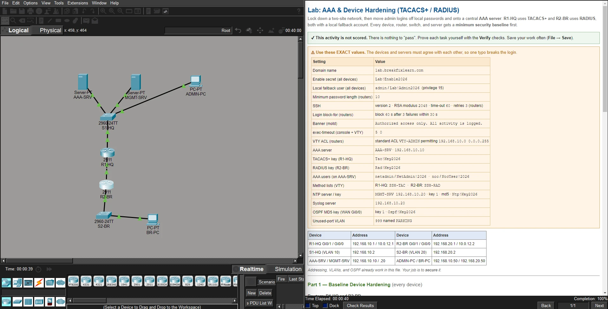

Both files are in the download box on this page, with SHA-256 checksums so you can confirm the download wasn't changed.

## The ideas you'll use

**1. A method list is read left to right.** `aaa authentication login default group tacacs+ local` means: ask the TACACS+ server first, and only if that doesn't work, check the local database.

**2. "Doesn't work" means no answer, not a wrong answer.** This is the rule people get wrong most often:

| The server... | IOS calls it | Next method (`local`) tried? |
|---|---|---|
| Is down, unreachable, or sends nothing usable | **ERROR** | **Yes** |
| Answers "reject" (bad password, unknown user) | **FAIL** | **No**: the answer is final |

So while the server is up, a **local-only** account can't log in. The local account is a **break-glass** account for when the AAA server can't be reached.

**3. The server knows a router by its source IP.** A router sends AAA packets from the interface that **leads to the server**. R2-BR reaches HQ through Gi0/0, so the AAA server must list R2 as **10.0.12.2**, not its LAN address.

**4. TACACS+ vs. RADIUS:**

| | TACACS+ | RADIUS |
|---|---|---|
| Transport | **TCP 49** | **UDP 1812 / 1813** (older gear and Packet Tracer: 1645 / 1646) |
| Encrypts | The **whole packet body** | The **password only** |
| AAA functions | **Separate**: per-command authorization possible | Authentication and authorization **combined** |
| Typical use | **Device administration** | **Network access** (VPN, 802.1X, wireless) |

R1-HQ uses TACACS+ and R2-BR uses RADIUS so you can compare them side by side, against the same server, the way Cisco ISE serves both in production.

## Think like the defender first

Before you type anything, answer these for the network in the file:

- **Who should be able to manage the routers, and from where?** Only the NOC subnet at HQ (192.168.10.0/24), over SSH. The branch user PC should get nothing.
- **What happens when the AAA server dies?** If the answer is "nobody can log in anywhere", you've built your own outage. Every method list needs a local fallback.
- **What else is running that nobody needs?** Every open service on a server, every dynamic switch port and every unused jack is something an attacker can probe.

---

# Packet Tracer vs. real IOS

Every command in this lab runs in Packet Tracer 9.0. A few real-IOS tools aren't available or aren't reliable there, so the lab uses these replacements:

| Real IOS | In this lab | Why |
|---|---|---|
| `test aaa group ...` | Real SSH logins from ADMIN-PC | Not reliable in Packet Tracer, and a real login is the true test anyway |
| `debug tacacs`, `debug radius`, `debug aaa` | **Simulation mode** with the TACACS and RADIUS filters | Watch the actual packets instead |
| `show aaa servers`, `show tacacs` | Login behavior and Simulation mode | Not reliable in Packet Tracer |
| `tacacs server NAME` / `radius server NAME` blocks | Legacy `tacacs-server host` and `radius-server host` with `key` | Long supported in Packet Tracer, same result |
| `aaa authorization`, `aaa accounting` | Not configured; users land at `>` and use `enable` | Packet Tracer's AAA server stores only username and password, no privilege levels |
| NTP `hmac-sha2-256` keys | `ntp authentication-key 1 md5 ...` | Packet Tracer's NTP server authenticates with MD5 |
| `login block-for` and `security passwords min-length` on the 2960 | Routers only | The Packet Tracer 2960 rejects them |
| `enable algorithm-type scrypt secret` (type 9) | Standard `enable secret` | Use type 8 or 9 on real IOS |
| VTY lines 5 to 15 on the 2911 | `line vty 0 4` | Always secure **every** VTY line on real routers |

The real-IOS versions of these commands, with `debug tacacs` output, are in the [AAA with TACACS+ lab](/ccnp-security/labs/aaa-tacacs-configure-troubleshoot).

---

# Topology

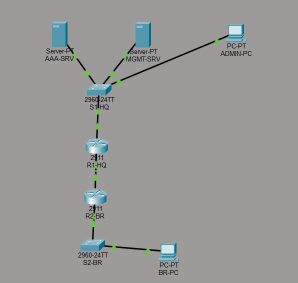

HQ is the NOC and management segment: it holds the AAA server, the management server and the admin PC. The branch is a user site. R2-BR's AAA, NTP and syslog traffic all cross the WAN link to reach HQ, which matters in Part 4.

## Devices

| Name | Packet Tracer model | Role |
|---|---|---|
| R1-HQ | 2911 | HQ router: **TACACS+** client, OSPF, NTP and syslog client |
| R2-BR | 2911 | Branch router: **RADIUS** client, OSPF, NTP and syslog client |
| S1-HQ | 2960-24TT | HQ access switch |
| S2-BR | 2960-24TT | Branch access switch |
| AAA-SRV | Server-PT | AAA service: TACACS+ for R1, RADIUS for R2 |
| MGMT-SRV | Server-PT | Authenticated NTP and syslog |
| ADMIN-PC | PC-PT | NOC admin workstation, allowed to manage devices |
| BR-PC | PC-PT | Branch user, must be **blocked** from device management |

## Cabling

| From | Port | To | Port | Cable |
|---|---|---|---|---|
| R1-HQ | Gi0/0 | R2-BR | Gi0/0 | Copper cross-over |
| R1-HQ | Gi0/1 | S1-HQ | Gi0/1 | Copper straight-through |
| AAA-SRV | Fa0 | S1-HQ | Fa0/1 | Copper straight-through |
| MGMT-SRV | Fa0 | S1-HQ | Fa0/2 | Copper straight-through |
| ADMIN-PC | Fa0 | S1-HQ | Fa0/3 | Copper straight-through |
| R2-BR | Gi0/1 | S2-BR | Gi0/1 | Copper straight-through |
| BR-PC | Fa0 | S2-BR | Fa0/1 | Copper straight-through |

## Addressing

| Device | Interface | IP / mask | Gateway |
|---|---|---|---|
| R1-HQ | Gi0/0 (WAN) | 10.0.12.1 /30 | n/a |
| R1-HQ | Gi0/1 (HQ LAN) | 192.168.10.1 /24 | n/a |
| R2-BR | Gi0/0 (WAN) | 10.0.12.2 /30 | n/a |
| R2-BR | Gi0/1 (branch LAN) | 192.168.20.1 /24 | n/a |
| S1-HQ | VLAN 10 SVI | 192.168.10.2 /24 | 192.168.10.1 |
| S2-BR | VLAN 20 SVI | 192.168.20.2 /24 | 192.168.20.1 |
| AAA-SRV | Fa0 | 192.168.10.10 /24 | 192.168.10.1 |
| MGMT-SRV | Fa0 | 192.168.10.20 /24 | 192.168.10.1 |
| ADMIN-PC | Fa0 | 192.168.10.50 /24 | 192.168.10.1 |
| BR-PC | Fa0 | 192.168.20.50 /24 | 192.168.20.1 |

OSPF process 1, area 0, router IDs **1.1.1.1** (R1) and **2.2.2.2** (R2). VLAN 10 `HQ-MGMT` on S1-HQ, VLAN 20 `BR-USERS` on S2-BR; you'll add VLAN 999 `PARKING` for unused ports.

## Values to use exactly

The devices and servers must agree with each other, so one typo breaks the login.

| Setting | Value |
|---|---|
| Domain name | `lab.breakfixlearn.com` |
| Enable secret (all devices) | `Lab!Enable2026` |
| Local fallback user (all devices) | `admin` / `Lab!Admin2026`, privilege 15 |
| Minimum password length (routers) | 10 |
| SSH (routers) | Version 2, RSA 2048, time-out 60, retries 3 |
| Login block-for (routers) | Block 60 s after 3 failures within 30 s |
| Banner | `Authorized access only. All activity is logged.` |
| exec-timeout (console and VTY) | `5 0` |
| VTY ACL (routers) | Standard ACL `VTY-ADMIN` permitting `192.168.10.0 0.0.0.255` |
| AAA server | AAA-SRV, 192.168.10.10 |
| TACACS+ key (R1-HQ) | `Tac!Key2026` |
| RADIUS key (R2-BR) | `Rad!Key2026` |
| AAA users | `netadmin` / `NetAdmin!2026`, `noc` / `NocUser!2026` |
| VTY method lists | R1-HQ: `SSH-TAC`, R2-BR: `SSH-RAD` |
| NTP | MGMT-SRV 192.168.10.20, key 1, MD5, `Ntp!Key2026` |
| Syslog server | 192.168.10.20 |
| OSPF MD5 key (WAN Gi0/0) | Key 1, `Ospf!Key2026` |
| Unused-port VLAN | 999, named `PARKING` |

> **Lab values only.** These passwords and keys are training values. Never reuse them on real equipment.

---

# Before you start: the baseline works

Open the file and wait for the link lights to turn green. **Fast Forward Time** (bottom left) speeds up OSPF and spanning tree. Then:

```
R1-HQ# show ip ospf neighbor
```

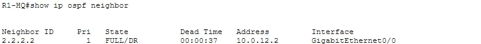

**Read the output:** neighbor **2.2.2.2** is **FULL**: R1 and R2 have exchanged their routing databases over the WAN, so each site can reach the other. R2 is the DR on this link.

From **ADMIN-PC → Desktop → Command Prompt**:

```
ping 192.168.20.50
```

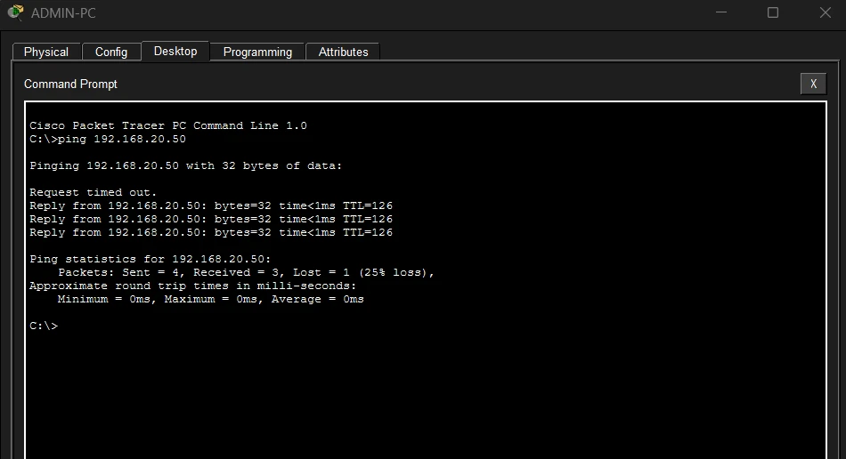

**Read the output:** the first ping times out while the routers resolve ARP; the next three reply. **TTL 126** means two routers were crossed (128 minus 2). The network works. It just isn't secure: anyone can Telnet to anything, every switch port negotiates, and the routers still use no passwords at all.

---

# Part 1: baseline device hardening

## Routers (R1-HQ, then repeat on R2-BR)

**Passwords and the local break-glass account:**

```
enable
configure terminal
security passwords min-length 10
enable secret Lab!Enable2026
service password-encryption
username admin privilege 15 secret Lab!Admin2026
```

- **`min-length 10` comes first.** It only checks passwords set after it. Try a 9-character password afterwards and it's rejected, which proves the control works.
- **`enable secret`**, never `enable password`: the secret is stored as a hash.
- **`service password-encryption`** obscures any plaintext passwords and keys left in the config as type 7. Type 7 is reversible, so it only stops shoulder-surfing, but CIS benchmarks still expect it.
- **`admin` is the break-glass account.** Once AAA is on, it works only when the server can't be reached (idea 2).

**SSH, login throttling and the banner:**

```
ip domain-name lab.breakfixlearn.com
crypto key generate rsa modulus 2048
ip ssh version 2
ip ssh time-out 60
ip ssh authentication-retries 3
login block-for 60 attempts 3 within 30
banner motd #Authorized access only. All activity is logged.#
```

- **The RSA key needs a hostname and domain name first**: they form the key's name.
- **SSH version 2 only**, with a 60-second negotiation window and 3 password tries per session.
- **`login block-for`**: 3 failures within 30 seconds puts the router in **quiet mode** for 60 seconds, refusing remote logins. That throttles password guessing.
- **The banner** is a legal "authorized use only" notice. It never names the company or the device.

**The management ACL:**

```
ip access-list standard VTY-ADMIN
 permit 192.168.10.0 0.0.0.255
 exit
```

Only the HQ NOC subnet may **open** a management session. Everything else hits the implicit deny.

**AAA on, with local first, and the lines locked down:**

```
aaa new-model
aaa authentication login default local
line console 0
 login authentication default
 exec-timeout 5 0
 logging synchronous
line vty 0 4
 login authentication default
 transport input ssh
 exec-timeout 5 0
 access-class VTY-ADMIN in
 end
```

- **`aaa new-model`** switches the router to AAA: from now on, method lists decide how every login works.
- For now the **default** list is only `local`. Part 2 puts a server in front of it.
- **`exec-timeout 5 0`** logs out idle sessions after 5 minutes, **`transport input ssh`** turns Telnet off, and **`access-class`** applies the ACL to the VTY lines.

**Repeat everything above on R2-BR.**

**Checkpoint 1a.** From ADMIN-PC: `ssh -l admin 192.168.10.1` and `ssh -l admin 10.0.12.2` both log in with `Lab!Admin2026`. On a router, `show ip ssh` reports **SSH Enabled - version 2.0**.

## Switches (S1-HQ, then S2-BR)

**Management access:**

```
enable
configure terminal
enable secret Lab!Enable2026
service password-encryption
username admin privilege 15 secret Lab!Admin2026
ip domain-name lab.breakfixlearn.com
crypto key generate rsa modulus 2048
ip ssh version 2
banner motd #Authorized access only. All activity is logged.#
line console 0
 login local
 exec-timeout 5 0
 logging synchronous
line vty 0 15
 login local
 transport input ssh
 exec-timeout 5 0
 exit
```

The switches use plain `login local`: in this lab only the routers are AAA clients. `security passwords min-length` and `login block-for` are left out because the Packet Tracer 2960 rejects them.

**Layer 2 minimum security (S1-HQ):**

```
vlan 999
 name PARKING
 exit
interface GigabitEthernet0/1
 description Uplink to R1-HQ
 switchport mode access
 switchport nonegotiate
 exit
interface range FastEthernet0/1 - 3
 switchport mode access
 switchport nonegotiate
 switchport port-security
 switchport port-security maximum 1
 switchport port-security mac-address sticky
 switchport port-security violation shutdown
 spanning-tree portfast
 spanning-tree bpduguard enable
 no cdp enable
 exit
interface range FastEthernet0/4 - 24
 switchport mode access
 switchport access vlan 999
 shutdown
 exit
interface GigabitEthernet0/2
 switchport mode access
 switchport access vlan 999
 shutdown
 exit
interface vlan 1
 shutdown
 end
```

- **`switchport mode access` before `nonegotiate` and port security.** Both need a fixed mode; the other order errors out.
- **The baseline ports were left in DTP dynamic mode**, so an attacker's device could negotiate a trunk. `mode access` plus `nonegotiate` closes that.
- **Port security, maximum 1, sticky**: each host port learns one MAC address and shuts down if a different device appears.
- **PortFast and BPDU Guard** on host ports only: a switch plugged into a host port gets shut down.
- **Unused ports** are parked in a dead VLAN **and** shut, so plugging into a spare jack gets nothing.
- **The VLAN 1 SVI is shut**: VLAN 1 carries nothing here, so it shouldn't have a management address waiting.

**S2-BR:** the same, with host port **Fa0/1** and unused ports **Fa0/2 to 24** and **Gi0/2**; the uplink description is `Uplink to R2-BR`.

**Checkpoint 1b.** On S1-HQ:

```
show port-security
show interfaces status
show ip ssh
```

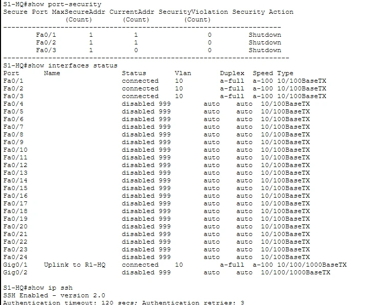

**Read the output:**

- **Fa0/1 to Fa0/3** each allow **1** secure address with action **Shutdown**. Fa0/1 and Fa0/2 have already learned their server's MAC (current count 1). Fa0/3 shows 0 until ADMIN-PC sends traffic, then sticks.
- **Fa0/4 to Fa0/24 and Gi0/2** are **disabled** in VLAN **999**. Only the four ports with a job are connected.
- **Gi0/1** shows its description, `Uplink to R1-HQ`: labelled ports make audits faster.
- **SSH Enabled - version 2.0**. The authentication timeout is the switch default (120 seconds) because the time-out and retry settings were applied on the routers.

From ADMIN-PC, `ssh -l admin 192.168.10.2` reaches S1-HQ.

## Servers (Services tab)

**Least functionality:** turn **Off** every service a server doesn't need. Every running service is something an attacker can probe.

| Server | Keep On | Turn Off |
|---|---|---|
| AAA-SRV | **AAA** | HTTP, HTTPS, DHCP, DHCPv6, TFTP, DNS, SYSLOG, NTP, EMAIL, FTP and any others your build shows |
| MGMT-SRV | **NTP**, **SYSLOG** | Everything else |

---

# Part 2: AAA with TACACS+ and RADIUS

## Step 2.1: the AAA server

On **AAA-SRV → Services → AAA**, turn the service **On** and add two clients, then two users:

| Client Name | Client IP | Secret | ServerType |
|---|---|---|---|
| `R1-HQ` | `192.168.10.1` | `Tac!Key2026` | Tacacs |
| `R2-BR` | **`10.0.12.2`** | `Rad!Key2026` | Radius |

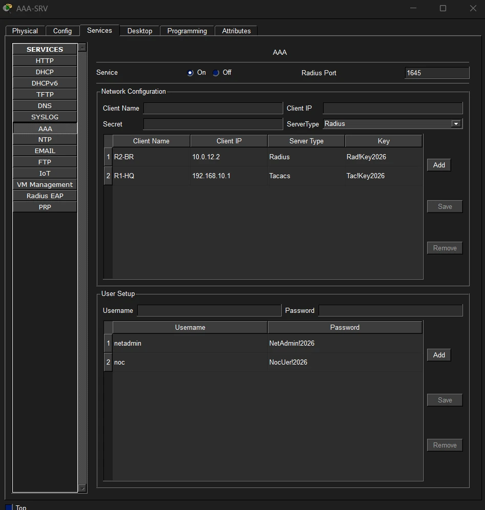

**Read the output:**

- **One server, two protocols.** R1-HQ is a **Tacacs** client and R2-BR a **Radius** client, each with its own shared secret. That's how Cisco ISE works in production.
- **R2-BR's client IP is 10.0.12.2, its WAN address.** R2's packets to 192.168.10.10 leave through Gi0/0, so that's the source address the server sees (idea 3). Enter 192.168.20.1 instead and RADIUS fails: that's Challenge 4.
- **Radius Port 1645**: Packet Tracer's server listens on the legacy RADIUS port. Real deployments use **1812** (and 1813 for accounting). When a real RADIUS setup fails, a port mismatch between device and server is worth checking.
- The users exist **only** on the server, which is how you'll prove the server is doing the authentication.

> **One typo in this screenshot.** The `noc` password reads `NocUer!2026`, a typo made while building the lab. Use `NocUser!2026` from the values table when you add the user, and log in with what you typed.

## Step 2.2: R1-HQ uses TACACS+

```
configure terminal
tacacs-server host 192.168.10.10
tacacs-server key Tac!Key2026
aaa authentication login default group tacacs+ local
aaa authentication login SSH-TAC group tacacs+ local
line vty 0 4
 login authentication SSH-TAC
 end
```

- Re-entering the **default** list replaces the Part 1 `local` version: the console now asks TACACS+ first, then local.
- **`SSH-TAC`** is a **named list** for the VTY lines. It has the same methods today, but each access path now has its own policy, so you could change remote logins later without touching the console break-glass path.

> **Lockout safety:** stay logged in on the console while you change AAA, and test SSH from ADMIN-PC before you log out. It's a habit worth keeping on real equipment.

## Step 2.3: R2-BR uses RADIUS

```
configure terminal
radius-server host 192.168.10.10
radius-server key Rad!Key2026
aaa authentication login default group radius local
aaa authentication login SSH-RAD group radius local
line vty 0 4
 login authentication SSH-RAD
 end
```

## Checkpoint 2: server-only users can log in

From ADMIN-PC:

```
ssh -l netadmin 192.168.10.1
enable
show users
```

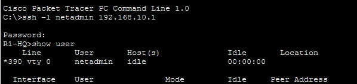

**Read the output:** `netadmin` landed at **`R1-HQ>`**, and `show users` shows the VTY line owned by **netadmin**. `netadmin` has no local account on R1, so only the TACACS+ server could have authenticated it. It lands at `>` (user EXEC) and needs `enable`, because Packet Tracer's AAA server can't hand out privilege levels; on real IOS, `aaa authorization exec` would.

```
ssh -l noc 10.0.12.2
enable
show users
```

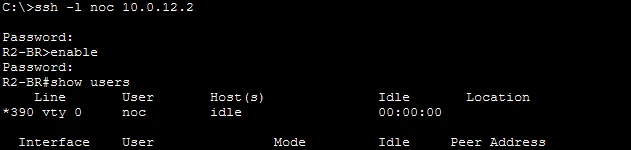

**Read the output:** the same result on R2-BR, this time over **RADIUS**: VTY 0 belongs to **noc**, another server-only user.

## See the AAA packets in Simulation mode

Packet Tracer's replacement for `debug`:

1. Click **Simulation** (bottom right).
2. **Edit Filters**: clear everything, then tick **TACACS** and **SSH** (or **RADIUS** and **SSH**).
3. Start the SSH login from ADMIN-PC, then press **Capture / Forward** repeatedly.
4. Click an envelope to open its PDU, and check the source IP. Click **Realtime** to go back.

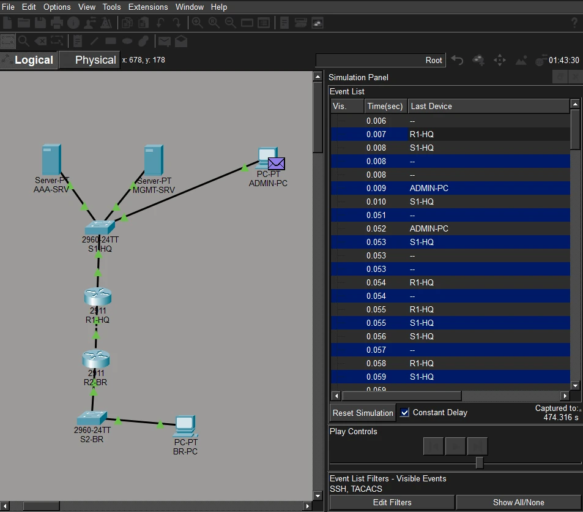

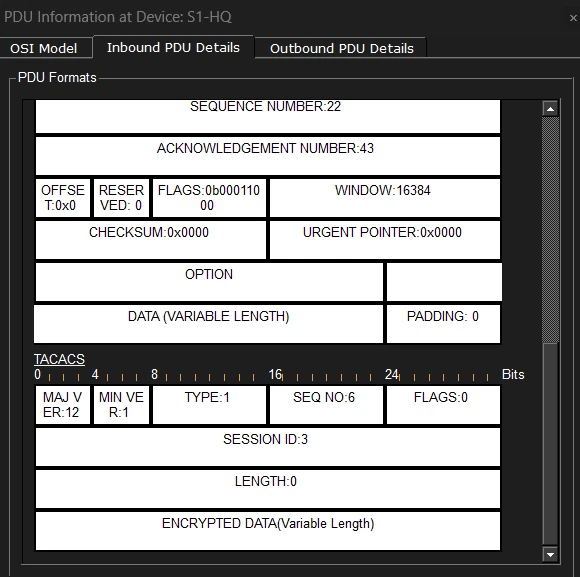

**Read the output:**

- The SSH session goes ADMIN-PC → R1-HQ, and **R1-HQ opens its own conversation with AAA-SRV** to check the password. The PC never talks to the AAA server.
- The PDU shows **TCP** fields (sequence and acknowledgement numbers, window) wrapped around a **TACACS** header: TACACS+ rides **TCP**.
- **TYPE 1** is an authentication packet, and the body is **ENCRYPTED DATA**: TACACS+ encrypts the whole payload with the shared key. A RADIUS packet would show the username in clear and hide only the password.

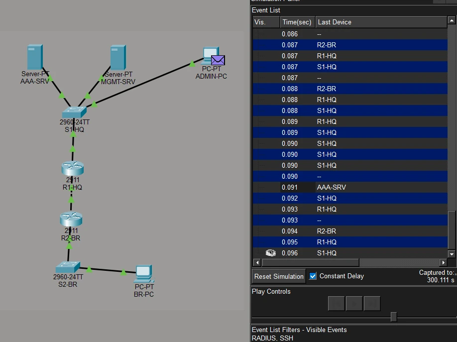

**Read the output:** the RADIUS exchange crosses the whole network: **R2-BR → R1-HQ → S1-HQ → AAA-SRV** and back. Open one of R2-BR's packets and the source is **10.0.12.2**, the WAN interface, which is why the server's client entry must use that address. It also means **R2's logins depend on OSPF**: Challenge 7.

---

# Part 3: network-wide minimum security (both routers)

## Authenticated NTP

On **MGMT-SRV → Services → NTP**: On, Authentication **Enable**, Key **1**, Password **`Ntp!Key2026`**.

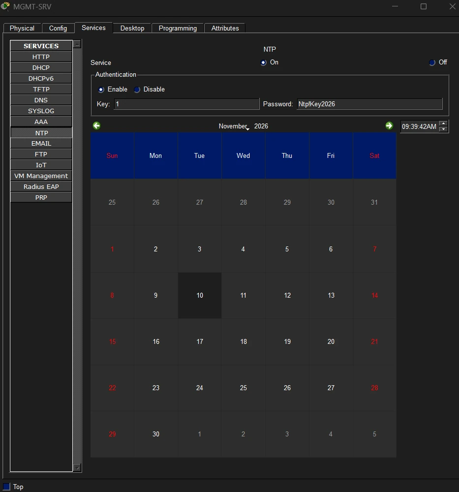

Then on each router:

```
configure terminal
ntp authentication-key 1 md5 Ntp!Key2026
ntp trusted-key 1
ntp authenticate
ntp server 192.168.10.20
ntp update-calendar
end
```

- The key number and password must match the server exactly.
- `ntp update-calendar` keeps the router's hardware calendar in step with NTP, so the time survives a reload.
- Packet Tracer's NTP server uses **MD5**. On real IOS XE use `hmac-sha2-256` and add `key 1` to the `ntp server` line, as in the [authenticated NTP lab](/ccnp-security/labs/ntp-authentication-lab).

```
show ntp status
show clock
```

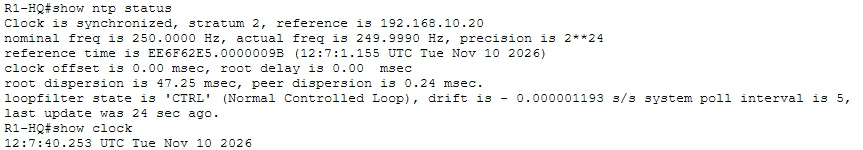

**Read the output:** **Clock is synchronized**, **stratum 2**, **reference 192.168.10.20**. MGMT-SRV acts as a stratum 1 source, so R1 is one hop below. `show clock` now reports the real date, which every log message, certificate check and lockout timer depends on.

## Syslog with timestamps

```
configure terminal
service timestamps log datetime msec
logging host 192.168.10.20
end
```

Generate a message: enter `configure terminal` and then `end` on a router. Then open **MGMT-SRV → Services → SYSLOG**.

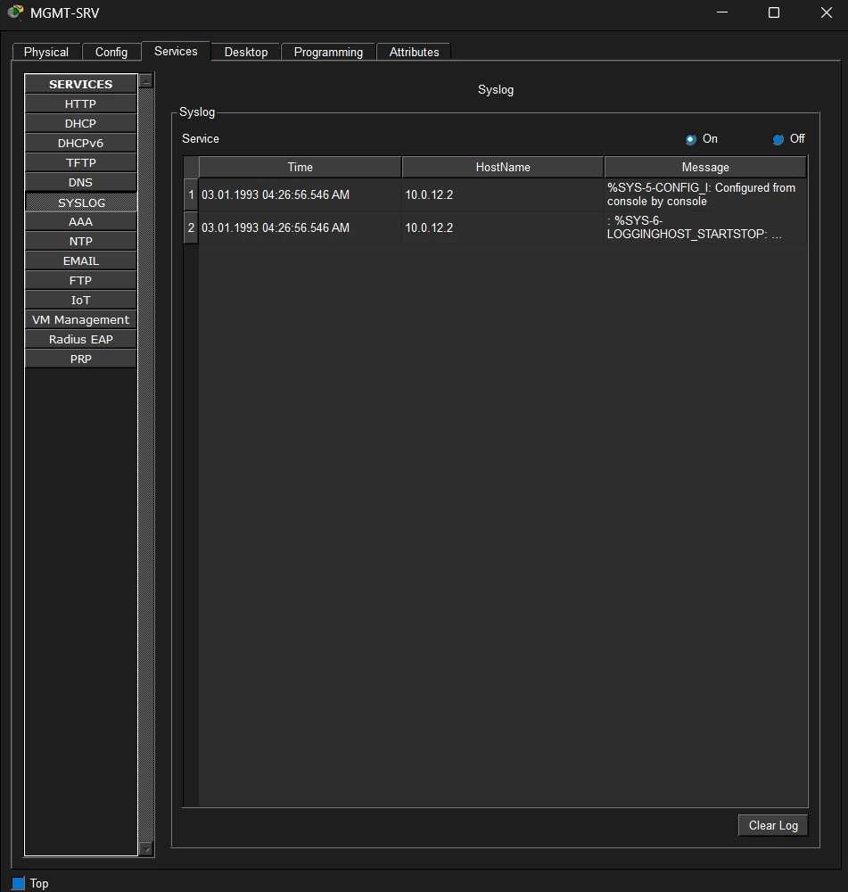

**Read the output, as an investigator would:**

- **HostName 10.0.12.2**: these messages came from **R2-BR**, identified by its **WAN** address, the same exit-interface rule as AAA.
- **`%SYS-5-CONFIG_I: Configured from console by console`**: a configuration change, logged centrally, where an attacker who wipes the router's local log can't erase it.
- **`%SYS-6-LOGGINGHOST_STARTSTOP`**: logging to the host started.
- **The time is 03.01.1993.** These messages were sent **before R2's clock had synchronized**, so they carry Packet Tracer's default date. In an incident, a log line with the wrong time is almost useless. That's why NTP comes before syslog, and why you check `show ntp status` on every device.

## OSPF authentication and a passive LAN

Do this from each router's **console**: the adjacency drops until both ends match, and with it R2's path to the AAA server.

```
configure terminal
interface GigabitEthernet0/0
 ip ospf authentication message-digest
 ip ospf message-digest-key 1 md5 Ospf!Key2026
 no cdp enable
 exit
router ospf 1
 passive-interface GigabitEthernet0/1
 end
```

- **MD5 authentication** means a rogue router on the link can't form an adjacency and inject routes.
- **`passive-interface`** stops OSPF hellos going out to the user LAN, where nobody should be speaking OSPF.
- **`no cdp enable`** on the WAN stops the router advertising its model and software version to the link.

```
show ip ospf interface GigabitEthernet0/0
show ip ospf neighbor
```

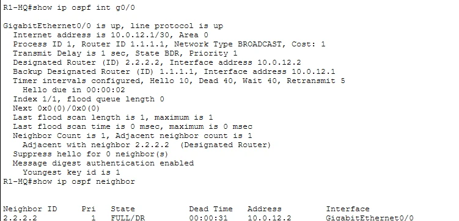

**Read the output:** **Message digest authentication enabled**, **youngest key id is 1**, and the neighbor is back to **FULL**. Both routers agree on the key. `Youngest key id` matters during key rotation: OSPF sends with the newest key while both are configured.

---

# Part 4: break and fix

Predict each result **before** you test it, then restore the change before starting the next challenge.

## C1: log in as admin while AAA-SRV is up

```
ssh -l admin 192.168.10.1
```


<details><summary>Why is a valid local account rejected?</summary>

The server is reachable and answers "I don't know this user". That's a **FAIL**, a final answer, so IOS never tries `local`. The local account is for when the server **can't be reached**, not a second chance after a rejection. If a reject fell through to local, an attacker could keep guessing against the weakest password store on the device.

</details>

## C2: turn the AAA service off

On AAA-SRV, set the AAA service **Off**. Then SSH as `netadmin`, then as `admin`.

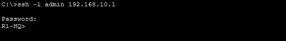

<details><summary>Which one works now, and why?</summary>

`netadmin` **fails**: it exists only on the server, and the server isn't answering. `admin` **works**: no answer is an **ERROR**, so IOS moves to the next method, `local`. This is why every method list ends with `local`. Without it, a dead AAA server locks every administrator out of every device. Turn the AAA service back **On**.

</details>

## C3: wrong TACACS+ key on R1-HQ

```
configure terminal
tacacs-server key WrongKey2026
end
```

Try `netadmin`, then `admin`.

<details><summary>What happens when the router and server don't share a secret?</summary>

`netadmin` **fails**. With different keys, neither side can read the other's packets, so the router gets no usable reply. That counts as an ERROR, so the local `admin` account works again. One typo in the shared key breaks AAA for **every** user on that device. Restore `Tac!Key2026`.

</details>

## C4: wrong client IP for R2-BR on the server

On AAA-SRV, change R2-BR's client IP to `192.168.20.1`. Try `noc` on R2.

<details><summary>Why does the server ignore R2 now?</summary>

R2's requests arrive from **10.0.12.2**, an address the server has no client entry for. RADIUS servers **silently discard** requests from unknown clients (RFC 2865). `noc` fails, and because the router hears nothing back, `admin` falls back to local. The source IP is the **exit interface toward the server**. Restore `10.0.12.2`.

</details>

## C5: manage R2-BR from the branch PC

From **BR-PC**:

```
ssh -l admin 192.168.20.1
telnet 192.168.20.1
```

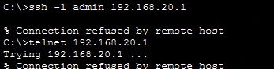

<details><summary>Which two controls block these?</summary>

SSH is refused by the **VTY access-class**: 192.168.20.50 isn't in `VTY-ADMIN`. Telnet is refused by **`transport input ssh`** and by the ACL. Two independent layers: management only from the management subnet, and only over an encrypted protocol. In production, management would sit on a dedicated out-of-band network.

</details>

## C6: trigger login throttling

From ADMIN-PC, fail R1-HQ's password **3 times within 30 seconds** (as many SSH attempts as you need). Then on R1-HQ's console:

```
show login
```

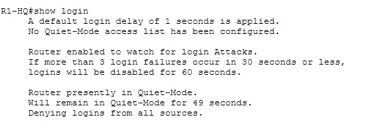

<details><summary>What state is the router in, and for how long?</summary>

**Quiet-Mode**: for **60 seconds** (49 left in the screenshot) the router is **denying logins from all sources**, even with correct credentials. That throttles password guessing to a crawl. The console is unaffected. Note the line **No Quiet-Mode access list has been configured**: on real IOS, `login quiet-mode access-class <ACL>` lets the NOC subnet still log in during quiet mode, so an attacker can't use the throttle to lock administrators out.

</details>

## C7: break OSPF, watch AAA fail

On R2-BR only, change the OSPF key:

```
configure terminal
interface GigabitEthernet0/0
 ip ospf message-digest-key 1 md5 WrongOspf2026
 end
```

Wait for the neighbor to drop, then try `noc` on R2-BR's console.

<details><summary>How did a routing fault change AAA?</summary>

The adjacency drops, R2 loses its route to 192.168.10.0/24, and **RADIUS can't reach AAA-SRV**. `noc` fails; `admin` works through the local fallback. NTP and syslog from R2 stop too. Management depends on the control plane: when routing breaks, the local fallback account is the only way in. Restore the key and watch the neighbor return to FULL.

</details>

---

# How this maps to CIS-style hardening

The CIS benchmarks for Cisco IOS group recommendations by the three planes. This lab touches each one:

| Plane | What you configured |
|---|---|
| **Management** | `aaa new-model` with server-based login and local fallback, `enable secret`, minimum password length, `service password-encryption`, SSH v2 only (2048-bit key, time-out, retries), VTY `access-class`, `exec-timeout`, `login block-for`, banner, least-functionality servers |
| **Control** | Authenticated NTP, central syslog with timestamps, OSPF MD5 authentication, `passive-interface`, CDP off on the WAN |
| **Data / Layer 2** | Port security, PortFast and BPDU Guard, DTP disabled, unused ports parked and shut, VLAN 1 SVI shut |

---

# The same configuration on real IOS XE

What changes when you build this on production gear:

```
username admin privilege 15 algorithm-type scrypt secret <strong-password>
aaa new-model
!
tacacs server ISE-1
 address ipv4 192.168.10.10
 key <long-unique-key>
aaa group server tacacs+ ADMIN-TAC
 server name ISE-1
 ip tacacs source-interface Loopback0
aaa authentication login SSH-TAC group ADMIN-TAC local
aaa authorization exec SSH-TAC group ADMIN-TAC local
aaa accounting commands 15 default start-stop group ADMIN-TAC
!
radius server ISE-1-RAD
 address ipv4 192.168.10.10 auth-port 1812 acct-port 1813
 key <long-unique-key>
!
login quiet-mode access-class VTY-ADMIN
ntp authentication-key 1 hmac-sha2-256 <ntp-key>
ntp server 192.168.10.20 key 1
line vty 0 15
 login authentication SSH-TAC
 authorization exec SSH-TAC
 transport input ssh
 access-class VTY-ADMIN in
```

| Packet Tracer | Real IOS XE |
|---|---|
| `tacacs-server host` / `key` | Named `tacacs server` blocks in a server group |
| Router sources AAA from the exit interface | `ip tacacs source-interface Loopback0`: one stable address, whatever the path |
| Users land at `>` and use `enable` | `aaa authorization exec` returns privilege 15 from the server |
| No accounting | `aaa accounting commands 15`: every privileged command logged |
| RADIUS on 1645 | 1812 / 1813 |
| MD5 NTP | `hmac-sha2-256` |
| `enable secret` (type 5) | `algorithm-type scrypt` (type 9) |

---

# Check yourself

<details><summary>1. Why must aaa new-model come before any aaa authentication line?</summary>

`aaa new-model` turns on the AAA framework. Until it's entered, the `aaa authentication` commands aren't available. Once it is, every login path follows the method lists, so the local admin account must exist first.

</details>

<details><summary>2. The AAA server is up. Can the local admin account log in?</summary>

No. The server answers with a reject, a FAIL, and IOS doesn't try the next method. Local is used only when the server can't be reached (ERROR).

</details>

<details><summary>3. Why does the AAA server list R2-BR as 10.0.12.2?</summary>

R2 sends its AAA packets out of the interface toward the server, Gi0/0, so their source address is 10.0.12.2. The server identifies clients by source IP.

</details>

<details><summary>4. What did Simulation mode show about TACACS+?</summary>

It rides TCP, and the body of the packet is encrypted with the shared key. Only the router talks to the AAA server; the admin PC never does.

</details>

<details><summary>5. Why did R2's syslog messages show a 1993 date?</summary>

They were sent before R2's clock had synchronized with NTP, so they carried Packet Tracer's default date. Logs are only useful once every device has trusted time.

</details>

<details><summary>6. How can a routing problem lock users out of a router?</summary>

R2-BR reaches the AAA server across the OSPF network. If routing fails, the server is unreachable, server-only users can't log in, and only the local fallback account works.

</details>

---

# Answer configs

Try every part before opening these.

<details><summary>Show the final R1-HQ config (TACACS+ client)</summary>

```
configure terminal
security passwords min-length 10
enable secret Lab!Enable2026
service password-encryption
username admin privilege 15 secret Lab!Admin2026
ip domain-name lab.breakfixlearn.com
crypto key generate rsa modulus 2048
ip ssh version 2
ip ssh time-out 60
ip ssh authentication-retries 3
login block-for 60 attempts 3 within 30
banner motd #Authorized access only. All activity is logged.#
ip access-list standard VTY-ADMIN
 permit 192.168.10.0 0.0.0.255
 exit
aaa new-model
tacacs-server host 192.168.10.10
tacacs-server key Tac!Key2026
aaa authentication login default group tacacs+ local
aaa authentication login SSH-TAC group tacacs+ local
line console 0
 login authentication default
 exec-timeout 5 0
 logging synchronous
 exit
line vty 0 4
 login authentication SSH-TAC
 transport input ssh
 exec-timeout 5 0
 access-class VTY-ADMIN in
 exit
ntp authentication-key 1 md5 Ntp!Key2026
ntp trusted-key 1
ntp authenticate
ntp server 192.168.10.20
ntp update-calendar
service timestamps log datetime msec
logging host 192.168.10.20
interface GigabitEthernet0/0
 ip ospf authentication message-digest
 ip ospf message-digest-key 1 md5 Ospf!Key2026
 no cdp enable
 exit
router ospf 1
 passive-interface GigabitEthernet0/1
 end
write memory
```

</details>

<details><summary>Show the final R2-BR config (RADIUS client)</summary>

```
configure terminal
security passwords min-length 10
enable secret Lab!Enable2026
service password-encryption
username admin privilege 15 secret Lab!Admin2026
ip domain-name lab.breakfixlearn.com
crypto key generate rsa modulus 2048
ip ssh version 2
ip ssh time-out 60
ip ssh authentication-retries 3
login block-for 60 attempts 3 within 30
banner motd #Authorized access only. All activity is logged.#
ip access-list standard VTY-ADMIN
 permit 192.168.10.0 0.0.0.255
 exit
aaa new-model
radius-server host 192.168.10.10
radius-server key Rad!Key2026
aaa authentication login default group radius local
aaa authentication login SSH-RAD group radius local
line console 0
 login authentication default
 exec-timeout 5 0
 logging synchronous
 exit
line vty 0 4
 login authentication SSH-RAD
 transport input ssh
 exec-timeout 5 0
 access-class VTY-ADMIN in
 exit
ntp authentication-key 1 md5 Ntp!Key2026
ntp trusted-key 1
ntp authenticate
ntp server 192.168.10.20
ntp update-calendar
service timestamps log datetime msec
logging host 192.168.10.20
interface GigabitEthernet0/0
 ip ospf authentication message-digest
 ip ospf message-digest-key 1 md5 Ospf!Key2026
 no cdp enable
 exit
router ospf 1
 passive-interface GigabitEthernet0/1
 end
write memory
```

</details>

<details><summary>Show the final S1-HQ config</summary>

```
configure terminal
enable secret Lab!Enable2026
service password-encryption
username admin privilege 15 secret Lab!Admin2026
ip domain-name lab.breakfixlearn.com
crypto key generate rsa modulus 2048
ip ssh version 2
banner motd #Authorized access only. All activity is logged.#
line console 0
 login local
 exec-timeout 5 0
 logging synchronous
 exit
line vty 0 15
 login local
 transport input ssh
 exec-timeout 5 0
 exit
vlan 999
 name PARKING
 exit
interface GigabitEthernet0/1
 description Uplink to R1-HQ
 switchport mode access
 switchport nonegotiate
 exit
interface range FastEthernet0/1 - 3
 switchport mode access
 switchport nonegotiate
 switchport port-security
 switchport port-security maximum 1
 switchport port-security mac-address sticky
 switchport port-security violation shutdown
 spanning-tree portfast
 spanning-tree bpduguard enable
 no cdp enable
 exit
interface range FastEthernet0/4 - 24
 switchport mode access
 switchport access vlan 999
 shutdown
 exit
interface GigabitEthernet0/2
 switchport mode access
 switchport access vlan 999
 shutdown
 exit
interface vlan 1
 shutdown
 end
write memory
```

S2-BR is the same with host port **Fa0/1**, unused ports **Fa0/2 to 24** and **Gi0/2**, and the uplink description `Uplink to R2-BR`.

</details>

<details><summary>Show the server settings</summary>

| Server | Setting |
|---|---|
| AAA-SRV | Every service Off except **AAA** (On). Clients `R1-HQ` 192.168.10.1 `Tac!Key2026` Tacacs, `R2-BR` 10.0.12.2 `Rad!Key2026` Radius. Users `netadmin` / `NetAdmin!2026`, `noc` / `NocUser!2026` |
| MGMT-SRV | Every service Off except **NTP** (On, authentication Enable, key 1, `Ntp!Key2026`) and **SYSLOG** (On) |

</details>

## Final verification checklist

| Check | Command or action | Expected |
|---|---|---|
| TACACS+ login (R1) | ADMIN-PC: `ssh -l netadmin 192.168.10.1` | `R1-HQ>` |
| RADIUS login (R2) | ADMIN-PC: `ssh -l noc 10.0.12.2` | `R2-BR>` |
| Reject isn't fallback | ADMIN-PC: `ssh -l admin 192.168.10.1` with the server up | Rejected |
| Fallback works | AAA service Off, then `ssh -l admin 192.168.10.1` | Accepted (turn AAA back On) |
| VTY ACL | BR-PC: `ssh -l admin 192.168.20.1` | Refused |
| SSH only | `telnet 192.168.10.1` | Refused |
| Login throttling | 3 bad passwords in 30 s, then `show login` | Quiet-Mode for 60 s |
| NTP | `show ntp status` | Synchronized, reference 192.168.10.20 |
| Syslog | `configure terminal` / `end`, then MGMT-SRV SYSLOG | `%SYS-5-CONFIG_I` with the current date |
| OSPF authentication | `show ip ospf interface Gi0/0`, `show ip ospf neighbor` | Message digest enabled, FULL |
| SSH v2 | `show ip ssh` | `SSH Enabled - version 2.0` |
| Switch ports | `show port-security`, `show interfaces status` | Host ports secured, unused ports disabled in VLAN 999 |
| Servers | Each Services tab | Only the required services On |

---

# Exam mapping

| You configured | Exam angle | SCOR v2.0 |
|---|---|---|
| `aaa new-model`, default and named method lists | Method lists, order, where they apply | 2.6 |
| TACACS+ on R1, RADIUS on R2 | TACACS+ vs. RADIUS: transport, encryption, use cases | 2.6 |
| Local fallback, C1 to C4, C7 | ERROR vs. FAIL; troubleshooting AAA by layer | 2.6 |
| Client IP = exit interface | Device trust: source IP and shared key | 2.6 |
| SSH v2, ACLs, throttling, banners, passwords | CIS management-plane recommendations | 2.5 |
| NTP, syslog, OSPF MD5, Layer 2 controls | CIS control- and data-plane recommendations | 2.5 |

Drill it with the [flashcards](/ccnp-security/flashcards#d2) and the [mock exam](/ccnp-security/mock-exam#d2).
