# Lab: AAA with TACACS+ (configure and troubleshoot)

> Companion lab for the Management Options, CIS Benchmarks & AAA notes. SCOR 350-701 v2.0 topic 2.6: troubleshoot AAA for device access with TACACS+.

---

# What you'll build

A router that authenticates administrators against a TACACS+ server, with a local account as the safety net. You'll build it one step at a time with a **verify command after every step**, prove a server-only user can log in, then break it three ways and read each fault straight from `debug tacacs`.

| Item | Detail |
|---|---|
| **Platform** | A real IOS or IOS XE router and a TACACS+ server (see where to run it, below) |
| **Time** | 45 to 60 minutes |
| **Level** | CCNP Security. You should be comfortable with the IOS CLI and basic routing |
| **You'll practice** | `aaa new-model`, TACACS+ server definitions, method lists with a local fallback, `test aaa`, `show tacacs`, `debug tacacs`, and reading three different failures |
| **Exam topic** | 2.6 (core); supports 2.5 (CIS Benchmarks) |
| **Before this** | [Management Options, CIS Benchmarks & AAA notes](/ccnp-security/management-cis-benchmarks-aaa), especially [AAA for device and network access](/ccnp-security/management-cis-benchmarks-aaa#aaa-for-device-and-network-access) |

| Part | What you do | What it proves |
|---|---|---|
| 1 Baseline | Check that AAA is off | You know the starting state |
| 2 Build | Local account, AAA on, server, `test aaa`, method list, `enable secret` | Each step works before you rely on it |
| 3 Prove | Log in as a user that exists **only** on the server | TACACS+ is really doing the authentication |
| 4 Break and fix | Wrong key, wrong password, wrong server IP | You can name the failing layer from the debug |
| 5 More breaks | Unapplied list, dead server, no fallback, and more | The faults that catch people in production |
| 6 Stretch | Authorization and accounting | AAA beyond "can you log in" |

## The one card to memorize

AAA login fails at exactly three layers, and each has its own signature in `debug tacacs`:

| Layer | Question | `debug tacacs` says |
|---|---|---|
| **1. Reachability** | Can the router reach the server on TCP 49? | `No authoritative response from any server` after a connection timeout |
| **2. Device trust** | Do the shared keys match? | `Invalid AUTHEN/START ... (check keys)` after the connection **opened** |
| **3. User** | Are the username and password valid? | `status = FAIL`, `rejected by server` |

## Think like the defender first

Before you type, answer three questions about the router's management plane:

- **What happens if the TACACS+ server is unreachable?** If the answer is "nobody can log in", you've built a denial of service into your own network. That's why every method list here ends with `local`.
- **What happens if someone types the wrong password?** It should fail, and a reachable server's "no" must be final. If a reject fell through to the local database, an attacker could keep guessing against your weakest password store.
- **How will you know it works before you depend on it?** You test the server with `test aaa` **before** you point the login lines at it, and you keep your console session open the whole time.

---

# Where to run this lab

This lab needs **real IOS behavior**: an actual TACACS+ exchange, real rejects, and `debug tacacs` output. Packet Tracer can configure basic AAA with its AAA server device, but it has no `debug tacacs`, so the troubleshooting half of the lab doesn't work there. No real IOS gear? The [AAA and device hardening lab](/ccnp-security/labs/aaa-device-hardening-packet-tracer) covers TACACS+ and RADIUS logins, local fallback and Simulation-mode packet views entirely in Packet Tracer.

| Environment | How to set it up |
|---|---|
| **Cisco Modeling Labs (CML)** | An IOSv or IOL router plus an Ubuntu node running a TACACS+ daemon, or an ISE node. Recommended: it's the closest to the exam |
| **Cisco DevNet Sandbox / dCloud** | Hosted labs and demos; look for a topology with IOS XE and ISE already built |
| **Your own gear** | Any IOS or IOS XE router and a Linux VM running a TACACS+ server, reachable over IP |

**If you build your own server**, the classic open-source `tac_plus` daemon needs only a few lines. This matches the lab's accounts (classic `tac_plus` syntax; `tac_plus-ng` uses a different format):

```
key = "Cisco!23"

user = user1 {
    login = cleartext "Cisco!23"
    service = exec {
        priv-lvl = 1
    }
}

user = admin1 {
    login = cleartext "Cisco!23"
    service = exec {
        priv-lvl = 15
    }
}
```

Then add the router as a client. With `tac_plus` the shared `key` above covers every client; on ISE, add the router under **Network Devices** with its IP and the same shared secret, and enable the **Device Administration** service.

> **Lab values only.** `Cisco!23`, the IPs and the cleartext Telnet login in this lab come from a training sandbox. Never reuse them on real equipment. The production version of this configuration is at the end of the lab.

---

# Topology and accounts

```
                         TCP 49 (TACACS+, body encrypted with the shared key)
   +--------------+  -------------------------------------->  +--------------------+
   |  Router R8   |                                            |  TACACS+ server    |
   |              |        shared key: Cisco!23                |  192.168.1.100     |
   |  Loopback0   |                                            |                    |
   |  8.8.8.8     |                                            |  admin1 (also      |
   |              |                                            |   local on R8)     |
   |  VTY 0-15 <--+-- telnet 8.8.8.8 from R8 itself            |  user1 (server     |
   |  Console 0   |                                            |   only)            |
   +--------------+                                            +--------------------+
```

| Item | Value |
|---|---|
| Router | R8 (real IOS) |
| TACACS+ server | 192.168.1.100, **TCP 49** |
| Shared key | `Cisco!23`, identical on router and server |
| Loopback0 on R8 | 8.8.8.8. Not the internet: R8's own loopback, so `telnet 8.8.8.8` from R8 tests its own VTY lines |
| Local account | `admin1` / `Cisco!23`, privilege 15 |
| Server accounts | `admin1` and **`user1`**, both `Cisco!23` |
| Method list | `TAC-Login`: `group tacacs+` then `local`, applied to `line vty 0 15` |

**Why two accounts?** `admin1` exists on the server **and** locally, so a successful `admin1` login can't prove which one answered. **`user1` exists only on the server.** If `user1` logs in, TACACS+ did the work. That's the whole proof.

**Why `telnet 8.8.8.8`?** It's a quick way to open a VTY session on the same router from the console, without a second device. In production you'd use SSH from an admin workstation; the hardening section shows how.

---

# Part 1: baseline (prove AAA is off)

Capture the "before" state. It's what makes the "after" convincing.

```
show run | include aaa
show run | include username
show privilege
```

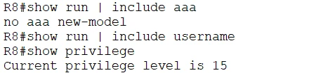

**Read the output:**

- **`no aaa new-model`**: AAA is off. Some images print nothing here instead; both mean the same thing.
- **No `username` lines**: there's no local account yet. If you turned on AAA right now, you could lock yourself out.
- **`Current privilege level is 15`**: you're on the console at full privilege. **Keep this console session open for the entire lab.** It's your way back in if a later step goes wrong.

---

# Part 2: build it, verifying every step

## Step 1: local lifeboat account, then AAA on

`aaa new-model` makes AAA authoritative for **every** login path the moment you press Enter. Create the local fallback account **first**.

```
configure terminal
 username admin1 privilege 15 secret Cisco!23
 aaa new-model
end
show run | include aaa new-model
show run | include username
```

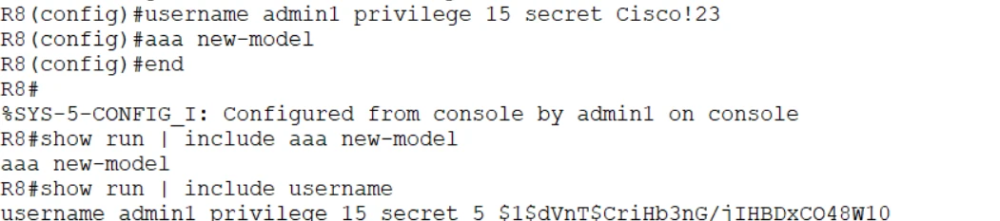

**Read the output:**

- **`aaa new-model`** is now in the running config.
- **`username admin1 privilege 15 secret 5 $1$...`**: the password is stored as a hash, not in cleartext. **Type 5 is MD5**, which is old. On modern IOS XE, CIS Benchmarks expect a stronger hash: `username admin1 privilege 15 algorithm-type scrypt secret <password>` stores it as **type 9**.
- `%SYS-5-CONFIG_I: Configured from console by admin1`: every configuration change is logged with who made it. That log line is what drift detection and accounting build on.

## Step 2: define the TACACS+ server

```
configure terminal
 tacacs server Our-TACACS
  address ipv4 192.168.1.100
  key Cisco!23
end
show run | section tacacs server
show tacacs
show aaa servers
```

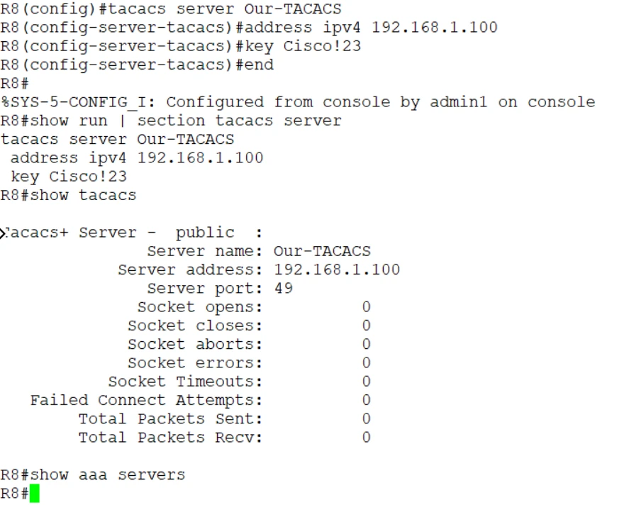

**Read the output:**

- **`Our-TACACS`** is only a local name for the server. The address and port (**49**) are what matter.
- **`key Cisco!23` shows in cleartext** in the running config. Anyone who sees a config backup sees the key. CIS Benchmarks call for encrypting stored secrets: `service password-encryption` (weak type 7), or on IOS XE, `key config-key password-encrypt` plus `password encryption aes`, which stores the key as type 6.
- **`show tacacs` counters are all 0**: the router hasn't talked to the server yet. Remember these zeros; Step 3 makes them move.
- **`show aaa servers` printed nothing.** That's not a fault. On classic IOS and IOSv it barely reports TACACS+ servers. **`show tacacs`** is the reliable counter view on this router. (`show aaa servers` fills in after a test using the `new-code` path, and it's the main view on IOS XE.)

## Step 3: prove the server answers before you rely on it

This is the habit the exam rewards: **never point login lines at a server you haven't tested.** First reachability:

```
ping 192.168.1.100
```

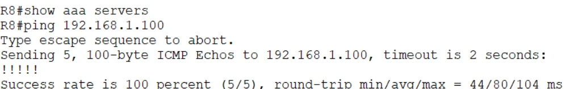

`Success rate is 100 percent`: IP reachability works. But **ping uses ICMP, not TCP 49.** A firewall can allow one and block the other, so a good ping doesn't prove TACACS+ reachability. The next command does.

```
test aaa group tacacs+ admin1 Cisco!23 legacy
test aaa group tacacs+ user1 Cisco!23 legacy
```

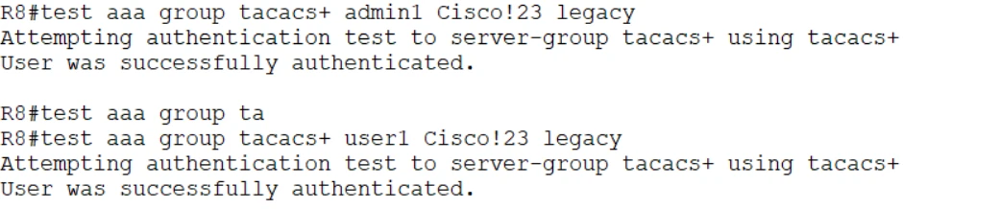

**Read the output:**

- **`User was successfully authenticated`** for both users.
- **`user1` succeeding is the proof**: it has no local account, so only the server could have said yes.
- `test aaa` authenticates **without changing your login configuration**. It's a safe dry run you can repeat as often as you like.
- **`legacy`** uses the older, most compatible test path. **`new-code`** runs through the full server-group machinery (and updates `show aaa servers`). If your release doesn't accept `legacy`, use `new-code`.

```
show tacacs
```

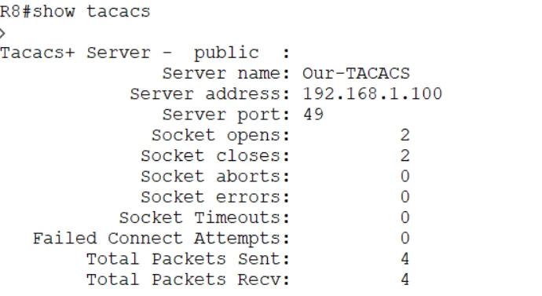

**Read the output:** **Socket opens 2, Socket closes 2**: each test opened one TCP session to port 49 and closed it cleanly. **Packets sent 4, received 4**: two exchanges per login (the start and the password). Compared with the zeros in Step 2, this is hard evidence that R8 talked to the server.

## Step 4: point the VTY lines at TACACS+, with a fallback

```
configure terminal
 aaa authentication login TAC-Login group tacacs+ local
 line vty 0 15
  login authentication TAC-Login
end
show run | section line vty
show run | section aaa
```

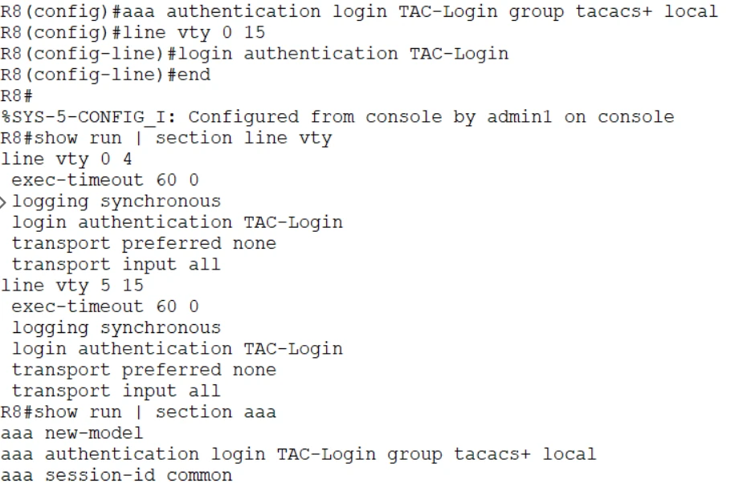

**Read the method list left to right:** try the TACACS+ servers first; **if none answers**, use the local database.

**Read the output:**

- **`login authentication TAC-Login`** appears under **both** `line vty 0 4` and `line vty 5 15`. IOS splits the range, but one command covered all 16 lines.
- **`aaa authentication login TAC-Login group tacacs+ local`** is in the AAA section. The name on the line and the name of the list match exactly; a one-letter difference would silently break it.
- **`transport input all`** and **`exec-timeout 60 0`** are lab defaults a CIS audit would flag: production needs `transport input ssh` and an idle timeout of 10 minutes or less.
- **`aaa session-id common`** is a default that appears with AAA; leave it.

**Two traps live in this one line:**

1. **No `local` = lockout.** With only `group tacacs+`, a dead server means nobody logs in.
2. **`local` is used only when no server answers, never after a reject.** A wrong password from a reachable server is final.

## Step 5: set enable secret

TACACS+ authenticated the login, but **privileged EXEC is a separate check.** A TACACS+ user lands at privilege 1, and `enable` needs its own password. Without one, `enable` fails.

```
configure terminal
 enable secret Cisco!23
end
```

This is the simplest fix and what the lab uses. The better production options are to authenticate `enable` against the server (`aaa authentication enable default group tacacs+ enable`) or to have the server hand out privilege 15 at login (`aaa authorization exec`, Part 6).

---

# Part 3: prove remote login uses TACACS+

From the console:

```
telnet 8.8.8.8
  Username: user1
  Password: Cisco!23
enable
  Password: Cisco!23
show users
show run | include username
```

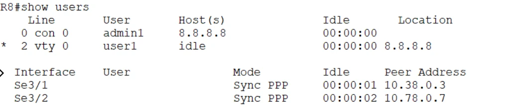

**Read the output:**

- **`con 0` belongs to `admin1`**: your safety session on the console.
- **`vty 0` belongs to `user1`**, connected from 8.8.8.8. A user with **no local account** just logged in to a VTY line. Only the TACACS+ server could have authenticated it.
- `show run | include username` still lists only `admin1`, confirming `user1` is purely a server identity.

Type `exit` to leave the VTY session and return to the console.

---

# Part 4: break it three ways, then fix it

Every break uses the same loop: **turn on the debug, run the test, read the one key line, fix, test again.**

```
debug tacacs
test aaa group tacacs+ user1 Cisco!23 legacy
...
undebug all
```

## Break 1: wrong shared key (device trust)

```
configure terminal
 tacacs server Our-TACACS
  key Cisco
end
debug tacacs
test aaa group tacacs+ user1 Cisco!23 legacy
```

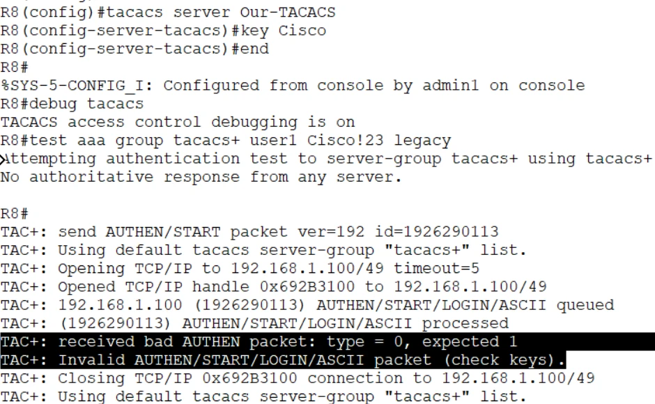

**Read the output, line by line:**

1. `Opening TCP/IP to 192.168.1.100/49` then **`Opened TCP/IP handle`**: the TCP connection **succeeded**. Reachability is fine.
2. `AUTHEN/START/LOGIN/ASCII queued` and `processed`: the router sent its request, encrypted with the wrong key.
3. **`received bad AUTHEN packet: type = 0, expected 1`**: the reply decrypted to garbage.
4. **`Invalid AUTHEN/START/LOGIN/ASCII packet (check keys)`**: IOS names the cause for you. Trust failed.

> **Read the debug, not the summary.** The `test aaa` result says `No authoritative response from any server`, which sounds like a reachability problem. If you trusted that line, you'd waste time on routing and firewalls. The debug shows the connection opened and the key failed. Always check the debug before you choose a fix.

**Fix it:** put the key back and test again.

```
configure terminal
 tacacs server Our-TACACS
  key Cisco!23
end
test aaa group tacacs+ user1 Cisco!23 legacy
```

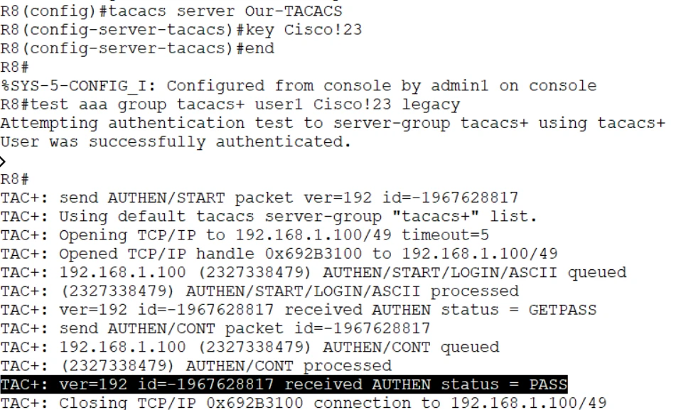

**This is what a healthy exchange looks like:** connection opened → **`GETPASS`** (the server asks for the password) → `send AUTHEN/CONT` (the router sends it) → **`status = PASS`** → connection closed. Compare every failure against this.

## Break 2: wrong password (user credentials)

```
test aaa group tacacs+ user1 WrongPass legacy
```

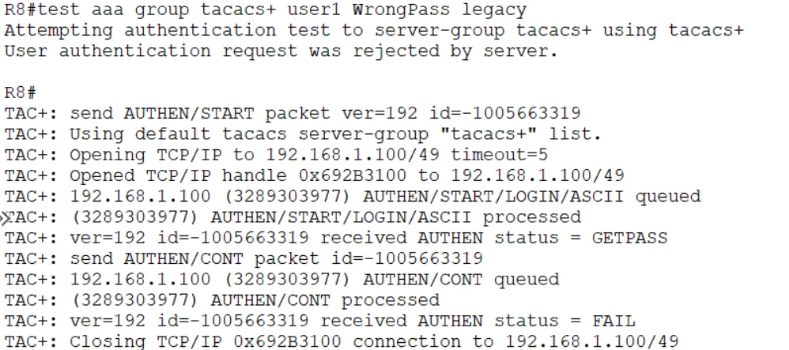

**Read the output:** the exchange gets further than Break 1. The connection opens, the key is fine (no "check keys"), the server asks for the password (`GETPASS`), and then answers **`status = FAIL`**. The summary line says it plainly: **`User authentication request was rejected by server`**.

The server is healthy and understood the request; it **chose** to say no. That's layer 3, the user's credentials. And because this is a **reject**, not an error, the `local` fallback in `TAC-Login` would **not** be tried on a real login.

**Fix it:** use the right password.

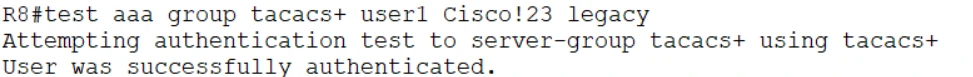

## Break 3: wrong server IP (reachability)

```
configure terminal
 tacacs server Our-TACACS
  address ipv4 192.168.1.10
end
debug tacacs
test aaa group tacacs+ user1 Cisco!23 legacy
```

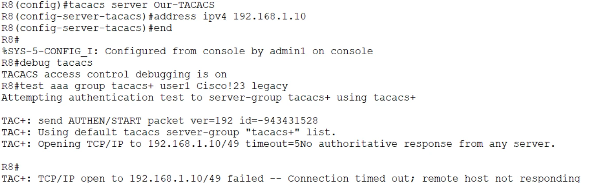

**Read the output:** `Opening TCP/IP to 192.168.1.10/49 timeout=5`, then nothing comes back. After 5 seconds: **`Connection timed out; remote host not responding`** and **`No authoritative response from any server`**. Unlike Break 1, there's **no `Opened TCP/IP handle` line**: the connection never existed.

This is layer 1, reachability. The possible causes: wrong IP (this case), routing, a firewall or ACL dropping TCP 49, or the server is down. Two variations worth knowing:

| Debug ending | Meaning | Where to look |
|---|---|---|
| `Connection timed out; remote host not responding` | **Nobody answered**: wrong IP, host down, or a firewall silently dropping TCP 49 | IP address, routing, host power, ACLs |
| `Connection refused by remote host` | **Something answered with a reset**: the host is up but nothing listens on port 49 | Start the TACACS+ service, check the port |

**On a real login**, this is where `local` saves you: no server answered, so IOS moves to the next method and `admin1` can still log in.

**Fix it:**

```
configure terminal
 tacacs server Our-TACACS
  address ipv4 192.168.1.100
end
test aaa group tacacs+ user1 Cisco!23 legacy
undebug all
```

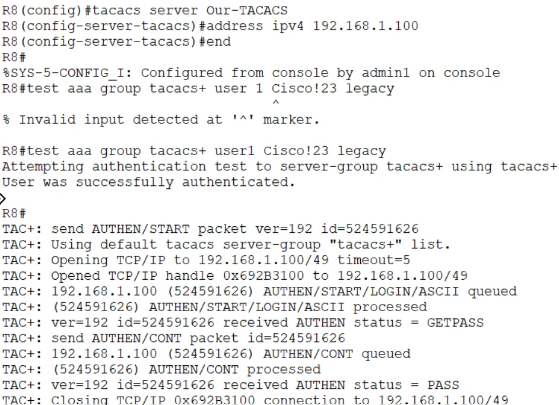

`status = PASS` again. (The first command in the screenshot has a typo, `user 1`, and IOS rejects it before anything is sent. A useful reminder to read error markers before blaming the server.)

## Check the counters

```
show tacacs
```

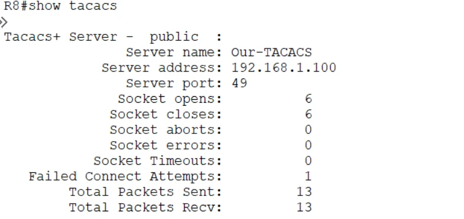

**Read the output:**

- **Socket opens = Socket closes**: every session that opened was closed cleanly.
- **Failed Connect Attempts 1**: the wrong-IP test from Break 3, recorded against this server entry. On a production router, a climbing value here is an early warning that the server or the path to it is failing.
- The wrong key and wrong password tests don't show up as failures here: the TCP connection worked in both. Those faults live in the debug and the server's logs, not in the socket counters.

## The debug decoder

| `debug tacacs` says | Failed layer | Root cause | Where to look |
|---|---|---|---|
| `No authoritative response from any server` + connection timed out | **Reachability** | Wrong IP, server down, TCP 49 blocked | `ping`, routing, ACLs, firewall, service status |
| `Connection refused` | **Reachability** | Host up, service not listening | The TACACS+ service and port |
| `Opened TCP/IP handle` then `(check keys)` | **Device trust** | Shared key mismatch | The `key` on the router **and** the server |
| `GETPASS` then `status = FAIL`, `rejected by server` | **User** | Wrong username or password, disabled account | The account on the server |
| `GETPASS` then `status = PASS` | Working | | |

---

# Part 5: more breaks to try

The three breaks above are the headline cases. These are the faults that catch people in production. Try them with your console session open.

| # | Break | What you see | The tell | Fix |
|---|---|---|---|---|
| 4 | `aaa new-model` missing | `aaa authentication` commands rejected or ignored | The AAA engine is off | `aaa new-model` |
| 5 | List defined but not applied to the line | `debug tacacs` **silent** on a real login; `test aaa` **works** | The request is never generated | `login authentication TAC-Login` under `line vty 0 15` |
| 6 | List name misspelled on the line (`TAC-Logn`) | Logins misbehave, debug silent | Names don't match character for character | Make the names identical |
| 7 | No `local` method and the server is down | `No authoritative response`, then **locked out** | No second method to try | `group tacacs+ local` |
| 8 | Ping works, auth times out | Ping 100%, `test aaa` times out | An ACL allows ICMP but blocks TCP 49 | Permit TCP 49 from the router to the server |
| 9 | Source-interface mismatch | Timeouts or `(check keys)` with the right IP and key | The server sees an unexpected source IP and has no matching client entry | `ip tacacs source-interface` matching the server's client entry |
| 10 | Server marked DEAD | Fault fixed, logins still go straight to `local` | IOS skips a dead server for the dead-time | `show aaa servers`; wait out the dead-time or re-test |
| 11 | `enable` fails after a good login | Logged in at priv 1, `enable` errors | Authentication isn't privilege | `enable secret`, `aaa authentication enable`, or `aaa authorization exec` |
| 12 | Authorization denies the shell | Login accepted, then dropped; `debug aaa authorization` shows a fail | Authenticated but not authorized | Fix the server's shell profile, or add `local` / `if-authenticated` |

> **The money diagnostic (case 5):** `test aaa` works but real logins never reach the server. `test aaa` talks to the server group directly and ignores your line configuration, so a working test plus a silent debug on login means the **method-list binding** is wrong, not the server.

**Case 7 safely:** set the list to `aaa authentication login TAC-Login group tacacs+` (no `local`), point the server at 192.168.1.10, and try `telnet 8.8.8.8` as `admin1`. You're denied, because there's no second method. Add `local` back and the same outage lets `admin1` in. Keep the console open: it's your way back.

---

# Part 6 (stretch): authorization and accounting

Authentication answers "who are you". Authorization and accounting answer "what may you do" and "what did you do".

```
configure terminal
 aaa authorization exec TAC-Exec group tacacs+ local
 aaa authorization commands 15 TAC-Cmd group tacacs+ local
 aaa accounting exec default start-stop group tacacs+
 aaa accounting commands 15 default start-stop group tacacs+
 line vty 0 15
  authorization exec TAC-Exec
  authorization commands 15 TAC-Cmd
end
show run | section aaa
show aaa sessions
```

| Command | What it does |
|---|---|
| `aaa authorization exec` | The server returns the user's privilege level at login, so `admin1` lands directly at level 15 and nobody shares an `enable` password |
| `aaa authorization commands 15` | Every privileged command is sent to the server for approval first. This is **TACACS+'s headline feature**: RADIUS can't authorize individual commands |
| `aaa accounting exec` | Records when each session starts and stops |
| `aaa accounting commands 15` | Records every privileged command with who ran it and when: the audit trail |

> **Lockout risk:** if command authorization points only at an unreachable server, an admin can log in and then have **every command denied**. Keep `local` (or `if-authenticated`) at the end of authorization lists too, and test with the console open.

---

# Harden it for production

The lab uses Telnet, a cleartext key and one server to keep things simple. A CIS-aligned version looks like this:

```
username admin1 privilege 15 algorithm-type scrypt secret <strong-local-password>
aaa new-model
!
tacacs server ISE-1
 address ipv4 10.10.99.10
 key <long-unique-shared-secret>
tacacs server ISE-2
 address ipv4 10.10.99.11
 key <long-unique-shared-secret>
aaa group server tacacs+ ADMIN-TAC
 server name ISE-1
 server name ISE-2
 ip tacacs source-interface Loopback0
!
aaa authentication login VTY-AUTH group ADMIN-TAC local
aaa authorization exec VTY-AUTHZ group ADMIN-TAC local
aaa authorization commands 15 VTY-CMD group ADMIN-TAC local
aaa accounting exec default start-stop group ADMIN-TAC
aaa accounting commands 15 default start-stop group ADMIN-TAC
!
ip ssh version 2
line vty 0 15
 login authentication VTY-AUTH
 authorization exec VTY-AUTHZ
 authorization commands 15 VTY-CMD
 transport input ssh
 exec-timeout 10 0
 access-class MGMT-ONLY in
```

| Lab shortcut | Production fix | Why |
|---|---|---|
| Telnet to the VTY lines | `transport input ssh`, `ip ssh version 2` | Credentials never cross the wire in cleartext |
| One TACACS+ server | Two servers in a group | One failure isn't an outage |
| Key visible in the config | Encrypted key storage (type 6 on IOS XE) | Config backups don't leak the trust key |
| No source interface | `ip tacacs source-interface Loopback0` | Requests always come from the IP the server expects |
| Type 5 (MD5) local secret | `algorithm-type scrypt` (type 9) | Much harder to crack offline |
| `exec-timeout 60 0` | `exec-timeout 10 0` or less | Idle sessions don't stay open |
| No accounting | Exec and command accounting | Every privileged action is recorded |
| VTY open to any source | `access-class` permitting admin subnets only | Only the management network can even try |

---

# Check yourself

<details><summary>1. Why create the local user before aaa new-model?</summary>

`aaa new-model` makes AAA control every login path immediately. With no local account, a later mistake or an unreachable server can leave no working way to log in.

</details>

<details><summary>2. A test prints "No authoritative response from any server". Is the server unreachable?</summary>

Not necessarily. Run `debug tacacs`. If it shows `Opened TCP/IP handle` followed by `(check keys)`, the server was reachable and the shared key is wrong, exactly as in Break 1. Only a connection that never opens (timeout or refused) is a reachability problem.

</details>

<details><summary>3. The server is up and rejects a user's password. Will the local fallback let them in?</summary>

No. The next method in a list is tried only when the current method returns an error (no answer). A reject from a reachable server is final.

</details>

<details><summary>4. test aaa succeeds, but VTY logins never show up in debug tacacs. What's wrong?</summary>

The method list isn't applied to the VTY lines, or the name on the line doesn't match the list. `test aaa` talks to the server group directly and ignores line configuration.

</details>

<details><summary>5. Ping to the server works, but authentication times out. How?</summary>

Ping uses ICMP. TACACS+ uses TCP 49. An ACL or firewall can permit one and drop the other. Check the path for TCP 49 specifically.

</details>

<details><summary>6. What can TACACS+ do that RADIUS effectively can't, and why?</summary>

Per-command authorization. TACACS+ keeps authorization separate from authentication, so the router can ask the server about each command. RADIUS combines authentication and authorization in one exchange.

</details>

---

# Answer config

<details><summary>Show the final lab config for R8</summary>

```
username admin1 privilege 15 secret Cisco!23
aaa new-model
!
tacacs server Our-TACACS
 address ipv4 192.168.1.100
 key Cisco!23
!
aaa authentication login TAC-Login group tacacs+ local
!
enable secret Cisco!23
!
line vty 0 15
 login authentication TAC-Login
!
! Stretch (Part 6)
aaa authorization exec TAC-Exec group tacacs+ local
aaa authorization commands 15 TAC-Cmd group tacacs+ local
aaa accounting exec default start-stop group tacacs+
aaa accounting commands 15 default start-stop group tacacs+
line vty 0 15
 authorization exec TAC-Exec
 authorization commands 15 TAC-Cmd
```

Lab values only. Use the production version above on real equipment.

</details>

---

# Exam mapping

| You practiced | Exam angle | SCOR v2.0 |
|---|---|---|
| `aaa new-model` with a local account first | Lockout prevention | 2.6 |
| TACACS+ server, TCP 49, shared key | TACACS+ vs. RADIUS facts | 2.6 |
| Method list with `local` fallback | Fallback on error, never on reject | 2.6 |
| `test aaa`, `show tacacs`, `debug tacacs` | Troubleshooting tools | 2.6 |
| Wrong key, wrong password, wrong IP | Identify the failing layer from output | 2.6 |
| Authorization and accounting | Per-command authorization, audit trail | 2.6 |
| SSH only, encrypted keys, timeouts | CIS Benchmark management-plane items | 2.5 |

Drill it with the [flashcards](/ccnp-security/flashcards#d2) and the [mock exam](/ccnp-security/mock-exam#d2).
