# Lab: IKEv1 site-to-site VPN (build, verify, break, harden)

> Companion lab for the [VPNs, IPsec & IKE notes](/ccnp-security/vpn-ipsec-ike). SCOR 350-701 v2.0 topic 1.6: standards-based IPsec, the crypto-map deployment that every other VPN type builds on.

---

# What you'll build

A crypto-map IPsec tunnel between two routers, R2 and R3, so that the LAN behind each one can reach the other across a transit "internet" router that has **no route to either LAN**. You'll build it one block at a time, verify each IKE phase with the right `show` command, watch main mode and quick mode happen in `debug`, then break it six ways and read each fault from the output. Every screenshot in this lab comes from real IOS routers.

| Item | Detail |
|---|---|
| **Platform** | Real IOS routers and two hosts (see [where to run it](#where-to-run-this-lab)) |
| **Time** | 90 to 120 minutes |
| **Level** | CCNP Security. You should be comfortable with the IOS CLI, static routes and extended ACLs |
| **You'll practice** | ISAKMP policies, pre-shared keys, transform sets, crypto ACLs, crypto maps, `show crypto isakmp sa`, `show crypto ipsec sa`, `show crypto session`, `debug crypto isakmp`, and six failure signatures |
| **Exam topic** | 1.6 (core); supports 1.5 and 2.9 |
| **Before this** | [VPNs, IPsec & IKE notes](/ccnp-security/vpn-ipsec-ike), especially [IKEv1, step by step](/ccnp-security/vpn-ipsec-ike#ikev1-step-by-step) |

| Part | What you do | What it proves |
|---|---|---|
| 1 Baseline | Check interfaces, routes and peer reachability | The tunnel can't fail for a reason you didn't check |
| 2 Build R2 | Phase 1 policy and key, transform set, ACL, crypto map | Each block is correct before the next one |
| 3 Build R3 | The mirror image | You know exactly which two values differ |
| 4 Bring it up | Send interesting traffic | Configured isn't the same as up |
| 5 Verify | Read Phase 1, Phase 2, the session, the counters and `debug` | You can prove the tunnel works, not just see a ping |
| 6 Break and fix | PSK, policy, transform set, ACL mirror, return path, router ping | You can name the failing phase from one output |
| Harden it | AES-256, SHA-256, group 14, PFS and more | The lab config isn't a production config |

## The one card to memorize

A packet from PC-2 becomes VPN traffic only if **both** are true on R2:

1. **Routing sends it out G0/0**, the interface with the crypto map, **and**
2. **it matches ACL 100**, the interesting traffic.

Miss either one and the packet leaves **in cleartext** and dies at the internet router, which has no route to `172.16.x.x`. Half of the breaks in this lab are that sentence in disguise.

## Think like the defender first

Before you type, answer three questions:

- **What is this tunnel protecting, exactly?** Only the flows in ACL 100. Everything else leaves unencrypted, without a warning. An ACL that's too narrow leaks traffic; one that's too broad hides traffic from inspection.
- **Who could pretend to be R3?** Anyone who learns the pre-shared key and can send packets from R3's address. The key appears in cleartext in `show running-config` unless you encrypt it, and the same key on many sites means one leak breaks them all.
- **What's weak here on purpose?** DH group 2, SHA-1 and a short shared key. They're the lab's starting point, and fixing them is the last part of the lab.

---

# Where to run this lab

This lab needs **real IOS behavior**: actual IKE negotiation, `debug crypto isakmp`, and the exact states and log messages that identify each fault. The screenshots were captured on a hosted course lab with real IOS routers and VPCS hosts. Any environment in the list at the top of this page gives you the same output; **CML**, or **EVE-NG / GNS3 with VPCS hosts**, is the closest match. Packet Tracer can build the tunnel but has no `debug crypto`, so it can't do Part 6.

**Host commands.** The screenshots use VPCS: `ping`, `trace`, and `ip <address> <mask> <gateway>`. On a Linux host, use `ping -c 5`, `traceroute`, and `ip route replace default via <gateway>` instead.

> **Lab values only.** The pre-shared key `S3cr3tk3y!`, the wrong key `WrongKey123` used in a break, and every address in this lab come from a training sandbox. Never reuse them on real equipment. The [hardened version](#harden-it) is at the end.

---

# Topology and values

![Lab topology: PC-2 at 172.16.2.10 sits on R2's LAN, 172.16.2.0/24, behind R2's G1/0 at 172.16.2.2; R2's G0/0 at 22.2.2.2/28 connects to the internet router at 22.2.2.1; the internet router's other link, 33.3.3.1, connects to R3's G0/0 at 33.3.3.3/28; R3's G1/0 at 172.16.3.3 serves PC-3 at 172.16.3.10 on 172.16.3.0/24; the internet router knows only the two /28 networks, not the LANs; an ESP tunnel in tunnel mode runs between 22.2.2.2 and 33.3.3.3 and carries only the 172.16.2.0/24 to 172.16.3.0/24 flow](img/ipsec-ikev1-s2s/fig-topology.webp)

| Device | Interface | Address | Notes |
|---|---|---|---|
| **R2** | G0/0 | `22.2.2.2/28` | WAN and tunnel endpoint. Default route to `22.2.2.1` |
| **R2** | G1/0 | `172.16.2.2/24` | LAN gateway |
| **R3** | G0/0 | `33.3.3.3/28` | WAN and tunnel endpoint. Default route to `33.3.3.1` |
| **R3** | G1/0 | `172.16.3.3/24` | LAN gateway |
| **PC-2** | | `172.16.2.10/24`, gateway `.2` | Host behind R2 |
| **PC-3** | | `172.16.3.10/24`, gateway `.3` | Host behind R3 |
| **Internet router** | | `22.2.2.1`, `33.3.3.1` | Routes the public /28s only. **No route to 172.16.x.x**, just like the real internet and RFC 1918 addresses |

| VPN setting | R2 | R3 |
|---|---|---|
| ISAKMP policy 10 | AES-128, SHA, pre-share, DH group 2, lifetime 86400 | Same |
| Pre-shared key | `S3cr3tk3y!` for peer `33.3.3.3` | `S3cr3tk3y!` for peer `22.2.2.2` |
| Transform set | `S2S_TRANSFORM_SET`: `esp-aes esp-sha-hmac`, tunnel mode | Same |
| ACL 100 (interesting traffic) | `172.16.2.0/24 → 172.16.3.0/24` | **Mirror:** `172.16.3.0/24 → 172.16.2.0/24` |
| Crypto map | `S2S_CRYPTO_MAP 10`, peer `33.3.3.3`, on G0/0 | Same name, peer `22.2.2.2`, on G0/0 |
| Phase 2 lifetime | Not set: the IOS default, **3,600 s** | Same |

<details><summary>Building the topology yourself? Starting configs</summary>

```
! ---- Internet router ----
interface GigabitEthernet0/0
 ip address 22.2.2.1 255.255.255.240
 no shutdown
interface GigabitEthernet0/1
 ip address 33.3.3.1 255.255.255.240
 no shutdown
! no routes to 172.16.0.0: that's the point
!
! ---- R2 ----
interface GigabitEthernet0/0
 ip address 22.2.2.2 255.255.255.240
 no shutdown
interface GigabitEthernet1/0
 ip address 172.16.2.2 255.255.255.0
 no shutdown
ip route 0.0.0.0 0.0.0.0 22.2.2.1
!
! ---- R3 ----
interface GigabitEthernet0/0
 ip address 33.3.3.3 255.255.255.240
 no shutdown
interface GigabitEthernet1/0
 ip address 172.16.3.3 255.255.255.0
 no shutdown
ip route 0.0.0.0 0.0.0.0 33.3.3.1
```

```
PC-2> ip 172.16.2.10 255.255.255.0 172.16.2.2
PC-3> ip 172.16.3.10 255.255.255.0 172.16.3.3
```

Interface names vary by platform. Use whatever your routers have; only the addresses matter.

</details>

---

# Part 1: baseline (prove it's broken for the right reason)

## Interfaces and routing on both routers

```
show ip interface brief
show ip route static
```

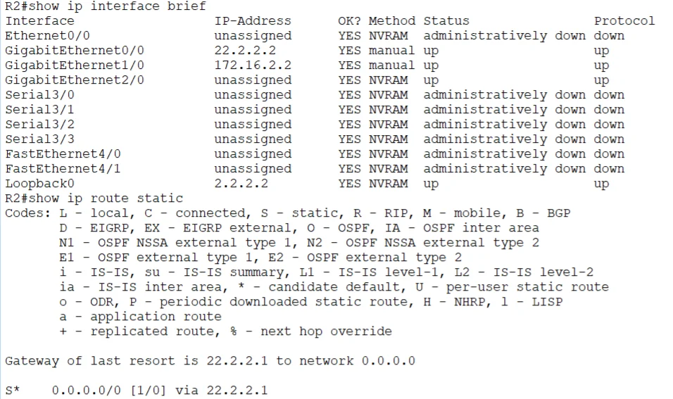

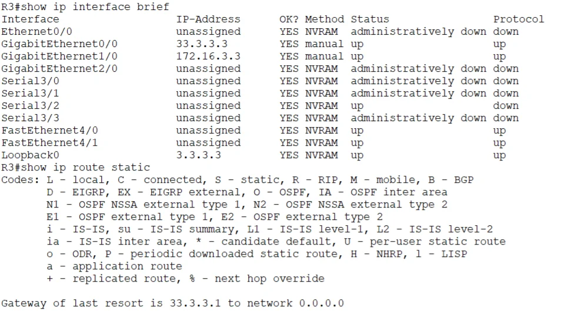

**Read the output:**

- **Both interfaces `up up`** on both routers. A tunnel can't start on an interface that's down.
- **`S* 0.0.0.0/0 via 22.2.2.1`**: R2's only route to `172.16.3.0` is the default route, and it points **out G0/0**. That's exactly where the crypto map will go, so this route is half of [the one card](#the-one-card-to-memorize).
- The loopbacks you may see belong to a later lab that shares this topology. Ignore them here.

## The two tunnel endpoints must reach each other

```
R2# ping 33.3.3.3
```

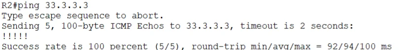

**`!!!!!`**: the WAN addresses route across the internet router. **If this fails, no VPN config will ever work**, because IKE travels between exactly these two addresses. Always check peer reachability first.

## The LANs can't talk yet

```
PC-2> ping 172.16.3.10
```

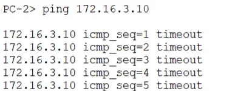

Five timeouts. R2 forwards the packet to the internet router, which has **no route to 172.16.3.0** and drops it. That's the problem the VPN solves.

## No crypto anywhere

```
R2# show run | section crypto
R2# show crypto isakmp sa
R2# show crypto ipsec sa
```

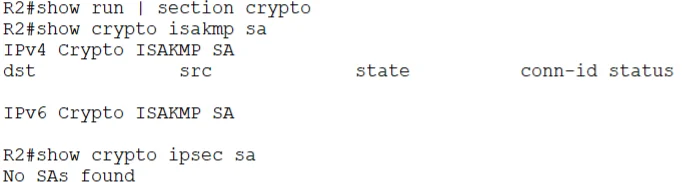

Nothing configured, no Phase 1 SA, **`No SAs found`** for Phase 2. This is your "before."

---

# Part 2: build R2, verifying every block

## Step 1: Phase 1 policy and pre-shared key

```
R2# configure terminal
R2(config)# crypto isakmp policy 10
R2(config-isakmp)# encr aes 128
R2(config-isakmp)# hash sha
R2(config-isakmp)# authentication pre-share
R2(config-isakmp)# group 2
R2(config-isakmp)# lifetime 86400
R2(config-isakmp)# exit
R2(config)# crypto isakmp key S3cr3tk3y! address 33.3.3.3
```

`encr aes ?` lists the key sizes (128, 192, 256). A bare `encr aes` means 128.

```
R2# show crypto isakmp policy
R2# show crypto isakmp key
```


**Read the output:**

- **`Protection suite of priority 10`** with your five values. If you have several policies, **the lowest number is offered first**. Some IOS releases also list built-in default policies numbered 65507 and up; yours always win because they're numbered lower.
- **`#2 (1024 bit)`**: DH group 2 is in the [weak list](/ccnp-security/vpn-ipsec-ike#quick-mode-pfs-and-diffie-hellman-groups). It works, which is exactly the problem.
- **`Keyring default ... 33.3.3.3 ... S3cr3tk3y!`**: the key is bound to the peer's **address**, and it's shown **in cleartext** to anyone with privileged access. That's a security finding you'll fix in [Harden it](#harden-it).

## Step 2: Phase 2 transform set

```
R2(config)# crypto ipsec transform-set S2S_TRANSFORM_SET esp-aes esp-sha-hmac
R2(cfg-crypto-trans)# mode tunnel
R2(cfg-crypto-trans)# exit
```

`esp-aes` is ESP with AES-128; `esp-sha-hmac` is ESP's integrity check with HMAC-SHA-1. **Tunnel mode** wraps the whole original packet behind a new header from `22.2.2.2` to `33.3.3.3`, which is what lets private addresses cross the internet.

## Step 3: interesting traffic

```
R2(config)# access-list 100 permit ip 172.16.2.0 0.0.0.255 172.16.3.0 0.0.0.255
```

`permit` here means **encrypt**, not "allow." This ACL is a selector: it never blocks anything.

## Step 4: crypto map, and apply it

```
R2(config)# crypto map S2S_CRYPTO_MAP 10 ipsec-isakmp
R2(config-crypto-map)# set peer 33.3.3.3
R2(config-crypto-map)# set transform-set S2S_TRANSFORM_SET
R2(config-crypto-map)# match address 100
R2(config-crypto-map)# exit
R2(config)# interface GigabitEthernet0/0
R2(config-if)# crypto map S2S_CRYPTO_MAP
R2(config-if)# end
R2# write memory
```

Applying the map logs **`%CRYPTO-6-ISAKMP_ON_OFF: ISAKMP is ON`**. That's normal.

**A typo worth learning from.** `set transform set S2S_TRANSFORM_SET` (a space instead of the hyphen) fails with *"transform set with tag set does not exist"*. IOS read `set` as the **name** of a transform set. The command is `set transform-set`.

```
R2# show crypto ipsec transform-set
R2# show crypto map
```


**Read the output:**

- **`Transform set default`** in transport mode is a **built-in** set on newer IOS releases. Your map doesn't use it; ignore it.
- **`S2S_TRANSFORM_SET ... will negotiate = { Tunnel, }`**: your set, in tunnel mode.
- **`Security association lifetime: 4608000 kilobytes/3600 seconds`**: the **Phase 2** lifetime is the IOS default of **one hour**, even though you typed `lifetime 86400`. That command was in the ISAKMP policy, which only sets **Phase 1**. The two lifetimes are independent.
- **`PFS (Y/N): N`**: no Perfect Forward Secrecy. Phase 2 keys come from Phase 1's keying material.
- **`Interfaces using crypto map S2S_CRYPTO_MAP: GigabitEthernet0/0`**: the map is active. If this line is missing, nothing will ever be encrypted.

```
R2# show run | section crypto
R2# show access-lists 100
```


**Read the output:** you typed five lines under `crypto isakmp policy 10`, but the running config shows **three**. IOS **hides default values**: `hash sha` and `lifetime 86400` are the defaults, and `encr aes` without a size means 128. Don't "fix" a config because a line you typed seems to be missing; check `show crypto isakmp policy`, which shows the effective values. And note ACL 100 has **no matches** yet. You'll come back to that counter.

---

# Part 3: build R3 (the mirror)

R3 gets the same configuration with exactly **two** differences: the **peer address** and the **ACL direction**.

```
R3# configure terminal
R3(config)# crypto isakmp policy 10
R3(config-isakmp)# encr aes 128
R3(config-isakmp)# hash sha
R3(config-isakmp)# authentication pre-share
R3(config-isakmp)# group 2
R3(config-isakmp)# lifetime 86400
R3(config-isakmp)# exit
R3(config)# crypto isakmp key S3cr3tk3y! address 22.2.2.2
R3(config)# crypto ipsec transform-set S2S_TRANSFORM_SET esp-aes esp-sha-hmac
R3(cfg-crypto-trans)# mode tunnel
R3(cfg-crypto-trans)# exit
R3(config)# access-list 100 permit ip 172.16.3.0 0.0.0.255 172.16.2.0 0.0.0.255
R3(config)# crypto map S2S_CRYPTO_MAP 10 ipsec-isakmp
R3(config-crypto-map)# set peer 22.2.2.2
R3(config-crypto-map)# set transform-set S2S_TRANSFORM_SET
R3(config-crypto-map)# match address 100
R3(config-crypto-map)# exit
R3(config)# interface GigabitEthernet0/0
R3(config-if)# crypto map S2S_CRYPTO_MAP
R3(config-if)# end
R3# write memory
```

When you create the map, IOS warns *"This new crypto map will remain disabled until a peer and a valid access list have been configured."* The next three lines satisfy it.

```
R3# show crypto map
R3# show access-lists 100
```


**Read the output:** **`Peer = 22.2.2.2`** and the ACL reads **`172.16.3.0 → 172.16.2.0`**, the exact reverse of R2's. Everything else matches R2 line for line.

---

# Part 4: bring it up

## Configured is not up

```
R2# show crypto isakmp sa
R3# show crypto isakmp sa
```

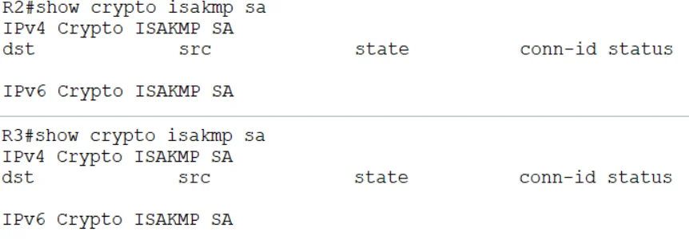

**Both empty, and nothing is wrong.** An IKEv1 crypto map is **on demand**: it negotiates only when interesting traffic arrives, and none has been sent. This "configured but idle" state is a classic exam trap.

## Send interesting traffic

```
PC-2> ping 172.16.3.10
```

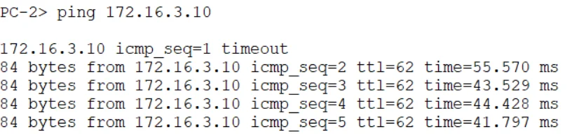

**Read the output:**

- **The first request times out.** That packet **triggered** Phase 1 (main mode) and Phase 2 (quick mode), and it was dropped while they ran. Every later packet rides the new tunnel. Ping again and all five succeed.
- **`ttl=62`** is proof of the tunnel. PC-3 replies with TTL 64. R3 decrements it to 63 and **encrypts** the packet inside a new outer header. The internet router decrements only the **outer** header; it never sees the inner one. R2 decrypts and decrements the inner TTL to 62. Without a tunnel, the internet router would have taken one more off.

---

# Part 5: verify like an engineer

A successful ping proves something works. These commands prove **what** works, and they're the same commands you'll use when it doesn't.

## Phase 1: the ISAKMP SA

```
R2# show crypto isakmp sa
```

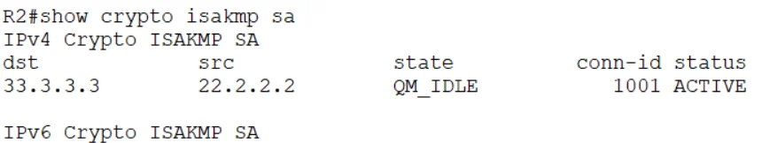

**`QM_IDLE ... ACTIVE`** means Phase 1 is **complete and healthy**: the ISAKMP SA is up and idle, ready for quick mode exchanges. Any `MM_` state that doesn't change means Phase 1 is stuck, and [Part 6](#part-6-break-and-fix) shows which state means what.

```
R2# show crypto isakmp sa detail
```

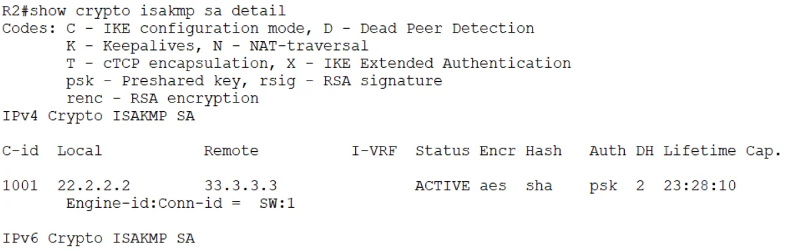

This shows what was **actually negotiated**: **aes, sha, psk, DH 2**, and the time left on the SA. When a router has several policies, this is how you prove which one won.

## Phase 2: the IPsec SAs

```
R2# show crypto ipsec sa
```


| Line | What it proves |
|---|---|
| `Crypto map tag: S2S_CRYPTO_MAP, local addr 22.2.2.2` | The map on G0/0 is the one in use |
| `local ident (172.16.2.0/...)` and `remote ident (172.16.3.0/...)` | The **proxy identities**, taken straight from ACL 100. R3's must be the mirror |
| `current_peer 33.3.3.3 port 500` | The peer, and **UDP 500 means no NAT in the path**. With NAT you'd see **4500** ([NAT-T](/ccnp-security/phishing-defense-cryptography#nat-and-nat-t)) |
| `#pkts encaps: 4 ... #pkts decaps: 4` | 4 packets encrypted out, 4 decrypted in: **traffic flows both ways** |
| `#send errors 0, #recv errors 0` | Nothing matched the ACL without being able to use an SA |
| `plaintext mtu 1438` | The 1500-byte link minus the ESP tunnel overhead. Packets larger than this are fragmented, which is why VPN designs often lower the TCP MSS |
| `PFS (Y/N): N, DH group: none` | No PFS. You'll turn it on in [Harden it](#harden-it) |
| `current outbound spi` | The SPI that tags every ESP packet R2 sends on this SA |

**Reading encaps against decaps** is the most useful troubleshooting habit in this lab:

| Counters | Meaning |
|---|---|
| encaps ≈ decaps, both climbing | Healthy, two-way traffic |
| **encaps climbing, decaps stuck** | You're sending, nothing comes back: look **beyond** the far end ([Break 5](#break-5-tunnel-up-return-path-broken)) |
| Both 0, but `send errors` climbing | Traffic matches the ACL but there's no SA to encrypt it with ([Break 3](#break-3-transform-set-mismatch)) |
| Both 0, nothing else | No traffic matches, or it's routed somewhere else |

`show crypto ipsec sa peer 33.3.3.3` shows the same thing filtered to one peer, which is handy once a router has many tunnels.

## Read the session summary

```
R2# show crypto session
R2# show crypto session detail
```


**Read the output:**

- **`UP-ACTIVE`**: both phases are up.
- **`IKEv1 SA: local 22.2.2.2/500 remote 33.3.3.3/500`**: port **500** on both ends again confirms no NAT-T.
- **`Active SAs: 2`**: one tunnel, **two** IPsec SAs, because **IPsec SAs are one-way**: one for each direction.
- **A lifetime puzzle.** Add the **uptime** (`00:19:11`) to the **lifetime left** (`23:09:52`) and you get about **23:29**, roughly **84,600 seconds**, not the 86,400 you configured. The SA didn't start with 86,400 seconds. Hold that thought until [Break 2](#break-2-phase-1-policy-mismatch), where R3's policy reveals why.

## Prove traffic matched the ACL

```
R2# show access-lists 100
```

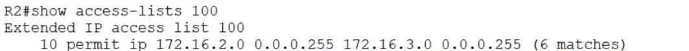

**`(6 matches)`**: the quickest answer to "is my traffic even interesting?" If a tunnel won't come up and this counter isn't moving, the problem is on the traffic side, not in IKE.

## Prove it's a tunnel

```
PC-2> trace 172.16.3.10
```

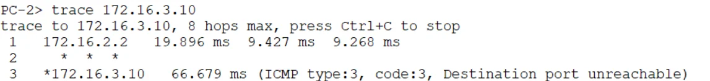

**Read the output:**

- **Only three hops**, and the **internet router never appears**, even though every packet physically crosses it. It only ever sees the outer ESP header, and the probe's TTL lives in the encrypted inner packet.
- **Hop 2 is R3, and it shows `* * *`.** R3 does send a "time exceeded" reply, but it sends it **from its own WAN address, `33.3.3.3`**. A flow from `33.3.3.3` to `172.16.2.10` **doesn't match R3's ACL 100**, so it isn't encrypted; it leaves in cleartext and the internet router drops it, having no route to `172.16.2.0`. That's [the one card](#the-one-card-to-memorize) failing for a router-generated packet, and [Break 6](#break-6-ping-from-the-router-itself) shows the same thing on purpose.
- **Hop 3, `Destination port unreachable`**, is PC-3 answering. VPCS traces with UDP probes, so the destination itself replies that the port is closed. That's how the trace knows it arrived.

## The crypto engine's view

```
R2# show crypto engine connections active
```

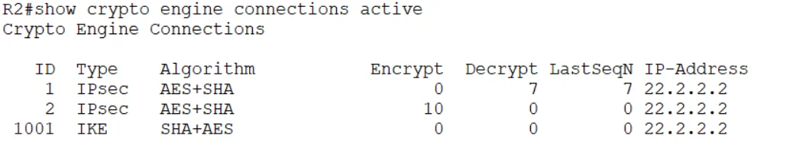

This is the clearest picture of **one-way SAs** you'll get. Connection **1** only **decrypts** (it's the inbound SA); connection **2** only **encrypts** (outbound). Connection **1001** is the **ISAKMP SA**, the same `conn-id` you saw in `show crypto isakmp sa`. Three SAs in total: one bidirectional Phase 1 SA and two one-way Phase 2 SAs.

## Watch it negotiate

```
R2# terminal monitor
R2# debug crypto isakmp
R2# clear crypto session
PC-2> ping 172.16.3.10
R2# undebug all
```

`terminal monitor` is needed when you're on a VTY (SSH or Telnet) line; on the console, debug output appears anyway. `clear crypto session` tears the tunnel down so you can watch it rebuild. It's the **reset button** for every break in Part 6.

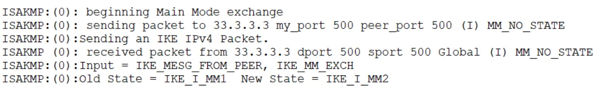

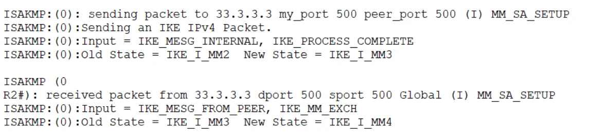

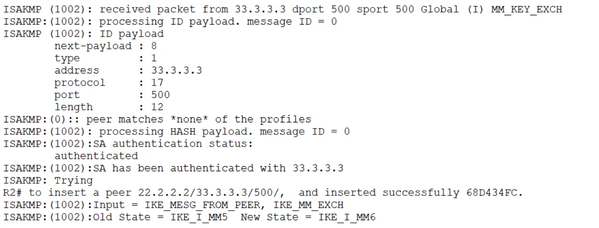

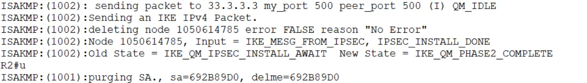

Match the debug to the [main mode message pairs](/ccnp-security/vpn-ipsec-ike#what-each-main-mode-message-pair-does):

| Debug lines | Messages | What happened |
|---|---|---|
| `beginning Main Mode exchange`, `MM_NO_STATE`, `IKE_I_MM1 → IKE_I_MM2` | 1 and 2 | R2 offered policy 10; R3 accepted it |
| `MM_SA_SETUP`, `IKE_I_MM3 → IKE_I_MM4` | 3 and 4 | Diffie-Hellman values and nonces exchanged; both sides now share keys |
| `MM_KEY_EXCH`, `ID payload`, `HASH payload`, `authenticated`, `IKE_I_MM5 → IKE_I_MM6` | 5 and 6 | Identities and PSK-based hashes exchanged **encrypted**; R3 proved it knows the key |
| `QM_IDLE`, `IPSEC_INSTALL_DONE`, `IKE_QM_PHASE2_COMPLETE` | Quick mode | IPsec SAs negotiated and installed |

`peer matches *none* of the profiles` is normal here: ISAKMP profiles are an optional feature this lab doesn't use. The final `purging SA` line is the **old** SA (conn-id 1001) being removed after `clear crypto session`; the new one has its own ID.

---

# Part 6: break and fix

Same loop every time: **break → clear → re-trigger from PC-2 → read the symptom → fix → verify.** Run `debug crypto isakmp` on **both** routers if you can. The **responder (R3)** often logs the clearest reason, because it's the one rejecting the proposal.

## Break 1: PSK mismatch

```
R3(config)# no crypto isakmp key S3cr3tk3y! address 22.2.2.2
R3(config)# crypto isakmp key WrongKey123 address 22.2.2.2
R3(config)# end
R3# clear crypto session
PC-2> ping 172.16.3.10
```

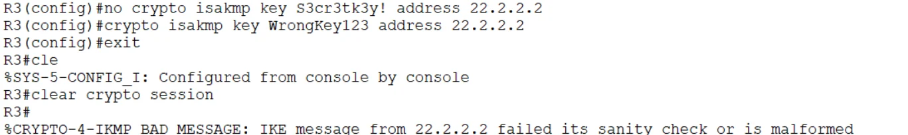

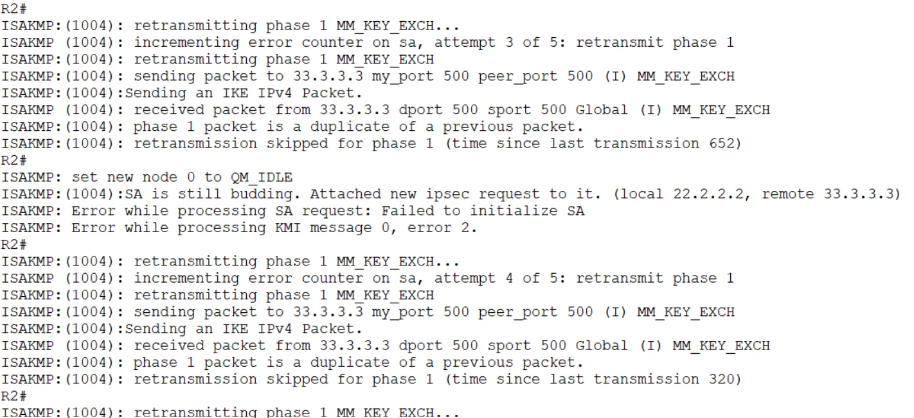

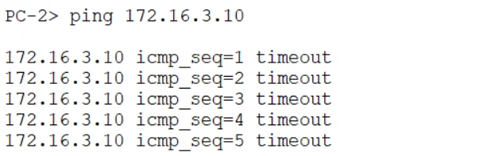

**Read the output:**

- **R3: `IKMP_BAD_MESSAGE ... failed its sanity check or is malformed`.** This is the classic **PSK-mismatch fingerprint**. R2's message 5 is encrypted with keys derived from `S3cr3tk3y!`; R3 derived its keys from `WrongKey123`, so the message decrypts to garbage.
- **R2: stuck in `MM_KEY_EXCH`, retransmitting.** The Diffie-Hellman exchange (messages 3 and 4) worked, so the state got that far. Messages 5 and 6 never succeed, and R2 retries up to 5 times. **`SA is still budding`** means Phase 1 never finished, so the new IPsec request has nothing to ride on.
- **`MM_KEY_EXCH` + `IKMP_BAD_MESSAGE` = wrong key.** Nothing else produces that pair.

**Fix:**

```
R3(config)# no crypto isakmp key WrongKey123 address 22.2.2.2
R3(config)# crypto isakmp key S3cr3tk3y! address 22.2.2.2
R3(config)# do show crypto isakmp key
```

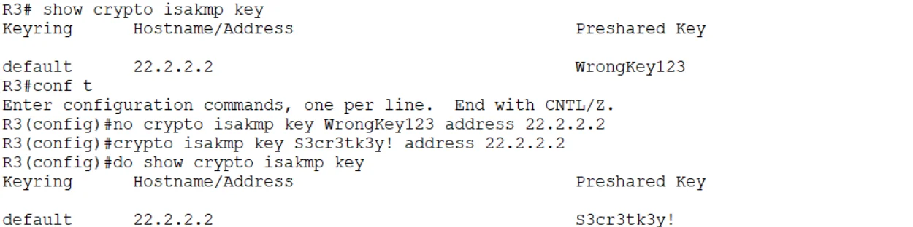

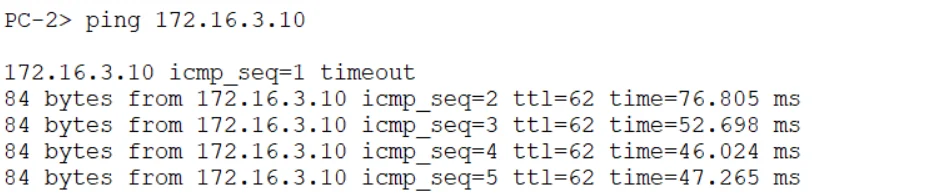

Remove the wrong key before adding the right one, and confirm with `show crypto isakmp key`. It keeps the change obvious, and it's the habit that stops a stale key from lingering in a config to confuse the next engineer.

## Break 2: Phase 1 policy mismatch

```
R3(config)# crypto isakmp policy 10
R3(config-isakmp)# group 5
R3(config-isakmp)# end
R3# clear crypto session
PC-2> ping 172.16.3.10
```

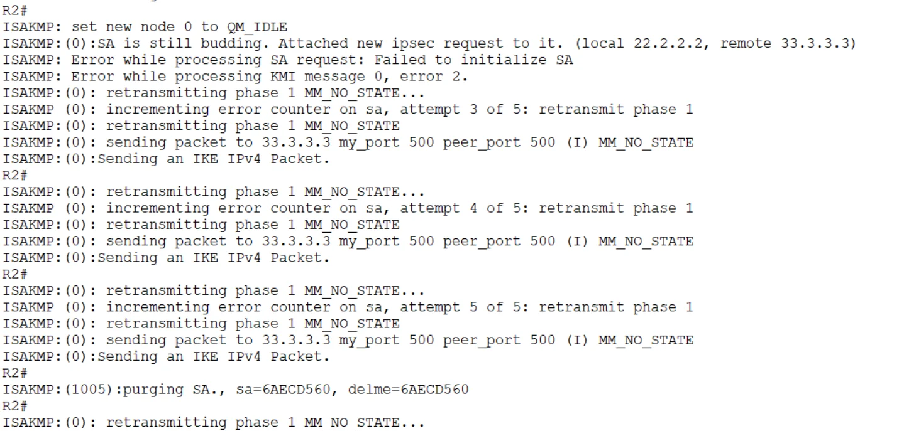

**Read the output:** R2 is stuck at **`MM_NO_STATE`**, retransmitting message 1 until it gives up at attempt 5 and purges the SA. Main mode failed in the **first message pair**: R3 found no policy that matches R2's proposal, so no keys were ever created. With `debug crypto isakmp` on R3, you'd see why: **`atts are not acceptable`** and **`phase 1 SA policy not acceptable`**.

`MM_NO_STATE` that never moves has two possible causes, and you tell them apart from the **responder**: a **policy mismatch** (R3 logs a rejection), or R3 **not answering at all** (R3 logs nothing: check UDP 500 reachability and whether the crypto map is applied there).

**Fix it on R3, and look closely:**

```
R3# show crypto isakmp policy
R3(config)# crypto isakmp policy 10
R3(config-isakmp)# group 2
R3(config-isakmp)# do show crypto isakmp policy
```


**Read the output, twice:**

- **`#5 (1536 bit)`** was the break. Encryption, hash, authentication method and **DH group** must all match for a Phase 1 policy to be accepted. Back to `#2` and the tunnel comes up.
- **`lifetime: 84600 seconds`.** That's not the `86400` in the lab's values: a **typo on R3** from the original build, and it's been there all along. This solves the [lifetime puzzle](#read-the-session-summary): the tunnel came up anyway because **the lifetime is the one Phase 1 setting that doesn't have to match**, and IOS used the **shorter** value. That's why the uptime and the remaining lifetime added up to about 84,600 seconds. Fix it with `lifetime 86400` so both ends rekey on the same schedule; another vendor's gateway might not be as forgiving.

**The lesson:** a working tunnel can still have a config mistake in it. `show crypto isakmp sa detail` and `show crypto session detail` tell you what was **negotiated**; compare that to what you **intended**.

## Break 3: transform-set mismatch

```
R3(config)# crypto ipsec transform-set S2S_TRANSFORM_SET esp-3des esp-sha-hmac
R3(cfg-crypto-trans)# end
R3# clear crypto session
PC-2> ping 172.16.3.10
R2# show crypto ipsec sa
```

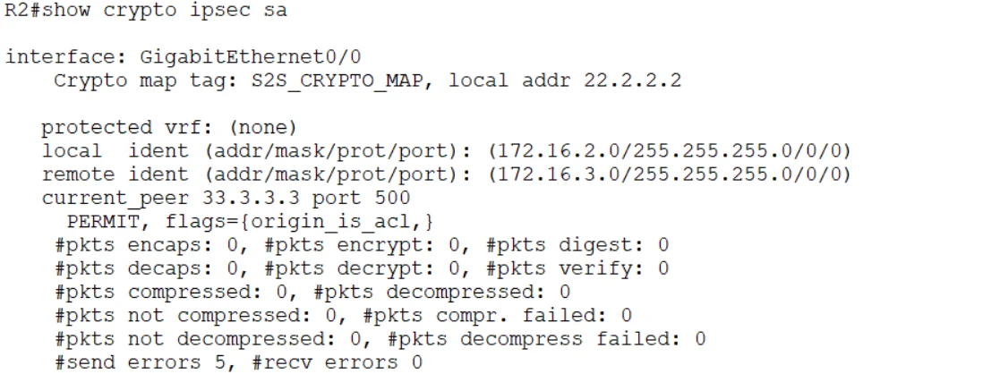

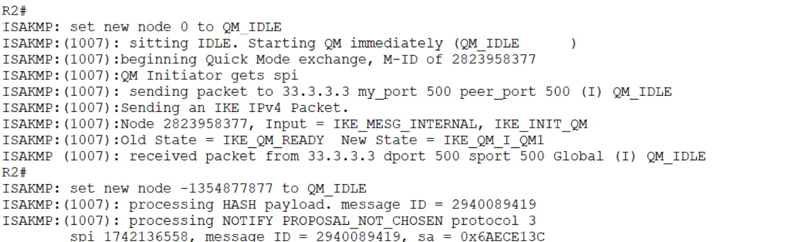

**Read the output:**

- **Phase 1 still comes up.** The debug starts from `QM_IDLE`: main mode worked, because nothing in Phase 1 changed.
- **`NOTIFY PROPOSAL_NOT_CHOSEN protocol 3`**: R3 **rejected R2's Phase 2 proposal**. Protocol 3 is ESP in IKE's numbering, so it's the ESP transforms that didn't match: R2 offered AES, R3 now only accepts 3DES.
- **`show crypto ipsec sa`: encaps 0, decaps 0, `#send errors 5`.** The flows still show, because they come from ACL 100, but there's **no SA** to encrypt with. Each of PC-2's five pings matched the ACL and became a send error.
- **`QM_IDLE` with no IPsec SA = look at Phase 2**: the transform set, PFS or the ACL.

**Fix:** re-enter the transform set with **exactly the same name**, so it overwrites the transforms:

```
R3(config)# crypto ipsec transform-set S2S_TRANSFORM_SET esp-aes esp-sha-hmac
R3(cfg-crypto-trans)# mode tunnel
R3(cfg-crypto-trans)# end
R3# show crypto ipsec transform-set
R3# clear crypto session
```

> **Name trap.** The name must match **character for character**. Type `S2S-TRANSFORM_SET` (a hyphen) and IOS creates a **second, unused** set while the 3DES one stays in the map. Check `show crypto map` to see which name the map actually references, and remove an orphan with `no crypto ipsec transform-set S2S-TRANSFORM_SET`.

## Break 4: ACLs not mirrored

```
R3(config)# no access-list 100
R3(config)# access-list 100 permit ip 172.16.3.0 0.0.0.255 172.16.20.0 0.0.0.255
R3(config)# end
R3# clear crypto session
PC-2> ping 172.16.3.10
```

Phase 1 comes up, Phase 2 fails. With `debug crypto ipsec` on R3 you'll see **`IPSEC(validate_transform_proposal): proxy identities not supported`**: R2 proposed protecting `172.16.2.0 ↔ 172.16.3.0`, and R3's ACL doesn't describe that flow. This is the **most common real-world site-to-site failure**, usually after someone adds a subnet on one side only.

**Fix:** find the wrong entry, then replace it:

```
R3# show access-lists
R3(config)# no access-list 100
R3(config)# access-list 100 permit ip 172.16.3.0 0.0.0.255 172.16.2.0 0.0.0.255
R3(config)# do show access-lists
```

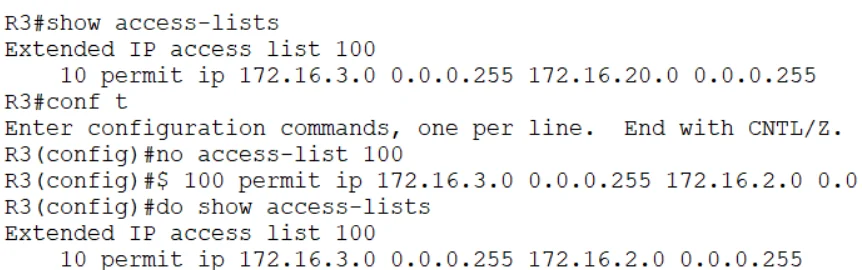

**Read the output:** `172.16.20.0` instead of `172.16.2.0`, one extra character. The `$` at the start of the corrected line is just IOS **scrolling a long command** to fit the terminal width; the whole line was entered.

**Why `no access-list 100` first?** Numbered ACL entries are appended. Without removing the old list, the wrong entry would stay and still be offered as a proxy identity.

## Break 5: tunnel up, return path broken

Give PC-3 a wrong default gateway, so it can't answer:

```
PC-3> ip 172.16.3.10 255.255.255.0 172.16.3.99
PC-2> ping 172.16.3.10
R2# show crypto ipsec sa | include encaps|decaps
R3# show crypto ipsec sa | include encaps|decaps
```

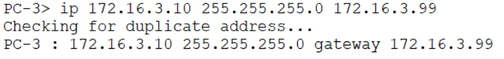

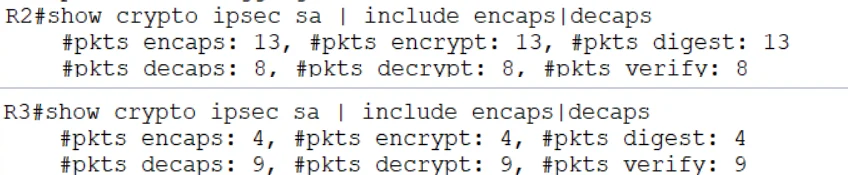

**Read the output:** look at the **gap** on each router, not the totals.

- **R2: encaps 13, decaps 8.** R2 encrypted **5 more** than it received: it's sending, and nothing is coming back.
- **R3: decaps 9, encaps 4.** R3 decrypted **5 more** than it sent: it **receives and decrypts** perfectly, then has nothing to send back.
- **Both gaps are 5: PC-2's five pings.** The tunnel is healthy in both directions. The problem is **beyond R3**: PC-3 sends its replies to a gateway that doesn't exist.

The absolute numbers don't line up between the routers because each router's counters started when its own SAs were created. The direction of the gap is what tells you where to look.

**Fix:** `PC-3> ip 172.16.3.10 255.255.255.0 172.16.3.3`.

## Break 6: ping from the router itself

```
R2# ping 172.16.3.3
R2# ping 172.16.3.3 source g1/0
```

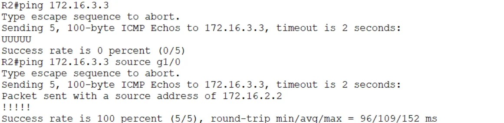

**Read the output:**

- **`UUUUU`**: five **ICMP unreachables**. A plain router ping is sourced from the **exit interface, `22.2.2.2`**. The flow `22.2.2.2 → 172.16.3.3` doesn't match ACL 100, so it isn't encrypted. It leaves in cleartext, and the **internet router** answers "unreachable" because it has no route to `172.16.3.0`. The `U` itself proves the packet reached the internet router unencrypted.
- **`Packet sent with a source address of 172.16.2.2` ... `!!!!!`**: sourcing from the LAN interface makes the flow match ACL 100, so it rides the tunnel.
- **Lesson:** when you test a VPN from a router, always **source from the protected LAN interface**. "The VPN is up but I can't ping from the router" is almost never a VPN problem.

## More breaks to try

- **Remove the crypto map from R2's G0/0.** No negotiation at all; traffic leaves in cleartext and dies. `show crypto map` no longer lists an interface.
- **Remove R2's default route.** Nothing routes `172.16.3.0` out G0/0, so the crypto map never sees the traffic. Encryption happens **after** the routing decision: no route, no VPN.
- **Turn on PFS on one side only** (`set pfs group14` in R2's map). Phase 1 comes up, Phase 2 fails, just like Break 3.
- **Shut R3's G0/0, then bring it back** (`shutdown`, then `no shutdown`). Watch how long R2 keeps its stale SAs. Then add `crypto isakmp keepalive 10 3 periodic` on both routers and repeat: dead peer detection notices the peer is gone and clears the SAs.

## The debug decoder

![The IKEv1 troubleshooting ladder, read top to bottom: no SA and nothing in debug means no interesting traffic, no route out the crypto map interface or no crypto map applied; MM_NO_STATE retransmitting means a Phase 1 policy mismatch or no reply on UDP 500; MM_KEY_EXCH with IKMP_BAD_MESSAGE on the peer means a pre-shared key mismatch; QM_IDLE with PROPOSAL_NOT_CHOSEN means a transform set or PFS mismatch; QM_IDLE with proxy identities not supported means the ACLs aren't mirrored; SAs up with encaps climbing and decaps stuck means the return path beyond the tunnel is broken; each rung lists the command that shows it and the fix](img/ipsec-ikev1-s2s/fig-troubleshooting-ladder.webp)

| What you see | Phase | Cause | Break |
|---|---|---|---|
| No SA at all, nothing in `debug` | | No interesting traffic, not routed out G0/0, or crypto map not applied | More breaks |
| **`MM_NO_STATE`**, retransmitting; peer logs `atts are not acceptable` | 1 | **Policy mismatch** (encryption, hash, auth, DH group) | 2 |
| **`MM_KEY_EXCH`**; peer logs **`IKMP_BAD_MESSAGE ... sanity check`** | 1 | **PSK mismatch** | 1 |
| **`QM_IDLE`**, no IPsec SA, **`PROPOSAL_NOT_CHOSEN`**, `send errors` climbing | 2 | **Transform set** (or PFS) mismatch | 3 |
| **`QM_IDLE`**, no IPsec SA, **`proxy identities not supported`** | 2 | **ACLs not mirrored** | 4 |
| SAs up, **encaps climbing, decaps stuck** | Data | **Return path** broken beyond the tunnel | 5 |
| Router ping **`UUUUU`**, PC ping works | | Router ping not sourced from the LAN, so not interesting | 6 |

---

# Harden it

The lab works, but by today's standards almost every value in it is weak. Upgrade **both** routers. Do them close together: until both have the new Phase 2 settings, the tunnel won't rebuild.

**1. A stronger Phase 1 policy.** Add it with a **lower number**, so it's offered first:

```
crypto isakmp policy 5
 encr aes 256
 hash sha256
 authentication pre-share
 group 14
 lifetime 86400
```

`clear crypto session`, re-trigger, and `show crypto isakmp sa detail` should show **aes256, sha256, DH 14**: policy 5 wins because it's tried first. Once both routers have it, **remove policy 10** (`no crypto isakmp policy 10`) so group 2 and SHA-1 can never be negotiated again. Leaving a weak policy as a fallback leaves the weakness in place.

**2. A stronger Phase 2 with PFS:**

```
crypto ipsec transform-set STRONG_TS esp-aes 256 esp-sha256-hmac
 mode tunnel
crypto map S2S_CRYPTO_MAP 10 ipsec-isakmp
 set transform-set STRONG_TS
 set pfs group14
```

`show crypto ipsec sa` should now show **`PFS (Y/N): Y, DH group: group14`**: every new IPsec SA runs its own Diffie-Hellman exchange.

**3. The rest of the list:**

| Control | Command | Why |
|---|---|---|
| Disable aggressive mode | `crypto isakmp aggressive-mode disable` | Aggressive mode with a PSK exposes a hash that can be [cracked offline](/ccnp-security/vpn-ipsec-ike#main-mode-and-aggressive-mode) |
| Encrypt the PSK in the config | `key config-key password-encrypt <master-key>` then `password encryption aes` | Otherwise `show run` and `show crypto isakmp key` show it in cleartext. It's stored as type 6 afterwards |
| A real key | 20+ random characters, unique **per peer** | A short or shared key is the easiest way in. One leaked shared key breaks every tunnel that uses it |
| Dead peer detection | `crypto isakmp keepalive 10 3 periodic` | Detects a dead peer and clears stale SAs. Optional in IKEv1, built into IKEv2 |
| Set the Phase 2 lifetime on purpose | `crypto ipsec security-association lifetime seconds 3600` | Both ends should agree, especially with another vendor's gateway, whose defaults often differ |
| Prefer certificates | `authentication rsa-sig` with a PKI trustpoint | Scales, and one device can be revoked without touching the others ([PSK vs. certificates](/ccnp-security/phishing-defense-cryptography#authenticating-the-peers-pre-shared-keys-and-certificates)) |
| Move to IKEv2 | See [the IKEv2 configuration](/ccnp-security/vpn-ipsec-ike#the-ikev2-configuration-on-ios) | Fewer messages, built-in NAT-T and liveness checks, modern defaults |

**Threat lens.** DH group 2 (1024-bit) and SHA-1 are considered breakable or deprecated. A PSK reused across sites turns one leak into a full compromise. And because the tunnel protects **only** what ACL 100 matches, a missing or over-broad ACL silently changes what's encrypted: review it like a firewall rule, on both peers, whenever a subnet changes.

---

# Check yourself

<details><summary>1. Both routers are fully configured and `show crypto isakmp sa` is empty. Is the tunnel broken?</summary>

No. An IKEv1 crypto map negotiates only when **interesting traffic** arrives. Ping from PC-2 to PC-3; the first packet is lost while Phase 1 and Phase 2 run.

</details>

<details><summary>2. PC-2's ping replies arrive with ttl=62. What does that prove?</summary>

That the internet router didn't decrement the **inner** packet's TTL. PC-3 sent 64; only R3 and R2 decremented it. The internet router only saw the **outer** ESP header, so the traffic really crossed it inside the tunnel.

</details>

<details><summary>3. Why does `show crypto session` say Active SAs: 2 for one tunnel, and which command shows them working in opposite directions?</summary>

**IPsec SAs are one-way**, so a tunnel needs one inbound and one outbound SA. `show crypto engine connections active` shows one SA that only **decrypts** and one that only **encrypts**.

</details>

<details><summary>4. R2 is stuck at MM_KEY_EXCH and R3 logs IKMP_BAD_MESSAGE. Which phase, which message pair, and what's wrong?</summary>

**Phase 1, messages 5 and 6**, where identities and authentication hashes are exchanged under the new keys. The **pre-shared keys don't match**, so each side derives different keys and can't verify the other's messages.

</details>

<details><summary>5. Phase 1 is QM_IDLE, but `show crypto ipsec sa` shows zero encaps and climbing send errors. Name two possible causes, and the debug message that separates them.</summary>

A **transform-set (or PFS) mismatch**, shown by **`PROPOSAL_NOT_CHOSEN`**, or **crypto ACLs that aren't mirrored**, shown on the responder by **`proxy identities not supported`**.

</details>

<details><summary>6. R2 shows encaps 40, decaps 0. R3 shows decaps 40, encaps 0. Where's the problem?</summary>

**Beyond R3.** The tunnel carries traffic from R2 to R3 fine, and R3 decrypts it, but nothing comes back to R3 to encrypt. Check the far host's gateway and R3's LAN side.

</details>

<details><summary>7. The tunnel is up, yet `ping 172.16.3.3` from R2 returns UUUUU. Why, and what's the fix?</summary>

The ping is sourced from **`22.2.2.2`**, which isn't in ACL 100, so it leaves **unencrypted** and the internet router replies **unreachable**. Use `ping 172.16.3.3 source GigabitEthernet1/0`.

</details>

<details><summary>8. R3's ISAKMP policy says lifetime 84600 and R2's says 86400, yet the tunnel came up. Why, and which value is used?</summary>

The Phase 1 **lifetime doesn't have to match**: IOS uses the **shorter** one, 84,600 seconds. Encryption, hash, authentication and DH group do have to match.

</details>

---

# Answer config

<details><summary>Show the final lab config for R2 and R3</summary>

```
! ===== R2 =====
crypto isakmp policy 10
 encr aes 128
 hash sha
 authentication pre-share
 group 2
 lifetime 86400
crypto isakmp key S3cr3tk3y! address 33.3.3.3
!
crypto ipsec transform-set S2S_TRANSFORM_SET esp-aes esp-sha-hmac
 mode tunnel
!
access-list 100 permit ip 172.16.2.0 0.0.0.255 172.16.3.0 0.0.0.255
!
crypto map S2S_CRYPTO_MAP 10 ipsec-isakmp
 set peer 33.3.3.3
 set transform-set S2S_TRANSFORM_SET
 match address 100
!
interface GigabitEthernet0/0
 crypto map S2S_CRYPTO_MAP
```

```
! ===== R3 =====
crypto isakmp policy 10
 encr aes 128
 hash sha
 authentication pre-share
 group 2
 lifetime 86400
crypto isakmp key S3cr3tk3y! address 22.2.2.2
!
crypto ipsec transform-set S2S_TRANSFORM_SET esp-aes esp-sha-hmac
 mode tunnel
!
access-list 100 permit ip 172.16.3.0 0.0.0.255 172.16.2.0 0.0.0.255
!
crypto map S2S_CRYPTO_MAP 10 ipsec-isakmp
 set peer 22.2.2.2
 set transform-set S2S_TRANSFORM_SET
 match address 100
!
interface GigabitEthernet0/0
 crypto map S2S_CRYPTO_MAP
```

Lab values only. Use the [hardened version](#harden-it) on real equipment.

</details>

---

# Exam mapping

| You practiced | Exam angle | SCOR v2.0 |
|---|---|---|
| ISAKMP policy, PSK, transform set, ACL, crypto map | Standards-based IPsec site-to-site deployment | 1.6 |
| Phase 1 vs. Phase 2, ISAKMP SA vs. IPsec SAs | Which exchange creates which SA | 1.6 |
| Interesting traffic, mirrored ACLs | Policy-based selection, proxy identities | 1.6 |
| Port 500 vs. 4500, ESP in tunnel mode | NAT-T, ESP vs. AH | 1.5 |
| PSK in cleartext, certificates, aggressive mode | Pre-shared key vs. certificate authentication | 1.5 |
| AES-256, SHA-256, group 14, PFS | Strong vs. weak cryptography | 1.5 |
| The same objects on a firewall | Site-to-site VPN on Secure Firewall (FTD) | 2.9 |

Drill it with the [flashcards](/ccnp-security/flashcards#d1) and the [mock exam](/ccnp-security/mock-exam#d1).
