# Lab: Layer 2 Attack Prevention (Packet Tracer)

> Companion lab for the Segmentation & Layer 2 Hardening notes. SCOR 350-701 v2.0 topic 2.3: DHCP snooping, Dynamic ARP Inspection, STP protection and storm control.

---

# What you'll build

One small office network, attacked and then defended in five phases. Every phase runs the same loop: **run the attack, apply the protection, prove the attack now fails.** If you never see the attack succeed, a passing show command proves nothing, so Phase 0 starts with an unprotected network and attacks it first.

| Item | Detail |
|---|---|
| **Tool** | Cisco Packet Tracer 9.0 or later |
| **Time** | 2 to 3 hours |
| **Level** | CCNP Security. You should already be comfortable with VLANs, trunks and the switch CLI |
| **Devices** | 3650 access switch, 3560 distribution switch, 2911 router, two rogue 2960 switches, a rogue DHCP server, an attacker laptop, a printer, two PCs |
| **You'll practice** | DHCP snooping, Dynamic ARP Inspection, PortFast + BPDU Guard, Root Guard, storm control, trunk and unused-port hardening, and how to recover an err-disabled port |
| **Exam topic** | 2.3 (core) |
| **Before this** | [Segmentation & Layer 2 Hardening notes](/ccnp-security/segmentation-layer-2-hardening) and the [Layer 2 Hardening lab](/ccnp-security/labs/segmentation-l2-hardening-packet-tracer) |

| Phase | You configure | Attack you prove first | Result in Packet Tracer |
|---|---|---|---|
| 0 Baseline | Nothing new: read the base configs | Rogue DHCP hands PC1 a fake gateway; ARP goes unchecked | Attack works |
| 1 DHCP snooping | Trusted uplink, untrusted host ports, rate limit, binding table | Rogue DHCP server | **Protection works** |
| 2 Dynamic ARP Inspection | DAI on VLAN 10, trusted uplink, validation checks | Static-IP attacker sends ARP with no binding | Config and show output only |
| 3 STP protection | PortFast + BPDU Guard, Root Guard | Rogue switch on a user port; rogue switch claims root | **Protection works** |
| 4 Storm control | Broadcast thresholds | Broadcast flood | Config and show output only |
| 5 Validation | Nothing new | Every attack again | Checklist |

## The files

| File | What it is | How to use it |
|---|---|---|
| **Baseline lab (.pkt)** | The network with Phase 0 done: addressing, VLANs, trunk, DHCP on R1, the rogue server ready. No Layer 2 protection | Open it and start at the baseline attacks in Phase 0 |
| **Activity (.pka)** | The same lab as a Packet Tracer activity with these instructions built in | Follow the steps inside Packet Tracer. It is **not graded**: the completion bar shows 100% from the start, so prove each phase with the show commands on this page instead |

Both files are in the download box on this page. The SHA-256 checksums are listed at the bottom so you can confirm your download wasn't changed.

## Think like the defender first

Before you type anything, look at the topology and answer two questions for every port on ASW1: **who should be on the other end, and what is it allowed to send?**

- A PC port should never send a DHCP OFFER, never ARP for an address it wasn't given, never send a BPDU and never flood broadcasts.
- The uplink toward DSW1 and R1 is the only place DHCP server replies and the gateway's ARP may legitimately come from.

Every protection in this lab is one of those answers turned into a command. The access edge is **untrusted**, the uplink is **trusted**, and the switch enforces the difference. Keep that model in your head and the commands stop being a list to memorize.

---

# Real IOS vs. Packet Tracer: read this first

Packet Tracer **simulates** IOS; it doesn't run it. Some commands are rejected outright, and some are **accepted but not enforced**, which is worse, because the configuration looks right and nothing happens. The exam tests real IOS, so every phase shows the **real IOS commands first**, then what to type in Packet Tracer when it differs.

| Feature or command | Real IOS | Packet Tracer 3650-24PS | What to do in this lab |
|---|---|---|---|
| P0: Rogue DHCP race | Whichever server answers first wins | R1 always answers first, so the rogue never wins | Turn R1's DHCP off with `no service dhcp` to run the attack |
| P1: `show ip dhcp snooping` operational line | Lists VLAN 10 as operational | Can show `none` even when snooping works | Judge by the trusted port, the rate limits and the leases |
| P1: Binding lease time | Counts down from the lease | Shows 0 | Ignore it |
| P2: DAI enforcement | ARP without a binding is dropped and counted | Accepted, VLAN 10 shows Active, but nothing is dropped and Dropped stays 0 | Config and show output only |
| P2: `ip arp inspection limit rate 15` (interface) | Sets the ARP rate limit | Rejected; only `trust` exists under the interface | Skip it. The 15 pps default still shows |
| P2: `arp access-list` + `ip arp inspection filter` | Lets static hosts through DAI | Rejected | Move PRINTER to DHCP |
| P2: `ip source binding`, EXEC `ip dhcp snooping binding` | Adds a static binding | Rejected | Move PRINTER to DHCP |
| P2: Printer-PT | n/a | No Desktop tab or command prompt | Test PRINTER by pinging it from PC1 |
| P3: `spanning-tree guard loop`, `spanning-tree loopguard default` | Loop Guard | Rejected; `spanning-tree guard ?` offers only `root` | Learn it, skip it |
| P3: Root Guard state | `BKN*` with `ROOT_Inc` | `BLK`, plus a ROOTGUARDBLOCK log | Same meaning |
| P3: err-disable recovery | `errdisable recovery` timer, or manual | Use manual recovery | `shutdown` then `no shutdown` |
| P4: `storm-control multicast` / `unicast` | Thresholds for those traffic types | Only `broadcast` exists | Broadcast only |
| P4: Falling threshold (`level 20.00 10.00`) | Rising and falling thresholds | Falling value rejected | `level 20.0`; lower shows the same as upper |
| P4: `storm-control action trap` or `shutdown` | Log/trap or err-disable the port | Rejected | Skip it. Excess broadcast is dropped and the port stays up |
| P4: Broadcast flood test | Port trips at the threshold | A broadcast ping is about 600 bps, far below 1% of 100 Mbps | Config and show output only |

**Check before you type.** Use `?` at the prompt (for example `ASW1(config-if)# storm-control ?`). Packet Tracer support changes between versions. If a command is rejected, write it down and carry on.

**Simulation devices aren't the whole answer either.** In Cisco Modeling Labs, IOSvL2 switches run real IOS code and do enforce DHCP snooping and DAI, so that's where to watch spoofed ARP actually get dropped. Features that depend on switch hardware, such as storm control, may still be accepted there without being enforced. Verify with `?` and the show commands on any virtual switch.

---

# Devices and topology

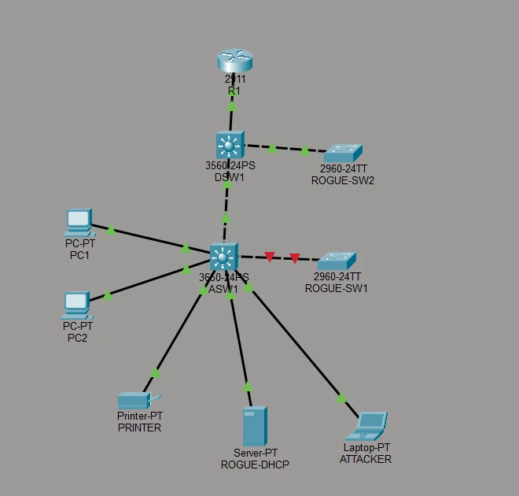

Every host and both rogue devices enter through **ASW1's access ports**, so that's where most protections go. DSW1 has one job to defend: staying the spanning-tree root. Everything sits in one user VLAN (10) so each attack is easy to see.

## Why a 3650 for the access switch

ASW1 is a **3650-24PS**. It runs IOS XE, supports every feature in this lab on real hardware, and is the most complete switch Packet Tracer offers. Even so, it accepts more than it enforces in the simulator (see the table above).

> **3650 gotcha:** a new 3650-24PS has no power supply, so the CLI stays dark. Open it, go to the **Physical** tab, drag **AC-POWER-SUPPLY** into the empty slot, and it boots. The baseline file already has it.

## Devices

| Hostname | Packet Tracer model | Role | Configured on it |
|---|---|---|---|
| ASW1 | 3650-24PS | Access switch | DHCP snooping, DAI, PortFast, BPDU Guard, storm control, port hardening |
| DSW1 | 3560-24PS | Distribution switch, STP root | Root priority, Root Guard, trunk hardening |
| R1 | 2911 | Gateway and legitimate DHCP server | DHCP pool for VLAN 10 |
| ROGUE-SW1 | 2960-24TT | Attacker's switch on a user port | Nothing. A switch sends BPDUs by default |
| ROGUE-SW2 | 2960-24TT | Attacker's switch claiming root | `spanning-tree vlan 10 priority 0` |
| ROGUE-DHCP | Server-PT | Rogue DHCP server | DHCP service with a fake gateway |
| ATTACKER | Laptop-PT | Static-IP spoofer | Static IP, no DHCP binding |
| PRINTER | Printer-PT | Legitimate static host | Static IP, moved to DHCP in Phase 2 |
| PC1, PC2 | PC-PT | Legitimate users | DHCP |

## Cabling

| Device A | Port | Device B | Port | Link | Cable |
|---|---|---|---|---|---|
| R1 | Gi0/0 | DSW1 | Fa0/1 | Access VLAN 10 | Straight-through |
| DSW1 | Gi0/1 | ASW1 | Gi1/0/24 | 802.1Q trunk, native VLAN 99 | Cross-over |
| ASW1 | Gi1/0/1 | PC1 | Fa0 | Access VLAN 10 | Straight-through |
| ASW1 | Gi1/0/2 | PC2 | Fa0 | Access VLAN 10 | Straight-through |
| ASW1 | Gi1/0/3 | ROGUE-DHCP | Fa0 | Access VLAN 10 | Straight-through |
| ASW1 | Gi1/0/4 | ATTACKER | Fa0 | Access VLAN 10 | Straight-through |
| ASW1 | Gi1/0/5 | PRINTER | Fa0 | Access VLAN 10 | Straight-through |
| ASW1 | Gi1/0/10 | ROGUE-SW1 | Fa0/1 | Access VLAN 10, Phase 3 test | Cross-over |
| DSW1 | Fa0/10 | ROGUE-SW2 | Fa0/1 | Trunk, Phase 3 test | Cross-over |

## VLANs and addressing

| VLAN | Name | Subnet | Purpose |
|---|---|---|---|
| 10 | USERS | 10.10.10.0/24 | All hosts |
| 99 | NATIVE | none | Unused native VLAN on trunks |
| 999 | BLACKHOLE | none | Parking VLAN for unused, shut ports |

| Device | Interface | IP address | Gateway | How assigned |
|---|---|---|---|---|
| R1 | Gi0/0 | 10.10.10.1/24 | n/a | Static |
| ASW1 | Vlan10 | 10.10.10.2/24 | 10.10.10.1 | Static (management) |
| DSW1 | Vlan10 | 10.10.10.3/24 | 10.10.10.1 | Static (management) |
| PRINTER | Fa0 | 10.10.10.15/24 | 10.10.10.1 | Static in Phases 0 and 1, DHCP from Phase 2 |
| ATTACKER | Fa0 | 10.10.10.50/24 | 10.10.10.1 | Static, no binding on purpose |
| ROGUE-DHCP | Fa0 | 10.10.10.66/24 | 10.10.10.66 | Static. Its pool hands out gateway .66 |
| PC1, PC2 | Fa0 | from R1's pool (.21 to .254) | 10.10.10.1 | DHCP from R1 (.1 to .20 excluded) |

Management sits in VLAN 10 to keep the lab small. In production, put switch management in its own VLAN, as the [Layer 2 Hardening lab](/ccnp-security/labs/segmentation-l2-hardening-packet-tracer) does.

---

# Phase 0: base build and baseline attacks

The baseline file already contains everything in this section. Read the configs so you know what you're defending, then go straight to the baseline attacks. If you build from scratch, paste these in and set up the end devices as listed.

## R1: gateway and legitimate DHCP server

```
hostname R1
no ip domain-lookup
!
interface GigabitEthernet0/0
 ip address 10.10.10.1 255.255.255.0
 no shutdown
!
ip dhcp excluded-address 10.10.10.1 10.10.10.20
ip dhcp pool VLAN10
 network 10.10.10.0 255.255.255.0
 default-router 10.10.10.1
 dns-server 10.10.10.1
```

The excluded range keeps .1 to .20 free for infrastructure and static hosts, so the first lease R1 hands out is 10.10.10.21.

## DSW1: distribution switch and STP root

```
hostname DSW1
no ip domain-lookup
!
vlan 10
 name USERS
vlan 99
 name NATIVE
vlan 999
 name BLACKHOLE
!
spanning-tree mode rapid-pvst
spanning-tree vlan 10,99 priority 4096
!
interface FastEthernet0/1
 description R1
 switchport mode access
 switchport access vlan 10
 spanning-tree portfast
!
interface GigabitEthernet0/1
 description TRUNK-ASW1
 switchport trunk encapsulation dot1q
 switchport mode trunk
 switchport trunk native vlan 99
 switchport trunk allowed vlan 10,99
 switchport nonegotiate
!
interface range FastEthernet0/2 - 9 , FastEthernet0/11 - 24 , GigabitEthernet0/2
 switchport mode access
 switchport access vlan 999
 shutdown
!
interface Vlan10
 ip address 10.10.10.3 255.255.255.0
 no shutdown
ip default-gateway 10.10.10.1
```

- `priority 4096` makes DSW1 the root on purpose. Never leave the root to chance: the lowest bridge ID wins, and on default priorities that's the switch with the lowest MAC, often the oldest one.
- The 3560 also supports ISL, so it needs `switchport trunk encapsulation dot1q` before `switchport mode trunk`.
- Fa0/10 is left alone. Phase 3 turns it into the Root Guard test port.

## ASW1: access switch

```
hostname ASW1
no ip domain-lookup
!
vlan 10
 name USERS
vlan 99
 name NATIVE
vlan 999
 name BLACKHOLE
!
spanning-tree mode rapid-pvst
!
interface GigabitEthernet1/0/24
 description TRUNK-DSW1 (path to the real DHCP server)
 switchport mode trunk
 switchport trunk native vlan 99
 switchport trunk allowed vlan 10,99
 switchport nonegotiate
!
interface range GigabitEthernet1/0/1 - 5
 description USER-PORTS
 switchport mode access
 switchport access vlan 10
 switchport nonegotiate
 no shutdown
!
interface GigabitEthernet1/0/10
 description ROGUE-SW1-TEST-PORT
 switchport mode access
 switchport access vlan 10
 switchport nonegotiate
!
interface range GigabitEthernet1/0/6 - 9 , GigabitEthernet1/0/11 - 23 , GigabitEthernet1/1/1 - 4
 switchport mode access
 switchport access vlan 999
 shutdown
!
interface Vlan10
 ip address 10.10.10.2 255.255.255.0
 no shutdown
ip default-gateway 10.10.10.1
```

Trunk hardening (native VLAN 99, only VLANs 10 and 99 allowed, no DTP) and parking unused ports in VLAN 999 are already done here. They stop VLAN hopping and walk-up access, which the [Layer 2 Hardening lab](/ccnp-security/labs/segmentation-l2-hardening-packet-tracer) covers step by step.

## End devices

1. **PC1, PC2:** Desktop → IP Configuration → **DHCP**.
2. **PRINTER:** Config → FastEthernet0 → Static, 10.10.10.15 / 255.255.255.0, gateway 10.10.10.1 (Config → Settings).
3. **ATTACKER:** Desktop → IP Configuration → Static, 10.10.10.50 / 255.255.255.0, gateway 10.10.10.1.
4. **ROGUE-DHCP:** static 10.10.10.66 / 255.255.255.0. Then Services → DHCP: interface FastEthernet0, default gateway 10.10.10.66, DNS server 10.10.10.66, start IP address 10.10.10.100, subnet mask 255.255.255.0. Click **Save**, then set the service to **On**.

**Keep the rogue switches out of the way.** If ROGUE-SW1 and ROGUE-SW2 are already cabled in your file, delete those two cables now and reconnect them in Phase 3. Cabled early, they fill ASW1's console with CDP native VLAN mismatch messages and can trip BPDU Guard before you've configured it on purpose.

## Baseline attack 1: the rogue DHCP server wins

In real networks the first DHCP server to answer wins the client. Packet Tracer always lets R1 answer first, so take R1 out of the race:

1. On R1: `enable`, `configure terminal`, `no service dhcp`.
2. On PC1: Desktop → Command Prompt, then `ipconfig /release` and `ipconfig /renew`.
3. On R1: `service dhcp`.
4. On PC1: `ipconfig /release` and `ipconfig /renew` again.

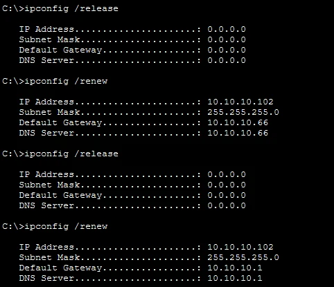

**Read the output:**

- First renew: **default gateway 10.10.10.66** and DNS 10.10.10.66. PC1 now sends everything that leaves the subnet, and every name lookup, to the attacker. That's a man-in-the-middle position without touching a single cable.
- The address .102 comes from the rogue pool (start .100), not from R1's.
- Second renew, after `service dhcp` on R1: gateway **10.10.10.1**. The network works again only because the rogue lost the race this time. Nothing stopped it.

## Baseline attack 2: ARP is unchecked

From ATTACKER's Command Prompt, `ping 10.10.10.1` and `ping 10.10.10.15`. Both succeed, although nobody approved ATTACKER's static address. A switch with no DAI forwards any ARP from anyone, which is exactly what ARP spoofing relies on.

## Baseline check: who is the STP root?

On ASW1:

```
show spanning-tree vlan 10
```

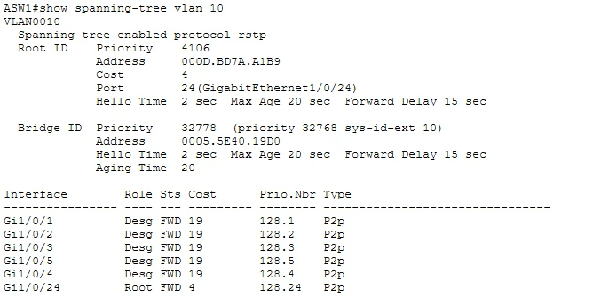

**Read the output:**

- **Root ID priority 4106** is DSW1: 4096 configured + 10, the VLAN number. Rapid PVST+ adds the VLAN ID (the *sys-id-ext*) to the priority, which is why 4096 shows as 4106.
- **Root port 24 (Gi1/0/24)**, cost 4: ASW1 reaches the root over the uplink. That's the topology you want.
- **Bridge ID priority 32778** (32768 + 10) is ASW1 itself, on the default priority.
- Every user port is **Desg FWD**. Remember this picture: Phase 3 defends it.

**Save** with `copy running-config startup-config` on every switch and the router, then save the file (Ctrl+S).

<details><summary>Think about it: why is the rogue DHCP attack so dangerous when it "only" changes a gateway?</summary>

The gateway is where every off-subnet packet goes. Whoever owns it can read, change or drop traffic, and with a fake DNS server can send users to fake sites. The attacker needs no password and no exploit, only a device on a user port that answers DHCP quickly. That's why the fix belongs on the switch port: the switch is the only device that knows which port a DHCP reply came in on.

</details>

---

# Phase 1: DHCP snooping

DHCP snooping makes ASW1 **drop DHCP server messages (OFFER, ACK, NAK) that arrive on untrusted ports**. ROGUE-DHCP sits on an untrusted port, so it goes silent. Snooping also builds the **binding table** (MAC, IP, VLAN, port for every lease it watched), which DAI uses in Phase 2. Deeper theory: [DHCP snooping](/ccnp-security/segmentation-layer-2-hardening#dhcp-snooping) in the notes.

## Configure ASW1

```
configure terminal
ip dhcp snooping
ip dhcp snooping vlan 10
no ip dhcp snooping information option
!
interface GigabitEthernet1/0/24
 ip dhcp snooping trust
!
interface range GigabitEthernet1/0/1 - 5 , GigabitEthernet1/0/10
 ip dhcp snooping limit rate 10
end
```

| Command | Why it's there |
|---|---|
| `ip dhcp snooping` + `ip dhcp snooping vlan 10` | Both are required. The global command alone does nothing until a VLAN is listed |
| `ip dhcp snooping trust` on Gi1/0/24 | Only the uplink toward R1 may send OFFER and ACK. Every port is untrusted by default, and that's the point |
| `ip dhcp snooping limit rate 10` | More than 10 DHCP packets per second err-disables the port. That stops DHCP starvation tools, which request thousands of leases to empty the pool |
| `no ip dhcp snooping information option` | By default the switch inserts option 82 with a relay address (giaddr) of 0.0.0.0. An IOS DHCP server such as R1 drops those requests, so nobody gets a lease. The other fix is `ip dhcp relay information trust-all` on R1 |

**Common mistake:** trusting a user port "to make DHCP work". If a PC can't get a lease, the uplink isn't trusted or option 82 is in the way. A host port is never the fix.

## Prove it: the configuration

```
show ip dhcp snooping
```

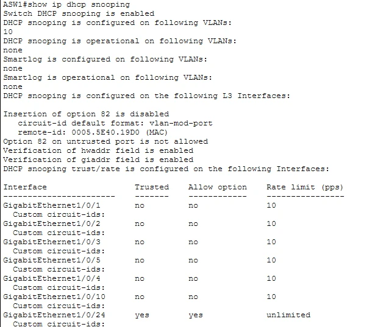

**Read the output:**

- **Switch DHCP snooping is enabled**, configured on VLAN **10**.
- **Insertion of option 82 is disabled**: the `no ip dhcp snooping information option` line took effect.
- **Gi1/0/24: Trusted yes, unlimited.** Every host port: **Trusted no, rate limit 10**.
- **"Operational on following VLANs: none"** is a Packet Tracer display quirk. The leases below prove snooping is running.

## Prove it: the attack fails

On PC1 and PC2, `ipconfig /release` then `ipconfig /renew`, several times each.

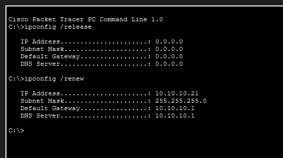

Every lease comes from R1's pool (10.10.10.21 here, the first address after the excluded range) with gateway **10.10.10.1**. However many times you renew, ROGUE-DHCP never wins.

**Watch the drop happen in Simulation mode.** Switch to **Simulation** (bottom right, or Shift+S). Under Event List Filters, click **Edit Filters**, clear everything and tick **DHCP** only. On PC2 run `ipconfig /renew`, then press **Play** and watch the envelopes.

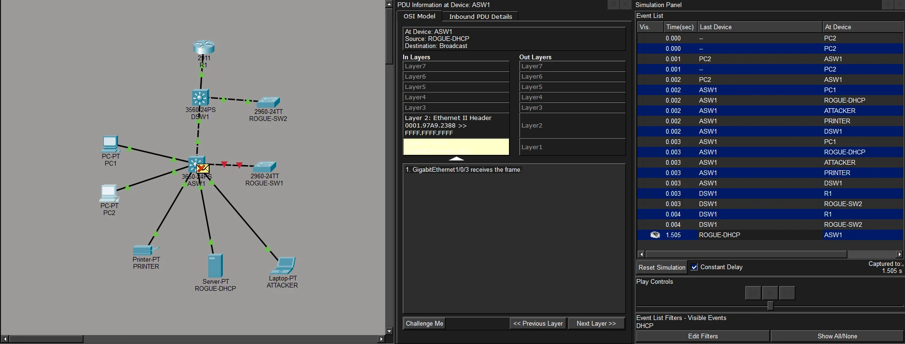

**Read the output:** the event list shows PC2's DISCOVER flooding out to every port, including ROGUE-DHCP. ROGUE-DHCP replies (last event, from ROGUE-DHCP at ASW1), and the envelope at ASW1 gets a **red X**. Click it: *GigabitEthernet1/0/3 receives the frame* and goes no further. The legitimate OFFER from R1 arrives on the trusted uplink and is forwarded.

**The strongest proof: repeat the baseline attack.** On R1, `no service dhcp`, then renew PC1. With snooping on, PC1 now gets **no lease at all** ("DHCP request failed" or a 169.254.x.x address). The only DHCP server left is the rogue, and its OFFER dies at Gi1/0/3. Failing safe is the correct result: no address beats an address with a malicious gateway. Then run `service dhcp` on R1 and renew PC1 again.

> **Exam points:** trust every uplink on the path to the legitimate server, never a host port. Snooping only works on the VLANs you list. The binding table it builds is the foundation for DAI and IP Source Guard.

<details><summary>Think about it: why does snooping need both trust and a rate limit?</summary>

Trust solves the **rogue server** problem: replies are only believed from the direction of the real server. The rate limit solves **starvation**: an attacker floods DISCOVERs with random MACs until R1's pool is empty, then their own rogue server is the only one with addresses left. One feature, two attacks, two settings.

</details>

---

# Phase 2: Dynamic ARP Inspection

ARP has no authentication: any host can claim to own any IP address. DAI makes the switch check every ARP packet on an untrusted port against the **DHCP snooping binding table**, and drop it if the sender's IP and MAC don't match a binding learned on that port. Phase 1 must be working first. Deeper theory: [DAI and IP Source Guard](/ccnp-security/segmentation-layer-2-hardening#dynamic-arp-inspection-and-ip-source-guard).

> **Packet Tracer result:** the 3650 accepts the DAI commands and shows VLAN 10 as Active, but ATTACKER can still ping and nothing is dropped. Do this phase for the configuration and the show output, and learn the real IOS behavior below for the exam.

## Step A: turn on DAI

**Real IOS:**

```
configure terminal
ip arp inspection vlan 10
ip arp inspection validate src-mac dst-mac ip
!
interface GigabitEthernet1/0/24
 ip arp inspection trust
!
interface range GigabitEthernet1/0/1 - 5 , GigabitEthernet1/0/10
 ip arp inspection limit rate 15
end
```

**Packet Tracer 3650:** the same, without the `limit rate` line (rejected).

| Command | Why it's there |
|---|---|
| `ip arp inspection vlan 10` | Turns DAI on for the VLAN. All ports are untrusted by default |
| `ip arp inspection trust` on Gi1/0/24 | R1 has a static IP, so it has no binding. Left untrusted, its ARP replies would be dropped and the whole VLAN would lose its gateway |
| `validate src-mac dst-mac ip` | Extra checks: the Ethernet source MAC must equal the ARP sender MAC; on replies, the Ethernet destination MAC must equal the ARP target MAC; no 0.0.0.0, broadcast or multicast IPs |
| `limit rate 15` | 15 ARP packets per second is already the default on untrusted ports. Going over err-disables the port. Full syntax: `ip arp inspection limit rate <pps> [burst interval <seconds>]` |

**Clear old ARP caches before testing**, or cached entries hide the result: `arp -d` on each PC and on ATTACKER, `clear arp-cache` on R1.

| Test | Real IOS | Packet Tracer |
|---|---|---|
| PC1 → `ping 10.10.10.1` | Succeeds: PC1 has a binding | Succeeds |
| ATTACKER → `ping 10.10.10.1` | **Fails**. ASW1 logs a DAI deny for 10.10.10.50 on Gi1/0/4 | Still succeeds |
| PC1 → `ping 10.10.10.15` | **Fails**. PRINTER is static, has no binding, so its ARP reply is dropped | Still succeeds |

That last row is the real-world side effect of DAI: **every static host breaks** unless you plan for it. Step B fixes it.

## Step B: let the legitimate static host through

**Real IOS:** permit the printer with an ARP ACL. Get its MAC from PRINTER → Config → FastEthernet0, or from `show mac address-table interface gi1/0/5`, and use it in place of `AAAA.BBBB.CCCC`:

```
arp access-list STATIC-HOSTS
 permit ip host 10.10.10.15 mac host AAAA.BBBB.CCCC
!
ip arp inspection filter STATIC-HOSTS vlan 10
```

The switch checks the ARP ACL first, then the binding table. Adding the `static` keyword to the filter command makes the ACL the only check, with an implicit deny at the end. Leave it off here.

**Packet Tracer 3650:** none of the ways to add a static exception exist. `arp access-list`, `ip source binding` and the EXEC command `ip dhcp snooping binding` are all rejected. Instead, move the printer to DHCP so snooping creates its binding:

1. PRINTER → Config → FastEthernet0 → **DHCP**.
2. Wait for it to get an address from R1's pool. Printer-PT has no command prompt, so check its new address on the same FastEthernet0 screen.
3. On ASW1, `show ip dhcp snooping binding`.

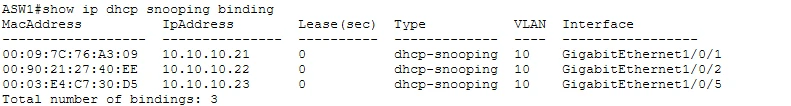

**Read the output:** three bindings, one per DHCP client. PC1 on **Gi1/0/1**, PC2 on **Gi1/0/2**, and now PRINTER (10.10.10.23) on **Gi1/0/5**. ATTACKER (static) and ROGUE-DHCP have no row, so on real IOS DAI would drop their ARP. Lease(sec) shows 0 in Packet Tracer; on real IOS it counts down. From PC1, ping the printer's new address to confirm it's reachable.

## Prove it: the show commands

```
show ip arp inspection vlan 10
show ip arp inspection interfaces
show ip arp inspection statistics vlan 10
```

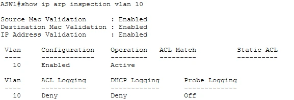

**Read the output:** all three validation checks **Enabled**; VLAN 10 Configuration **Enabled**, Operation **Active**. ACL Match is empty because Packet Tracer has no ARP ACL; on real IOS it would show STATIC-HOSTS. DHCP Logging **Deny** means ARP packets denied by the binding check are logged.

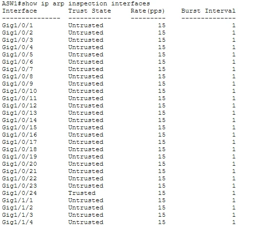

**Read the output:** **Gig1/0/24 Trusted**, every other port **Untrusted, 15 pps, burst interval 1**. The 15 pps is the default, which is why it shows even though Packet Tracer rejected the `limit rate` command.

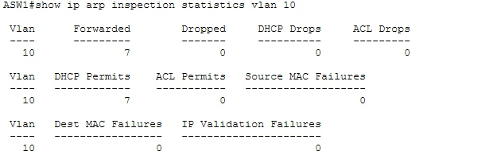

**Read the output:** **Forwarded 7, DHCP Permits 7**: ARP from clients with bindings was checked and allowed. **Dropped 0** even after ATTACKER pinged. On real IOS, Dropped and DHCP Drops climb with every ATTACKER ping. That's the simulator, not your configuration.

To watch DAI actually drop spoofed ARP, rebuild this phase in Cisco Modeling Labs with IOSvL2 switches.

<details><summary>Think about it: why does DAI trust the uplink instead of checking R1 against a binding?</summary>

DAI can only validate what DHCP snooping saw being leased. R1, servers and printers with static addresses never lease anything, so they have no binding. You either trust the port they arrive on (the uplink, where the gateway lives) or describe them in an ARP ACL. Trusting a host port would let anyone on that port spoof any address, so you only trust ports that face infrastructure.

</details>

---

# Phase 3: STP protection

STP believes the best BPDU it hears. An attacker who plugs in a switch can either join the topology from a user port or announce a better priority and become root, pulling traffic through their own switch. Three guards stop this; Packet Tracer supports the first two. Deeper theory: [Spanning tree protection](/ccnp-security/segmentation-layer-2-hardening#spanning-tree-protection).

| Feature | Where | Trigger | Result | Recovery |
|---|---|---|---|---|
| PortFast + BPDU Guard | ASW1 host ports | Any BPDU received | Port **err-disabled** | Manual: `shutdown` then `no shutdown` |
| Root Guard | DSW1 downlinks | A superior BPDU (better priority) received | Port **root-inconsistent** (blocking) | Automatic once superior BPDUs stop |
| Loop Guard | ASW1 uplink (root port) | BPDUs stop arriving | Port **loop-inconsistent** (blocking) | Automatic once BPDUs return |

## ASW1: PortFast and BPDU Guard on the user ports

```
configure terminal
interface range GigabitEthernet1/0/1 - 5 , GigabitEthernet1/0/10
 spanning-tree portfast
 spanning-tree bpduguard enable
end
```

- **PortFast** lets a host port forward straight away instead of waiting through STP states. It's only safe where a host, never a switch, is connected.
- **BPDU Guard** enforces that promise: the moment a BPDU arrives, the port is err-disabled.
- If the switch prompts for `spanning-tree portfast edge` (newer IOS XE syntax), use that form. The global alternative is `spanning-tree portfast default` plus `spanning-tree portfast bpduguard default`, which applies BPDU Guard to every PortFast port.

**Real IOS only, Loop Guard on the uplink:**

```
interface GigabitEthernet1/0/24
 spanning-tree guard loop
```

In Packet Tracer, `spanning-tree guard ?` under Gi1/0/24 offers only `root`. Skip Loop Guard here, but know it for the exam: if the uplink stops receiving BPDUs (a one-way fiber, for example), Loop Guard blocks it instead of letting it move to forwarding and create a loop.

## DSW1: Root Guard on the downlinks

```
configure terminal
interface GigabitEthernet0/1
 spanning-tree guard root
!
interface FastEthernet0/10
 description ROGUE-SW2-TEST-DOWNLINK
 switchport trunk encapsulation dot1q
 switchport mode trunk
 switchport trunk native vlan 99
 switchport trunk allowed vlan 10,99
 spanning-tree guard root
 no shutdown
end
```

**Where Root Guard goes:** on the root's ports that face *away* from the root, where a better BPDU should never appear. **Never on ASW1 Gi1/0/24**: that port faces the root, so it receives the root's superior BPDUs all the time, and Root Guard would block your own uplink. Root Guard and Loop Guard can't run on the same port, which is why Root Guard sits on DSW1's side of the trunk and Loop Guard on ASW1's side.

## Attack 1: a rogue switch on a user port (BPDU Guard)

1. Add or reuse **ROGUE-SW1** (2960-24TT), with no configuration.
2. Cable its **Fa0/1** to **ASW1 Gi1/0/10** with a cross-over cable.
3. Watch ASW1's console. On real IOS you'll see `%SPANTREE-2-BLOCK_BPDUGUARD` followed by `%PM-4-ERR_DISABLE: bpduguard error detected on Gi1/0/10`. The link lights turn red.
4. Check the port:

```
show interfaces gigabitEthernet1/0/10 status
```

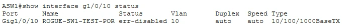

**Read the output:** Gi1/0/10 is **err-disabled**. A default switch sent a BPDU, and BPDU Guard shut the port before the rogue switch could join the topology. On real IOS, `show interfaces status err-disabled` lists every err-disabled port with the reason, here **bpduguard**.

**Recover the port manually.** Delete the cable to ROGUE-SW1 first: if you bring the port up with the rogue switch still attached, it err-disables again straight away. Then, on ASW1:

```
configure terminal
interface GigabitEthernet1/0/10
 shutdown
 no shutdown
end
```

- `show interfaces gigabitEthernet1/0/10 status` now shows **notconnect**: the port is healthy and waiting.
- Nothing legitimate lives on Gi1/0/10, so **shut it again**. A port with nothing to serve stays off. That's why Gi1/0/10 shows **disabled** in Phase 5.

> **Exam note:** real IOS can recover err-disabled ports on a timer (`errdisable recovery cause bpduguard` with `errdisable recovery interval`). Manual recovery is the safer habit for BPDU Guard: someone should find out why a switch appeared on a user port before the port comes back.

## Attack 2: a rogue switch claims root (Root Guard)

First, configure the attack on **ROGUE-SW2** (2960-24TT):

```
enable
configure terminal
hostname ROGUE-SW2
vlan 10
vlan 99
exit
spanning-tree mode rapid-pvst
spanning-tree vlan 10 priority 0
interface FastEthernet0/1
 switchport mode trunk
 switchport trunk native vlan 99
end
```

Then launch it:

1. Cable ROGUE-SW2 **Fa0/1** to **DSW1 Fa0/10** with a cross-over cable.
2. ROGUE-SW2 now sends BPDUs with priority 0 + 10 = **10**, better than DSW1's 4106. Without Root Guard, it would become root and every switch would recalculate toward it.
3. On DSW1, watch the console, then run `show spanning-tree vlan 10`.

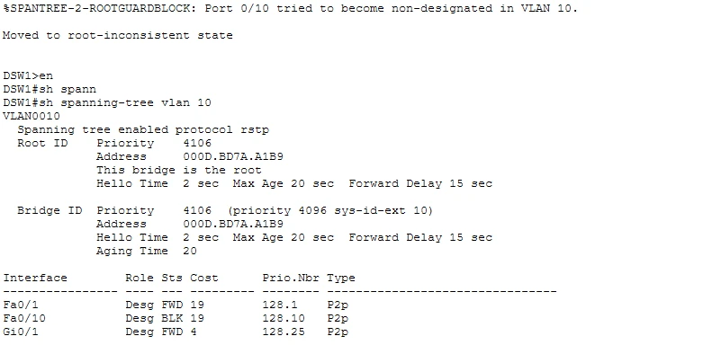

**Read the output:**

- `%SPANTREE-2-ROOTGUARDBLOCK ... Moved to root-inconsistent state`: Root Guard saw the superior BPDU on Fa0/10 and refused it.
- **This bridge is the root**, priority **4106**: DSW1 kept the role. The attack failed.
- **Fa0/10: Desg BLK**. The port is blocking, so no traffic passes to or from ROGUE-SW2. On real IOS this shows as `BKN*` with `ROOT_Inc`, and `show spanning-tree inconsistentports` lists it.
- Gi0/1 (to ASW1) and Fa0/1 (to R1) stay **FWD**: the rest of the network never noticed.

**Remove the attack.** On ROGUE-SW2: `configure terminal`, `spanning-tree vlan 10 priority 32768`, `end`. Wait a few seconds, then `show spanning-tree vlan 10` on DSW1 again.

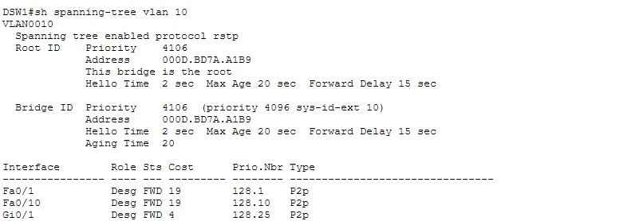

**Read the output:** Fa0/10 is back to **Desg FWD** on its own. No `shutdown` / `no shutdown` was needed. That's the key difference from BPDU Guard: Root Guard blocks only while superior BPDUs keep arriving, because the neighbor might be a legitimate switch that was simply misconfigured.

> **Exam note on BPDU Filter:** `spanning-tree bpdufilter enable` on an interface stops it sending and receiving BPDUs, which disables STP there and can cause loops. The global `spanning-tree portfast bpdufilter default` is safer: a PortFast port that receives a BPDU loses PortFast and runs normal STP. Never combine BPDU Filter with BPDU Guard on a port: the filter wins and the guard never fires.

<details><summary>Think about it: BPDU Guard and Root Guard both react to BPDUs. Why do they behave so differently?</summary>

They answer different questions. **BPDU Guard** asks "should *any* switch be here?" On a user port the answer is no, so any BPDU is proof of a policy violation and the port is shut until a human looks. **Root Guard** asks "should a *better root* appear here?" A downstream switch on that port is fine; only a superior BPDU is wrong, so it blocks while the problem exists and recovers by itself. Pick the guard by asking what's legitimately allowed on the port.

</details>

---

# Phase 4: storm control

A broadcast storm, from a loop or a flood tool, makes every switch forward the same frames to every port until links and CPUs saturate. Storm control measures broadcast, multicast or unicast traffic on a port over 1-second intervals and acts once it passes a **rising** threshold (percent of link bandwidth). Forwarding of that traffic type resumes when it drops below the **falling** threshold. Deeper theory: [Storm control](/ccnp-security/segmentation-layer-2-hardening#storm-control).

**Real IOS:**

```
interface range GigabitEthernet1/0/1 - 3 , GigabitEthernet1/0/5
 storm-control broadcast level 20.00 10.00
 storm-control multicast level 30.00 20.00
 storm-control action trap
!
interface GigabitEthernet1/0/4
 description ATTACKER - strict policy
 storm-control broadcast level 1.00 0.50
 storm-control action shutdown
```

**Packet Tracer 3650:** only the broadcast level exists, without a falling level or an action. Run `storm-control ?` under an interface to see this for yourself, then configure:

```
configure terminal
interface range GigabitEthernet1/0/1 - 3 , GigabitEthernet1/0/5
 storm-control broadcast level 20.0
!
interface GigabitEthernet1/0/4
 description ATTACKER - strict policy
 storm-control broadcast level 1.0
end
```

| Action | Over the threshold |
|---|---|
| none (default) | Excess traffic of that type is dropped; the port stays up |
| `trap` | Excess is dropped, plus a log message and an SNMP trap |
| `shutdown` | The port goes err-disabled until recovered with `shutdown` / `no shutdown` |

Full syntax: `storm-control {broadcast | multicast | unicast} level {rising [falling] | bps ... | pps ...}`. With no falling level, the falling level equals the rising level.

## Prove it

```
show storm-control broadcast
```

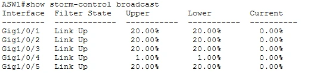

**Read the output:**

- User ports: **Upper 20.00%**. Lower is also 20.00% because Packet Tracer has no falling level. On real IOS it would show 10.00%.
- **Gi1/0/4 (ATTACKER): 1.00%**, the strict policy for the port you trust least.
- **Filter State Link Up**: no port is over its threshold. When broadcast exceeds the upper level, the state changes to Blocking (or the port err-disables with `action shutdown`).
- **Current 0.00%**: the measured broadcast load right now.

**Why a flood test won't trip it:** from ATTACKER, `ping -t 10.10.10.255` sends one broadcast per second, roughly 600 bps. 1% of a 100 Mbps link is 1 Mbps, well over a thousand minimum-size frames per second. Even on real IOS a ping won't cross that. The configuration and show output are what the exam tests.

<details><summary>Think about it: why give the attacker's port 1% when user ports get 20%?</summary>

Thresholds are a policy statement about each port. A normal PC sends a few broadcasts per second (ARP, DHCP), nowhere near 1% of a gigabit port, so a tight limit costs nothing and catches a flood early. User ports get headroom so a busy workstation or an imaging job isn't cut off by mistake. In production you'd baseline real traffic first and set thresholds just above normal.

</details>

---

# Phase 5: validation

The lab passes when every attack from Phase 0 fails and every legitimate host still works. On real IOS that's every row below. In Packet Tracer, judge each row by its Packet Tracer column. Run through it end to end after reopening your saved file.

## Attack results

| Attack | Protection | Real IOS | Packet Tracer |
|---|---|---|---|
| Rogue DHCP server | DHCP snooping | Every PC gets gateway .1 | **Works**: gateway .1; with R1's DHCP off, no lease at all |
| DHCP starvation | Snooping rate limit | Port err-disables over 10 pps | Not testable: no starvation tool |
| ARP from a static attacker | DAI | Pings fail, drops logged | Config only: pings succeed, Dropped stays 0 |
| Legitimate static printer | DAI + ARP ACL | Allowed by the ACL | ACL not supported; PRINTER on DHCP, PC1 can ping it |
| Rogue switch on a user port | BPDU Guard | Gi1/0/10 err-disabled | **Works** |
| Rogue switch claims root | Root Guard | Fa0/10 root-inconsistent, DSW1 stays root | **Works** |
| Unidirectional uplink | Loop Guard | Port loop-inconsistent | Not supported |
| Broadcast flood | Storm control | Excess dropped or port shut | Config only |
| VLAN hopping, walk-up access | Trunk and unused-port hardening | No DTP, native 99 unused, unused ports shut | **Works** |

## Show-command checklist

| Device | Command | Pass looks like |
|---|---|---|
| ASW1 | `show ip dhcp snooping` | VLAN 10 configured; Gi1/0/24 trusted; host ports rate 10 |
| ASW1 | `show ip dhcp snooping binding` | One row per DHCP client, on the right port, including PRINTER on Gi1/0/5 |
| ASW1 | `show ip arp inspection vlan 10` | Enabled, Active, three validation checks enabled |
| ASW1 | `show ip arp inspection interfaces` | Gi1/0/24 trusted; host ports untrusted at 15 pps |
| ASW1 | `show interfaces gi1/0/10 status` | err-disabled during Attack 1; disabled (shut) afterwards |
| ASW1 | `show storm-control broadcast` | 20% on user ports, 1% on Gi1/0/4 |
| ASW1 | `show interfaces trunk` | Gi1/0/24 trunking, native 99, allowed 10,99 |
| ASW1 | `show interfaces status` | User ports connected in VLAN 10, unused ports disabled in 999 |
| DSW1 | `show spanning-tree vlan 10` | This bridge is the root; Fa0/10 blocking during Attack 2, forwarding after |
| DSW1 | `show running-config interface gi0/1` | `spanning-tree guard root` |
| Hosts | `ipconfig` on PC1 and PC2 | Gateway 10.10.10.1 |

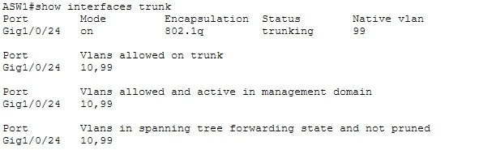

**Read the output:** **Mode on** (hard-coded trunk, no DTP negotiation), **802.1q**, **native VLAN 99**, and only VLANs **10,99** allowed, active and forwarding. An attacker can't negotiate a trunk, can't double-tag into VLAN 10 through the native VLAN, and can't reach any VLAN you didn't list.

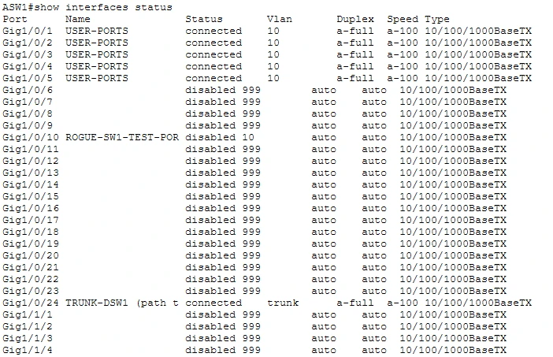

**Read the output:**

- **Gi1/0/1 to 1/0/5 connected, VLAN 10**: the five legitimate access ports.
- **Gi1/0/10 disabled**: shut after the BPDU Guard test because nothing should be connected there.
- **Gi1/0/24 connected, trunk**.
- **Every other port disabled in VLAN 999**: someone who plugs into a spare port gets no link, and even if a port were turned on by mistake, it would land in a VLAN that goes nowhere.

---

# Troubleshooting

| Symptom | Likely cause | Fix |
|---|---|---|
| ASW1 is dark and has no CLI | The 3650 has no power supply | Physical tab: add AC-POWER-SUPPLY |
| PCs get no IP after snooping is on | R1 drops option 82 requests with giaddr 0.0.0.0 | `no ip dhcp snooping information option` on ASW1, or `ip dhcp relay information trust-all` on R1 |
| PCs get no IP, binding table empty | Uplink Gi1/0/24 not trusted | `ip dhcp snooping trust` on Gi1/0/24 |
| PCs get no IP, R1 is fine | `no service dhcp` still set on R1 from an attack step | `service dhcp` on R1, then renew |
| The whole VLAN loses its gateway after DAI | Uplink not DAI-trusted, so R1's ARP is dropped | `ip arp inspection trust` on Gi1/0/24 |
| ATTACKER can still ping after DAI | The Packet Tracer limitation, or old ARP cache entries | `arp -d` on hosts, `clear arp-cache` on R1, test again. If Dropped stays 0, it's the simulator |
| PRINTER has no binding | Still static, or hasn't renewed | Config → FastEthernet0 → DHCP, then check the binding table |
| A port err-disables again after `no shutdown` | The cause is still connected | Remove the rogue device first, then `shutdown` / `no shutdown` |
| Gi1/0/10 err-disabled before Phase 3 | ROGUE-SW1 was cabled early | Delete the cable, recover the port, reconnect in Phase 3 |
| Fa0/10 never blocks on DSW1 | ROGUE-SW2 priority not lower than 4096, Root Guard missing, or the trunk isn't up | Check `show spanning-tree vlan 10` on ROGUE-SW2 and `show run int fa0/10` on DSW1 |
| Trunk won't form | `nonegotiate` on one side only, or native VLAN mismatch | Configure both ends identically |
| A command is rejected | Feature missing in this Packet Tracer version or model | Check with `?`, note it, carry on |
| Storm control never drops anything | Test traffic is far below the threshold | Expected. Verify the config and show output instead |

---

# Answer configs

Try every phase before opening these. The Packet Tracer versions are what the activity file accepts; the real IOS version is what the exam expects.

<details><summary>Show the final ASW1 config (Packet Tracer 3650)</summary>

```
hostname ASW1
no ip domain-lookup
!
vlan 10
 name USERS
vlan 99
 name NATIVE
vlan 999
 name BLACKHOLE
!
spanning-tree mode rapid-pvst
!
ip dhcp snooping
ip dhcp snooping vlan 10
no ip dhcp snooping information option
!
ip arp inspection vlan 10
ip arp inspection validate src-mac dst-mac ip
!
interface GigabitEthernet1/0/24
 description TRUNK-DSW1 (path to the real DHCP server)
 switchport mode trunk
 switchport trunk native vlan 99
 switchport trunk allowed vlan 10,99
 switchport nonegotiate
 ip dhcp snooping trust
 ip arp inspection trust
!
interface range GigabitEthernet1/0/1 - 3 , GigabitEthernet1/0/5
 description USER-PORTS
 switchport mode access
 switchport access vlan 10
 switchport nonegotiate
 spanning-tree portfast
 spanning-tree bpduguard enable
 ip dhcp snooping limit rate 10
 storm-control broadcast level 20.0
!
interface GigabitEthernet1/0/4
 description ATTACKER - strict policy
 switchport mode access
 switchport access vlan 10
 switchport nonegotiate
 spanning-tree portfast
 spanning-tree bpduguard enable
 ip dhcp snooping limit rate 10
 storm-control broadcast level 1.0
!
interface GigabitEthernet1/0/10
 description ROGUE-SW1-TEST-PORT
 switchport mode access
 switchport access vlan 10
 switchport nonegotiate
 spanning-tree portfast
 spanning-tree bpduguard enable
 ip dhcp snooping limit rate 10
 shutdown
!
interface range GigabitEthernet1/0/6 - 9 , GigabitEthernet1/0/11 - 23 , GigabitEthernet1/1/1 - 4
 switchport mode access
 switchport access vlan 999
 shutdown
!
interface Vlan10
 ip address 10.10.10.2 255.255.255.0
 no shutdown
ip default-gateway 10.10.10.1
```

</details>

<details><summary>Show the final ASW1 config (real IOS)</summary>

```
hostname ASW1
no ip domain-lookup
!
vlan 10
 name USERS
vlan 99
 name NATIVE
vlan 999
 name BLACKHOLE
!
spanning-tree mode rapid-pvst
!
ip dhcp snooping
ip dhcp snooping vlan 10
no ip dhcp snooping information option
!
ip arp inspection vlan 10
ip arp inspection validate src-mac dst-mac ip
arp access-list STATIC-HOSTS
 permit ip host 10.10.10.15 mac host AAAA.BBBB.CCCC
ip arp inspection filter STATIC-HOSTS vlan 10
!
interface GigabitEthernet1/0/24
 description TRUNK-DSW1
 switchport mode trunk
 switchport trunk native vlan 99
 switchport trunk allowed vlan 10,99
 switchport nonegotiate
 ip dhcp snooping trust
 ip arp inspection trust
 spanning-tree guard loop
!
interface range GigabitEthernet1/0/1 - 3 , GigabitEthernet1/0/5
 description USER-PORTS
 switchport mode access
 switchport access vlan 10
 switchport nonegotiate
 spanning-tree portfast
 spanning-tree bpduguard enable
 ip dhcp snooping limit rate 10
 ip arp inspection limit rate 15
 storm-control broadcast level 20.00 10.00
 storm-control multicast level 30.00 20.00
 storm-control action trap
!
interface GigabitEthernet1/0/4
 description ATTACKER - strict policy
 switchport mode access
 switchport access vlan 10
 switchport nonegotiate
 spanning-tree portfast
 spanning-tree bpduguard enable
 ip dhcp snooping limit rate 10
 ip arp inspection limit rate 15
 storm-control broadcast level 1.00 0.50
 storm-control action shutdown
!
interface GigabitEthernet1/0/10
 description ROGUE-SW1-TEST-PORT
 switchport mode access
 switchport access vlan 10
 switchport nonegotiate
 spanning-tree portfast
 spanning-tree bpduguard enable
 ip dhcp snooping limit rate 10
 ip arp inspection limit rate 15
 shutdown
!
interface range GigabitEthernet1/0/6 - 9 , GigabitEthernet1/0/11 - 23 , GigabitEthernet1/1/1 - 4
 switchport mode access
 switchport access vlan 999
 shutdown
!
interface Vlan10
 ip address 10.10.10.2 255.255.255.0
 no shutdown
ip default-gateway 10.10.10.1
```

On real IOS the printer could stay static (10.10.10.15) because the ARP ACL permits it. Any port err-disabled by BPDU Guard, the DHCP or ARP rate limit, or `storm-control action shutdown` is recovered with `shutdown` / `no shutdown` after the cause is removed.

</details>

<details><summary>Show the final DSW1 config</summary>

```
hostname DSW1
no ip domain-lookup
!
vlan 10
 name USERS
vlan 99
 name NATIVE
vlan 999
 name BLACKHOLE
!
spanning-tree mode rapid-pvst
spanning-tree vlan 10,99 priority 4096
!
interface FastEthernet0/1
 description R1
 switchport mode access
 switchport access vlan 10
 spanning-tree portfast
!
interface GigabitEthernet0/1
 description TRUNK-ASW1
 switchport trunk encapsulation dot1q
 switchport mode trunk
 switchport trunk native vlan 99
 switchport trunk allowed vlan 10,99
 switchport nonegotiate
 spanning-tree guard root
!
interface FastEthernet0/10
 description ROGUE-SW2-TEST-DOWNLINK
 switchport trunk encapsulation dot1q
 switchport mode trunk
 switchport trunk native vlan 99
 switchport trunk allowed vlan 10,99
 spanning-tree guard root
 no shutdown
!
interface range FastEthernet0/2 - 9 , FastEthernet0/11 - 24 , GigabitEthernet0/2
 switchport mode access
 switchport access vlan 999
 shutdown
!
interface Vlan10
 ip address 10.10.10.3 255.255.255.0
 no shutdown
ip default-gateway 10.10.10.1
```

</details>

---

# Go further in Cisco Modeling Labs

To see the attacks against real IOS, rebuild the same topology in Cisco Modeling Labs with IOSvL2 switches and a Kali Linux node. Tools such as Yersinia and ettercap generate genuine DHCP starvation and ARP poisoning traffic, so you can watch the snooping rate limit err-disable a port and DAI drop and log spoofed ARP. Check storm control there with `?` and the show commands too, since a virtual switch may accept it without enforcing it. Only run attack tools inside your own lab.

---

# Exam mapping

| You configured | Attack it stops | SCOR v2.0 |
|---|---|---|
| DHCP snooping, trust, rate limit | Rogue DHCP server, DHCP starvation | 2.3 |
| DAI, validation checks, ARP ACL | ARP spoofing and poisoning | 2.3 |
| PortFast + BPDU Guard | Rogue switch on a user port | 2.3 |
| Root Guard | Rogue root bridge | 2.3 |
| Loop Guard | Loops from unidirectional links | 2.3 |
| Storm control | Broadcast and multicast storms | 2.3 |
| Trunk hardening, unused ports in VLAN 999 | VLAN hopping, walk-up access | 2.3 |

Drill it with the [flashcards](/ccnp-security/flashcards#d2) and the [mock exam](/ccnp-security/mock-exam#d2).
