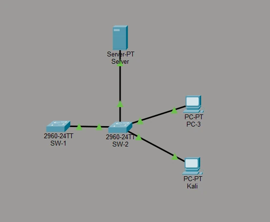
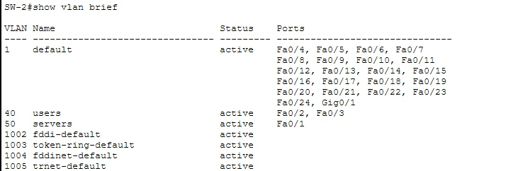
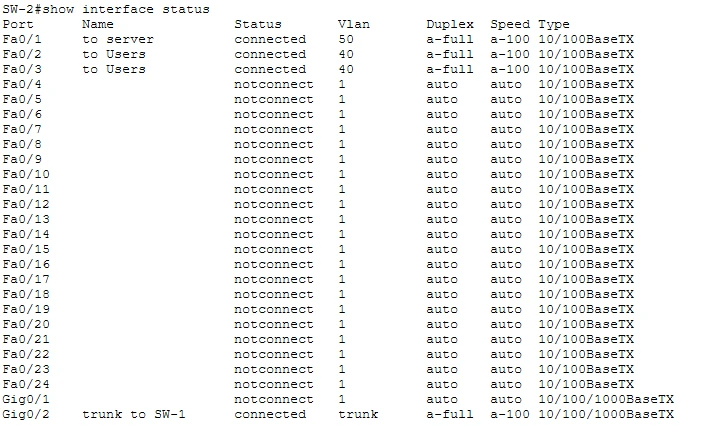
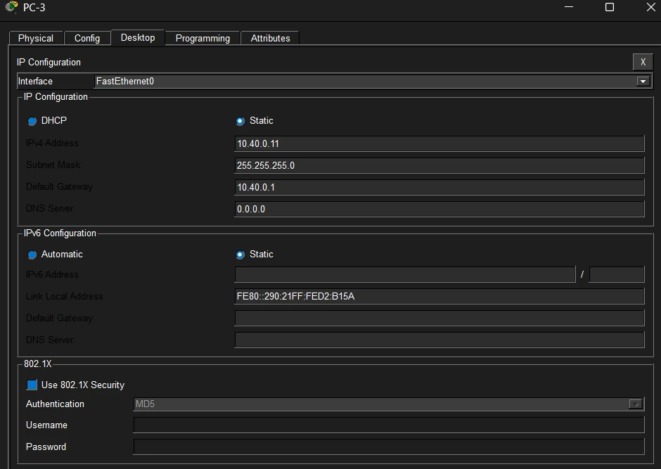
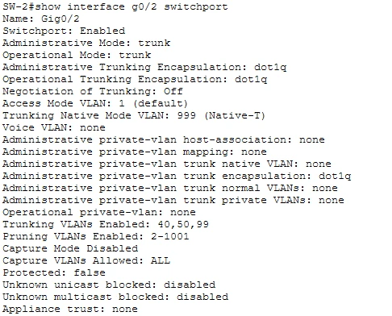
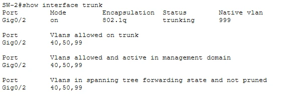
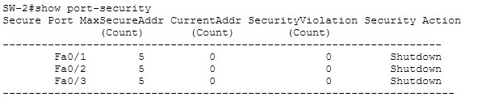

# Lab: Segmentation & Layer 2 Hardening (Packet Tracer)

> Companion lab for the Segmentation & Layer 2 Hardening notes. SCOR 350-701 v2.0 topic 2.3.

---

# What you'll build

You get a small switched network that *works* but was configured the lazy way: DTP on, native VLAN 1, every unused port live in VLAN 1, no port security, an open management plane. Your job is to harden switch **SW-2** (and the trunk end on **SW-1**) until every Layer 2 weakness from the notes is closed, and to prove it with `show` commands and ping tests.

| Item | Detail |
|---|---|
| **Tool** | Cisco Packet Tracer 9.0 or later, two Catalyst 2960 switches |
| **Time** | 60 to 90 minutes |
| **You'll practice** | Management-plane baseline, VLANs and dead VLANs, access and trunk hardening, native VLAN, port security, PortFast and BPDU Guard, protected ports, unused-port lockdown |
| **Exam topics** | 2.3 (core), 2.5 CIS-style baseline, 2.7 secure management |
| **Read first** | [Segmentation & Layer 2 Hardening notes](/ccnp-security/segmentation-layer-2-hardening) |

## How to approach it like a security engineer

Don't type the commands as a checklist. For every port, ask the three questions from the notes: **who should be on the other end, what is it allowed to say, and if it lies, how far can the lie travel?** Write your answer next to each port in the port table below *before* you configure anything. Then the configuration is just your answers translated into IOS.

Each exercise follows the same rhythm:

- **Do**: the commands to type.
- **See**: the output you should get.
- **Why**: the attack this closes, and why it matters on the exam.
- **Checkpoint**: prove it worked before moving on.

---

# Topology and addressing



**SW-2 is the switch under test.** SW-1 only needs the management baseline and its end of the trunk. The inter-switch trunk uses the Gigabit uplinks (**SW-2 Gi0/2 ↔ SW-1 Gi0/1**); end devices use FastEthernet ports on SW-2.

## VLAN plan

| VLAN | Name | Subnet | Purpose |
|---|---|---|---|
| 40 | users | 10.40.0.0/24 | User hosts (PC-3, Kali) |
| 50 | servers | 10.50.0.0/24 | Protected server |
| 99 | mgmt | 10.99.0.0/24 | Switch management (SVIs) |
| 777 | Nowhere | none | **Dead VLAN** for unused, shut ports |
| 999 | Native-T | none | **Dead VLAN** used only as the trunk's native VLAN |

## Addressing

| Device | Interface | VLAN | IP address | Gateway |
|---|---|---|---|---|
| Server | Fa0 | 50 | 10.50.0.10/24 | 10.50.0.1 |
| PC-3 | Fa0 | 40 | 10.40.0.11/24 | 10.40.0.1 |
| Kali | Fa0 | 40 | 10.40.0.12/24 | 10.40.0.1 |
| SW-1 | VLAN 99 SVI | 99 | 10.99.0.1/24 | none |
| SW-2 | VLAN 99 SVI | 99 | 10.99.0.2/24 | none |

There is **no router** on purpose. This is a pure Layer 2 lab, so traffic from VLAN 40 to VLAN 50 must **fail**: that failure is the segmentation working. The gateways are configured on the hosts but nothing answers on them yet.

## SW-2 ports: target state

| Port | Connects to | Mode | VLAN | Hardening |
|---|---|---|---|---|
| Gi0/2 | SW-1 (trunk) | trunk | native 999, allow 40,50,99 | nonegotiate, native = dead VLAN, pruned |
| Fa0/1 | Server | access | 50 | nonegotiate, port security, PortFast, BPDU Guard |
| Fa0/2 | PC-3 | access | 40 | nonegotiate, port security, PortFast, BPDU Guard, protected |
| Fa0/3 | Kali | access | 40 | nonegotiate, port security, PortFast, BPDU Guard, protected |
| Fa0/4-24, Gi0/1 | unused | access, shut | 777 | `shutdown` + dead VLAN |

## Required exact values

Use these exactly; the graded activity and the answer configs expect them.

| Setting | Value |
|---|---|
| Hostnames | `SW-1`, `SW-2` |
| Domain name | `lab.breakfixlearn.com` |
| Enable secret | `Lab!Enable2026` |
| Admin user / password | `admin` / `Lab!Admin2026` (privilege 15) |
| SSH | version 2, RSA modulus 2048 |
| Banner (motd) | `Authorized access only. All activity is logged.` |
| exec-timeout | `5 0` |
| Management IP SW-1 / SW-2 (VLAN 99) | `10.99.0.1` / `10.99.0.2` (/24) |
| VLANs | `40 users`, `50 servers`, `99 mgmt`, `777 Nowhere`, `999 Native-T` |
| Port security | `maximum 5`, `violation shutdown` |
| Trunk | native `999`, allowed `40,50,99` |

These are lab passwords. Never reuse lab credentials on real equipment.

---

# Part A: management-plane baseline (both switches)

Before any Layer 2 work, lock the front door. A switch whose management plane is open doesn't need to be VLAN-hopped: the attacker just logs in. This baseline mirrors what the CIS benchmark for Cisco IOS checks (SCOR 2.5) and the secure management in SCOR 2.7.

**Do** (SW-2 shown; repeat on SW-1 with its own hostname and `10.99.0.1`):

```
enable
configure terminal
 hostname SW-2
 enable secret Lab!Enable2026
 service password-encryption
 username admin privilege 15 secret Lab!Admin2026
 ip domain-name lab.breakfixlearn.com
 crypto key generate rsa
  2048
 ip ssh version 2
 banner motd #Authorized access only. All activity is logged.#
 line console 0
  login local
  exec-timeout 5 0
  logging synchronous
 line vty 0 15
  login local
  transport input ssh
  exec-timeout 5 0
 exit
 vlan 99
  name mgmt
 interface vlan 99
  ip address 10.99.0.2 255.255.255.0
  no shutdown
 interface vlan 1
  shutdown
 end
```

The hostname and domain name must exist **before** `crypto key generate rsa`: the key is named after them. When prompted for the modulus, enter `2048` (SSH v2 needs at least 768; use 2048).

**Why each line matters**

| Line | Closes |
|---|---|
| `enable secret`, `service password-encryption` | Cleartext or weakly hashed passwords in the config |
| `username ... secret` + `login local` | Shared line passwords with no accountability |
| `transport input ssh`, `ip ssh version 2` | Telnet's cleartext sessions |
| `exec-timeout 5 0` | Forgotten open sessions |
| Banner | Legal notice for prosecution and policy |
| Management SVI in VLAN 99, VLAN 1 SVI shut | Management reachable from the default VLAN every unconfigured port sits in |

Also turn off CDP toward hosts (A6). It advertises the switch model, IOS version and native VLAN to anyone listening:

```
configure terminal
 interface range fa0/1 - 3
  no cdp enable
 end
```

**Checkpoint**

```
show ip ssh
show running-config | section line vty
show ip interface brief
```

`SSH Enabled - version 2.0`; VTY lines show `transport input ssh`; `Vlan99` is up/up (once VLAN 99 crosses the trunk in Part B) and `Vlan1` is administratively down.

---

# Exercise 1: see the segmentation you already have

**Do** on SW-2:

```
show vlan brief
show interface status
```

**See**





**Why:** PC-3 and Kali (VLAN 40) and the Server (VLAN 50) are in different broadcast domains. A Layer 2 attack in VLAN 40 (ARP spoofing, a MAC flood, a broadcast storm) cannot reach VLAN 50. That containment exists from VLAN assignment alone. But look at the rest: **22 unused ports live in VLAN 1** and are enabled. Any one of them is a walk-up network connection. Remember that for Exercise 5.

**Checkpoint:** check PC-3's addressing (Desktop → IP Configuration):



From PC-3: ping **Kali** `10.40.0.12` → **succeeds** (same VLAN). Ping the **Server** `10.50.0.10` → **fails** (different VLAN, no router).

---

# Exercise 2: lock down access ports and the trunk

## The weakness

**Do**

```
show interface fa0/3 switchport
```

**See** two danger signs:

```
Administrative Mode: dynamic auto
Negotiation of Trunking: On          <-- DTP is running
Access Mode VLAN: 40 (users)
Trunking Native Mode VLAN: 1 (default)
```

**Why:** "Negotiation of Trunking: On" means the port speaks **DTP** and will become a trunk if a device asks. Kali sits on this port. If Kali sends DTP, it gets a trunk carrying every VLAN and can tag its way into VLAN 50, bypassing every inter-VLAN control. That's **switch-spoofing VLAN hopping**.

## Add the dead VLANs (B1)

**Do**

```
configure terminal
 vlan 777
  name Nowhere
 vlan 999
  name Native-T
 end
show vlan brief
```

VLANs 40 and 50 already exist; just confirm their names are `users` and `servers`.

## Harden the access ports (B2)

**Do**

```
configure terminal
 interface fa0/1
  description to Server
 interface range fa0/2 - 3
  description to Users
 interface range fa0/1 - 3
  switchport mode access
  switchport nonegotiate
 end
show interface fa0/3 switchport
```

**See:** `Administrative Mode: static access` and `Negotiation of Trunking: Off`.

**Why:** a hard-coded access port can't be talked into trunking. Switch spoofing is dead on these ports.

## Harden the trunk and the native VLAN (B5)

**Do** on SW-2:

```
configure terminal
 interface gig0/2
  description trunk to SW-1
  switchport mode trunk
  switchport nonegotiate
  switchport trunk native vlan 999
  switchport trunk allowed vlan 40,50,99
 end
```

**See** a native VLAN mismatch until the other side matches:

```
%CDP-4-NATIVE_VLAN_MISMATCH: Native VLAN mismatch discovered on GigabitEthernet0/2 (999), with SW-1 GigabitEthernet0/1 (1).
```

That's expected. **Do** on SW-1 (create VLANs 40, 50, 99 and 999 there too if they don't exist):

```
configure terminal
 interface gig0/1
  switchport mode trunk
  switchport nonegotiate
  switchport trunk native vlan 999
  switchport trunk allowed vlan 40,50,99
 end
```

**Checkpoint**

```
show interface gig0/2 switchport
show interface trunk
```





**Why:**

- `nonegotiate` on the trunk stops DTP on infrastructure links too; both ends are hard-coded, so nothing needs negotiating.
- The native VLAN is now **999**, a VLAN with no hosts in it. Nobody can stand in the native VLAN, so **double tagging** has nothing to start from.
- The allowed list carries only 40, 50 and 99. VLAN 1 no longer crosses the trunk, and future VLANs won't spread unless you add them.
- With VLAN 99 on the trunk, the management SVIs can now reach each other: from SW-2, `ping 10.99.0.1` should succeed.

> On real Catalyst switches you'd also add `vlan dot1q tag native` so even native-VLAN frames are tagged. Packet Tracer doesn't model it.

---

# Exercise 3: stop a host from flooding the MAC table (B4)

**Why first:** the CAM table is finite. A MAC flood (the notes show `macof` adding 3,300 entries in two seconds) fills it, and the switch floods unknown unicast out every port like a hub, so the attacker can sniff. Port security caps how many MACs each port may use.

**Do**

```
configure terminal
 interface range fa0/1 - 3
  switchport port-security
  switchport port-security maximum 5
  switchport port-security violation shutdown
 end
show port-security
```

**See**



`CurrentAddr` reads 0 until a host sends a frame. Ping from PC-3 and the Server, then run `show port-security` again: each active port learns one address.

**The number one mistake:** typing `maximum` and `violation` but not the bare `switchport port-security`. Without it the feature is off: `show port-security interface fa0/2` says `Port Security : Disabled`.

**Recovering a tripped port.** If a port goes err-disabled (`show interface status` shows `err-disabled`), bounce it:

```
configure terminal
 interface fa0/2
  shutdown
  no shutdown
 end
```

Automatic recovery (`errdisable recovery cause psecure-violation`) is real-IOS only and not modeled in Packet Tracer.

**Checkpoint:** `show port-security interface fa0/3` → `Port Security : Enabled`, `Port Status : Secure-up`, `Maximum MAC Addresses : 5`.

---

# Exercise 4: PortFast, BPDU Guard and host isolation

## PortFast + BPDU Guard (B3)

**Do**

```
configure terminal
 interface range fa0/1 - 3
  spanning-tree portfast
  spanning-tree bpduguard enable
 end
show running-config interface fa0/2
```

**Why:** PortFast lets hosts come up without the 30-second STP delay. **BPDU Guard** err-disables a port the moment it receives a BPDU, so a rogue switch (or an attacker sending superior BPDUs to become root) on a user port is cut off instead of rebuilding your spanning tree around itself.

**Try it:** connect a spare 2960 to one of these ports and watch it go err-disabled (`%SPANTREE-2-BLOCK_BPDUGUARD`). Recover it with `shutdown` / `no shutdown` after you remove the switch.

## Protected ports (C1, stretch)

**Do**

```
configure terminal
 interface range fa0/2 - 3
  switchport protected
 end
```

**Checkpoint (C2):** from PC-3, ping Kali `10.40.0.12` → now **fails**, even though both are in VLAN 40 and the same subnet. PC-3 → Server still fails (different VLAN).

**Why:** protected ports can't forward any traffic to other protected ports on the same switch. It's Packet Tracer's stand-in for **private VLAN isolated ports**: the blast radius of a compromised host shrinks to that host. Kali is now alone on its segment even though it shares the subnet. Protected ports are local to one switch; private VLANs and SGTs scale beyond it (see the notes).

---

# Exercise 5: lock unused ports, then verify everything

## Unused ports to the dead VLAN (B6)

**Do**

```
configure terminal
 interface range fa0/4 - 24 , gig0/1
  switchport mode access
  switchport access vlan 777
  shutdown
 end
show interface status
```

**See:** Fa0/4 to Fa0/24 and Gi0/1 show **disabled** in VLAN **777**.

**Why:** a port at defaults is in VLAN 1 and enabled, so whoever plugs into a lobby jack is on your network. **Both** steps: shut it, and park it in a VLAN that isn't routed or trunked anywhere, so an accidental `no shutdown` still leads nowhere.

## Final verification

| Check | Command or test | Expected |
|---|---|---|
| Access ports can't trunk | `show interface fa0/3 switchport` | `static access`, Negotiation **Off**, VLAN 40 |
| Trunk hardened | `show interface trunk` | native **999**, allowed **40,50,99** |
| Port security on | `show port-security` | Fa0/1-3, max 5, Shutdown |
| Edge protection | `show running-config interface fa0/2` | portfast, bpduguard, protected, no cdp |
| Unused ports | `show interface status` | Fa0/4-24, Gi0/1 **disabled**, VLAN **777** |
| Management | `show ip interface brief` | Vlan99 up/up, Vlan1 administratively down |
| Management path | SW-2: `ping 10.99.0.1` | succeeds |
| SSH only | `show running-config` (line vty section) | `transport input ssh`, `login local` |
| Isolation in VLAN 40 | PC-3 → Kali | fails (protected ports) |
| Segmentation | PC-3 → Server | fails (no routing between VLANs) |

---

# Troubleshooting

| Symptom | Likely cause | Fix |
|---|---|---|
| `% Invalid input` on `switchport trunk encapsulation dot1q` | The 2960 is 802.1Q-only | Skip the command on a 2960 |
| Native VLAN mismatch messages keep appearing | Only one side changed | Set `switchport trunk native vlan 999` on SW-1 Gi0/1 too |
| `ping 10.99.0.1` from SW-2 fails | VLAN 99 missing on one switch, not allowed on the trunk, or the SVI is shut | `show vlan brief`, `show interface trunk`, `show ip interface brief` on both |
| `show port-security` lists nothing | The bare `switchport port-security` is missing | Add it on Fa0/1-3 |
| `Command rejected: ... is a dynamic port` | Port security on a port still in dynamic mode | `switchport mode access` first |
| A port shows `err-disabled` | Port security or BPDU Guard fired | Remove the cause, then `shutdown` / `no shutdown` |
| `crypto key generate rsa` fails | No hostname or domain name yet | Set both, then generate |
| Trunk drops after `nonegotiate` | Far end still dynamic | Hard-code `switchport mode trunk` on both ends |
| PC-3 → Kali still works after C1 | `switchport protected` on only one port | Both ports must be protected |

---

# Answer configs

Try the whole lab before opening these.

<details><summary>Show the full SW-2 answer config</summary>

```
hostname SW-2
enable secret Lab!Enable2026
service password-encryption
username admin privilege 15 secret Lab!Admin2026
ip domain-name lab.breakfixlearn.com
! crypto key generate rsa  (modulus 2048, from exec/config prompt)
ip ssh version 2
banner motd #Authorized access only. All activity is logged.#
line console 0
 login local
 exec-timeout 5 0
 logging synchronous
line vty 0 15
 login local
 transport input ssh
 exec-timeout 5 0
!
vlan 40
 name users
vlan 50
 name servers
vlan 99
 name mgmt
vlan 777
 name Nowhere
vlan 999
 name Native-T
!
interface vlan 99
 ip address 10.99.0.2 255.255.255.0
 no shutdown
interface vlan 1
 shutdown
!
interface fa0/1
 description to Server
 switchport mode access
 switchport access vlan 50
 switchport nonegotiate
 switchport port-security
 switchport port-security maximum 5
 switchport port-security violation shutdown
 no cdp enable
 spanning-tree portfast
 spanning-tree bpduguard enable
!
interface range fa0/2 - 3
 description to Users
 switchport mode access
 switchport access vlan 40
 switchport nonegotiate
 switchport port-security
 switchport port-security maximum 5
 switchport port-security violation shutdown
 switchport protected
 no cdp enable
 spanning-tree portfast
 spanning-tree bpduguard enable
!
interface gig0/2
 description trunk to SW-1
 switchport mode trunk
 switchport nonegotiate
 switchport trunk native vlan 999
 switchport trunk allowed vlan 40,50,99
!
interface range fa0/4 - 24 , gig0/1
 switchport mode access
 switchport access vlan 777
 shutdown
```

</details>

<details><summary>Show the SW-1 answer config</summary>

```
hostname SW-1
enable secret Lab!Enable2026
service password-encryption
username admin privilege 15 secret Lab!Admin2026
ip domain-name lab.breakfixlearn.com
! crypto key generate rsa  (modulus 2048)
ip ssh version 2
banner motd #Authorized access only. All activity is logged.#
line console 0
 login local
 exec-timeout 5 0
 logging synchronous
line vty 0 15
 login local
 transport input ssh
 exec-timeout 5 0
!
vlan 40
 name users
vlan 50
 name servers
vlan 99
 name mgmt
vlan 999
 name Native-T
!
interface vlan 99
 ip address 10.99.0.1 255.255.255.0
 no shutdown
interface vlan 1
 shutdown
!
interface range gig0/1 - 2
 switchport mode trunk
 switchport nonegotiate
 switchport trunk native vlan 999
 switchport trunk allowed vlan 40,50,99
```

</details>

---

# What Packet Tracer can't do, and how to go further

Packet Tracer simulates IOS; it doesn't run it. These are valid on real Cisco IOS but rejected or missing in the Packet Tracer 2960, so the lab leaves them out:

| Real IOS feature | In this lab |
|---|---|
| `errdisable recovery cause psecure-violation` / `interval 60` | Recover manually with `shutdown` / `no shutdown` |
| `login block-for 60 attempts 3 within 30` | Not modeled |
| `no ip http server` / `no ip http secure-server` | No HTTP server in the simulated 2960 |
| `vlan dot1q tag native` | Not modeled; the dead, host-free native VLAN is the defense here |
| Full private VLANs | `switchport protected` stands in |
| Attack tools (Yersinia, macof) | Not possible; the notes show each attack on virtual IOS switches |

To practice the rest of SCOR 2.3, build the same topology in **Cisco Modeling Labs** (IOSvL2) or on real Catalyst switches, add a router for VLAN 40 and a Linux host, and try:

```
! DHCP snooping + DAI (VLAN 40), trusting the uplink
ip dhcp snooping
ip dhcp snooping vlan 40
no ip dhcp snooping information option
ip arp inspection vlan 40
interface gig0/2
 ip dhcp snooping trust
 ip arp inspection trust
interface range gig1/1 - 2
 ip dhcp snooping limit rate 10
 ip verify source
 storm-control broadcast level 20.00 10.00
 storm-control action trap
```

Then attack it: run a rogue DHCP server on the Linux host, try ARP spoofing the gateway, and confirm the switch drops and logs each attempt. The [notes](/ccnp-security/segmentation-layer-2-hardening#validation-re-run-every-attack) list the expected result and the log message for every attack.

---

# Exam mapping

| You configured | Attack it stops | SCOR v2.0 |
|---|---|---|
| `switchport mode access` + `nonegotiate` | VLAN hopping by switch spoofing (DTP) | 2.3 |
| Native VLAN 999, allowed list | VLAN hopping by double tagging; VLAN sprawl | 2.3 |
| Port security max 5, shutdown | MAC flooding / CAM overflow | 2.3 |
| PortFast + BPDU Guard | STP manipulation, rogue switches | 2.3 |
| Protected ports | Lateral movement inside a VLAN | 2.3 (segmentation) |
| Unused ports shut + VLAN 777 | Walk-up access | 2.3 |
| SSH v2, local users, timeouts, banner, mgmt VLAN | Management-plane takeover | 2.5, 2.7, 2.4 |

If you can name the attack, the defense and the command for every row from memory, you have the Layer 2 half of SCOR Domain 2. Test yourself with the [flashcards](/ccnp-security/flashcards#d2) and the [mock exam](/ccnp-security/mock-exam#d2).
