# Lab: NETCONF and RESTCONF on IOS XE

> Companion lab for the Secure Network Management notes. SCOR 350-701 v2.0 topic 2.7: configure NETCONF and RESTCONF.

---

# What you'll build

Two model-driven management interfaces on an IOS XE router: **RESTCONF** over HTTPS and **NETCONF** over SSH. You'll confirm the YANG processes behind them are actually running, then read live data from a Linux host with `curl`, Python `requests` and `ncclient`: the interface list, the OSPF configuration, and the entire running configuration as XML.

| Item | Detail |
|---|---|
| **Platform** | An IOS XE router with SSH working, and a Linux host with Python 3 (see where to run it, below) |
| **Time** | 45 to 60 minutes |
| **Level** | CCNP Security. Basic Python helps but isn't required: every script is shown in full |
| **You'll practice** | `restconf`, `netconf-yang`, `show platform software yang-management process`, `show netconf-yang sessions`, RESTCONF URLs and headers, NETCONF capabilities, certificate errors |
| **Exam topic** | 2.7 (core) |
| **Before this** | [Secure Network Management notes](/ccnp-security/secure-network-management), especially [NETCONF, RESTCONF and YANG](/ccnp-security/secure-network-management#netconf-restconf-and-yang) |

| Part | What you do | What it proves |
|---|---|---|
| 1 Baseline | Check what's already enabled | Know your starting attack surface |
| 2 RESTCONF | Enable it, check the HTTPS server and the YANG processes | It's on **and** ready |
| 3 Read with RESTCONF | Python and curl against two YANG models | Structured data over HTTPS |
| 4 NETCONF | Enable it, open a session, read the whole config | Structured data over SSH 830 |
| 5 Break | Certificate errors, early requests, wrong names | Read each failure correctly |

## The one thing to remember

**NETCONF = SSH / 830 / XML / transactions. RESTCONF = HTTPS / 443 / JSON or XML / HTTP methods.** Both carry the same YANG models, and **NETCONF doesn't need the HTTPS server.**

## Think like the defender first

An API that can read the whole configuration can usually change it too. Before you enable one, decide:

- **Which transport, and is it encrypted?** HTTPS and SSH only. Never the plain HTTP server.
- **Who can reach it?** Automation hosts, not the user network.
- **Which account does it use?** A dedicated one, with authorization and accounting, because a script with privilege 15 is an administrator.

---

# Where to run this lab

| Environment | How to set it up |
|---|---|
| **Cisco Modeling Labs (CML)** | A Catalyst 8000V (or CSR 1000v) router and an Ubuntu node with Python 3, on one subnet. Recommended |
| **Cisco DevNet Sandbox** | The always-on IOS XE sandbox exposes RESTCONF and NETCONF; use your own machine as the client |
| **Your own gear** | Any IOS XE 16.x or 17.x device and a Linux VM |

On the Linux host:

```
python3 -m venv .venv && . .venv/bin/activate
pip install requests ncclient
```

**SSH must already work on the router** (hostname, domain name, RSA key, a local user, `transport input ssh`). RESTCONF needs a **privilege 15** account.

> **Lab values only.** The `john` / `Cisco123` login in the screenshots is a training value. In the scripts below the password is typed at run time, never stored in the file.

# Topology

| Item | Value |
|---|---|
| Router | R1, 10.0.0.1, IOS XE 17.3, OSPF process 1 in area 51 |
| Linux host | 10.0.0.5, Python 3 with `requests` and `ncclient` |
| RESTCONF | HTTPS, TCP 443 |
| NETCONF | SSH subsystem, TCP 830 |

---

# Part 1: baseline

```
show running-config | include ip http|restconf|netconf
```

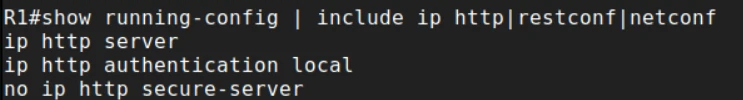

**Read the output, as a defender:**

- **`ip http server`** is **on**: the **plain HTTP** server, port 80, cleartext. Many images ship like this. Anything that logs in over it sends credentials in the clear.
- **`no ip http secure-server`**: HTTPS is off.
- **`ip http authentication local`**: the web server checks the local user database (or AAA). RESTCONF will use this.
- No `restconf` or `netconf-yang` yet.

The finding before you've configured anything: a cleartext management service is already listening. Remember it for the hardening section.

---

# Part 2: enable RESTCONF

```
configure terminal
 ip http secure-server
 restconf
 end
show running-config | include ip http|restconf|netconf
```

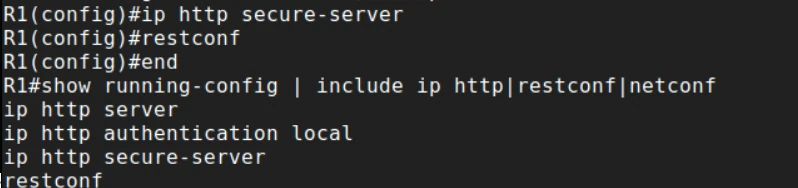

RESTCONF runs on the HTTPS server, so both lines are required.

## Check the HTTPS server

```
show ip http server status | include secure|server|Restconf
```

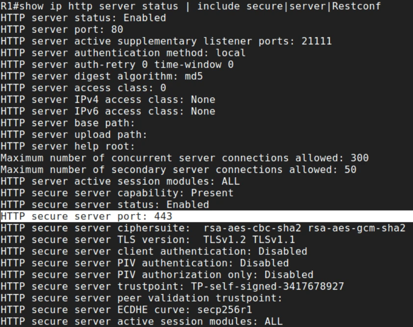

**Read the output:**

- **`HTTP secure server status: Enabled`** on **port 443**: RESTCONF's transport is up.
- **`HTTP server status: Enabled`, port 80**: the cleartext server from the baseline is still running alongside it.
- **`TLS version: TLSv1.2 TLSv1.1`**: TLS 1.1 is deprecated and should be turned off.
- **`trustpoint: TP-self-signed-...`**: the router made its own certificate. Clients can't validate it, which is exactly the curl error in Part 5.
- **`access class: 0`** / **`IPv4 access class: None`**: no ACL; any host that can route to the router can try to log in.

## Check the YANG processes are ready

```
show platform software yang-management process
```

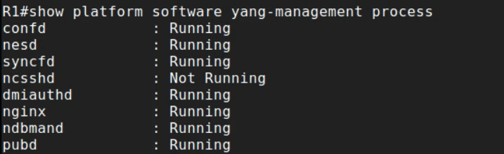

**Read the output:**

- **`nginx` Running**: the web front end that answers RESTCONF requests.
- **`confd` Running**: the configuration database that holds the YANG data.
- **`ncsshd` Not Running**: the NETCONF SSH server. Correct: NETCONF isn't enabled yet.

**This command is the gate.** Right after you enable RESTCONF, these processes take a minute or two to start. Query too early and you get an HTML error page instead of data (Part 5).

---

# Part 3: read data with RESTCONF

## The interface list (standard IETF model, JSON)

Save this as `rest_interfaces.py`:

```
#!/usr/bin/env python3
"""RESTCONF: list interface names using the IETF (vendor-neutral) model."""
from getpass import getpass
import requests
import urllib3

# Lab only: the router uses a self-signed certificate. In production,
# install a CA-signed certificate and pass verify="/path/to/ca.pem".
urllib3.disable_warnings(urllib3.exceptions.InsecureRequestWarning)

HOST = "10.0.0.1"
USER = "john"
url = f"https://{HOST}/restconf/data/ietf-interfaces:interfaces"
headers = {"Accept": "application/yang-data+json"}

resp = requests.get(url, headers=headers, auth=(USER, getpass()), verify=False, timeout=15)
print(resp.status_code)
if resp.status_code != 200 or "json" not in resp.headers.get("Content-Type", ""):
    print("Not JSON yet: is RESTCONF ready? (show platform software yang-management process)")
    print(resp.text[:300])
    raise SystemExit(1)

for interface in resp.json()["ietf-interfaces:interfaces"]["interface"]:
    print(interface["name"])
```

```
python3 rest_interfaces.py
```

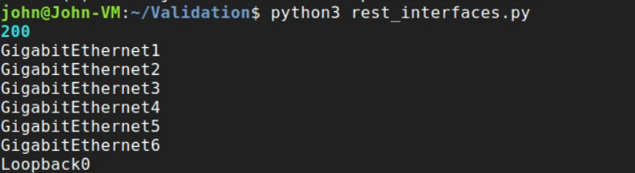

**Read the output:** **`200`** (OK), then one name per interface. The script didn't parse any CLI text: it walked a JSON structure defined by the `ietf-interfaces` YANG model, so the same script works on any vendor that supports that model.

The status-and-content-type check before `resp.json()` is deliberate. Without it, an early request fails with a confusing `JSONDecodeError` instead of telling you RESTCONF isn't ready.

## OSPF (Cisco native model, XML)

Save this as `rest_ospf.py`:

```
#!/usr/bin/env python3
"""RESTCONF: read the routing configuration using the Cisco native model, as XML."""
from getpass import getpass
import requests
import urllib3

urllib3.disable_warnings(urllib3.exceptions.InsecureRequestWarning)  # lab only

HOST = "10.0.0.1"
USER = "john"
url = f"https://{HOST}/restconf/data/Cisco-IOS-XE-native:native/router"
headers = {"Accept": "application/yang-data+xml"}

resp = requests.get(url, headers=headers, auth=(USER, getpass()), verify=False, timeout=15)
print(resp.status_code)
print(resp.text)
```

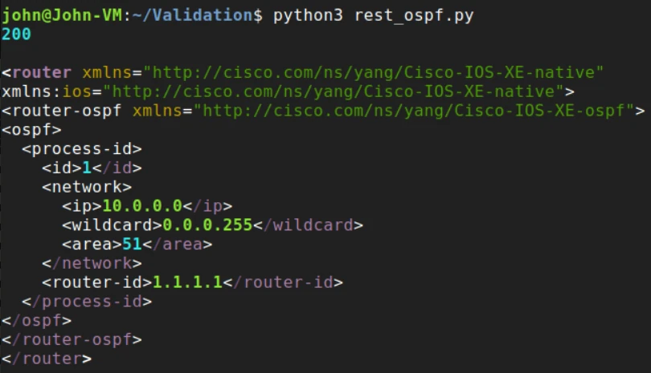

**Read the output:**

- The `Accept` header asked for **XML**, so that's what came back: RESTCONF supports both encodings.
- The namespaces show the model: **`Cisco-IOS-XE-native`** with the **`Cisco-IOS-XE-ospf`** sub-model. OSPF process **1**, network **10.0.0.0 0.0.0.255** in **area 51**, router ID **1.1.1.1**. It's the same information as `show run | section ospf`, but as data a program can trust.
- The **native** model reaches every IOS XE feature; the **IETF** model in the previous script is portable but covers less.

## The same read with curl

curl is the quickest proof that RESTCONF works, no script needed:

```
curl -k -u john -H "Accept: application/yang-data+json" https://10.0.0.1/restconf/data/ietf-interfaces:interfaces
```

`-u john` without a password makes curl prompt for it. `-k` skips certificate validation (lab only; Part 5 shows why it's needed here).

**Optional write (RESTCONF PATCH).** GET is read-only; PATCH merges a change into a resource. This sets the hostname through the native model, and the router answers **204 No Content** on success:

```
curl -k -u john -X PATCH -H "Content-Type: application/yang-data+json" \
  -d '{"Cisco-IOS-XE-native:native": {"hostname": "R1-SET-BY-RESTCONF"}}' \
  https://10.0.0.1/restconf/data/Cisco-IOS-XE-native:native
```

Treat API write access like enable access. Change the hostname back afterwards.

---

# Part 4: enable NETCONF

```
configure terminal
 netconf-yang
 end
```

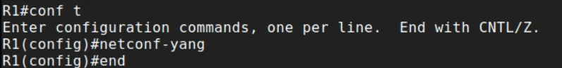

That's the whole configuration. NETCONF rides **SSH on port 830**, so it needs working SSH, **not** the HTTPS server.

## Open a NETCONF session by hand

From the Linux host:

```
ssh john@10.0.0.1 -p 830 -s netconf
```

`-p 830` is the NETCONF port and `-s netconf` asks for the NETCONF **subsystem** instead of a CLI shell.

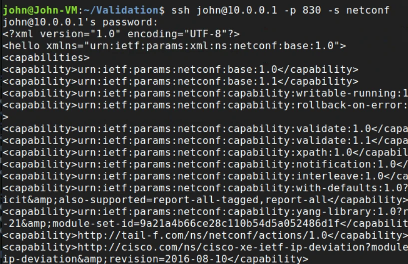

**Read the output:** the router opens with a **`<hello>`** listing its **capabilities**:

- **`base:1.0` and `base:1.1`**: the NETCONF protocol versions it speaks.
- **`writable-running`**: edits can go straight to the running configuration.
- **`rollback-on-error`** and **`validate`**: a failed change can be undone as a whole, and changes can be checked before they're applied.
- **`notification`** and **`interleave`**: event streams.
- Further down, hundreds of lines list every **YANG module** the device supports.

A NETCONF client would now answer with its own `<hello>`. You're not going to, so press **Ctrl+C**.

## Check the session and the processes on the router

While a session is open:

```
show platform software yang-management process
show netconf-yang sessions
```

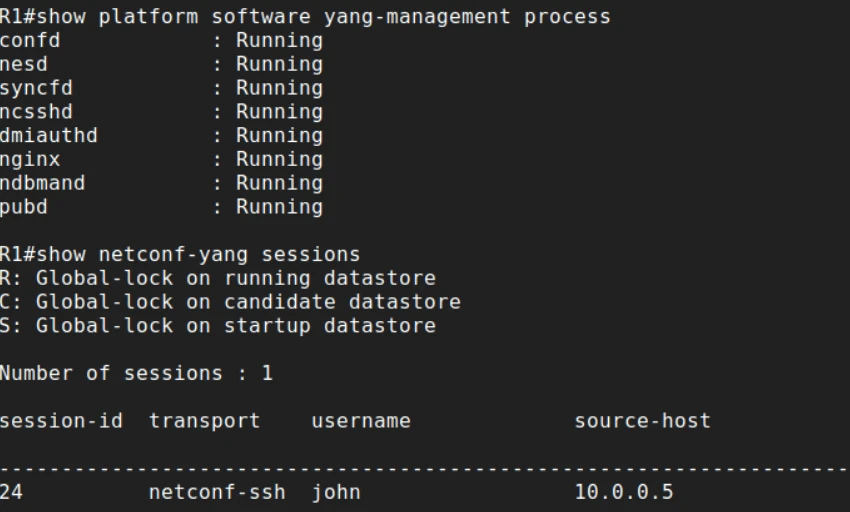

**Read the output:**

- **`ncsshd` is now Running**: the NETCONF SSH server started when you entered `netconf-yang`.
- **One session**: transport **`netconf-ssh`**, user **`john`**, from **10.0.0.5**. That's the audit view of who is connected over the API.
- The legend lists **global locks** on the running, candidate and startup datastores. Locking is a NETCONF feature RESTCONF doesn't have: a client can lock a datastore so nobody else changes it mid-transaction.

## Pull the whole running config with ncclient

Save this as `net_config.py`:

```
#!/usr/bin/env python3
"""NETCONF: pull the full running configuration as XML with ncclient (SSH, port 830)."""
from getpass import getpass
from ncclient import manager

device = {
    "host": "10.0.0.1",
    "port": 830,
    "username": "john",
    "password": getpass(),
    "hostkey_verify": False,          # lab only: verify the SSH host key in production
    "device_params": {"name": "iosxe"},
}

with manager.connect(**device) as m:
    reply = m.get_config(source="running")
    print(reply.xml)
```

```
python3 net_config.py
```

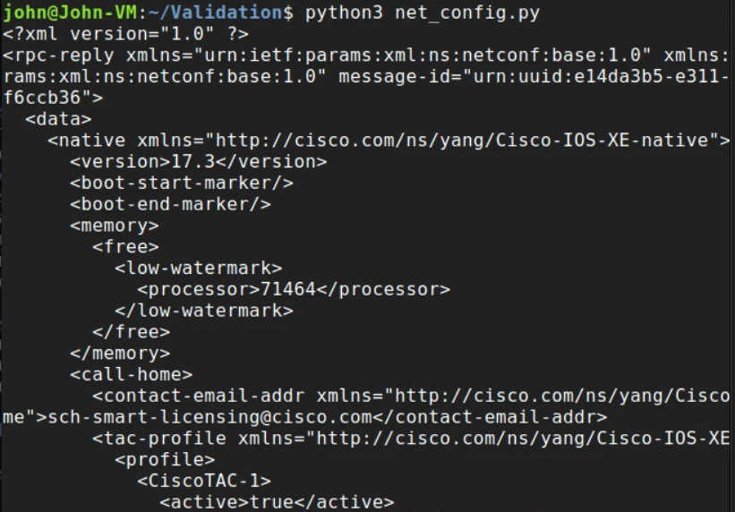

**Read the output:**

- An **`<rpc-reply>`** to the script's `<get-config>` RPC, with a `message-id` that ties the reply to the request.
- Inside **`<data>`**, the whole running configuration under **`Cisco-IOS-XE-native`**, starting with `<version>17.3</version>`. Everything in `show running-config` is here, as structured XML.
- One RPC, one complete, parseable configuration. That's why NETCONF is the backbone of automation tools, and why an account that can do this deserves the same protection as an administrator.

---

# Part 5: break it on purpose

## curl without -k: the self-signed certificate

```
curl -u john -H "Accept: application/yang-data+json" https://10.0.0.1/restconf/data/ietf-interfaces:interfaces
```

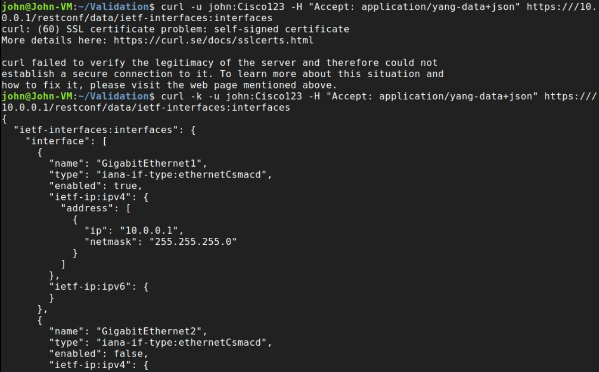

**Read the output:**

- **`curl: (60) SSL certificate problem: self-signed certificate`**: curl refused, because it can't verify who signed the router's certificate. That's TLS doing its job: it would refuse an impostor the same way.
- With **`-k`** the request succeeds and returns the JSON tree: GigabitEthernet1 **enabled** with **10.0.0.1/24**, GigabitEthernet2 **disabled**, and so on.
- `-k` and `verify=False` turn off the protection that makes HTTPS worth using. They're acceptable in a lab only. In production, enroll the router in your PKI, point the HTTPS server at that trustpoint (`ip http secure-trustpoint`), and validate it in every client.

## Other faults to recognize

| What you see | Why | Fix |
|---|---|---|
| `JSONDecodeError: Expecting value: line 1 column 1 (char 0)` right after enabling RESTCONF | The YANG processes weren't ready, so the router returned an HTML error page, not JSON | `show platform software yang-management process`; wait for `nginx` and `confd`; print the status code and the start of the response before parsing |
| `401 Unauthorized` | Wrong credentials, the HTTP server isn't authenticating against your user, or the account isn't privilege 15 | `ip http authentication local` (or AAA); privilege 15 account |
| `404` or empty data | Wrong module or container name (`ietf-interface:interfaces`) | Names are exact: `ietf-interfaces:interfaces` |
| Script expects JSON, gets XML | `Accept` header asks for `+xml` | Match the header to what the script parses |
| NETCONF connection refused on 830 | `netconf-yang` not configured, `ncsshd` not running, or SSH broken | Enable it, check the processes, confirm SSH on port 22 works first |

---

# Harden it for production

The baseline already showed what to fix:

```
no ip http server
ip http secure-server
ip http tls-version TLSv1.2
ip http secure-trustpoint <CA-SIGNED-TRUSTPOINT>
ip http access-class ipv4 AUTOMATION-HOSTS
ip http authentication aaa
!
ip access-list standard AUTOMATION-HOSTS
 permit 10.10.99.0 0.0.0.255
```

| Finding in this lab | Fix |
|---|---|
| Plain HTTP server on port 80 | `no ip http server` |
| TLS 1.1 enabled | `ip http tls-version TLSv1.2` (or later) |
| Self-signed certificate, clients using `-k` | CA-signed certificate with `ip http secure-trustpoint`; validate in clients |
| No access class | `ip http access-class ipv4 <ACL>`; VTY ACLs for NETCONF's SSH |
| Shared admin account | Dedicated automation accounts through AAA, with command accounting to a SIEM |
| `hostkey_verify=False` | Pin the router's SSH host key in the automation host's `known_hosts` |

---

# Check yourself

<details><summary>1. Which one needs ip http secure-server: NETCONF or RESTCONF?</summary>

RESTCONF. It runs over HTTPS on port 443. NETCONF runs over SSH on port 830 and needs no HTTP server.

</details>

<details><summary>2. A RESTCONF script fails with JSONDecodeError at char 0 right after you enabled RESTCONF. First command?</summary>

`show platform software yang-management process`. If `nginx` or `confd` aren't Running yet, the router is answering with an HTML error page instead of JSON.

</details>

<details><summary>3. Which encodings does each protocol support?</summary>

NETCONF: XML. RESTCONF: JSON or XML, chosen with the `Accept` and `Content-Type` headers.

</details>

<details><summary>4. What does the NETCONF hello tell you?</summary>

The protocol versions and features the device supports (base 1.0 and 1.1, writable-running, validate, rollback-on-error, notifications) and every YANG module it implements.

</details>

<details><summary>5. Why did curl fail without -k, and why is -k dangerous?</summary>

The router presented a self-signed certificate that curl couldn't verify. `-k` skips verification entirely, so curl would also accept an attacker's certificate. Use a CA-signed certificate and validate it.

</details>

---

# Answer config

<details><summary>Show the final config for R1</summary>

```
ip http secure-server
ip http authentication local
restconf
netconf-yang
```

The lab leaves `ip http server` on as found; the hardening section removes it.

</details>

---

# Exam mapping

| You practiced | Exam angle | SCOR v2.0 |
|---|---|---|
| `ip http secure-server` + `restconf` | RESTCONF on HTTPS 443 | 2.7 |
| `netconf-yang`, SSH port 830 | NETCONF transport; no HTTP server needed | 2.7 |
| IETF vs. native YANG models | Model-driven programmability | 2.7 |
| JSON and XML via the `Accept` header | RESTCONF encodings | 2.7 |
| NETCONF hello and `<get-config>` | Capabilities, RPCs, datastores | 2.7 |
| Certificate error and hardening | Securing programmability interfaces | 2.7 |

Drill it with the [flashcards](/ccnp-security/flashcards#d2) and the [mock exam](/ccnp-security/mock-exam#d2).
