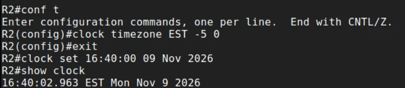
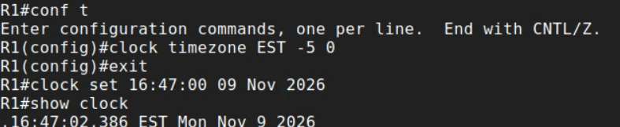
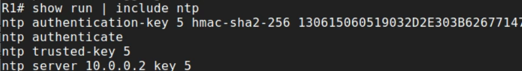
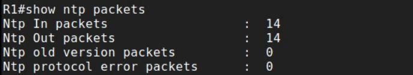
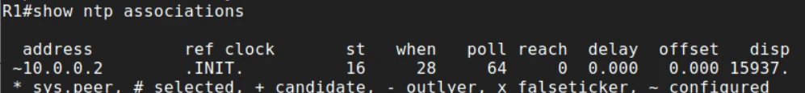
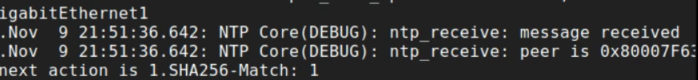
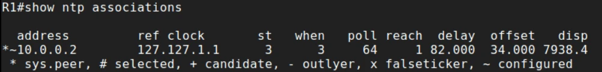
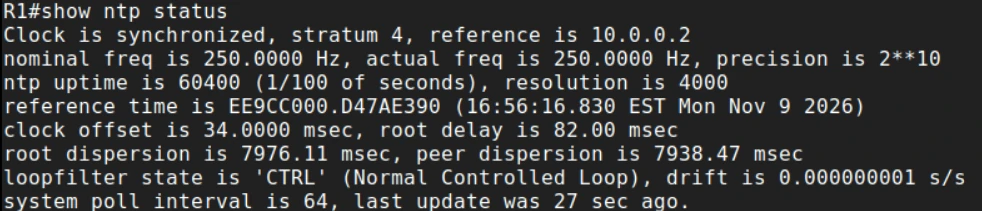
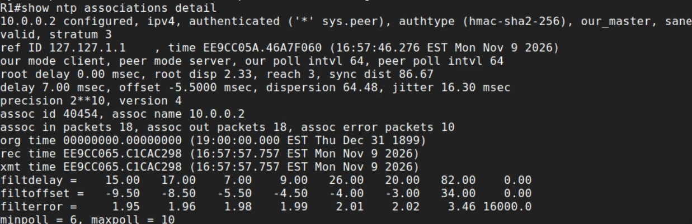

# Lab: authenticated NTP

> Companion lab for the Secure Network Management notes. SCOR 350-701 v2.0 topic 2.7: configure NTP with authentication.

---

# What you'll build

Two IOS XE routers: **R2** becomes an authenticated NTP **server**, and **R1** its **client**, accepting time only when R2 signs it with an HMAC-SHA-256 key. You'll watch R1 go from **stratum 16** (no trusted time) to **synchronized**, and prove the authentication from the debug output and `show ntp associations detail`.

| Item | Detail |
|---|---|
| **Platform** | Two IOS XE routers on the same subnet (see where to run it, below) |
| **Time** | 30 to 45 minutes, most of it waiting for the clocks to sync |
| **Level** | CCNP Security |
| **You'll practice** | `clock set`, `ntp master`, `ntp authenticate`, `ntp authentication-key`, `ntp trusted-key`, `ntp server ... key`, `show ntp status / associations / packets`, `debug ntp all` |
| **Exam topic** | 2.7 (core) |
| **Before this** | [Secure Network Management notes](/ccnp-security/secure-network-management), especially [NTP with authentication](/ccnp-security/secure-network-management#ntp-with-authentication) |

| Part | What you do | What it proves |
|---|---|---|
| 1 Server | Set R2's clock and make it an authenticated source | The time source exists and signs its replies |
| 2 Client | Set R1's clock close, add the key, point at R2 | The client will only trust signed time |
| 3 Verify | Packets, associations, debug, status, detail | Two-way traffic, matching keys, synchronization, authentication |
| 4 Break | Wrong key, clock too far off, unreachable server | You can tell the faults apart |

## The one thing to remember

**The client authenticates the server.** Authentication needs **all four** commands on the client (`ntp authenticate`, `ntp authentication-key`, `ntp trusted-key`, `ntp server ... key`), and the key number, algorithm and secret must match the server exactly.

## Think like the defender first

- **What breaks if this router's clock is wrong?** Log correlation, certificate checks (VPNs, HTTPS, secure syslog), and anything time-based. Time is a dependency of other security controls.
- **Who could change it?** Without authentication, anyone who can send UDP 123 packets that look like the server's.
- **What's the fallback when time isn't trusted?** The client should refuse the time and stay unsynchronized, not accept whatever arrives. That's exactly what you'll see when you break the key.

---

# Where to run this lab

| Environment | How to set it up |
|---|---|
| **Cisco Modeling Labs (CML)** | Two Catalyst 8000V (or CSR 1000v / IOSv) routers on one link. Recommended |
| **Cisco DevNet Sandbox / dCloud** | Any reservable topology with two IOS XE routers |
| **Your own gear** | Two IOS or IOS XE routers. Older releases may only offer `md5` keys; use the strongest algorithm `ntp authentication-key 5 ?` lists |

> **Lab values only.** The key secret below is a training value. Never reuse it on real equipment.

# Topology

```
  +-------------------------+      10.0.0.0/24      +-------------------------+
  |  R1  NTP client         | --------------------> |  R2  NTP server         |
  |  10.0.0.1               |       UDP 123         |  10.0.0.2               |
  |  becomes stratum 4      | <-------------------- |  ntp master 3           |
  +-------------------------+  replies signed with  +-------------------------+
                                key 5 (hmac-sha2-256)
```

| Item | Value |
|---|---|
| NTP server | R2, 10.0.0.2, `ntp master 3` |
| NTP client | R1, 10.0.0.1 |
| Key | ID **5**, **`hmac-sha2-256`**, secret `NtpLabKey123456`, identical on both |
| Time zone | EST, UTC -5 |

---

# Part 1: R2, the authenticated server

## Step 1: time zone and clock

`clock set` is a **privileged EXEC** command, not a configuration command. Set the time zone in configuration mode, leave it, then set the clock:

```
configure terminal
 clock timezone EST -5 0
 exit
clock set 16:40:00 09 Nov 2026
show clock
```

Use the real current time.



**Read the output:** **`16:40:02.963 EST Mon Nov 9 2026`**: the clock is set, in the right zone. R2 is about to become the time source for R1, so its own time has to be right. Typed at `(config)#`, `clock set` would be rejected with `% Invalid input detected`.

## Step 2: make R2 an authenticated time source

```
configure terminal
 ntp master 3
 ntp source GigabitEthernet1
 ntp authentication-key 5 hmac-sha2-256 NtpLabKey123456
 ntp trusted-key 5
 ntp authenticate
 end
show run | include ntp
```

| Command | Why |
|---|---|
| `ntp master 3` | Serve time from the local clock as stratum 3 (reference `127.127.1.1`). In production, R2 would itself sync to upstream servers instead |
| `ntp source GigabitEthernet1` | Always send NTP from the same address, so clients and ACLs see a predictable source |
| `ntp authentication-key 5 hmac-sha2-256 ...` | Define key 5. SHA-256 is far stronger than the legacy `md5` option |
| `ntp trusted-key 5` | Only trusted keys are used |
| `ntp authenticate` | Turn on authentication |

---

# Part 2: R1, the authenticated client

## Step 3: time zone and clock, close to R2's

NTP refuses to step a clock that's more than about **1000 seconds** off (its panic threshold). Set R1 roughly right first:

```
configure terminal
 clock timezone EST -5 0
 exit
clock set 16:47:00 09 Nov 2026
show clock
```



**Read the output:** R1 reads **16:47**, set a few minutes apart from R2. That's well within NTP's limit, so NTP can correct it. A clock years off would never sync, however good the key. The leading dot is IOS flagging the time: it was set by hand and NTP hasn't synchronized it yet.

## Step 4: the key, and the server it applies to

```
configure terminal
 ntp authenticate
 ntp authentication-key 5 hmac-sha2-256 NtpLabKey123456
 ntp trusted-key 5
 ntp server 10.0.0.2 key 5
 end
show run | include ntp
```



**Read the output:**

- **All four pieces** are present: the key, `ntp authenticate`, `ntp trusted-key 5`, and **`ntp server 10.0.0.2 key 5`**, which binds the key to this server.
- **The secret isn't shown as typed.** IOS stores it in an encrypted (reversible) form. That keeps it off a casual glance at the screen, but anyone with the config file can recover it, so protect configuration backups.

---

# Part 3: verify (be patient)

## Is there a conversation?

```
show ntp packets
```



**Read the output:** **In 14, Out 14**. Both directions are moving: R1 asks, R2 answers. If **Out climbed and In stayed at 0**, R2 wouldn't be answering (unreachable, UDP 123 filtered, or not serving time). Zero protocol errors.

## Early: the association is initializing

```
show ntp associations
```



**Read the output:**

- **`~10.0.0.2`**: the tilde means **configured**. There's no `*` yet, so R1 hasn't chosen it as its time source.
- **ref clock `.INIT.`** and **st 16**: still initializing; stratum 16 means "no trusted time".
- **reach 0**: no successful polls recorded yet.

This is normal for the first few minutes. NTP is deliberately cautious: it collects several samples before it trusts a source.

## Authentication in the debug

```
debug ntp all
show log | include NTP
```



**Read the output:** **`SHA256-Match: 1`**. The HMAC-SHA-256 on R2's reply matched R1's key 5: authentication succeeded. A **`0`** here would mean the keys differ, and R1 would discard the reply. Turn debugging off afterwards with `undebug all`; NTP debugs are chatty.

The debug timestamps (21:51) are in **UTC** while `show clock` shows EST. Logs are only useful for correlation when every device stamps them the same way: `service timestamps log datetime msec localtime show-timezone` puts the local time and zone on every message.

## Synchronized

After a few minutes:

```
show ntp associations
show ntp status
```





**Read the output:**

- **`*~10.0.0.2`**: the **`*`** means R1 is now **synced** to R2 (its system peer).
- **ref clock `127.127.1.1`**: R2's own reference, the local clock it serves because of `ntp master`.
- **st 3**: R2's stratum. **reach 1**: the most recent poll was answered; it climbs toward **377** (octal: all of the last 8 polls) as the association settles.
- **`Clock is synchronized, stratum 4, reference is 10.0.0.2`**: the one-line verdict. R1 is one hop below R2, so stratum 4.
- **clock offset 34 msec**: R1 is now within milliseconds of R2, down from minutes.

## Proof the time is authenticated

```
show ntp associations detail
```



**Read the output:**

- **`authenticated`** and **`authtype (hmac-sha2-256)`**: the proof that this association uses the key. Without `key 5` on the `ntp server` line, R1 could still sync, but this field wouldn't say authenticated.
- **`our_master`, `sane`, `valid`**: R2 is the chosen source and its data passed NTP's checks.
- **our mode client, peer mode server**: client/server mode, where the client verifies the server.
- **assoc in 18, out 18, error packets 10**: errors are packets that were rejected. A count from the start-up period is normal; a number that keeps climbing points to a key, timing or reachability problem.

---

# Part 4: break it on purpose

## Break 1: key mismatch

On R1 only, change the secret:

```
configure terminal
 ntp authentication-key 5 hmac-sha2-256 WrongKey987654
 end
```

With `debug ntp all` on, the log now shows **`SHA256-Match: 0`**, and after the current sync ages out `show ntp status` reports **unsynchronized**. R1 refuses time it can't verify, which is the whole point. **Fix:** put the identical secret back. The key number, algorithm **and** secret must match.

## Break 2: clock too far off

```
clock set 11:00:00 02 Jun 2020
```

Even with the right key, NTP won't step a clock that's years off. R1 stays at stratum 16. **Fix:** set the clock close to R2's, then wait.

## Break 3: the server doesn't answer

Shut R2's interface, or point R1 at a wrong address. `show ntp packets` on R1 shows **Out climbing while In stays the same**: one-sided traffic. **Fix:** check reachability, ACLs for UDP 123, and that R2 is serving time.

## Break decoder

| Symptom | Layer | Cause | Fix |
|---|---|---|---|
| `SHA256-Match: 0`, no sync | Authentication | Key number, algorithm or secret differ | Identical key on both ends |
| Out climbing, In flat | Reachability | Server down, UDP 123 filtered, nothing serving time | Ping, ACLs, `ntp master` or upstream sync on the server |
| Stuck at st 16 with matching keys | Time offset | Clock too far off, or not enough time yet | `clock set` close; wait several minutes |
| Synced, but `detail` doesn't say authenticated | Configuration | `key 5` missing on `ntp server`, or `ntp authenticate` / `trusted-key` missing | Add the missing piece |
| Everything looks right but no sync | Process stuck | Association needs restarting | `no ntp server 10.0.0.2 key 5`, then add it again |

---

# Harden it for production

| Lab shortcut | Production fix |
|---|---|
| R2 serves its own clock (`ntp master`) | Internal servers sync to several trusted upstream sources |
| One server | At least three authenticated servers, so a bad one is outvoted (a falseticker) |
| Anyone can query R2 | `ntp access-group serve-only <ACL>` on servers, `ntp access-group peer <ACL>` on clients, UDP 123 filtered at the edge |
| Debug timestamps in UTC, clock in EST | `service timestamps log datetime msec localtime show-timezone` everywhere |
| Key visible in config backups | Protect backups; rotate keys |

---

# Check yourself

<details><summary>1. In client/server mode, who authenticates whom?</summary>

The client authenticates the server. `ntp server 10.0.0.2 key 5` means R1 accepts time from R2 only if R2's packets are signed with trusted key 5.

</details>

<details><summary>2. Why set the clock by hand before NTP?</summary>

NTP won't step a clock that's more than about 1000 seconds off. A clock that's far out never syncs, however good the key.

</details>

<details><summary>3. show ntp packets shows Out 6, In 0. What does that mean?</summary>

R1 is asking and nobody is answering: R2 is unreachable, UDP 123 is filtered, or R2 isn't serving time.

</details>

<details><summary>4. What do * and ~ mean in show ntp associations?</summary>

`~` means the peer is configured. `*` means it's the system peer: the source the clock is synchronized to.

</details>

<details><summary>5. Why does R1 show stratum 4?</summary>

It syncs to R2, which serves stratum 3. Each hop adds one.

</details>

---

# Answer config

<details><summary>Show the final config for both routers</summary>

```
! R2 (server)
clock timezone EST -5 0
ntp master 3
ntp source GigabitEthernet1
ntp authentication-key 5 hmac-sha2-256 NtpLabKey123456
ntp trusted-key 5
ntp authenticate
!
! R1 (client)
clock timezone EST -5 0
ntp authentication-key 5 hmac-sha2-256 NtpLabKey123456
ntp trusted-key 5
ntp authenticate
ntp server 10.0.0.2 key 5
```

`clock set` is a privileged EXEC command, so it isn't part of the configuration. Lab values only.

</details>

---

# Exam mapping

| You practiced | Exam angle | SCOR v2.0 |
|---|---|---|
| The four authentication commands | All four required; keys must match | 2.7 |
| `ntp server ... key 5` | The client authenticates the server | 2.7 |
| Stratum 16 to 3 / 4 | Stratum meaning, `ntp master` | 2.7 |
| `show ntp status`, `associations`, `detail` | Verify sync and authentication | 2.7 |
| Wrong key, clock offset, one-sided packets | Troubleshooting NTP | 2.7 |

Drill it with the [flashcards](/ccnp-security/flashcards#d2) and the [mock exam](/ccnp-security/mock-exam#d2).
