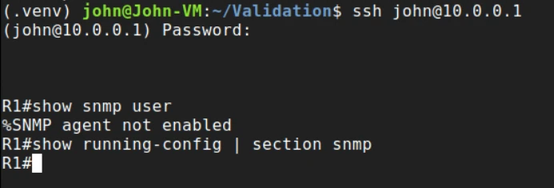
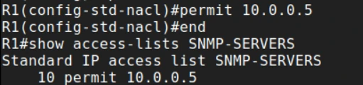
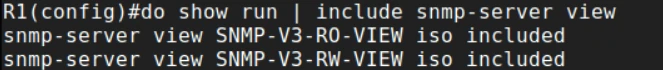
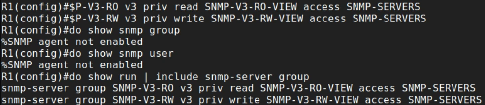
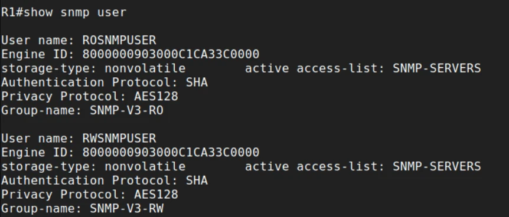
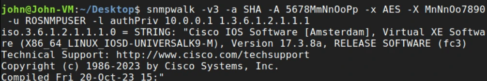
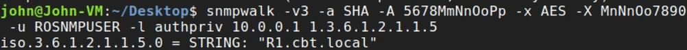
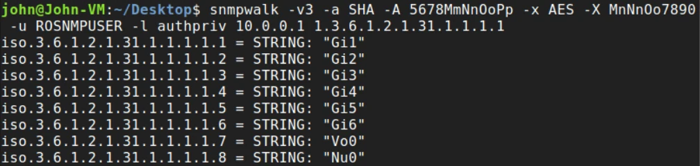
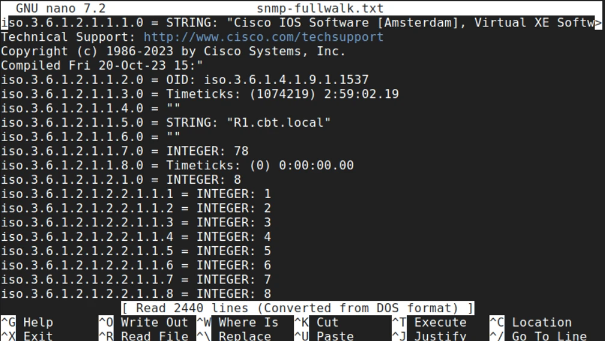
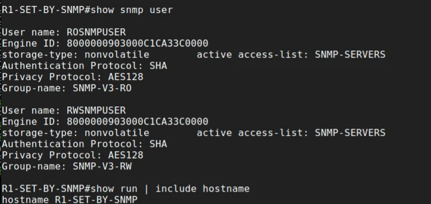

# Lab: SNMPv3 with authPriv

> Companion lab for the Secure Network Management notes. SCOR 350-701 v2.0 topic 2.7: configure SNMPv3.

---

# What you'll build

SNMPv3 on an IOS XE router, at the **authPriv** level (SHA authentication and AES encryption), locked to one monitoring host. Then you'll prove it from a Linux monitoring station with Net-SNMP: read the device description, hostname and interfaces, walk the whole MIB, and finally **change the router's hostname over SNMP**, which shows exactly why read-write SNMP needs to be locked down.

| Item | Detail |
|---|---|
| **Platform** | An IOS XE router and a Linux host with Net-SNMP (see where to run it, below) |
| **Time** | 45 to 60 minutes |
| **Level** | CCNP Security. You should be comfortable with the IOS CLI and a Linux shell |
| **You'll practice** | SNMP ACLs, views, groups and users; `show snmp user`; `snmpwalk`, `snmpget` and `snmpset`; reading SNMPv3 errors |
| **Exam topic** | 2.7 (core) |
| **Before this** | [Secure Network Management notes](/ccnp-security/secure-network-management), especially [SNMPv3](/ccnp-security/secure-network-management#snmpv3) |

| Part | What you do | What it proves |
|---|---|---|
| 1 Baseline | Check SNMP is off | Clean start |
| 2 Build | ACL, views, groups, users | Each object exists before the next depends on it |
| 3 Read | `snmpwalk` from the monitoring host | Authentication and encryption work end to end |
| 4 Write | `snmpset` the hostname with the read-write user | Read-write SNMP is real control over the device |
| 5 Break | Wrong keys, wrong level, wrong group, wrong source | You can name the fault from the error |

## The one thing to remember

SNMPv3 is four objects in a chain: **ACL → view → group → user**, at level **authPriv**. The fastest sanity check is **`show snmp user`**: it shows each user's protocols and, crucially, which **group** the user is in.

## Think like the defender first

- **Who should be able to poll this router?** One or two monitoring servers, not the whole network. That's the ACL.
- **What do they need to see?** Usually interface counters and system information, not the whole MIB. That's the view. This lab exposes everything to keep it simple; the hardening section narrows it.
- **Does anything need to write?** Most monitoring doesn't. Every read-write user is a way to change the device without logging in. Part 4 shows how much it can do.

---

# Where to run this lab

| Environment | How to set it up |
|---|---|
| **Cisco Modeling Labs (CML)** | A Catalyst 8000V (or CSR 1000v / IOSv) router and an Ubuntu node with the `snmp` package, on one subnet. Recommended |
| **Cisco DevNet Sandbox / dCloud** | An always-on or reservable IOS XE sandbox, polled from your own Linux machine over the sandbox VPN |
| **Your own gear** | Any IOS XE router and a Linux VM with `sudo apt install snmp` (Debian / Ubuntu) or `dnf install net-snmp-utils` (Red Hat family) |

> **Lab values only.** The passphrases and addresses in this lab are training values shown in the screenshots. Never reuse them on real equipment.

# Topology

```
  +-----------------------+                 +------------------------+
  |  Linux host (NMS)     |   10.0.0.0/24   |  Router R1 (IOS XE)    |
  |  10.0.0.5             | --------------> |  10.0.0.1              |
  |  snmpwalk / snmpset   |  UDP 161        |  SNMP agent            |
  +-----------------------+                 +------------------------+
```

| Item | Value |
|---|---|
| Router | R1, 10.0.0.1, IOS XE 17.3 |
| Monitoring host | 10.0.0.5, Net-SNMP tools |
| Read-only user | `ROSNMPUSER`: auth SHA `5678MmNnOoPp`, priv AES-128 `MnNnOo7890` |
| Read-write user | `RWSNMPUSER`: auth SHA `9876QqRrSsTt`, priv AES-128 `TtUuVv3456` |

---

# Part 1: baseline

From the monitoring host, SSH to R1 and confirm SNMP isn't configured:

```
ssh john@10.0.0.1
show snmp user
show running-config | section snmp
```



**Read the output:** **`%SNMP agent not enabled`** and an empty `section snmp`: no SNMP of any version is running. That's the safest default, and the state to return to on devices nobody monitors.

---

# Part 2: build it, verifying every step

## Step 1: ACL (only the monitoring host may speak SNMP)

```
configure terminal
 ip access-list standard SNMP-SERVERS
  remark SNMP Server #1
  permit 10.0.0.5
 end
show access-lists SNMP-SERVERS
```



**Read the output:** one entry, **`10 permit 10.0.0.5`**. Everything else hits the implicit deny. SNMP ACL denies are **silent**: a blocked host simply times out, with no error message to tell an attacker why.

## Step 2: views (what part of the MIB is visible)

```
configure terminal
 snmp-server view SNMP-V3-RO-VIEW iso included
 snmp-server view SNMP-V3-RW-VIEW iso included
 do show run | include snmp-server view
```



**Read the output:** both views include **`iso`**, the name for OID 1, the root of the tree. In other words, everything. That keeps the lab simple; production views should include only the subtrees the monitoring tool polls.

## Step 3: groups (minimum level, views and ACL)

```
 snmp-server group SNMP-V3-RO v3 priv read SNMP-V3-RO-VIEW access SNMP-SERVERS
 snmp-server group SNMP-V3-RW v3 priv write SNMP-V3-RW-VIEW access SNMP-SERVERS
 do show snmp group
 do show snmp user
 do show run | include snmp-server group
```



**Read the output:**

- Both groups are in the running config: **SNMPv3**, minimum level **`priv`** (authPriv), the views, and the ACL.
- **`show snmp group` and `show snmp user` still say `%SNMP agent not enabled`.** That's not a fault. On IOS XE, views and groups don't start the SNMP agent; the first **user** (or community) does. Until then, verify from the running config.
- The read-only group has a `read` view; the read-write group has a `write` view. A group that must both read and write would list both (`read SNMP-V3-RW-VIEW write SNMP-V3-RW-VIEW`).

## Step 4: users (identity and keys)

```
 snmp-server user ROSNMPUSER SNMP-V3-RO v3 auth sha 5678MmNnOoPp priv aes 128 MnNnOo7890 access SNMP-SERVERS
 snmp-server user RWSNMPUSER SNMP-V3-RW v3 auth sha 9876QqRrSsTt priv aes 128 TtUuVv3456 access SNMP-SERVERS
 end
show snmp user
```

Check the group name on each line before you press Enter: putting the read-write user in the read-only group is the classic mistake, and Part 5 shows what it looks like.



**Read the output, field by field:**

- **Engine ID `8000000903000C1CA33C0000`**: the same for both users, because it belongs to the agent. The passphrases were hashed with it to make the real keys. If it ever changes, both users must be recreated.
- **storage-type: nonvolatile**: the users survive a reload once the config is saved.
- **active access-list: SNMP-SERVERS**: the host restriction is applied to the user too.
- **Authentication Protocol: SHA** and **Privacy Protocol: AES128**: authPriv.
- **Group-name**: `SNMP-V3-RO` for the read-only user and **`SNMP-V3-RW`** for the read-write user. This one field is what catches the most common SNMPv3 mistake.

Notice what's **not** here: the passphrases. SNMPv3 keys never appear in `show running-config` or `show snmp user`. You confirm a user by testing it, not by reading the key back.

---

# Part 3: read from the monitoring host

Each `snmpwalk` names the version, the level, the user, and both protocols and passphrases:

| Flag | Meaning |
|---|---|
| `-v3` | SNMP version 3 |
| `-a SHA` / `-A` | Authentication protocol / passphrase |
| `-x AES` / `-X` | Privacy protocol / passphrase |
| `-u ROSNMPUSER` | Username |
| `-l authPriv` | Security level (must meet the group's minimum; case doesn't matter) |
| `10.0.0.1 <OID>` | Target and the OID to walk |

## sysDescr: what is this device?

```
snmpwalk -v3 -a SHA -A 5678MmNnOoPp -x AES -X MnNnOo7890 -u ROSNMPUSER -l authPriv 10.0.0.1 1.3.6.1.2.1.1.1
```



**Read the output:** `iso.3.6.1.2.1.1.1.0 = STRING: "Cisco IOS Software [Amsterdam], Virtual XE Software ... Version 17.3.8a"`. Two lessons:

- Getting **any** answer means authentication and decryption worked. A wrong key would have failed (Part 5).
- That string is gold for an attacker: platform and **exact software version**, ready to match against published vulnerabilities. That's why views matter and why SNMP must never be reachable from untrusted networks.

## sysName and interfaces

```
snmpwalk -v3 -a SHA -A 5678MmNnOoPp -x AES -X MnNnOo7890 -u ROSNMPUSER -l authPriv 10.0.0.1 1.3.6.1.2.1.1.5
snmpwalk -v3 -a SHA -A 5678MmNnOoPp -x AES -X MnNnOo7890 -u ROSNMPUSER -l authPriv 10.0.0.1 1.3.6.1.2.1.31.1.1.1.1
```





**Read the output:**

- **sysName** (`.1.5.0`) is the hostname plus domain.
- **ifName** returns one row per interface. The last number of each OID is the **ifIndex** (1 to 8 here), the key SNMP uses for every per-interface counter. `Vo0` is a virtual interface and `Nu0` is Null0.
- `-l authpriv` in lowercase works too: Net-SNMP doesn't care about case.

Useful OIDs to try next:

| OID | Object | Notes |
|---|---|---|
| `1.3.6.1.2.1.1.3` | sysUpTime | Uptime in hundredths of a second |
| `1.3.6.1.2.1.2.2.1.8` | ifOperStatus | 1 = up, 2 = down |
| `1.3.6.1.2.1.2.2.1.7` | ifAdminStatus | 1 = up, 2 = down (writable) |
| `1.3.6.1.2.1.2.2.1.10` / `.16` | ifInOctets / ifOutOctets | Traffic counters |

For a single value, `snmpget` is faster (scalars need the `.0` instance): `snmpget ... 10.0.0.1 1.3.6.1.2.1.1.5.0`. For big tables, `snmpbulkwalk` uses GetBulk and is much quicker.

## The whole MIB

```
snmpwalk -v3 -a SHA -A 5678MmNnOoPp -x AES -X MnNnOo7890 -u ROSNMPUSER -l authPriv 10.0.0.1 > snmp-fullwalk.txt
nano snmp-fullwalk.txt
```



**Read the output:** **2440 lines** from one command: system information, uptime (2:59:02), sysName, the interface table and much more. With no OID given, `snmpwalk` walks the standard MIB-2 tree; that's what `iso included` exposed. Imagine that walk run by someone else, and the case for scoped views makes itself.

---

# Part 4: write with the read-write user

Read-write SNMP isn't monitoring; it's configuration. Change the router's sysName from the monitoring host:

```
snmpset -v3 -a SHA -A 9876QqRrSsTt -x AES -X TtUuVv3456 -u RWSNMPUSER -l authPriv 10.0.0.1 1.3.6.1.2.1.1.5.0 s "R1-SET-BY-SNMP"
```

`s` means the value is a string (`i` would be an integer). Then look at the router:

```
show snmp user
show run | include hostname
```



**Read the output:**

- **The prompt itself changed** to `R1-SET-BY-SNMP#`, and the running config now says **`hostname R1-SET-BY-SNMP`**. On IOS, sysName is tied to the hostname, so one SNMP packet renamed the device.
- **RWSNMPUSER is in `SNMP-V3-RW`**, the group with the write view. That's why the set was allowed.

> **This is the attack in miniature.** The same write access could set `ifAdminStatus` to 2 and shut an interface (`snmpset ... 1.3.6.1.2.1.2.2.1.7.<ifIndex> i 2`), or trigger a configuration copy off the device. Read-write SNMP is equivalent to configuration access. Give it only to tools that need it, from hosts that need it.

Put the hostname back when you're done: `configure terminal`, `hostname R1`.

---

# Part 5: break it on purpose

Run each of these from the monitoring host, read the error, then fix it.

| Break | Command change | What you see | Why |
|---|---|---|---|
| Wrong authentication passphrase | `-A WRONGPASS123` | `Authentication failure (incorrect password, community or key)` | The HMAC doesn't verify |
| Wrong privacy passphrase | correct `-A`, wrong `-X` | Timeout, or a decryption error | The agent can't decrypt the request |
| Level below the group's minimum | `-l authNoPriv` (drop `-x` / `-X`) | An error about an unsupported or insufficient security level | The group requires authPriv |
| Source not in the ACL | Change the ACL to permit another host | `Timeout: No Response` | ACL denies are silent |
| SNMPv2c attempt | `snmpwalk -v2c -c public 10.0.0.1 1.3.6.1.2.1.1.5` | `Timeout: No Response` | No community exists: only v3 is configured |
| Read-write user in the read-only group | Recreate `RWSNMPUSER` with group `SNMP-V3-RO`, then `snmpset` | Reads still work; the set fails with `notWritable` or `noAccess` | The group has no write view |

**Fixing the group mistake** the way a troubleshooter would:

```
show snmp user
configure terminal
 snmp-server user RWSNMPUSER SNMP-V3-RW v3 auth sha 9876QqRrSsTt priv aes 128 TtUuVv3456 access SNMP-SERVERS
 end
show snmp user
```

`Group-name` changes from `SNMP-V3-RO` to `SNMP-V3-RW`, and the set works again.

> **Two timeouts, different causes.** "Timeout: No Response" can mean a wrong privacy key, a blocked source, or no matching user. Check the cheap things first: is the host in the ACL (`show access-lists SNMP-SERVERS` hit counts), and is the privacy passphrase right?

---

# Harden it for production

| Lab shortcut | Production fix |
|---|---|
| `iso included` views | Views limited to what's polled, e.g. `snmp-server view MON-VIEW system included` and `interfaces included` |
| A read-write user | No RW unless a tool needs it; separate RW user, separate ACL |
| AES-128 and SHA-1 | The strongest your release supports (`snmp-server user ?`): AES-256 and SHA-2 where available |
| Passphrases typed on the command line | Long, unique passphrases per role, stored in the NMS's credential vault |
| SNMP reachable from the user network | Out-of-band management network; UDP 161 filtered everywhere else |
| No notifications | SNMPv3 informs to the NMS: `snmp-server host <nms> informs version 3 priv <user>` |

---

# Check yourself

<details><summary>1. Why do show snmp group and show snmp user fail after the groups exist?</summary>

On IOS XE the SNMP agent starts only when the first user or community exists. Views and groups alone don't start it, so the operational `show snmp` commands report `%SNMP agent not enabled` until Step 4.

</details>

<details><summary>2. A walk with -l authNoPriv fails against these groups. Why?</summary>

The groups were created with `priv`, so authPriv is the minimum. A request at a lower level is refused.

</details>

<details><summary>3. Reads work for RWSNMPUSER but every snmpset fails. First command?</summary>

`show snmp user`. Check the `Group-name`: a read-write user created in the read-only group has no write view.

</details>

<details><summary>4. Why must users be recreated if the engine ID changes?</summary>

The passphrases are localized: hashed with the engine ID to produce the actual keys. A new engine ID means the stored keys no longer match.

</details>

<details><summary>5. Why is sysDescr sensitive?</summary>

It reveals the platform and exact software version, which an attacker can match against known vulnerabilities. Scope views and restrict who can poll.

</details>

---

# Answer config

<details><summary>Show the final SNMPv3 config for R1</summary>

```
ip access-list standard SNMP-SERVERS
 remark SNMP Server #1
 permit 10.0.0.5
!
snmp-server view SNMP-V3-RO-VIEW iso included
snmp-server view SNMP-V3-RW-VIEW iso included
snmp-server group SNMP-V3-RO v3 priv read SNMP-V3-RO-VIEW access SNMP-SERVERS
snmp-server group SNMP-V3-RW v3 priv write SNMP-V3-RW-VIEW access SNMP-SERVERS
snmp-server user ROSNMPUSER SNMP-V3-RO v3 auth sha 5678MmNnOoPp priv aes 128 MnNnOo7890 access SNMP-SERVERS
snmp-server user RWSNMPUSER SNMP-V3-RW v3 auth sha 9876QqRrSsTt priv aes 128 TtUuVv3456 access SNMP-SERVERS
```

Lab values only. SNMPv3 users don't appear in `show running-config`; they live in the agent's user table.

</details>

---

# Exam mapping

| You practiced | Exam angle | SCOR v2.0 |
|---|---|---|
| ACL → view → group → user | SNMPv3 object model (USM, VACM) | 2.7 |
| `v3 priv`, SHA + AES | Security levels; authPriv | 2.7 |
| `show snmp user` | Engine ID, protocols, group membership | 2.7 |
| `snmpwalk`, `snmpget`, `snmpset` | Ports, operations, OIDs | 2.7 |
| Read-write hostname change | Why RW SNMP is configuration access | 2.7 |

Drill it with the [flashcards](/ccnp-security/flashcards#d2) and the [mock exam](/ccnp-security/mock-exam#d2).
