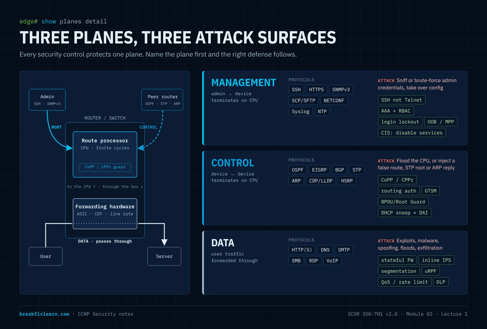
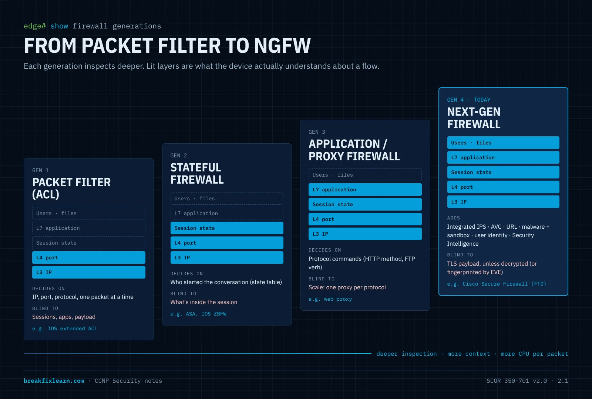
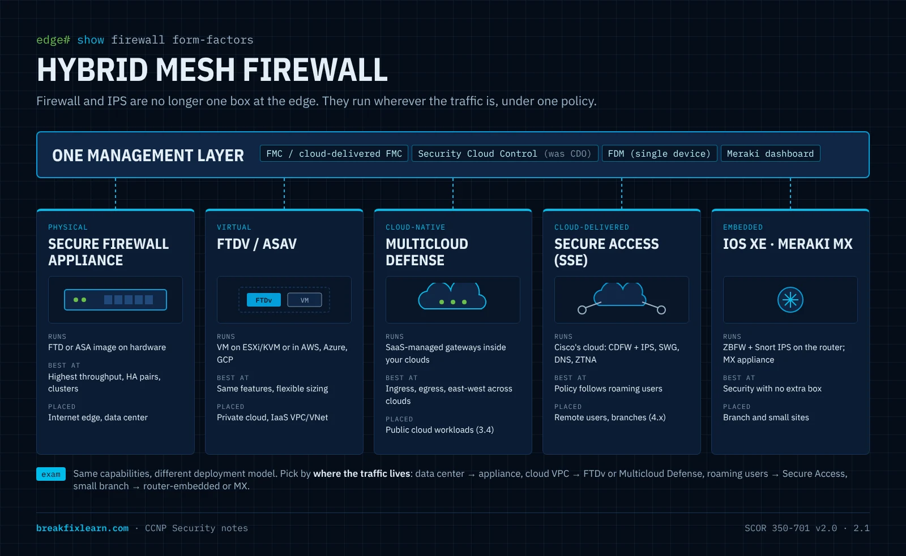
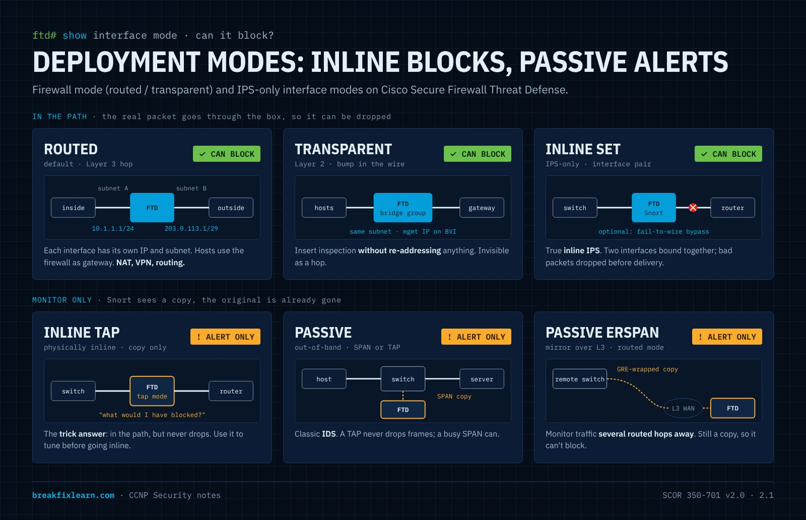
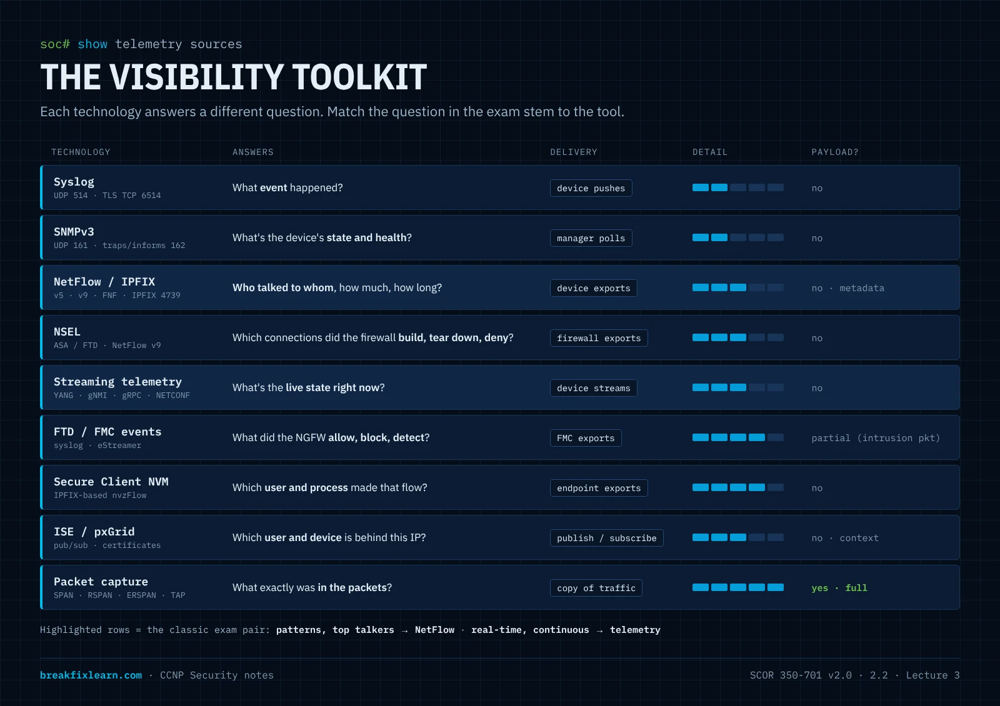
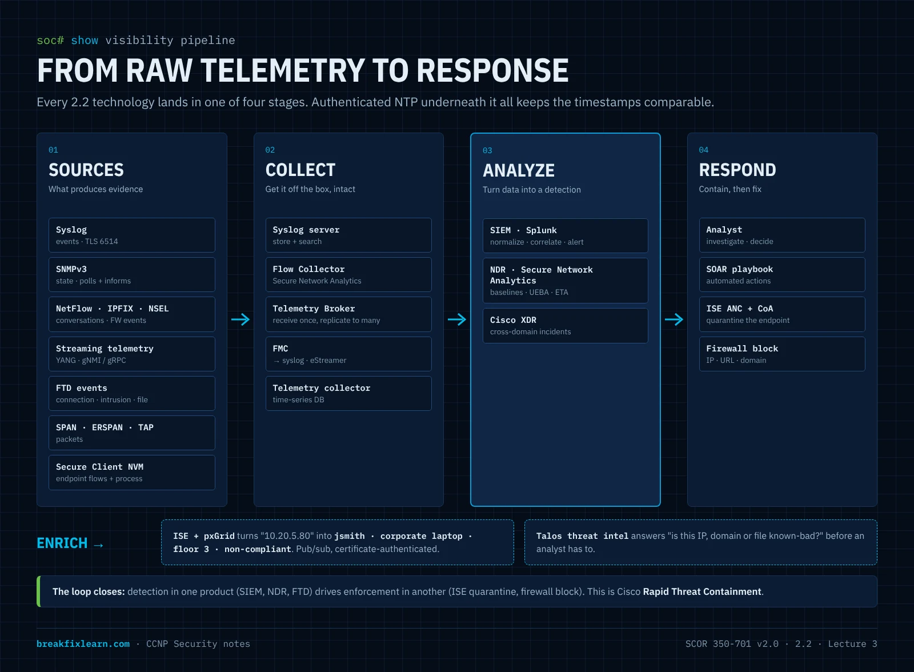

# Network Security: Firewalls, IPS, and Visibility

> **CCNP Security · SCOR 350-701 v2.0 · Domain 2.0 Network Security (25% of the exam)**
>
> **2.1** Describe network security solutions and deployment models that provide intrusion prevention and firewall capabilities
> **2.2** Describe security monitoring and telemetry technologies
>
> **Module scope:** three connected lectures. Lecture 1 shows how traffic splits into three planes, Lecture 2 covers the firewall and IPS solutions and where you deploy them (2.1), and Lecture 3 covers monitoring and telemetry (2.2).
> **Level:** CCNA → CCNP. Assumes VLANs, routing, ACLs, and basic AAA.
> **Blueprint version:** objective wording and all cross-references follow the official **v2.0** exam topics (testing since 27 Aug 2026).

---

# How this module fits together

Both objectives start with the verb **Describe**. That tells you the depth Cisco expects: you need to know *what each solution is, what it can and can't do, and where it belongs*. You don't need to configure it yet. The hands-on objectives come later in Domain 2: **2.7** (secure management config) and **2.8** (FTD access control, AVC, URL, malware, and IPS policy).

The two objectives answer two questions:

1. **2.1: What enforces, and where do you put it?** Firewalls, IPS/IDS, and next-generation firewalls, plus the deployment models: inline vs. passive, routed vs. transparent, appliance vs. virtual vs. cloud-delivered, and how they stay up (HA).
2. **2.2: How do you see what's happening?** Syslog, SNMPv3, NetFlow/IPFIX, streaming telemetry, packet capture, firewall events, NDR, SIEM, and identity context from ISE/pxGrid.

| Lecture | Core objective | Also reinforces (v2.0 numbering) |
|---|---|---|
| 1. Securing the Three Planes | Framework for 2.1 (which plane each control protects) | 2.3 L2 security · 2.4 in-band vs. OOB · 2.5 CIS hardening · 2.6 AAA · 2.7 secure mgmt |
| 2. Firewall & IPS Solutions and Deployment Models | **2.1** | 2.4 management options · 2.8 FTD policies · 4.x Secure Access · 3.4 Multicloud Defense |
| 3. Security Monitoring & Telemetry | **2.2** | 2.7 SNMPv3 / secure syslog / NTP · 6.5 exfiltration · 6.6 XDR & SIEM · 6.8 Splunk |

> Read the module top to bottom once. After that, each lecture stands alone for review. The **coverage checklist** at the very end shows where every 2.1/2.2 idea is taught.

---
---

# Lecture 1: Securing the Three Planes (Management, Control, and Data)

> **Role in this module:** the organizing framework. Every firewall, IPS, and telemetry feature in Lectures 2 and 3 protects or observes one of these planes.
> **Deeper coverage elsewhere:** Layer 2 attacks (2.3), management options (2.4), CIS benchmarks (2.5), AAA troubleshooting (2.6), secure management config (2.7).

---

## Why this matters

Modern networks get attacked from many directions at once, so no single device can protect everything. Defense has to be layered, and to layer it well you first need to know *what kind of traffic* you're protecting. Not all traffic on a router is the same. The packets an administrator uses to log in and configure the device are different from the routing updates two routers exchange. Both are different again from the user traffic flowing through the box.

Engineers group these into **three planes**: the **management plane**, the **control plane**, and the **data plane** (also called the forwarding plane). Each plane has its own job, its own protocols, its own attack surface, and its own hardening techniques. If you can look at any security feature and say "that protects the control plane" or "that protects the data plane," you'll answer a large slice of SCOR questions correctly without memorizing lists.

### Learning objectives

- Classify any protocol or traffic type into the correct plane.
- Explain the primary attack against each plane and the defenses that counter it.
- Describe management-plane hardening: secure protocols, AAA, RBAC, NTP, logging, out-of-band management, and service reduction.
- Explain CoPP vs. CPPr and when each applies.
- Explain data-plane protections: ACLs, segmentation, encryption, uRPF, rate limiting, IPS, DLP, and the Layer 2 toolkit.

---

## 1. The three planes at a glance

Think of a router as a small office building:

- The **management plane** is the staff entrance and the control room. Only administrators come in here to run and adjust the building.
- The **control plane** is the internal chatter between building systems: elevators, fire alarms, and HVAC talking to each other to decide how the building runs.
- The **data plane** is the lobby and hallways where the public actually walks through.

| Plane | Whose traffic | Direction | Typical protocols | "It decides…" |
|---|---|---|---|---|
| **Management** | Administrator ↔ device | To the device | SSH, HTTPS, SNMPv3, SCP/SFTP, NETCONF/RESTCONF, Syslog, NTP | *How the device is configured and monitored* |
| **Control** | Device ↔ device | To the device (from peers) | OSPF, EIGRP, BGP, STP, ARP, CDP/LLDP, HSRP/VRRP, LACP | *How the device learns the network and builds its tables* |
| **Data (forwarding)** | Users / applications | **Through** the device | HTTP(S), SMTP, DNS, SMB, RDP, VoIP, any transit traffic | *How user packets are forwarded* |

A useful shortcut:

- Control-plane traffic is **destined to the device's CPU**, because the route processor has to think about it.
- Data-plane traffic is **forwarded in hardware** and is just passing through.
- Management-plane traffic also goes to the CPU, but it's *you* talking to the box, not another router.

That CPU distinction explains the control-plane defenses later. Anything that forces the CPU to stop and process packets is a potential denial-of-service lever.

---

## 2. Securing the management plane

The management plane is the keys to the kingdom. If attackers compromise it, they don't need to break your security: they *become* your security and reconfigure it at will.

### 2.1 Use secure, authenticated, encrypted protocols

| Replace this (cleartext) | With this (secure) | Why |
|---|---|---|
| Telnet | **SSH** | Encrypts the whole CLI session and authenticates the server |
| HTTP | **HTTPS (TLS)** | Encrypts the web management session |
| FTP / TFTP | **SCP / SFTP** | Encrypted transfer of configs and images |
| SNMPv1 / v2c | **SNMPv3 (authPriv)** | v1/v2c send community strings in plaintext; v3 adds authentication and encryption |

SNMPv3's security levels are covered fully in Lecture 3, §5. The configuration belongs to **2.7**.

### 2.2 Harden the login path

- **Session timeouts** (`exec-timeout`) disconnect idle sessions so a forgotten one can't be hijacked.
- **Login lockout** (`login block-for`, or AAA-server lockout policy) is your front-line defense against **brute-force and password-spray** attacks.
- **Centrally managed credentials** through AAA (next), instead of local usernames on every box.

### 2.3 Centralize identity with AAA, and scope access with RBAC

**AAA** covers the three things every access decision needs: **Authentication** (who are you), **Authorization** (what may you do), and **Accounting** (what did you do: the audit trail).

| | **RADIUS** | **TACACS+** |
|---|---|---|
| Transport | UDP 1812/1813 (legacy 1645/1646) | TCP 49 |
| What it encrypts | **Only the password** | **The entire packet body** |
| AAA separation | Combines authN and authZ | Separates authN, authZ, accounting |
| Typical use | **Network access** (802.1X, VPN) | **Device administration**, per-command authorization |
| Full-packet encryption | **RADIUS over TLS (RadSec)** | Already encrypts the body |

**RBAC** applies least privilege by job function. An analyst role gets `show` commands only; an engineer role can enter `configure terminal`. Troubleshooting AAA is its own objective (**2.6**).

### 2.4 Keep clocks in sync with NTP, and log everything

Ship logs from every device to a central Syslog server or SIEM. **Authenticated NTP** keeps every timestamp aligned, which correlation, certificate validation, and Kerberos all depend on. Lecture 3 explains why this is the foundation of visibility.

### 2.5 Use out-of-band (OOB) management

**Out-of-band** means management traffic rides a *separate* path from user data: a dedicated management interface or network, or console access through a terminal server. If the production network is down or flooded, you can still reach your devices, and users have no path to the management plane at all. IOS **Management Plane Protection (MPP)** restricts which interfaces accept management protocols. In-band vs. OOB is part of **2.4**.

### 2.6 Disable unused services

Every listening service is another door. Turn off what you don't use: the HTTP server, CDP/LLDP on untrusted edge ports, small servers, proxy ARP, legacy daemons. This is exactly what **CIS benchmarks** codify for IOS XE and Secure Firewall (**2.5**): a published, checkable list of "turn this off, turn that on."

---

## 3. Securing the control plane

Two risks dominate here: an attacker **floods the CPU** with control-destined traffic (DoS), or **injects false control information** (a bogus route, a rogue STP root, a spoofed ARP) to redirect or blackhole traffic.

### 3.1 Protect the CPU: CoPP and CPPr

**Control Plane Policing (CoPP)** applies one MQC QoS policy to *all* traffic punted to the route processor. You classify (SSH, SNMP, routing protocols, etc.) and rate-limit each class, so a flood can't starve the CPU.

**Control Plane Protection (CPPr)** splits the control plane into **three subinterfaces** you can police separately:

- **Host**: traffic that terminates on the device (SSH, SNMP, BGP to this router).
- **Transit**: traffic software-switched *through* the device.
- **CEF-exception**: packets needing special handling (ARP, L2 keepalives, TTL-expired, and similar).

CPPr also adds **port-filtering** (drop traffic to closed ports early) and **queue-thresholding**.

> **One-liner:** CoPP = one aggregate policy. CPPr = the same idea split into host / transit / CEF-exception.

### 3.2 Authenticate control protocols

- **Routing authentication**: OSPF and EIGRP key chains (MD5/SHA), BGP MD5 or TCP-AO.
- **GTSM (BGP TTL security)** confirms eBGP peers are directly connected.
- **FHRP authentication** stops an attacker from becoming the HSRP/VRRP/GLBP active gateway.

### 3.3 Protect the Layer 2 control plane *(full treatment: 2.3)*

**BPDU Guard / Root Guard / Loop Guard** for STP, **DHCP snooping** against rogue DHCP servers, and **Dynamic ARP Inspection** against ARP spoofing.

---

## 4. Securing the data plane

The goals: **allow only wanted traffic, keep it confidential and intact, contain the blast radius, and watch it for abuse.** Most of Lecture 2's firewall and IPS content lives here.

| Control | What it does | Where it's taught |
|---|---|---|
| **ACLs** | Stateless L3/L4 permit/deny | CCNA baseline |
| **Segmentation** (VLAN, VRF, SGT) | Breaks a flat network into zones you can put policy between | 2.3 |
| **Stateful firewall / zones** | Permits return traffic only for sessions you started | **Lecture 2** |
| **IPS** | Inspects inline and drops exploits and malware callbacks | **Lecture 2** |
| **Encryption in transit** (IPsec, TLS) | Confidentiality and integrity across untrusted paths | 1.5, 1.6, 2.9 |
| **uRPF** | Drops spoofed sources. **Strict**: the source must route back out the arrival interface. **Loose**: the source just has to exist in the FIB | here |
| **Rate limiting / QoS** | Caps floods; protects voice/video | here |
| **DLP** | Stops labeled sensitive data from leaving | 4.4 (Secure Access) |
| **Port security, IP Source Guard, storm control, private VLANs** | Access-port protections | 2.3 |

---

## 5. Visibility (pointer)

Hardening reduces risk; **monitoring** catches what gets through. NetFlow, Syslog, SNMPv3, telemetry, NDR, and SIEM are the whole subject of **Lecture 3 (2.2)**.

---

## 6. Attacker's view: threat → plane → defense

| Attacker's goal | Plane | How they'd try it | Your defense |
|---|---|---|---|
| Steal admin credentials | Management | Sniff Telnet/HTTP/SNMPv2c; brute-force login | SSH/HTTPS/SNMPv3; AAA + lockout; OOB |
| Gain config access | Management | Abuse an open session or a default service | Timeouts; disable services; RBAC |
| Crash the router | Control | Flood control-destined traffic | CoPP / CPPr |
| Redirect traffic | Control | Inject a route or become STP root | Routing auth; BPDU/Root Guard; GTSM |
| Man-in-the-middle a LAN | Control (L2) | ARP spoof; rogue DHCP | DHCP snooping + DAI |
| Spoof source IPs | Data | Forged sources for DoS/reflection | uRPF |
| Deliver an exploit | Data | Malicious payload in transit | Inline IPS (Lecture 2) |
| Exfiltrate data | Data | Tunnel out over DNS/HTTPS | DLP; NetFlow anomaly hunting (Lecture 3) |

---

## 7. Lecture 1 exam traps

- **Which plane?** ARP, CDP/LLDP, STP, and routing protocols are **control**. User traffic passing through is **data**. SSH/SNMP/Syslog between an admin and the box is **management**.
- **RADIUS vs. TACACS+:** RADIUS (UDP) encrypts *only the password*; TACACS+ (TCP 49) encrypts *the whole body*. RadSec encrypts all of RADIUS.
- **CoPP vs. CPPr:** aggregate policy vs. host/transit/CEF-exception subinterfaces.
- **uRPF strict vs. loose:** strict checks the *arrival interface*; loose only checks that the source exists in the FIB.
- **Out-of-band** means a *separate management path* that users can't reach, not just "another VLAN."

---
---

# Lecture 2: Firewall & IPS Solutions and Deployment Models

> **Maps to:** **2.1** in full. Describe network security solutions and deployment models that provide intrusion prevention and firewall capabilities.
> **Reinforces:** 2.4 (management options), 2.8 (FTD policy implementation), 3.4 (Multicloud Defense), 4.x (Secure Access).

---

## Why this matters

Firewalls and IPS are the enforcement muscle of network security: the devices that sit in the traffic path and say *yes* or *no*. Visibility, identity, and segmentation all feed decisions that a firewall or IPS carries out.

Objective 2.1 has **two halves**, and candidates often study only the first:

- **Solutions**: what a firewall, IPS/IDS, and NGFW are, and which Cisco products provide them.
- **Deployment models**: *how* and *where* you deploy them. That means inline vs. passive, routed vs. transparent, physical vs. virtual vs. cloud-delivered, standalone vs. HA/cluster, and the hybrid mix that ties them together.

### Learning objectives

- Explain **stateful inspection** using the TCP handshake, and contrast it with stateless ACLs.
- Trace the evolution from packet filter to **NGFW**, and list what an NGFW adds.
- Distinguish **IPS vs. IDS**, the detection methods, and the IPS policy trade-off between security and connectivity.
- Describe the Cisco portfolio that provides firewall/IPS: **Secure Firewall (FTD and ASA)**, virtual, **Multicloud Defense**, **Secure Access**, IOS XE, and **Meraki MX**.
- Compare **inline vs. passive**, **routed vs. transparent**, and the FTD **IPS interface modes**, and state which can block.
- Describe HA options (**failover, clustering, multi-instance**) and fail-open vs. fail-closed.
- Explain the **hybrid mesh firewall** idea and where firewalls go in a SAFE-style architecture.

---

## 1. What a firewall does

A firewall **allows or blocks traffic according to policy**. It always sits at the internet edge and, increasingly, inside the network as well. It has four core jobs:

1. **Allow/block**: the fundamental permit/deny decision.
2. **Enforce policy**: rules that say which traffic is allowed and which isn't.
3. **Segment**: terminate VLANs or zones on the firewall so policy applies *between* segments, not just at the edge.
4. **Track connections**: remember sessions so return traffic is handled automatically.

### 1.1 Stateful inspection

Walk through an outbound web request:

1. Your host sends a **SYN**. The firewall records a new connection attempt.
2. It expects a **SYN-ACK** from that server and lets it back in.
3. Your host sends the **ACK**. There is now an established entry in the **state (connection) table**.

From then on, the server's replies are permitted because they match the session. In effect it's a temporary, dynamic permit that lives only as long as the session and ages out after it. UDP and ICMP get a *pseudo-state* based on idle timeouts.

Without state, you'd have to write ACLs permitting every possible return flow, which is impossible to maintain and full of holes.

> **Stateless vs. stateful:** a stateless ACL judges each packet alone with no memory. A stateful firewall judges each packet *in the context of its conversation*.

### 1.2 Common firewall features

| Feature | What it does |
|---|---|
| **ACLs / access rules** | Permit/deny by IP, port, protocol (and on an NGFW, by app, user, URL, zone) |
| **Stateful inspection** | Track sessions; auto-permit legitimate return traffic |
| **Application awareness (L7)** | Identify the *application*, not just the port, e.g. allow Facebook but block Facebook games |
| **NAT** | Translate addresses inbound and outbound |
| **VPN termination** | Site-to-site and remote-access VPN (configured in 2.9) |

---

## 2. From packet filter to NGFW

| Generation | Inspects | Knows about | Blind to |
|---|---|---|---|
| **Packet filter** (ACL) | L3/L4 headers, per packet | IP, port, protocol | Sessions, apps, payload |
| **Stateful firewall** | L3/L4 + connection state | Who started the conversation | What's inside it |
| **Application / proxy firewall** | Up to L7 for specific protocols | Application commands (HTTP methods, FTP verbs) | Scales poorly; one proxy per protocol |
| **NGFW** | L3–L7 on every flow, plus files | App, URL category, **user identity**, file verdicts, exploits (integrated IPS) | Encrypted payload, unless decrypted (§4.2) |

---

## 3. IPS and IDS

An **Intrusion Prevention System (IPS)** detects **and blocks** malicious traffic. An **Intrusion Detection System (IDS)** only **detects and alerts**. That one difference drives where each can be deployed (§6).

### 3.1 How an IPS decides

- **Signature-based**: matches known attack patterns. Precise, but blind to brand-new (zero-day) attacks until a signature exists, so it needs **regular rule updates**. Cisco **Talos** writes and publishes the Snort rules.
- **Anomaly/behavior-based**: flags deviation from a learned baseline. Catches the unknown, but raises more false positives.
- **Reputation-based**: blocks IPs, domains, URLs, or files with a bad reputation. On FTD this is **Security Intelligence**, which is evaluated *before* deep inspection, so it's cheap and early.
- **Policy-based**: blocks anything that violates a defined policy (for example, any SMBv1).

On Cisco Secure Firewall the IPS engine is **Snort**. **Snort 3** is the default on current FTD releases.

### 3.2 Getting the verdict right

|  | Traffic is actually malicious | Traffic is actually benign |
|---|---|---|
| **IPS fires** | True positive ✅ | **False positive**: legitimate traffic dropped (a business outage) |
| **IPS silent** | **False negative**: attack gets through (a breach) | True negative ✅ |

Tuning is a trade-off between these two failures. On FTD, Cisco ships ready-made **base intrusion policies** that express that trade-off:

| Base policy | Leans toward | Use when |
|---|---|---|
| **Connectivity Over Security** | Fewest rules, least latency, fewest false positives | Uptime is paramount |
| **Balanced Security and Connectivity** | The recommended starting point | Most deployments |
| **Security Over Connectivity** | More rules, more blocking | High-security segments |
| **Maximum Detection** | Everything on; heavy and noisy | Testing / lab, not production |

(Building these policies is **2.8**; for 2.1 just know they exist and why.)

---

## 4. Next-generation firewalls (NGFW)

An **NGFW = stateful firewall + integrated IPS + advanced visibility** in one platform:

- **Application Visibility and Control (AVC)**: identify thousands of apps regardless of port.
- **URL filtering**: allow/block by category and reputation.
- **Malware defense**: check file hashes and block known-bad files. Unknown files can go to a **sandbox** where they are *detonated* and judged. Cisco's sandbox is **Secure Malware Analytics** (formerly Threat Grid).
- **User identity awareness**: map IPs to users through **ISE (pxGrid)** or **Active Directory**, then write rules by user or group. For example, marketing may use social media; everyone else may not.
- **Integrated IPS**: Snort built in, no separate box.
- **Security Intelligence**: early blocking by Talos reputation feeds.

### 4.1 Security zones, and IOS Zone-Based Firewall

Firewalls reason in **zones**: groups of interfaces with the same trust level (inside, outside, DMZ). Policy is written *between* zones, not per interface. On IOS/IOS XE routers this is the **Zone-Based Policy Firewall (ZBFW)**, which you'll build in Packet Tracer. Its rules are worth memorizing:

- Traffic between interfaces **in the same zone** is allowed by default.
- Traffic between **different zones** is **dropped** unless a **zone-pair** with a policy allows it.
- An interface **in a zone cannot talk to an interface in no zone**.
- The **self zone** is the router itself. Traffic to and from the router is allowed unless you define a self zone-pair.
- Policy actions are **inspect** (stateful; return traffic allowed automatically), **pass** (stateless and one-way, so you need a mirror rule for the return), and **drop**.

### 4.2 Encrypted traffic: decrypt, or fingerprint

Most traffic is TLS, so an NGFW can't see payloads by default. Two answers:

- **TLS decryption** (FTD *decryption policy*): **Decrypt-Resign** for outbound traffic (the firewall acts as a trusted man-in-the-middle with an internal CA), **Decrypt-Known Key** for your own inbound servers. It costs performance and has privacy implications.
- **Encrypted Visibility Engine (EVE)**: fingerprints the TLS handshake (the ClientHello) to identify the client application, and flag malware, *without* decrypting.

---

## 5. Cisco solutions that provide firewall and IPS

Cisco now pitches these together as a **hybrid mesh firewall**: many enforcement points of different form factors, managed as *one* policy.

| Solution | Form factor | Firewall / IPS capability | Typical placement |
|---|---|---|---|
| **Cisco Secure Firewall, FTD image** | Hardware appliance (e.g. 1200, 3100, 4200, 9300 families) | Full NGFW: stateful FW, Snort IPS, AVC, URL, malware, decryption, VPN | Internet edge, data center, branch |
| **Cisco Secure Firewall, ASA image** | Same hardware family (one image at a time) or ASAv | Stateful FW, NAT, **VPN** (strong remote access), multiple contexts. **No built-in NGFW/IPS** | VPN headend, legacy/simple stateful edge |
| **FTDv / ASAv** | Virtual machine on a private hypervisor or in AWS, Azure, GCP | Same as the hardware image | Private cloud, IaaS VPC/VNet |
| **Cisco Multicloud Defense** | Cloud-native, SaaS-managed gateways | Ingress/egress/east-west FW, IPS, WAF-style app protection across clouds | Public cloud workloads (see **3.4**) |
| **Cisco Secure Access** | Cloud-delivered (SSE) | Cloud firewall + IPS, SWG, DNS security, ZTNA | Roaming users and branches (see **4.x**) |
| **IOS XE routers** (ISR/Catalyst 8000, SD-WAN) | Embedded on the router | **ZBFW** + **Snort IPS** (UTD container) | Branch: firewall/IPS without a separate box |
| **Meraki MX** | Cloud-managed appliance | Stateful FW, L7 app rules, Snort-based IDS/IPS | Simple, distributed branches |

### 5.1 ASA vs. FTD (the classic comparison, updated)

| | **ASA** | **FTD (Firepower Threat Defense)** |
|---|---|---|
| What it is | Stateful firewall + NAT + VPN | Unified NGFW image (ASA engine + Snort) |
| IPS / AVC / URL / malware | Not built in. The old ASA FirePOWER *add-on module* (5500-X era) is **end-of-life** | **Built in** |
| Virtualization on one box | **Multiple context mode** | **Multi-instance** (on supported hardware) |
| HA | Active/standby, active/active (with contexts), clustering | **Active/standby** failover, clustering |
| Managed by | ASDM, CLI, Security Cloud Control | **FMC**, **cdFMC**, **FDM**, Security Cloud Control |
| Exam weight in v2.0 | Know it for contrast | **Primary**: the blueprint is FTD-centric |

### 5.2 Managing it (preview of 2.4)

| Manager | Scope | Where it runs |
|---|---|---|
| **FDM** (Firewall Device Manager) | **Single** FTD, on-box | On the device |
| **FMC** (Secure Firewall Management Center) | **Many** FTDs | On-prem appliance or FMCv |
| **Cloud-delivered FMC** | Many FTDs | SaaS, inside Security Cloud Control |
| **Cisco Security Cloud Control** (formerly **CDO**) | ASA, FTD, Multicloud Defense, and more | SaaS |
| **ASDM** | Single ASA | Java GUI to the box |

---

## 6. Deployment model 1: inline vs. passive

Where you place a device in the path decides what it can **do**.

**Inline:** traffic *passes through* the device, so it **can drop** malicious packets before delivery. This is required for a firewall and for any IPS that should *prevent*.
- Downside: it's in the path, so it adds latency and becomes a potential bottleneck or single point of failure. Size it properly, use HA, and decide **fail-open vs. fail-closed** (§8).

**Passive (out-of-band):** the device gets a **copy** of traffic from a **SPAN** port or a network **TAP**. It **can analyze and alert, but never block**: the real packet has already moved on. This is IDS behavior.

> **Rule:** *if you want it to block, it must be inline.*

**TAP vs. SPAN:** a TAP is a physical device that copies every frame, errors included, and never oversubscribes. A SPAN session is a switch feature that's free and flexible but can drop frames under load. Use a TAP where completeness matters.

---

## 7. Deployment model 2: firewall mode and interface mode

Two separate settings on Secure Firewall:

### 7.1 Firewall mode: routed vs. transparent

| | **Routed mode** (default) | **Transparent mode** |
|---|---|---|
| Acts like | A **Layer 3 hop** (a router) | A **bump in the wire** (a Layer 2 bridge) |
| Interfaces | Each has its own IP / subnet | Grouped in **bridge groups**; a **BVI** holds the management IP |
| Network change needed | Yes: hosts and routers point to the firewall as next hop | **None**: drop it into an existing segment without re-addressing |
| Typical use | Internet edge, inter-VLAN/inter-zone routing, NAT, VPN headend | Insert inspection into a flat or existing network; stealthy (no L3 hop) |
| Inspection | Full NGFW | Full NGFW (firewall rules still apply, including to L2 traffic you allow) |

### 7.2 IPS-only interface modes (FTD)

FTD can also act purely as an IPS on some interfaces, without routing or bridging them:

| Interface mode | In the path? | **Can block?** | Notes |
|---|---|---|---|
| **Routed / BVI** | Yes | **Yes** | Normal firewall interfaces |
| **Inline set** (inline pair) | Yes: two interfaces bound together, traffic flows in one and out the other | **Yes** | True inline IPS. Options: *propagate link state*, *Snort fail-open*, and **hardware bypass (fail-to-wire)** on supported network modules |
| **Inline set in tap mode** | Yes, physically | **No**: copies to Snort, original forwarded untouched | Safe trial before going live: "what *would* I have blocked?" |
| **Passive** | No: fed by SPAN or TAP | **No** | Classic IDS |
| **Passive ERSPAN** | No: receives GRE-encapsulated mirrored traffic over L3 | **No** | Remote monitoring. Routed mode only |

> **Exam move:** inline tap mode is the trick answer. It's *physically* inline but behaves like IDS. Put a new IPS in tap mode, review the events, then switch to inline once tuned.

---

## 8. Deployment model 3: resilience and scale

| Option | What it is | Key facts |
|---|---|---|
| **Failover (HA pair)** | Two identical units; one active, one standby, with state sync | FTD: **active/standby** only. ASA: active/standby or **active/active** (needs multiple contexts) |
| **Clustering** | Several units act as **one logical firewall**, sharing load | Scale-out throughput and resiliency; a control unit manages the cluster |
| **Multi-instance** (FTD) | Splits one chassis into several independent FTD instances, each with dedicated resources | Separate policies and upgrades per tenant/segment on one box |
| **Multiple context mode** (ASA) | Virtual ASAs sharing one device | The ASA counterpart to multi-instance |

**Fail-open vs. fail-closed.** When an inline device or its inspection engine fails:
- **Fail-open** keeps forwarding *uninspected*: availability wins.
- **Fail-closed** stops forwarding: security wins.

Neither is "correct." It's a business decision about which risk is worse. Hardware bypass and Snort fail-open are the fail-open tools on FTD inline sets.

---

## 9. Deployment model 4: where it runs (on-prem, virtual, cloud, hybrid)

| Model | Examples | Strength | Watch out for |
|---|---|---|---|
| **On-prem physical** | Secure Firewall appliance at the edge or DC | Highest throughput; you own the data path | Hardware lifecycle, capacity planning |
| **Virtual / private cloud** | FTDv, ASAv on ESXi or KVM | Flexible; fits virtualized DCs | Throughput bounded by host resources |
| **Public cloud (IaaS)** | FTDv in AWS/Azure/GCP; **Multicloud Defense** gateways | Protects cloud workloads where they live | Shared responsibility: you secure your VPC/VNet (**3.1**) |
| **Cloud-delivered (SSE)** | **Secure Access** firewall + IPS + SWG + DNS | Follows users anywhere; no box to run | Requires traffic steering (Secure Client, tunnels) |
| **Embedded** | IOS XE ZBFW + Snort IPS; Meraki MX | Security in branches with no extra hardware | Fewer features than a full NGFW |
| **Hybrid** | All of the above together | What most organizations actually run | Policy consistency; that's why centralized management matters (2.4) |

### 9.1 Where firewalls go in the architecture (SAFE view)

Cisco's **SAFE** model (objective 1.9) places in **places in the network (PINs)**. Mapping firewall/IPS to them:

| Place in the network | Firewall / IPS role |
|---|---|
| **Internet edge** | NGFW with IPS, URL, malware, VPN headend. The classic perimeter |
| **Data center** | **East-west** segmentation between app tiers; high-throughput clusters |
| **Campus** | Internal segmentation between user groups, IoT, and servers |
| **Branch** | Router-embedded ZBFW/IPS, Meraki MX, or a small FTD, often backed by Secure Access |
| **Cloud** | FTDv or Multicloud Defense in front of and between workloads |
| **WAN / remote users** | Secure Access (SSE) as the cloud-delivered firewall |

### 9.2 Umbrella and Secure Access (bridge to Domain 4)

The cloud-delivered security that SCOR v1.1 taught as **Umbrella** now lives in **Cisco Secure Access**, Cisco's **SSE** platform. For 2.1, just know that it is a *cloud deployment model* for firewall and IPS:

- **DNS-layer security**: blocks known-bad domains at resolution, before any connection.
- **Secure Web Gateway (SWG)**: a full proxy that decrypts and inspects web traffic, with DLP.
- **Cloud-delivered firewall (with IPS)**: L3–L7 rules for non-web traffic.
- **CASB**: discovers and controls shadow-IT apps.
- **ZTNA**: per-app private access instead of full-tunnel VPN.

SSE + SD-WAN = **SASE**. Configuration is objectives **4.2–4.4**.

---

## 10. Attacker's view: what each control stops

| Attacker move | Control | Why it works |
|---|---|---|
| Unsolicited inbound connection | Stateful firewall | No matching session, so it's denied |
| Known exploit in the stream | **Inline** IPS (Snort) | Signature match drops the packet before delivery |
| Exploit, but the sensor is on a SPAN | *(nothing; wrong design)* | Passive can only alert; move it inline |
| Malware download | NGFW malware defense + sandbox | Hash verdict; unknowns are detonated |
| Callback to a known C2 IP or domain | Security Intelligence / DNS-layer security | Reputation blocks before inspection or connection |
| Malware hiding in TLS | Decryption policy, or EVE fingerprinting | Payload or handshake becomes visible |
| Lateral movement in the DC | East-west NGFW / segmentation | Zone policy between app tiers |
| Roaming user on hotel Wi-Fi | Secure Access (cloud firewall + SWG) | Policy follows the user, not the building |
| Firewall crash during attack | HA pair or cluster; fail-open/closed choice | Planned behavior instead of surprise outage |

---

## 11. Lecture 2 exam traps

- **IPS vs. IDS:** IPS prevents (inline); IDS only alerts (passive).
- **To block, be inline.** Passive, SPAN, TAP, and ERSPAN can never block.
- **Inline tap mode** is physically inline but **cannot block**.
- **Routed vs. transparent:** routed is an L3 hop with an IP per interface; transparent is an L2 bridge you insert without re-addressing (management IP on the **BVI**).
- **FTD HA is active/standby.** Active/active is an **ASA** feature that needs multiple contexts.
- **ASA vs. FTD:** the NGFW/IPS features are built into **FTD**. ASA is stateful FW + NAT + VPN.
- **Multi-instance (FTD) ≈ multiple contexts (ASA).**
- **CDO is now Cisco Security Cloud Control.** FMC = many devices; FDM = one device.
- **ZBFW:** inter-zone traffic is denied by default; zone ↔ no-zone is always denied; *pass* is stateless, *inspect* is stateful.
- **Base intrusion policies:** Balanced is the default recommendation; Maximum Detection is not for production.
- **Umbrella → Secure Access (SSE).** DNS-layer blocks at resolution; SWG is a decrypting proxy.

---

## 12. Lecture 2 self-check

1. A team wants to evaluate a new IPS on a production link without any chance of dropping traffic, then start blocking once it's tuned. Which FTD interface modes, in what order?

Start with an **inline set in tap mode**: it sits in the path, but only copies traffic to Snort, so it can't drop anything. After tuning, disable tap mode so the **inline set** can block. Optionally enable hardware bypass or Snort fail-open to protect availability.

2. You must add NGFW inspection between a server VLAN and its default gateway without changing any IP addresses. Which firewall mode?

**Transparent mode.** The firewall bridges the segment (bridge group + BVI) as a bump in the wire, so hosts keep their gateway.

3. A security architect asks for "active/active" Firepower Threat Defense HA. What do you tell them?

FTD failover is **active/standby** only. For several units sharing load, use **clustering**. Active/active failover exists only on **ASA** in multiple context mode.

4. On an IOS XE router, an admin creates zones INSIDE and OUTSIDE, assigns G0/0 and G0/1, and leaves G0/2 unassigned. Can hosts on G0/2 reach hosts on G0/0?

**No.** Traffic between an interface in a zone and an interface in no zone is always dropped.

5. Name two ways an NGFW can identify malware inside TLS sessions, and one trade-off of each.

**Decryption (Decrypt-Resign):** full payload visibility, but it costs performance, needs a trusted internal CA on endpoints, and raises privacy and compliance concerns. **Encrypted Visibility Engine:** no decryption needed, but it only sees handshake fingerprints, not content.

6. Which Cisco solution gives firewall + IPS to a remote user working from a café, with no hardware involved?

**Cisco Secure Access**, the cloud-delivered firewall/IPS in Cisco's SSE platform, with traffic steered by Cisco Secure Client.

---
---

# Lecture 3: Security Monitoring & Telemetry Technologies

> **Maps to:** **2.2** in full. Describe security monitoring and telemetry technologies.
> **Reinforces:** 2.7 (SNMPv3, secure syslog, NTP config), 6.5 (exfiltration), 6.6 (XDR/SIEM/SOAR), 6.8 (Splunk).

---

## Why this matters

**You can't protect what you can't see.** If an asset isn't in your inventory, you don't know to defend it. If an event isn't logged, you can't investigate it. If "normal" was never recorded, you can't recognize "abnormal."

Monitoring is also the half of security that catches what prevention misses. Lecture 2 put firewalls and IPS in the path; this lecture is about how you **prove** they're working and **notice** the attacker who got past them.

### Learning objectives

- Explain why inventory, NTP, and centralized off-box logging are the foundation.
- Compare the visibility technologies (Syslog, SNMP, NetFlow/IPFIX, NSEL, streaming telemetry, packet capture, firewall events, endpoint flow, identity context) by *what they tell you* and *how they deliver it*.
- Explain SNMPv3 security levels, MIB/OID, and traps vs. informs.
- Describe NetFlow versions, Flexible NetFlow's building blocks, and IPFIX.
- Describe SPAN, RSPAN, ERSPAN, and TAPs as telemetry sources.
- Describe Secure Network Analytics (NDR) and its components, Encrypted Traffic Analytics, and Secure Client NVM.
- Explain how ISE and pxGrid share context, and how SIEM, SOAR, and XDR fit together.
- Choose correctly between NetFlow and telemetry.

---

## 1. The foundation: inventory, time, and logs

**Know what you have.** An accurate **asset inventory** (workstations, network devices, servers, applications, data) is step zero. Unknown assets are unmonitored assets, and unmonitored assets are where breaches live.

**Logs are the story of what happened.** When an incident hits, logs are how you reconstruct who logged in, what changed, what was dropped, and when a service failed. Enable logging deliberately, not by default.

**Synchronize time with authenticated NTP.** Comparing a firewall log, a switch log, and a server log only works if their clocks agree. Authenticate NTP so an attacker can't skew time to sabotage logs or certificates.

**Don't leave logs on the box.** Local logs **rotate and overwrite** (you may hold only days), and attackers **delete local logs** to cover their tracks. Ship logs off-device to a Syslog server or SIEM, and treat that store as protected and access-controlled.

> **Takeaway:** local logs are convenient but ephemeral and tamperable. Centralized, time-synced, off-box logging is the real control.

### 1.1 What should you actually log?

| Category | Examples | Why it matters |
|---|---|---|
| **Network traffic** (selective) | Management sessions; denied flows | See admin access and suspicious flows without logging every packet |
| **User activity** | Logins, logouts, file/app access | Who did what; spot credential misuse |
| **Device health** | CPU, memory, disk, interfaces | Detect exhaustion, forecast capacity, protect **availability** |
| **Security events** | IPS/firewall drops, account and permission changes | Direct indicators of attack |
| **Application behavior** | Normal app-to-user patterns | Enables *management by exception* |
| **Configuration changes** | Device, server, app changes | A change with **no change ticket** is a breach tripwire |

---

## 2. The visibility toolkit at a glance

| Technology | Answers the question | Model | Granularity |
|---|---|---|---|
| **Syslog** | *What event happened?* | Device **pushes** messages | One line per event |
| **SNMP** (polls + traps) | *What's the device's state/health?* | Manager **polls**; device **traps** | Counters, status |
| **NetFlow / IPFIX** | *Who talked to whom, how much?* | Device **exports** flow records | Per conversation (metadata) |
| **NSEL** (ASA/FTD) | *Which connections did the firewall build, tear down, or deny?* | Firewall exports NetFlow v9 **events** | Per connection event |
| **Streaming telemetry** | *What's the live state, right now?* | Device **streams** YANG data | Near-real-time, structured |
| **Packet capture** (SPAN/TAP/EPC) | *What exactly was in the packets?* | Copy of traffic | Full payload; the most detail and the most storage |
| **Firewall/IPS events** (FMC) | *What did the NGFW allow, block, detect?* | FMC stores; exports via syslog/eStreamer | Connection, intrusion, file/malware, SI events |
| **Secure Client NVM** | *Which process on which endpoint made that flow?* | Endpoint exports flows (IPFIX-based) | Per flow + user/process context |
| **ISE / pxGrid** | *Which user and device is behind this IP?* | Publish/subscribe context | Per session |

---

## 3. Syslog

The standard for event logging. Every message has a **facility** (the source category, e.g. `local7`) and a **severity 0–7**, where the lowest number is the most severe:

| 0 Emergency | 1 Alert | 2 Critical | 3 Error | 4 Warning | 5 Notice | 6 Informational | 7 Debugging |
|---|---|---|---|---|---|---|---|

Mnemonic: *Every Awesome Cisco Engineer Will Need Icecream Daily.* Setting a logging level sends **that level and everything more severe** (lower number). `logging trap 4` sends 0–4.

- Classic syslog is **UDP 514**: unreliable and cleartext.
- **Secure syslog** runs over **TLS (TCP 6514)**, so logs can't be read or altered in transit. Configuring it is **2.7**.
- Add `service timestamps log datetime msec` and NTP, or the timestamps are useless.

---

## 4. SNMPv3

**SNMP** lets a management station **read** device data (counters, CPU, uptime) and, when permitted, **write** changes. The manager polls on **UDP 161**; devices send **notifications to UDP 162**.

- **Traps** are fire-and-forget notifications.
- **Informs** are **acknowledged** notifications, retransmitted until confirmed. Use informs when delivery matters.

SNMPv1/v2c use **plaintext community strings**. Only **SNMPv3** (User-based Security Model) adds authentication and encryption:

| Level | Authentication | Encryption | Use it? |
|---|---|---|---|
| `noAuthNoPriv` | none | none | No |
| `authNoPriv` | HMAC-MD5 / SHA | none | Only if encryption is impossible |
| `authPriv` | HMAC-MD5 / **SHA** | DES / 3DES / **AES** | **Yes, the secure choice** |

**MIB vs. OID:**
- The **MIB** is the tree, or database, of everything a device exposes.
- An **OID** is the exact address of one item. For example, `1.3.6.1.2.1.1.1.0` walks iso → org → dod → internet → mgmt → mib-2 → system → **sysDescr**.
- An **SNMP walk** returns every OID under a branch.

> Restrict SNMP with a **view** (read-only, limited OIDs) and an **ACL** of allowed managers. Least privilege applies here too.

---

## 5. NetFlow, IPFIX, and NSEL: conversation metadata

NetFlow records **who talked to whom, using what, and how much**. It is **not a packet capture**: no payload, only metadata. A flow is identified by its **key fields**, classically the 5-tuple (source/destination IP, source/destination port, protocol) plus ingress interface and ToS. Counters such as bytes, packets, timestamps, and TCP flags are added as **non-key fields**.

### 5.1 Versions

| Version | What to know |
|---|---|
| **NetFlow v5** | Fixed format, **IPv4 only**, no templates. Legacy |
| **NetFlow v9** | **Template-based**, so it's extensible (IPv6, MPLS, custom fields) |
| **Flexible NetFlow (FNF)** | Cisco's configuration framework for v9/IPFIX: you choose the fields |
| **IPFIX** | The **IETF standard** derived from v9, sometimes called "NetFlow v10." Default collector port **UDP 4739** |
| **Sampled NetFlow** | Examines 1-in-N packets to save CPU on fast links, at the cost of accuracy |

### 5.2 Flexible NetFlow building blocks

1. **Flow record**: `match` = key fields (which packets form a flow); `collect` = non-key fields (what to count).
2. **Flow exporter**: where to send records (collector IP, port, version).
3. **Flow monitor**: ties a record and an exporter together, with cache settings.
4. **Apply** the monitor to an interface, input and/or output.

### 5.3 Why security teams love it: an example

| Time | Source IP | Dest IP | Src Port | Dst Port | Proto | Bytes | Packets | Duration |
|---|---|---|---|---|---|---|---|---|
| 14:02:11 | 10.20.5.14 | 203.0.113.9 | 50122 | 443 | TCP | 18,400 | 42 | 00:00:07 |
| 14:02:12 | 10.20.5.33 | 10.20.9.10 | 49511 | 445 | TCP | 76,000 | 120 | 00:00:11 |
| 14:02:14 | 10.20.5.80 | 198.51.100.4 | 51988 | **53** | UDP | **9,840,000** | 21,300 | **00:04:58** |

Row three should stop you cold. **DNS almost never moves nearly 10 MB in one sustained conversation to an external host.** That's a textbook signature of **DNS tunneling exfiltration** (objective **6.5**). NetFlow didn't capture the data, but it told you exactly where to look. **Top talkers** reports surface outliers like this quickly.

### 5.4 NSEL: NetFlow from the firewall

**NetFlow Secure Event Logging (NSEL)** is how ASA (and FTD) export **connection events** as NetFlow v9 records: *flow-create*, *flow-teardown*, and *flow-denied*, including NAT translations. Router NetFlow says "this conversation happened"; NSEL adds "the firewall **built, closed, or denied** it."

---

## 6. Packet capture and traffic mirroring

When metadata isn't enough, you need the packets. These are also the feeds for the **passive IDS** from Lecture 2:

| Method | How | Reach |
|---|---|---|
| **SPAN** (local) | Switch copies source ports/VLANs to a destination port | Same switch |
| **RSPAN** | Mirrored traffic carried in a dedicated **RSPAN VLAN** | Across L2 switches |
| **ERSPAN** | Mirrored traffic **GRE-encapsulated** and routed | Across an **L3** network, e.g. to a remote sensor |
| **Network TAP** | Inline hardware that copies every frame | Complete, never oversubscribed |
| **On-device capture** | Embedded Packet Capture (IOS XE); `capture` and `packet-tracer` on FTD/ASA | Troubleshooting on the box itself |

Full capture gives the most detail but costs the most storage and raises privacy concerns. Use it **targeted**, not everywhere.

---

## 7. Streaming telemetry (model-driven telemetry)

Traditional monitoring **polls** (SNMP asks every N minutes). **Model-driven telemetry (MDT)** flips this: devices **push** structured data, defined by **YANG** models, to a collector continuously or on change.

| Term | Meaning |
|---|---|
| **Dial-in** | The collector connects and subscribes (e.g. **NETCONF** yang-push, **gNMI**) |
| **Dial-out** | The device initiates the stream to a configured receiver (e.g. **gRPC**) |
| **Periodic** | Send every *N* ms/s |
| **On-change** | Send only when the value changes |

**Why it beats SNMP polling:** near-real-time, structured (no MIB parsing), scales to far more data points, and lower CPU on the device. Security uses it for **management by exception**: stream what's normal, alert in real time on what isn't.

---

## 8. Firewall and IPS events (FTD / FMC)

The NGFW from Lecture 2 is itself a rich telemetry source. FMC records:

| Event type | Tells you |
|---|---|
| **Connection events** | Every logged flow: allowed/blocked, rule hit, app, URL, user |
| **Security Intelligence events** | Blocks from reputation feeds (bad IP/URL/DNS) |
| **Intrusion events** | Snort rule hits: signature, severity, packet data |
| **File & malware events** | Files seen, their type and disposition (clean / malware / unknown) |

These leave the FMC via **syslog**, **SNMP traps**, **eStreamer** (a high-volume event streaming API, used by the Splunk integration), or **Cisco Security Analytics and Logging**, to land in a SIEM or Cisco XDR.

---

## 9. NDR: Cisco Secure Network Analytics

**Cisco Secure Network Analytics** (formerly **Stealthwatch**) is Cisco's on-prem **Network Detection and Response (NDR)**. It turns the NetFlow/IPFIX your network *already produces* into security detections using **behavioral analytics and machine learning**: baselining every host, then flagging deviations.

| Component | Role |
|---|---|
| **Flow Collector** | Receives and stores NetFlow/IPFIX/NSEL from the network |
| **Manager** (formerly SMC) | Central console: analytics, alarms, investigation |
| **Flow Sensor** | Generates flow records (with app detail) from a SPAN/TAP, for segments whose devices can't export NetFlow |
| **UDP Director / Cisco Telemetry Broker** | Receives telemetry once and **replicates** it to many consumers (SNA, SIEM, others) |
| **Data Store** | Scalable flow storage for large deployments |

Related pieces to recognize:

- **Encrypted Traffic Analytics (ETA):** Catalyst switches and routers add handshake-derived fields (initial data packet, sequence of packet lengths and times) to flow records, so SNA can detect **malware in encrypted traffic without decrypting it**. It also audits which crypto is in use.
- **Secure Client Network Visibility Module (NVM):** the endpoint exports flows tagged with **user, process, and device** context. That tells you which *application* made a connection, even off-network.
- **Secure Cloud Analytics** (formerly Stealthwatch Cloud), the SaaS NDR for cloud and on-prem telemetry, is now **part of Cisco XDR**.

**A behavioral-analytics example.** Dao, an engineer, has worked only on *Project Falcon* for six months: that's her baseline. Today she accesses *Project Harbor*, which she has never touched. NDR flags it. Has she legitimately changed projects, or have her **credentials been compromised**? Analytics doesn't decide; it surfaces the anomaly so a human investigates. That's how lateral movement and account takeover get caught. (This user-and-entity approach is called **UEBA**.)

---

## 10. ISE and pxGrid: adding *who* and *what*

A firewall knows IPs and ports, not *people*. **Cisco ISE** knows who and what is on the network because it let them on (via RADIUS/802.1X/MAB). In the process it authenticates, **profiles** device type, checks **posture**, and applies policy. The result is a live picture of every session: **user, device type, location, IP, posture, VLAN/SGT, time**. This is *contextual* telemetry, not CPU counters.

**pxGrid (Platform Exchange Grid)** is the **publish/subscribe** fabric (certificate-authenticated) that shares this context:

| Subscriber | What it does with ISE context |
|---|---|
| **Secure Firewall (FMC)** | **User-aware** access rules (by identity, not IP) |
| **Secure Network Analytics** | Attributes anomalies to a real user and device |
| **SIEM / SOAR (Splunk)** | Enriches events with user and device |
| **Cisco XDR** | Correlates identity across domains |

It works both ways. When a SIEM, NDR, or firewall decides an endpoint is compromised, it can tell ISE over pxGrid, and ISE applies an **Adaptive Network Control (ANC)** policy, using **CoA** to quarantine the endpoint. This is **Rapid Threat Containment**: detection in one product drives enforcement in another. (ISE in depth is Domain 6.)

> **Don't confuse:** ISE is the **context broker** (it collects). pxGrid is the **sharing fabric** (it distributes).

---

## 11. SIEM, SOAR, and XDR

- **SIEM** (e.g. **Splunk**, which Cisco now owns) **ingests, normalizes, correlates, and alerts**. Example: the firewall allowed a connection → it hit a web server → the source IP is on a **Talos** blocklist → correlated alarm.
- **SOAR** **automates the response** with playbooks: push a block, open a ticket, trigger ISE quarantine. *SIEM = brain; SOAR = hands.*
- **EDR / NDR / XDR**: endpoint, network, and **cross-domain** detection and response. **Cisco XDR** stitches endpoint, network, email, cloud, and identity telemetry into one incident.

Configuring Splunk ingestion and automation belongs to **3.5, 6.6, and 6.8**. For 2.2, know each one's role.

---

## 12. NetFlow vs. telemetry: the decision table

| Goal | Use | Why |
|---|---|---|
| Analyze traffic **patterns / conversations** | **NetFlow** | It's a record of conversations |
| Identify **top talkers** | **NetFlow** | Top talkers is a flow report |
| **Real-time** device stats (CPU, interface, memory) | **Telemetry** | Live system state |
| **Stream** data **continuously** or on change | **Telemetry** | Streaming is its defining trait |
| See the **payload** | **Packet capture** | Neither NetFlow nor telemetry carries payload |
| Know which **user** owns an IP | **ISE / pxGrid** | Identity context |

> **Memory aid:** *patterns, conversations, how much, top talkers* → **NetFlow**. *Real-time, streaming, continuous, device stats* → **telemetry**. *What was in the packet* → **capture**.

---

## 13. How it all fits together

1. **Inventory** everything, so nothing is invisible.
2. **Time-sync** everything with authenticated NTP.
3. **Collect:** Syslog, SNMPv3, NetFlow/IPFIX/NSEL, streaming telemetry, firewall events, NVM, and targeted capture.
4. **Enrich** with identity from **ISE/pxGrid** and threat intel from **Talos**.
5. **Analyze:** NDR (Secure Network Analytics) for behavior; SIEM (Splunk) for correlation.
6. **Respond:** an analyst investigates; **SOAR** automates the playbook; **ISE ANC** quarantines the endpoint; the **firewall** blocks the indicator.
7. **XDR** ties network, endpoint, email, and cloud into one investigation.

---

## 14. Lecture 3 exam traps

- **NetFlow ≠ packet capture.** It's metadata (key fields + counters), no payload.
- **v5** is fixed and IPv4-only; **v9** is template-based; **IPFIX** is the IETF standard based on v9 (UDP 4739).
- **NSEL** = firewall connection *events* (create/teardown/deny) exported as NetFlow v9.
- **SPAN vs. RSPAN vs. ERSPAN:** same switch / across L2 via a VLAN / across L3 via GRE.
- **SNMP traps vs. informs:** informs are acknowledged. The secure SNMPv3 level is **authPriv**.
- **Syslog severity:** 0 is the most severe; the configured level includes everything more severe. Secure syslog = **TLS on TCP 6514**.
- **Dial-in vs. dial-out telemetry:** the collector subscribes vs. the device initiates.
- **Stealthwatch = Secure Network Analytics** (NDR, on-prem). **Secure Cloud Analytics** is now part of **Cisco XDR**.
- **ETA** detects threats in encrypted traffic **without decryption**.
- **ISE vs. pxGrid:** broker vs. fabric. pxGrid shares context, not CPU stats.
- **SIEM vs. SOAR:** detect and correlate vs. automate the response.

---

## 15. Lecture 3 self-check

1. A branch router can't export NetFlow, but you need flow visibility for that segment in Secure Network Analytics. What do you add?

A **Flow Sensor** fed by a SPAN or TAP. It generates flow records (with application detail) for the Flow Collector.

2. Your IDS sensor sits in the data center, three routed hops away from the switch whose traffic you need to inspect. Which mirroring method?

**ERSPAN**. It GRE-encapsulates the mirrored traffic so it can cross a Layer 3 network.

3. NetFlow shows 10.20.5.80 sending 9.8 MB over UDP/53 to an external IP for five minutes. What's the likely activity, and which two tools would you use next?

Likely **DNS tunneling exfiltration**. Next, check **ISE/pxGrid** to find which user and device own 10.20.5.80, and run a **targeted packet capture** or check DNS-layer security / firewall events to see the queried domains. Then contain the host, for example with ISE ANC quarantine.

4. The NOC wants interface utilization every 10 seconds from 400 switches, with less CPU impact than today's SNMP polling. What do you recommend?

**Model-driven streaming telemetry**, periodic subscription (dial-out gRPC or dial-in gNMI/NETCONF) using YANG models.

5. An auditor asks how you guarantee that monitoring traffic from routers to the NMS can't be read or forged. Which settings?

**SNMPv3 at authPriv** (SHA + AES), restricted by view and ACL; **secure syslog over TLS (TCP 6514)**; and **authenticated NTP** so timestamps can't be skewed.

6. What does pxGrid let a firewall do that it couldn't do with IP addresses alone, and what can a SIEM ask ISE to do in return?

The firewall can write **user- and group-based** rules from ISE session context. In return, a SIEM or SOAR can ask ISE to apply an **ANC** quarantine policy (via CoA) to a compromised endpoint.

---
---

# Module wrap-up: how 2.1 and 2.2 connect

- **2.1 is enforcement plus placement.** A firewall tracks state and enforces zones; an IPS drops malicious patterns; an NGFW fuses both with app, URL, user, and malware awareness. Then the deployment questions: *inline or passive? routed or transparent? appliance, virtual, cloud-native, or cloud-delivered? standalone, HA pair, or cluster?*
- **2.2 is evidence.** Syslog, SNMPv3, NetFlow/IPFIX/NSEL, streaming telemetry, capture, firewall events, NDR, ISE context, and SIEM/XDR tell you whether the enforcement works and what got past it.
- **Lecture 1's planes** tell you *which traffic* each control protects or observes.

### The five reflexes to carry into the exam

1. **Name the plane:** management, control, or data.
2. **Inline blocks; passive (and inline tap) only alerts.**
3. **Know the pairs cold:** IPS/IDS · stateful/stateless · routed/transparent · ASA/FTD · FMC/FDM · NetFlow/telemetry · SPAN/ERSPAN · traps/informs · SIEM/SOAR · ISE/pxGrid.
4. **Secure the management plane first:** SSH/HTTPS, SNMPv3 authPriv, AAA, authenticated NTP, secure syslog, OOB.
5. **You can't defend what you can't see.** Visibility is how prevention gets verified.

---

# Coverage checklist: SCOR v2.0 2.1 and 2.2

**2.1 Network security solutions and deployment models (firewall & IPS)**

| Concept | Where |
|---|---|
| Stateful vs. stateless filtering | L2 §1.1 |
| Firewall generations, NGFW capabilities | L2 §2, §4 |
| IPS vs. IDS, detection methods, false positives/negatives | L2 §3 |
| IPS policy trade-offs (base policies), Talos, Snort 3 | L2 §3.1–3.2 |
| Security zones and IOS ZBFW | L2 §4.1 |
| Encrypted traffic: decryption vs. EVE | L2 §4.2 |
| Cisco portfolio: FTD, ASA, FTDv/ASAv, Multicloud Defense, Secure Access, IOS XE, Meraki MX | L2 §5 |
| ASA vs. FTD; management options | L2 §5.1–5.2 |
| Inline vs. passive; TAP vs. SPAN | L2 §6 |
| Routed vs. transparent; FTD IPS interface modes | L2 §7 |
| HA: failover, clustering, multi-instance, contexts; fail-open/closed | L2 §8 |
| On-prem / virtual / cloud / cloud-delivered / hybrid mesh | L2 §9 |
| Placement in SAFE places in the network | L2 §9.1 |

**2.2 Security monitoring and telemetry technologies**

| Concept | Where |
|---|---|
| Inventory, NTP, centralized off-box logging, what to log | L3 §1 |
| Technology comparison (push/poll/stream, granularity) | L3 §2 |
| Syslog severities, facility, secure syslog | L3 §3 |
| SNMPv3 levels, MIB/OID, traps vs. informs | L3 §4 |
| NetFlow v5/v9, FNF, IPFIX, sampling, NSEL | L3 §5 |
| SPAN / RSPAN / ERSPAN / TAP / on-box capture | L3 §6 |
| Model-driven telemetry (YANG, dial-in/out, periodic/on-change) | L3 §7 |
| FTD/FMC event types and export | L3 §8 |
| NDR: Secure Network Analytics components, ETA, NVM, Secure Cloud Analytics → XDR | L3 §9 |
| ISE context + pxGrid, Rapid Threat Containment | L3 §10 |
| SIEM vs. SOAR vs. XDR | L3 §11 |
| NetFlow vs. telemetry vs. capture | L3 §12 |

---

# Labs for this module

2.1 and 2.2 are "Describe" objectives, so the labs build intuition rather than test config. They come later as part of the Domain 2 Packet Tracer series (showcase walkthrough + downloadable baseline):

- **IOS Zone-Based Firewall:** zones, zone-pairs, self zone; prove inspect vs. pass, and the "zone ↔ no-zone" drop.
- **Basic ASA:** security levels, stateful return traffic, NAT.
- **Visibility basics:** Syslog with NTP-aligned timestamps, SNMP, and NetFlow export to a collector.

Not possible in Packet Tracer (FTD inline sets, FMC, Secure Network Analytics, ISE/pxGrid): these stay conceptual here or move to CML.
