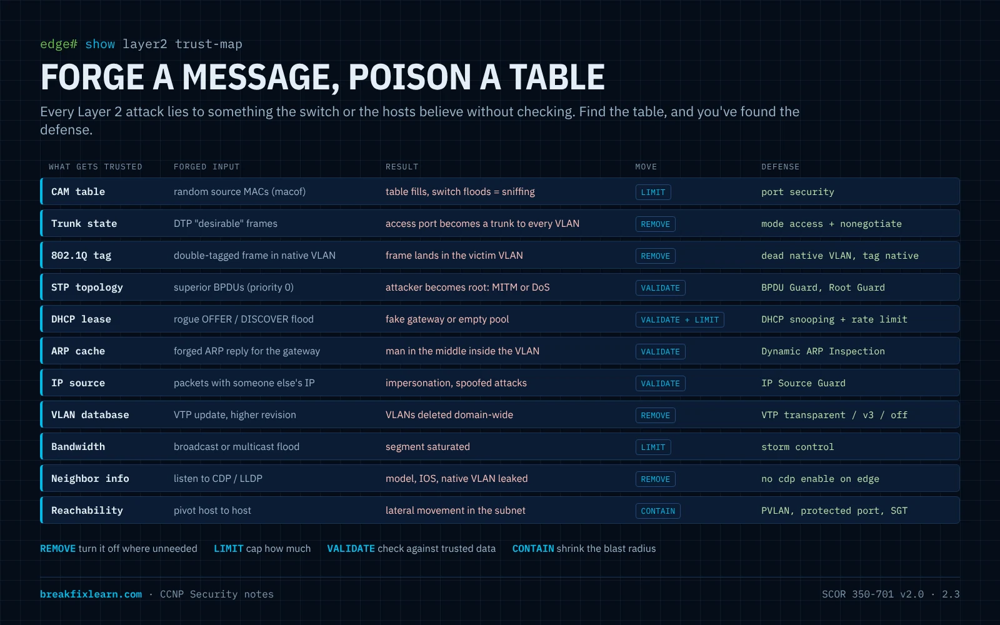
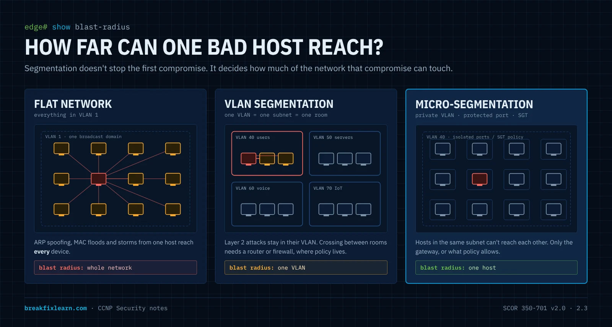
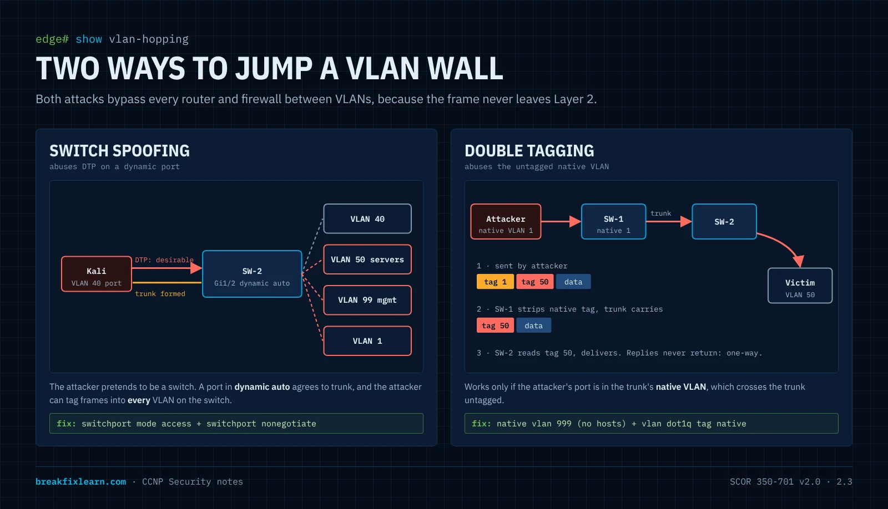
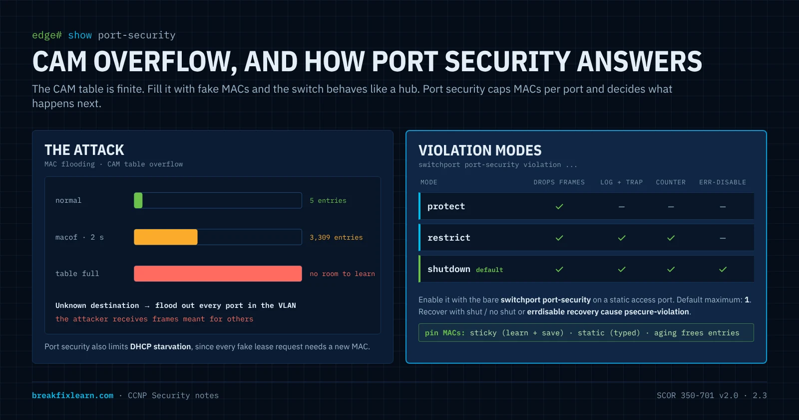
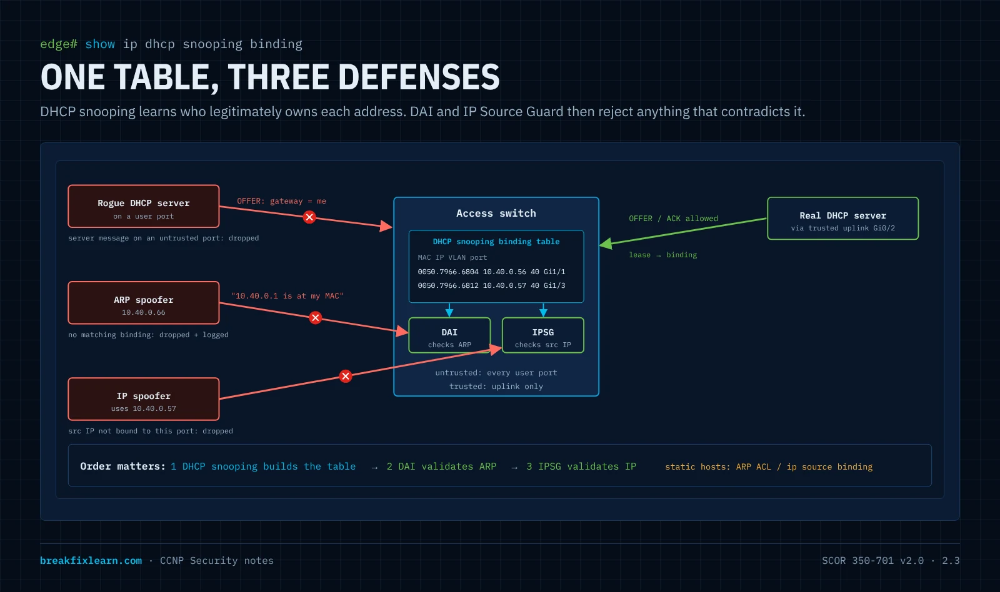
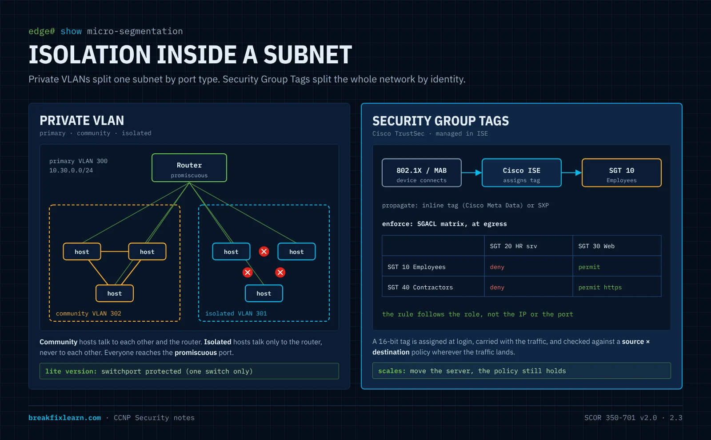

# Segmentation & Layer 2 Hardening

> **CCNP Security · SCOR 350-701 v2.0 · Domain 2.0 Network Security**
>
> **2.3** Configure network infrastructure security methods (network segmentation using VLANs or SGTs; Layer 2 and port security; DHCP snooping; Dynamic ARP inspection; storm control; and defenses against MAC, ARP, VLAN hopping, STP, and DHCP rogue attacks)

---

# How to think about Layer 2 security

Before any command, get the mindset right. Almost every Layer 2 attack on the exam, and in real networks, follows the same pattern. Once you see the pattern, you stop memorizing features and start *deriving* them.

## Layer 2 trusts everyone

The protocols that make a switched network work were designed for a friendly room: **ARP, DHCP, STP, DTP, CDP/LLDP and VTP have no authentication by default.** A switch believes whatever frame arrives on a port:

- A frame says "I am MAC `aaaa.bbbb.cccc`". The switch writes it into the **CAM table**.
- An ARP reply says "10.40.0.1 is at my MAC". Every host updates its **ARP cache**.
- A DHCP offer says "your gateway is 10.40.0.66". The client **believes it**.
- A BPDU says "I am the best root bridge". The whole VLAN **rebuilds its spanning tree** around the sender.
- A DTP frame says "let's trunk". A port in a dynamic mode **becomes a trunk**.

So the attacker's playbook is short:

> **Forge a control message → the network updates a table → traffic goes where the attacker wants.**

Every defense in this module breaks that chain in one of four ways:

| Defense move | Meaning | Examples |
|---|---|---|
| **Remove** | Turn the protocol off where it isn't needed | `switchport nonegotiate` (DTP), `no cdp enable`, VTP transparent, shut unused ports |
| **Limit** | Allow it, but cap how much | Port security (MAC count), DHCP snooping and DAI rate limits, storm control |
| **Validate** | Check the message against something trusted | DHCP snooping (trusted ports), DAI (binding table), IP Source Guard, BPDU Guard, Root Guard |
| **Contain** | Accept that something will get through and shrink how far it reaches | VLANs, private VLANs, protected ports, SGTs |



## The three questions for every port

When you design or audit a switch, walk every port and ask:

1. **Who should be on the other end?** A user PC, an IP phone, a server, another switch, nobody?
2. **What is it allowed to say?** Should this port ever send BPDUs, DHCP offers, DTP, more than a few MACs, ARP for addresses it doesn't own?
3. **If it lies, how far does the lie travel, and how will I know?** That's the blast radius (VLAN, private VLAN, SGT) and the detection (err-disable logs, SNMP traps, counters).

A user port answers: *a PC (maybe a phone), never BPDUs or DHCP offers or DTP, a handful of MACs, only ARP for its own DHCP lease.* That answer **is** the configuration: access mode, nonegotiate, BPDU Guard, untrusted for DHCP snooping and DAI, port security max 2 to 5, storm control. You just wrote the access-port template from first principles.

## Trusted vs. untrusted: the boundary is the access edge

Almost every validating feature has the same idea: **ports facing users are untrusted; ports facing infrastructure you control are trusted.** DHCP snooping trusts the uplink toward the real DHCP server, DAI trusts uplinks, BPDU Guard lives on edge ports, Root Guard sits on ports where the root must never appear. If you can draw the trust boundary on a topology, you can place every feature correctly. That is also how exam scenario questions are built: "which port should be trusted?"

## Defaults are built for plug-and-play, not security

| Default | Why it exists | Why it's a risk |
|---|---|---|
| Ports in `dynamic auto` (on many switches) | Trunks form automatically | Switch-spoofing VLAN hopping |
| Native VLAN 1, untagged | Backward compatibility | Double-tagging VLAN hopping |
| Trunks allow VLANs 1-4094 | Nothing breaks | Every VLAN reaches every switch |
| Every port in VLAN 1 and up | Plug in and it works | Walk-up access from any jack |
| Unlimited MACs per port | Hubs, VMs, phones | MAC flooding, CAM overflow |
| CDP/LLDP on everywhere | Neighbor discovery | Free reconnaissance for an attacker |
| VTP server mode | VLANs sync automatically | One bad switch can wipe the VLAN database |

Hardening a switch is mostly the act of **replacing each default with a deliberate choice.**

## A design method you can reuse

1. **Segment first.** Group devices by trust and function into VLANs, one subnet each. This limits blast radius before anything else.
2. **Classify every port**: access edge, infrastructure uplink, or unused. Each class gets one template.
3. **Remove** what each class doesn't need (DTP, CDP, VLAN 1, native VLAN 1, unused VLANs on trunks).
4. **Limit and validate** the protocols you must keep (port security, BPDU Guard, DHCP snooping, DAI, IPSG, storm control).
5. **Contain inside the segment** where hosts shouldn't talk (private VLANs, protected ports, SGTs).
6. **Prove it**: re-run each attack and confirm it fails, then check the logs fired.

The rest of this module follows exactly that order.

## Where this sits in SCOR v2.0

| Objective | How this module covers it |
|---|---|
| **2.3** Configure network infrastructure security methods | **The whole module**: VLANs and SGTs, port security, DHCP snooping, DAI, storm control, and defenses against MAC, ARP, VLAN hopping, STP and rogue DHCP attacks |
| 2.4 Management options (in-band vs. out-of-band) | Management VLAN, shutting the VLAN 1 SVI |
| 2.5 CIS benchmarks for IOS XE | The "remove the defaults" mindset; the management baseline in the lab |
| 2.7 Secure network management | SSH v2, local AAA, exec-timeout, banners in the lab baseline |
| 6.1 / 6.3 Identity and 802.1X with ISE | How SGTs get assigned, and why 802.1X beats port security against MAC spoofing |

> 2.3 starts with the verb **Configure**, unlike the "Describe" objectives around it. Expect to recognize the exact commands, the show output, and what happens when each feature triggers.

---

# Why Layer 2 is where containment begins

When engineers think about network security they jump to firewalls, VPNs and IPS, all Layer 3 and above. What gets overlooked is how much containment lives down at **Layer 2**, on the switches themselves. Long before traffic reaches a firewall, the way you carve up the switched network decides *how far a problem can spread*. The theme of this module: **use Layer 2 to limit the blast radius.**



## The blast-radius analogy

Picture one open office floor with no interior walls. If one person starts shouting and setting off alarms, *everyone* on the floor is affected immediately.

A flat network is that open floor. One big **Layer 2 broadcast domain** means every device can reach every other device directly, and a single compromised host can touch them all. A worm, an ARP-spoofing attacker, a broadcast storm: in a flat design, the whole floor is the blast zone.

Now add interior walls. If someone goes rogue in one room, the damage stays **in that room**. Those walls are **VLANs**. A Layer 2 attack that erupts in one VLAN (ARP poisoning, MAC flooding, a broadcast storm) stays inside that VLAN.

> **The principle:** segmentation isn't about making the network complicated. It's about making sure that *when* something goes wrong, it stays contained.

## VLANs and subnets: one to one

In a clean design there's a **1:1 relationship between a VLAN (broadcast domain) and an IP subnet**:

| VLAN | Purpose | Subnet |
|---|---|---|
| **40** users | User hosts | `10.40.0.0/24` |
| **50** servers | Servers | `10.50.0.0/24` |
| **99** mgmt | Switch management | `10.99.0.0/24` |

Layer 2 builds the walls; Layer 3 addressing rides on top. Traffic *between* VLANs must be routed, and that routed boundary is where firewalls and ACLs enforce policy (see [firewall and IPS deployment](/ccnp-security/network-security-firewall-ips-visibility#firewall-ips-solutions-and-deployment-models)). This module focuses on what the switches themselves can do before routing enters the picture.

## Where Layer 2 sits

| Layer | PDU | Device | This module's concern |
|---|---|---|---|
| 3 Network | Packet | Router / L3 switch | The inter-VLAN boundary (noted, not the focus) |
| **2 Data link** | **Frame** | **Switch** | **VLANs, trunks, CAM table, STP, DHCP/ARP validation** |
| 1 Physical | Bits | Cabling, jacks | Where an attacker plugs in (unused ports) |

## The threats this module defends against

| Attack | What the attacker does | Defense |
|---|---|---|
| **MAC flooding / CAM overflow** | Floods random source MACs until the CAM table fills; the switch floods unknown unicast out every port, so the attacker can sniff | [Port security](#port-security-containing-the-endpoint) |
| **MAC spoofing** | Clones a legitimate host's MAC to steal its traffic or its port | Sticky/static port security; 802.1X for real identity |
| **VLAN hopping: switch spoofing** | Negotiates a trunk with DTP and reaches every VLAN | [Access/trunk hardening](#access-ports-trunks-and-the-native-vlan) |
| **VLAN hopping: double tagging** | Stacks two 802.1Q tags to jump from the native VLAN into another | Native VLAN hardening |
| **STP manipulation** | Sends superior BPDUs to become root: man-in-the-middle or a topology DoS | [BPDU Guard, Root Guard](#spanning-tree-protection) |
| **Rogue DHCP server** | Hands out its own gateway/DNS to become the man in the middle | [DHCP snooping](#dhcp-snooping) |
| **DHCP starvation** | Exhausts the pool with thousands of fake requests | DHCP snooping rate limit + port security |
| **ARP spoofing / poisoning** | Forges ARP replies to intercept traffic in the VLAN | [Dynamic ARP Inspection](#dynamic-arp-inspection-and-ip-source-guard) |
| **IP spoofing** | Uses an IP address it wasn't given | IP Source Guard |
| **Broadcast / multicast storm** | A loop or a flood saturates the segment | [Storm control](#storm-control) |
| **VTP database overwrite** | A switch with a higher revision wipes the VLANs | VTP transparent / VTPv3 / no VTP |
| **Walk-up access** | Plugs into a live, unused jack | Shut unused ports + dead VLAN |
| **Lateral movement in a subnet** | Pivots host to host in the same VLAN | Private VLANs, protected ports, SGTs |

## The reference topology

The demonstrations use two switches trunked together and endpoints split across two VLANs:

- **SW-1 ── trunk ── SW-2**
- **VLAN 50** `10.50.0.0/24`: a server
- **VLAN 40** `10.40.0.0/24`: PC-3 and a Kali Linux host (the attacker)

The attack demos (Yersinia, macof) were run on virtual IOS switches, so interfaces read `Gi0/x` and `Gi1/x`. The [downloadable Packet Tracer lab](/ccnp-security/labs/segmentation-l2-hardening-packet-tracer) uses Catalyst 2960 switches, where user ports are `Fa0/1` to `Fa0/24`. The logic is identical.

---

# VLAN segmentation as a blast-radius control

This part builds the segmentation with **basic CCNA-level commands only, not hardened best practice.** That's deliberate: configuring it the minimal way exposes exactly the gaps the next parts close. Lay the foundation, then walk the building and find every unlocked door.

## Start from the baseline

Both switches start at defaults: no custom VLANs, every port in VLAN 1.

```
SW-2# show vlan brief
VLAN Name                             Status    Ports
---- -------------------------------- --------- -------------------------------
1    default                          active    Gi0/0, Gi0/1, Gi0/2, Gi0/3
                                                Gi1/0, Gi1/1, Gi1/2, Gi1/3
1002 fddi-default                     act/unsup
1003 trcrf-default                    act/unsup
1004 fddinet-default                  act/unsup
1005 trbrf-default                    act/unsup
```

Everything in VLAN 1 is the open floor.

## Create and name the VLANs

Names are documentation that saves the next engineer (and you, during an incident):

```
SW-2# configure terminal
SW-2(config)# vlan 40
SW-2(config-vlan)# name users
SW-2(config-vlan)# vlan 50
SW-2(config-vlan)# name servers
SW-2(config-vlan)# end
```

## Assign access ports

```
SW-2(config)# interface gig 1/0
SW-2(config-if)# description to Server
SW-2(config-if)# switchport access vlan 50
SW-2(config-if)# interface range gig 1/1 - 2
SW-2(config-if-range)# switchport access vlan 40
```

```
SW-2# show interface status
Port    Name        Status      Vlan   Duplex  Speed Type
Gi1/0   to Server   connected   50     a-full  auto  RJ45
Gi1/1   to PC-3     connected   40     a-full  auto  RJ45
Gi1/2   to Linux    connected   40     a-full  auto  RJ45
```

> **The containment payoff:** a Layer 2 attack launched from PC-3 (VLAN 40) now stays inside VLAN 40. The server in VLAN 50 is behind a wall, from VLAN assignment alone.

## Bring up the trunk (the basic way)

Look at the inter-switch port's default state first and notice two red flags:

```
SW-2# show interface gig 0/2 switchport
Name: Gi0/2
Switchport: Enabled
Administrative Mode: dynamic auto            <-- red flag 1: DTP
Operational Mode: static access
Negotiation of Trunking: On                  <-- red flag 1: DTP
Access Mode VLAN: 1 (default)
Trunking Native Mode VLAN: 1 (default)       <-- red flag 2: native VLAN 1
```

```
SW-2(config)# interface gig 0/2
SW-2(config-if)# switchport trunk encapsulation dot1q
SW-2(config-if)# switchport mode trunk
```

`switchport trunk encapsulation dot1q` is only needed on switches that also support ISL (and some virtual switches); a Catalyst 2960 is 802.1Q-only and rejects it.

```
SW-2# show interface trunk
Port    Mode  Encapsulation  Status    Native vlan
Gi0/2   on    802.1q         trunking  1

Port    Vlans allowed on trunk
Gi0/2   1-4094

Port    Vlans allowed and active in management domain
Gi0/2   1,40,50
```

## The security debt this leaves behind

| Red flag | Why it's dangerous | Fixed in |
|---|---|---|
| **DTP on** (`dynamic auto`, "Negotiation of Trunking: On") | An attacker's device can negotiate a trunk and reach every VLAN: **switch spoofing** | [Access ports and trunks](#access-ports-trunks-and-the-native-vlan) |
| **Native VLAN 1** | Native frames cross the trunk untagged: the lever for **double tagging** | Native VLAN hardening |
| **Trunk allows 1-4094** | Every VLAN goes everywhere, even where it isn't needed | Trunk pruning |

Both ends started as `dynamic auto`, so neither side initiated and no trunk formed until one side was forced. That's luck, not security: with DTP on, a *malicious* device can be the side that initiates.

## Where did the VLANs come from on the other switch? VTP

When the trunk came up, SW-1 suddenly knew VLANs 40 and 50. **VTP (VLAN Trunking Protocol)** synchronizes the VLAN database across trunked switches in the same domain:

```
SW-2# show vtp status
VTP Operating Mode              : Server
VTP Domain Name                 : OGIT
Configuration Revision          : 16
```

Create VLAN 999 on SW-2 and it appears on SW-1 seconds later.

> **Why this matters:** a switch inserted with the same domain and a **higher configuration revision** can overwrite the whole domain's VLAN database, deleting production VLANs and black-holing traffic. This is the **VTP bomb**. Mitigations: **VTP transparent mode** (the switch keeps its own VLANs and only relays VTP), **VTPv3** (only the designated *primary server* can change the database, plus a password), or **VTP off**. Remember: *highest revision wins*.

## Prove the segment works

```
PC-3> ip dhcp
DORA IP 10.40.0.56/24 GW 10.40.0.1
```

PC-3's frames enter on an access port in VLAN 40, cross the trunk **tagged 40**, and reach the DHCP server. The 1:1 VLAN-to-subnet design holds.

---

# Access ports, trunks and the native VLAN

Now attack the gaps from an endpoint, then harden the switch so the same attack fails.



## The vulnerability, seen from the switch

The Kali host sits on access port `Gi1/2` in VLAN 40:

```
SW-2# show interface gig 1/2 switchport
Administrative Mode: dynamic auto
Operational Mode: static access
Negotiation of Trunking: On            <-- the hole
Access Mode VLAN: 40 (users)
```

It *operates* as an access port, but "Negotiation of Trunking: On" means it still speaks **DTP**. It's willing to become a trunk if something asks.

## DTP modes: which combinations form a trunk

Know this matrix; the exam loves it.

| Side A \ Side B | access | dynamic auto | dynamic desirable | trunk |
|---|---|---|---|---|
| **access** | access | access | access | *mismatch* |
| **dynamic auto** | access | **access** | trunk | trunk |
| **dynamic desirable** | access | trunk | trunk | trunk |
| **trunk** | *mismatch* | trunk | trunk | trunk |

- `dynamic auto` waits to be asked; `dynamic desirable` actively asks. An attacker who sends "desirable" DTP frames to an `auto` port gets a trunk.
- `switchport nonegotiate` stops sending DTP. It only works with a hard-coded mode (`access` or `trunk`); a nonegotiate trunk needs the other end hard-coded to `trunk` as well.

## The attack: switch-spoofing VLAN hopping

On Kali, `ifconfig` shows a normal VLAN 40 host (`10.40.0.55`). The attacker launches **Yersinia**, a classic Layer 2 attack tool, in graphical mode (`yersinia -g`). It immediately lists the protocols the switch leaks: CDP, DTP, 802.1Q, STP. One menu action sends DTP "let's trunk" frames:

```
SW-2# show interface trunk
Port    Mode  Encapsulation  Status    Native vlan
Gi0/2   on    802.1q         trunking  1
Gi1/2   on    802.1q         trunking  1        <-- the attacker's port is now a TRUNK
```

**The wall just fell.** `Gi1/2` carries every VLAN. The attacker can tag frames for VLAN 50, VLAN 1 or any other VLAN and talk directly to those segments. No firewall, router ACL or inter-VLAN control is in the path.

> Every segmentation control assumes the attacker is stuck in one VLAN. Switch spoofing removes that assumption in one click against a port left in its default mode. "It works" is not the same as "it's secure."

## Fix 1: hard-code access ports (kill DTP)

```
SW-2(config)# interface gig 1/2
SW-2(config-if)# switchport mode access
SW-2(config-if)# switchport nonegotiate
```

Or use the macro on every access port:

```
SW-2(config)# interface range gig 1/0 - 2
SW-2(config-if-range)# switchport host
```

`switchport host` = `switchport mode access` + `spanning-tree portfast` + `no channel-group`. Great for access ports; never use it on an uplink. Static access mode already stops DTP negotiation; add `switchport nonegotiate` if you want DTP frames gone entirely.

```
SW-2# show interface gig 1/2 switchport
Administrative Mode: static access
Negotiation of Trunking: Off            <-- fixed
```

Re-run the Yersinia DTP attack: nothing happens, and `Gi1/2` never appears in `show interface trunk`.

## Fix 2: harden the trunk itself

Trunks to switches you control should also be hard-coded:

```
SW-2(config)# interface gig 0/2
SW-2(config-if)# switchport mode trunk
SW-2(config-if)# switchport nonegotiate
SW-2(config-if)# switchport trunk allowed vlan 40,50,99
```

The allowed list is **pruning by policy**: only VLANs that must cross this link are carried. A VLAN that never reaches a switch can't be attacked from that switch.

## Fix 3: the native VLAN (kill double tagging)

Frames in the **native VLAN** cross an 802.1Q trunk **untagged**. That's the lever for the second VLAN-hopping technique.

**How double tagging works:** the attacker sits in the native VLAN (VLAN 1 by default) and sends a frame with **two** 802.1Q tags: outer = native VLAN, inner = victim VLAN. The first switch sees the outer tag matches the native VLAN, strips it and sends the frame onto the trunk, which now carries the *inner* tag. The next switch reads the inner tag and delivers the frame into the victim VLAN. It's **one-way** (replies don't come back the same way), which still works for spoofed attacks and some DoS.

It needs two conditions: **the attacker's access port is in the native VLAN**, and **the native VLAN is untagged on the trunk**. Break both:

```
SW-2(config)# vlan 999
SW-2(config-vlan)# name Native-T
SW-2(config-vlan)# exit
SW-2(config)# interface gig 0/2
SW-2(config-if)# switchport trunk native vlan 999
```

Until both ends match you'll see:

```
%SPANTREE-2-RECV_PVID_ERR: Received BPDU with inconsistent peer vlan id 1 on Gi0/2 VLAN999.
%CDP-4-NATIVE_VLAN_MISMATCH: Native VLAN mismatch discovered on GigabitEthernet0/2 ...
```

Set `switchport trunk native vlan 999` on SW-1's end too and the errors clear. No host port ever lives in VLAN 999, so nobody can stand in the native VLAN.

**Tag the native VLAN as well.** On Catalyst switches the global command `vlan dot1q tag native` makes the switch tag native-VLAN frames on trunks, which defeats double tagging outright (some platforms offer a per-interface version). Packet Tracer doesn't model it.

> Some environments use the native VLAN for management or fallback and can't change it freely. The principle still holds: if you must keep native VLAN 1, tag it, keep hosts out of it, and prune it where you can.

## The rules to memorize

| Port type | Rule | Commands |
|---|---|---|
| **Access** | Hard-code access, no DTP | `switchport mode access` + `switchport nonegotiate` (or `switchport host`) |
| **Trunk** | Hard-code trunk, no DTP, prune | `switchport mode trunk` + `nonegotiate` + `switchport trunk allowed vlan ...` |
| **Native VLAN** | Dead VLAN, tagged, no hosts | `switchport trunk native vlan 999` + `vlan dot1q tag native` |
| **Unused** | Down and parked | `shutdown` + `switchport access vlan 777` |

---

# Port security: containing the endpoint

The ports can't be talked into trunking any more, but a device can still abuse the port it legitimately has, by attacking the switch's **CAM table**.



## The threat: CAM overflow / MAC flooding

A switch learns source MACs into the **CAM table**, one entry per (VLAN, MAC) → port. The table is finite. Flood it with thousands of random source MACs and two things happen: the table fills, and legitimate entries age out without room to be relearned. For a destination it no longer knows, the switch **floods the frame out every port in the VLAN**, like a hub. The attacker, in the same VLAN, now **receives traffic that was never addressed to it**.

Baseline on VLAN 40:

```
SW-2# show mac address-table count vlan 40
Mac Entries for Vlan 40:
Dynamic Address Count : 5
```

On Kali, `sudo macof -i eth0` for under two seconds:

```
SW-2# show mac address-table count vlan 40
Mac Entries for Vlan 40:
Dynamic Address Count : 3309        <-- from 5, in about 2 seconds
```

Left running, it fills the table and the switch starts flooding. The same tool also makes a decent **DHCP starvation** precursor, since every fake MAC can ask for a lease.

## The fix: port security

Port security limits **how many** source MACs a port accepts and **what happens** when the limit is exceeded:

```
SW-2(config)# interface gig 1/2
SW-2(config-if)# switchport mode access
SW-2(config-if)# switchport port-security maximum 5
SW-2(config-if)# switchport port-security violation shutdown
SW-2(config-if)# switchport port-security
```

- Port security only works on a **static** access (or trunk) port, not a dynamic one. Hard-code the mode first.
- The default maximum is **1**. Pick a number that fits the port's real role: a PC alone = 1 or 2, an IP phone with a PC behind it = 2 or 3 (the phone's MAC can be learned in both the voice and data VLAN), a small VM host = more.
- **The number one mistake:** configuring `maximum` and `violation` but forgetting the bare `switchport port-security` line that actually **enables** the feature.

## The three violation modes

| Mode | Drops the offending frames? | Log + SNMP trap? | Violation counter? | Port err-disabled? |
|---|---|---|---|---|
| **protect** | Yes | No | No | No |
| **restrict** | Yes | **Yes** | **Yes** | No |
| **shutdown** (default) | Yes, the whole port goes down | **Yes** | **Yes** | **Yes** |

- **protect** silently drops traffic from new MACs. No visibility, so it's poor for detection.
- **restrict** drops and tells you. Useful where uptime matters (a shared conference-room port).
- **shutdown** err-disables the port: every frame stops, including legitimate ones. The strongest containment and the default.

```
SW-2# show port-security interface gig 1/2
Port Security              : Enabled
Port Status                : Secure-up
Violation Mode             : Shutdown
Maximum MAC Addresses      : 5
Total MAC Addresses        : 1
Security Violation Count   : 0
```

## Triggering a violation

Re-run `macof`:

```
%PM-4-ERR_DISABLE: psecure-violation error detected on Gi1/2, putting Gi1/2 in err-disable state

SW-2# show interface status err-disabled
Port    Name       Status        Reason
Gi1/2   to Linux   err-disabled  psecure-violation
```

`Secure-shutdown` + `err-disabled (psecure-violation)` is port security doing its job.

## Recovering the port

**Manually:** `shutdown` then `no shutdown` on the interface.

**Automatically:** err-disable recovery is off by default (interval 300 seconds once enabled):

```
SW-2(config)# errdisable recovery cause psecure-violation
SW-2(config)# errdisable recovery interval 60
```

```
SW-2# show errdisable recovery
ErrDisable Reason      Timer Status
psecure-violation      Enabled
Interfaces that will be enabled at the next timeout:
Interface   Errdisable reason    Time left(sec)
Gi1/2       psecure-violation    18
```

If the attack is still running when the port recovers, it exceeds 5 MACs instantly and err-disables again. The attacker only ever gets tiny windows, while an honest accident heals itself.

## Choosing which MACs are allowed

| Method | Command | Behavior |
|---|---|---|
| **Dynamic** | (default) | Learns up to the maximum; forgotten on reload |
| **Sticky** | `switchport port-security mac-address sticky` | Learns, then writes the MACs into the running config; `copy run start` makes them permanent |
| **Static** | `switchport port-security mac-address 0050.7966.6804` | You type the allowed MAC |

**Aging** frees entries so a port can accept a new device later: `switchport port-security aging time 10` and `aging type inactivity` (remove after 10 minutes of silence) or `absolute`.

## What port security does not do

- It doesn't stop **VLAN hopping** (that's DTP and native VLAN hardening).
- It doesn't stop **ARP spoofing** (that's DAI).
- It doesn't prove **identity**. An attacker who unplugs a printer and clones the printer's MAC passes sticky port security. Real identity at the port is **802.1X** (or MAB as a fallback) with ISE, which is SCOR objective 6.3.

---

# Spanning tree protection

STP prevents loops by electing a **root bridge** and blocking redundant links. The election trusts BPDUs blindly: the bridge advertising the lowest bridge ID (priority + MAC) wins.

## The attack

An attacker (or an employee with a cheap switch) connects to an access port and sends **superior BPDUs** with priority 0. The VLAN re-elects the attacker as root:

- **Man in the middle:** traffic between switches now flows toward and through the attacker's position.
- **Denial of service:** every re-election blocks ports for up to 30 to 50 seconds with classic STP, and repeated BPDU floods keep the topology churning.

## The defenses

| Feature | Where | What it does when triggered |
|---|---|---|
| **PortFast** | Access (edge) ports | Skips listening/learning so hosts come up fast; not a security feature by itself |
| **BPDU Guard** | PortFast edge ports | Any BPDU received → port **err-disabled** (`bpduguard`) |
| **Root Guard** | Designated ports where the root must never appear (distribution ports facing access switches) | Superior BPDU → port goes **root-inconsistent** (blocking); recovers on its own when the superior BPDUs stop |
| **Loop Guard** | Non-designated (root and alternate) ports on links between switches | Stops a blocked port from becoming forwarding when BPDUs stop arriving (unidirectional link) → **loop-inconsistent** |
| **BPDU Filter** | Rarely, carefully | Stops sending/receiving BPDUs: effectively **disables STP** on the port. Dangerous; a loop through that port is not detected |

```
! per port
SW-2(config)# interface range gig 1/0 - 2
SW-2(config-if-range)# spanning-tree portfast
SW-2(config-if-range)# spanning-tree bpduguard enable

! or globally: BPDU Guard on every PortFast port
SW-2(config)# spanning-tree portfast bpduguard default

! on a distribution switch, ports facing access switches
DSW(config-if)# spanning-tree guard root
```

Newer IOS uses `spanning-tree portfast edge` and `spanning-tree portfast edge bpduguard default`. Same idea.

**Place the root deliberately.** Root Guard only helps if the root is where you intend: `spanning-tree vlan 40,50 root primary` (or `priority 4096`) on the core/distribution switch.

```
%SPANTREE-2-BLOCK_BPDUGUARD: Received BPDU on port Gi1/2 with BPDU Guard enabled. Disabling port.
%PM-4-ERR_DISABLE: bpduguard error detected on Gi1/2, putting Gi1/2 in err-disable state
```

> **Exam pairing:** BPDU Guard = *edge ports, err-disable*. Root Guard = *ports where the root must never be, root-inconsistent, self-recovering*. Mixing these up is a classic wrong answer.

---

# DHCP snooping

DHCP has no authentication. The first offer a client receives usually wins.

## Two attacks

- **Rogue DHCP server (spoofing):** the attacker answers DHCP requests faster than the real server and hands out *its own IP as the default gateway* (or DNS). Every client that accepts sends its traffic through the attacker: a man-in-the-middle with no further effort.
- **DHCP starvation:** the attacker sends thousands of DISCOVERs from random MACs until the real pool is empty. Legitimate clients get nothing (DoS), and a rogue server is often brought up right after to fill the gap.

## How DHCP snooping thinks

DHCP snooping divides ports into **trusted** (toward the real DHCP server or the relay/uplink) and **untrusted** (everything else, the default):

- **Server messages** (OFFER, ACK, NAK) arriving on an **untrusted** port are **dropped**. A rogue server on a user port is silenced.
- Client messages on untrusted ports are checked; by default the switch verifies the frame's source MAC matches the client hardware address inside the DHCP packet (`ip dhcp snooping verify mac-address`).
- Every successful lease builds an entry in the **DHCP snooping binding table**: MAC, IP, lease, VLAN, port. This table is the **source of truth** that DAI and IP Source Guard later use.



## Configuration

```
SW-2(config)# ip dhcp snooping
SW-2(config)# ip dhcp snooping vlan 40,50
SW-2(config)# interface gig 0/2
SW-2(config-if)# ip dhcp snooping trust              ! uplink toward the real server
SW-2(config-if)# interface range gig 1/0 - 2
SW-2(config-if-range)# ip dhcp snooping limit rate 10 ! DHCP packets per second on user ports
```

- Both the global command **and** the per-VLAN command are required. Forgetting `ip dhcp snooping vlan` is the usual mistake.
- Exceeding the rate limit **err-disables** the port (`dhcp-rate-limit`). Combined with port security's MAC cap, this kills starvation.
- **Option 82:** by default the switch inserts option 82 (relay agent information) into client requests. If the switch isn't the relay, an upstream router or DHCP server may drop those packets, and clients stop getting addresses. Fix with `no ip dhcp snooping information option` on the switch (or trust option 82 on the relay). A very common real-world "DHCP broke after I enabled snooping" cause.

## Verification

```
SW-2# show ip dhcp snooping
Switch DHCP snooping is enabled
DHCP snooping is configured on following VLANs:
40,50
Interface                  Trusted    Allow option    Rate limit (pps)
GigabitEthernet0/2         yes        yes             unlimited
GigabitEthernet1/2         no         no              10

SW-2# show ip dhcp snooping binding
MacAddress          IpAddress     Lease(sec)  Type           VLAN  Interface
00:50:79:66:68:04   10.40.0.56    86017       dhcp-snooping  40    GigabitEthernet1/1
```

---

# Dynamic ARP Inspection and IP Source Guard

## ARP spoofing

ARP maps IP to MAC with no authentication, and hosts accept **unsolicited (gratuitous) replies**. The attacker tells PC-3 "10.40.0.1 (the gateway) is at my MAC" and tells the gateway "10.40.0.56 is at my MAC". Both now send through the attacker: a classic man in the middle inside one VLAN. VLANs **contain** it to one segment; DAI **stops** it.

## How DAI thinks

On **untrusted** ports, **Dynamic ARP Inspection** intercepts every ARP request and reply and checks the sender's IP-to-MAC pair against the **DHCP snooping binding table**. No matching binding, no forwarding: the ARP is dropped and logged. **Trusted** ports (uplinks) skip the check.

```
SW-2(config)# ip arp inspection vlan 40,50
SW-2(config)# interface gig 0/2
SW-2(config-if)# ip arp inspection trust
SW-2(config-if)# exit
SW-2(config)# ip arp inspection validate src-mac dst-mac ip   ! optional extra checks
```

Key behaviors:

- **Depends on DHCP snooping.** Without bindings, DAI drops legitimate ARP. Enable snooping first.
- **Static IP hosts** (servers, printers) have no DHCP binding. Give DAI an **ARP ACL**, or their ARP gets dropped:

```
SW-2(config)# arp access-list STATIC-HOSTS
SW-2(config-arp-nacl)# permit ip host 10.50.0.10 mac host 0050.7966.6800
SW-2(config)# ip arp inspection filter STATIC-HOSTS vlan 50
```

- **Rate limit:** untrusted ports allow **15 ARP packets per second** by default; exceeding it **err-disables** the port (`arp-inspection`). ARP floods are contained too.
- `validate src-mac dst-mac ip` adds checks: Ethernet source MAC = ARP sender MAC, destination MAC consistency, and no invalid IPs (0.0.0.0, broadcast, multicast).

```
%SW_DAI-4-DHCP_SNOOPING_DENY: 1 Invalid ARPs (Res) on Gi1/2, vlan 40.([5000.0003.0000/10.40.0.1/...])
SW-2# show ip arp inspection statistics vlan 40
```

## IP Source Guard

DAI validates ARP. **IP Source Guard (IPSG)** validates **every IP packet** on an untrusted port: the source IP (and optionally source MAC) must match the binding for that port. A host that statically configures someone else's address is filtered.

```
SW-2(config)# interface range gig 1/1 - 2
SW-2(config-if-range)# ip verify source                  ! source IP check
SW-2(config-if-range)# ip verify source port-security    ! source IP + MAC (with port security)
! static host without DHCP:
SW-2(config)# ip source binding 0050.7966.6800 vlan 50 10.50.0.10 interface gig 1/0
```

Verify with `show ip verify source`. (Newer IOS XE versions express the MAC check as `ip verify source mac-check`.)

> **The chain to remember:** DHCP snooping **builds** the binding table → DAI uses it to validate **ARP** → IPSG uses it to validate **IP source addresses**. Snooping first, always.

---

# Storm control

A loop, a broken NIC or an attacker can flood a segment with broadcast, multicast or unknown-unicast frames until links and switch CPUs saturate. **Storm control** measures that traffic per port and acts when it crosses a threshold:

```
SW-2(config)# interface range gig 1/0 - 2
SW-2(config-if-range)# storm-control broadcast level 20.00 10.00   ! rising 20%, falling 10% of bandwidth
SW-2(config-if-range)# storm-control multicast level 30.00
SW-2(config-if-range)# storm-control action trap                  ! or: shutdown
```

- Thresholds can be a **percentage** of bandwidth, **bps** or **pps**.
- Default action: the switch **drops** the excess traffic of that type until the rate falls below the falling threshold. Add `action trap` to send an SNMP trap and log, or `action shutdown` to err-disable the port.
- Verify with `show storm-control` (and per type, e.g. `show storm-control gig 1/2 broadcast`).

Storm control is your blast-radius tool **within** a VLAN when the problem is volume rather than forgery.

---

# Unused ports, VTP, CDP and the management plane

## Unused ports: down and parked

A port left at defaults is in VLAN 1 and up. Anyone who plugs into a lobby jack lands on the network.

```
SW-2(config)# vlan 777
SW-2(config-vlan)# name Nowhere
SW-2(config)# interface range gig 0/0 - 1 , gig 0/3 , gig 1/3
SW-2(config-if-range)# switchport mode access
SW-2(config-if-range)# switchport access vlan 777
SW-2(config-if-range)# shutdown
```

**Both** actions, every time: shut it, and park it in a dead VLAN that isn't routed or trunked anywhere. If someone later re-enables the port by mistake, it still goes nowhere.

## VTP

Covered above: use **transparent mode**, **VTPv3** with a primary server and password, or no VTP. Never insert a switch from a lab into production without resetting its revision (changing the domain name or setting transparent mode resets it to 0).

## CDP and LLDP

CDP/LLDP advertise the switch model, IOS version, management IP, native VLAN and port: free reconnaissance for an attacker on a user port (Yersinia shows it immediately). Disable them on user-facing ports:

```
SW-2(config-if)# no cdp enable
SW-2(config-if)# no lldp transmit
SW-2(config-if)# no lldp receive
```

Keep them on infrastructure links if your IP phones or operations depend on them. That's the "remove what the port doesn't need" rule again.

## The management plane

- **Management VLAN, not VLAN 1:** put the switch SVI in a dedicated VLAN (99 in the lab) and `shutdown` the VLAN 1 SVI. Carry VLAN 99 only on trunks that need it.
- **SSH only** (`transport input ssh`, SSH v2), local or AAA users, `exec-timeout`, a login banner, `service password-encryption`, and `no ip http server` where the web UI isn't used.
- These are exactly the kind of checks the **CIS benchmark for Cisco IOS / IOS XE** lists (objective 2.5): a published, checkable baseline. The lab applies this baseline before any Layer 2 work, because a switch whose management plane is open doesn't need to be VLAN-hopped.

---

# Micro-segmentation: private VLANs, protected ports and SGTs

VLANs build walls *between* subnets. Sometimes hosts in the **same** VLAN and subnet must not talk: tenants on one hosting segment, printers, guest devices, IoT. Three tools, from local to enterprise-wide.



## Private VLANs

A **private VLAN** keeps one subnet and one gateway but splits the VLAN into port types:

| Component | Port type | Can talk to |
|---|---|---|
| **Primary VLAN** | **Promiscuous** (router, firewall, gateway) | Everyone in the private VLAN |
| **Community** (secondary) | Community | Its own community + promiscuous |
| **Isolated** (secondary) | Isolated | **Only** promiscuous. Not even other isolated ports |

A primary VLAN can have several community VLANs but **only one isolated VLAN**. Example, one subnet `10.30.0.0/24` with gateway `10.30.0.1`:

```
SW(config)# vtp mode transparent                 ! VTPv1/v2 can't carry PVLANs
SW(config)# vlan 301
SW(config-vlan)# private-vlan isolated
SW(config)# vlan 302
SW(config-vlan)# private-vlan community
SW(config)# vlan 300
SW(config-vlan)# private-vlan primary
SW(config-vlan)# private-vlan association 301,302

SW(config)# interface gig 1/1                    ! isolated host
SW(config-if)# switchport mode private-vlan host
SW(config-if)# switchport private-vlan host-association 300 301

SW(config)# interface gig 1/0                    ! router / firewall
SW(config-if)# switchport mode private-vlan promiscuous
SW(config-if)# switchport private-vlan mapping 300 301,302
```

(On a Layer 3 switch the SVI for VLAN 300 uses `private-vlan mapping 301,302` instead of a promiscuous port.) Verify with `show vlan private-vlan` and `show interface gig 1/1 switchport`.

> **Use case:** "Several devices share a subnet, and none of them may reach each other." Put them in the isolated VLAN: same subnet, same switch, zero host-to-host reachability. The blast radius shrinks to one host.

## Protected ports (PVLAN edge)

`switchport protected` is the lightweight version: **protected ports can't forward unicast, broadcast or multicast to other protected ports on the same switch**; they can still reach unprotected ports (the uplink). It's **locally significant only**: it doesn't extend across switches. Packet Tracer supports it, which is why the lab uses it as the stand-in for private VLANs.

## VLAN ACLs (VACLs)

Another intra-VLAN tool: a **VACL** (`vlan access-map` + `vlan filter`) filters traffic *within* a VLAN, including bridged traffic that never reaches a router. Useful when you need policy finer than "isolated or not".

## Security Group Tags (Cisco TrustSec)

Private VLANs are tied to **ports and location**. **SGTs** segment by **who or what the device is**:

1. **Classify.** When a device connects, it's assigned a **Security Group Tag**, a 16-bit number for its role (Employees, HR Servers, Cameras). Dynamically via **802.1X or MAB with ISE**, or statically by IP-to-SGT, subnet-to-SGT, VLAN-to-SGT or port mappings.
2. **Propagate.** The tag travels with the traffic: **inline tagging** (the SGT is carried in a Cisco Meta Data field in the Ethernet frame between capable devices) or **SXP**, the SGT Exchange Protocol, which shares IP-to-SGT mappings over TCP with devices that can't tag in hardware.
3. **Enforce.** A policy matrix of source tag × destination tag, typically **applied at egress** with **SGACLs** (or by a firewall that understands SGTs). "Employees may not talk to HR Servers" holds wherever either one connects.

Policies and the matrix are defined centrally in **Cisco ISE** and pushed to the network. The payoff is **location independence**: move the HR server to another data center and the rule still applies, with no ACL rewrites.

## Which tool when

| | Private VLAN | Protected port | SGT (TrustSec) |
|---|---|---|---|
| Segments by | Port type | Port flag | Identity / role |
| Scope | Switch / VLAN (can span trunks) | One switch only | Whole TrustSec domain |
| Follows the device? | No | No | **Yes** |
| Enforcement | Port forwarding rules | Port forwarding rules | SGACL policy matrix |
| Managed by | Switch config | Switch config | **ISE**, centrally |
| Best for | "Same subnet, these hosts mustn't talk" | Quick isolation on one switch | Scalable, role-based, location-independent policy |

---

# Putting it together: golden port templates

This is the "classify every port, one template per class" step from the design method, written as real IOS configuration.

## Global

```
vtp mode transparent
vlan 40
 name users
vlan 50
 name servers
vlan 99
 name mgmt
vlan 777
 name Nowhere
vlan 999
 name Native-T
vlan dot1q tag native
ip dhcp snooping
ip dhcp snooping vlan 40,50
no ip dhcp snooping information option
ip arp inspection vlan 40,50
spanning-tree portfast bpduguard default
errdisable recovery cause psecure-violation
errdisable recovery cause bpduguard
errdisable recovery cause dhcp-rate-limit
errdisable recovery cause arp-inspection
errdisable recovery interval 300
interface vlan 1
 shutdown
```

## Access edge (user)

```
interface range gig 1/1 - 2
 description Users
 switchport mode access
 switchport access vlan 40
 switchport nonegotiate
 switchport port-security maximum 3
 switchport port-security violation restrict
 switchport port-security aging time 10
 switchport port-security
 spanning-tree portfast
 ip dhcp snooping limit rate 10
 ip verify source
 storm-control broadcast level 20.00 10.00
 storm-control action trap
 no cdp enable
```

## Infrastructure uplink (trunk)

```
interface gig 0/2
 description trunk to SW-1
 switchport mode trunk
 switchport nonegotiate
 switchport trunk native vlan 999
 switchport trunk allowed vlan 40,50,99
 ip dhcp snooping trust
 ip arp inspection trust
```

## Unused

```
interface range gig 0/0 - 1 , gig 0/3 , gig 1/3
 switchport mode access
 switchport access vlan 777
 shutdown
```

Choices like `restrict` vs. `shutdown`, or the exact storm-control levels, depend on the site. What doesn't change is the shape: **every port has a class, and every class has a reason for each line.**

---

# Validation: re-run every attack

Hardening isn't done until you've tried to break it. For each control, attack, observe the expected failure, and confirm the switch told you.

| Attack | Expected result after hardening | Where you see it |
|---|---|---|
| Yersinia DTP "enable trunking" | No trunk forms | `show interface trunk` (attacker port absent), `show interface x switchport` = Negotiation Off |
| Double-tagged frame from a user port | Nothing reaches the victim VLAN; user ports aren't in the native VLAN | `show interface trunk` native 999; `show vlan brief` (999 has no ports) |
| `macof` MAC flood | Port err-disabled (shutdown) or drops + counter (restrict) | `%PM-4-ERR_DISABLE ... psecure-violation`, `show port-security` |
| Rogue switch sends BPDUs | Port err-disabled | `%SPANTREE-2-BLOCK_BPDUGUARD`, `show interface status err-disabled` |
| Rogue DHCP server on a user port | Clients still get leases from the real server | `show ip dhcp snooping`, `show ip dhcp snooping binding` |
| DHCP starvation | Port err-disabled by the rate limit; MAC cap stops random MACs | `dhcp-rate-limit` err-disable reason |
| ARP spoofing the gateway | Forged ARPs dropped and logged | `%SW_DAI-4-DHCP_SNOOPING_DENY`, `show ip arp inspection statistics` |
| Static spoofed source IP | Packets filtered | `show ip verify source` |
| Plug into an unused jack | No link, no VLAN | `show interface status` = disabled, VLAN 777 |
| PC to PC in an isolated/protected segment | Ping fails; gateway still reachable | Ping tests |

Then check that each event produced a **log entry or trap**. A control you can't see firing is a control you can't trust in an incident.

---

# Exam traps

- **SCOR v2.0 numbering:** this is objective **2.3** ("Configure network infrastructure security methods"). In v1.1 the same material was 2.4 and 2.5; don't let old books confuse you.
- **Two VLAN-hopping types:** *switch spoofing* abuses **DTP** (fix: `switchport mode access` + `nonegotiate`); *double tagging* abuses the **untagged native VLAN** (fix: dead native VLAN, no hosts in it, `vlan dot1q tag native`). Double tagging is **one-way**.
- **DTP matrix:** auto + auto = **access**. auto + desirable = trunk. `nonegotiate` needs a hard-coded mode.
- **Port security** needs a static mode and the bare `switchport port-security`; default max **1**; default violation **shutdown**; protect = silent, restrict = log + count, shutdown = err-disable + log + count.
- **Sticky** learns and saves to running config; **static** is typed; neither proves identity (MAC spoofing → 802.1X).
- **Err-disable recovery** is off by default; the interval defaults to **300 seconds**.
- **BPDU Guard** = edge ports, err-disable. **Root Guard** = root-inconsistent, auto-recovers. **Loop Guard** = loop-inconsistent. **BPDU Filter** can silently disable STP.
- **DHCP snooping:** trusted = toward the real server; server messages dropped on untrusted ports; needs **global + per-VLAN** commands; option 82 can break relayed DHCP.
- **DAI** relies on the **snooping binding table**; static hosts need an **ARP ACL**; default **15 pps** on untrusted ports, then err-disable.
- **IPSG** validates source IP (and MAC with `port-security`) against the binding table.
- **Storm control** default action drops excess; `trap` or `shutdown` add alerting or err-disable.
- **VTP:** highest revision wins; transparent, VTPv3 or off. Private VLANs need transparent mode with VTPv1/v2.
- **Private VLANs:** isolated can't reach other isolated ports; community reaches its community; both reach promiscuous. One isolated VLAN per primary.
- **Protected ports** are local to one switch.
- **SGT:** 16-bit tag, assigned by 802.1X/MAB/static mapping, propagated inline or by **SXP**, enforced by **SGACL** (egress), managed in **ISE**.

---

# Self-check

<details><summary>1. A user port shows "Administrative Mode: dynamic auto" and "Negotiation of Trunking: On". What attack is possible, and which two commands close it?</summary>

**Switch-spoofing VLAN hopping**: a device sends DTP and the port becomes a trunk carrying every VLAN. Fix with `switchport mode access` and `switchport nonegotiate` (or `switchport host`).
</details>

<details><summary>2. Both ends of a link are left at dynamic auto. Does a trunk form, and is that secure?</summary>

No trunk forms (auto + auto = access), but it isn't secure: an attacker's device can send desirable DTP and form a trunk with either port. Hard-code the mode.
</details>

<details><summary>3. Why does a double-tagging attack need the attacker to be in the native VLAN, and why is it one-way?</summary>

The first switch only strips the outer tag because it matches the trunk's native VLAN, which is sent untagged; the inner tag then steers the frame into the victim VLAN. Replies from the victim are tagged normally and never come back through the same trick, so the attacker gets no return path.
</details>

<details><summary>4. A conference-room port must stay up for meetings, but you still want to know when someone connects a hub. Which port-security violation mode?</summary>

**restrict**: it drops traffic from MACs beyond the limit, logs, sends a trap and increments the counter, without err-disabling the port.
</details>

<details><summary>5. After enabling DHCP snooping on an access switch, no clients get addresses. The DHCP server is behind a router acting as relay. What's the likely cause and fix?</summary>

The switch is inserting **option 82** with a zero giaddr, and the relay or server drops those packets. Disable insertion with `no ip dhcp snooping information option` (or configure the relay to trust option 82). Also confirm the uplink is `ip dhcp snooping trust` and the VLAN is listed in `ip dhcp snooping vlan`.
</details>

<details><summary>6. You enable DAI on VLAN 50 and the file server with a static IP drops off the network. Why, and what fixes it?</summary>

DAI validates ARP against the DHCP snooping binding table, and a static host has no binding, so its ARP is dropped. Add an **ARP ACL** permitting its IP/MAC pair and apply it with `ip arp inspection filter NAME vlan 50` (or trust the port if appropriate).
</details>

<details><summary>7. A distribution switch should never accept a new root from the access layer, but the access-layer uplinks must keep running STP. Which feature, and on which ports?</summary>

**Root Guard** (`spanning-tree guard root`) on the distribution ports facing the access switches. A superior BPDU puts the port in root-inconsistent state until it stops; normal BPDUs keep working.
</details>

<details><summary>8. Several cameras share one subnet and must reach only the NVR server and gateway, never each other. Which design?</summary>

A **private VLAN**: cameras on **isolated** ports, the gateway (and the NVR, if it must be reachable by all) on **promiscuous** ports. On a single small switch, protected ports could approximate it.
</details>

<details><summary>9. An attacker unplugs a printer and plugs in a laptop that clones the printer's MAC. Sticky port security doesn't trigger. What would stop this?</summary>

**802.1X** (or MAB plus ISE profiling) to authenticate the device, not just its MAC. Port security counts and pins MACs, but a cloned MAC looks legitimate.
</details>

<details><summary>10. Policy says contractors may never reach finance servers, wherever either connects, across three campuses. VLANs, private VLANs or SGTs?</summary>

**SGTs (Cisco TrustSec)**: classify contractors and finance servers by role through ISE, propagate the tags inline or with SXP, and enforce with an SGACL. The rule follows identity, not location.
</details>

---

# Coverage checklist: SCOR v2.0 2.3

| Part of 2.3 | Section |
|---|---|
| Network segmentation using VLANs | [VLAN segmentation](#vlan-segmentation-as-a-blast-radius-control) |
| Network segmentation using SGTs | [Micro-segmentation](#micro-segmentation-private-vlans-protected-ports-and-sgts) |
| Layer 2 and port security | [Access ports and trunks](#access-ports-trunks-and-the-native-vlan), [Port security](#port-security-containing-the-endpoint) |
| DHCP snooping | [DHCP snooping](#dhcp-snooping) |
| Dynamic ARP inspection | [DAI and IPSG](#dynamic-arp-inspection-and-ip-source-guard) |
| Storm control | [Storm control](#storm-control) |
| Defense against MAC attacks | [Port security](#port-security-containing-the-endpoint) |
| Defense against ARP attacks | [DAI and IPSG](#dynamic-arp-inspection-and-ip-source-guard) |
| Defense against VLAN hopping | [Access ports and trunks](#access-ports-trunks-and-the-native-vlan) |
| Defense against STP attacks | [Spanning tree protection](#spanning-tree-protection) |
| Defense against rogue DHCP | [DHCP snooping](#dhcp-snooping) |

---

# Lab for this module

Put it into practice in the [Segmentation & Layer 2 Hardening lab](/ccnp-security/labs/segmentation-l2-hardening-packet-tracer): a downloadable Packet Tracer baseline where you add the dead VLANs, lock down access ports and the trunk, apply port security, PortFast and BPDU Guard, park unused ports, and isolate hosts with protected ports. Packet Tracer can't run Yersinia or macof, so the lab is about building and verifying the defenses; the attacks above show why each one matters.
