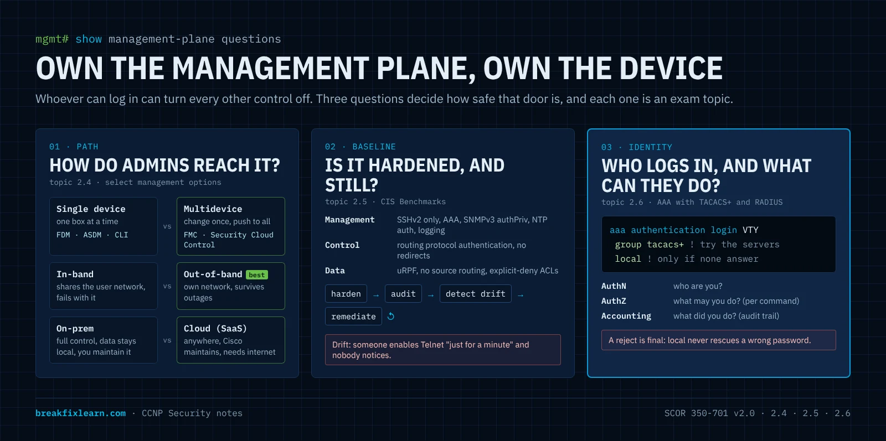
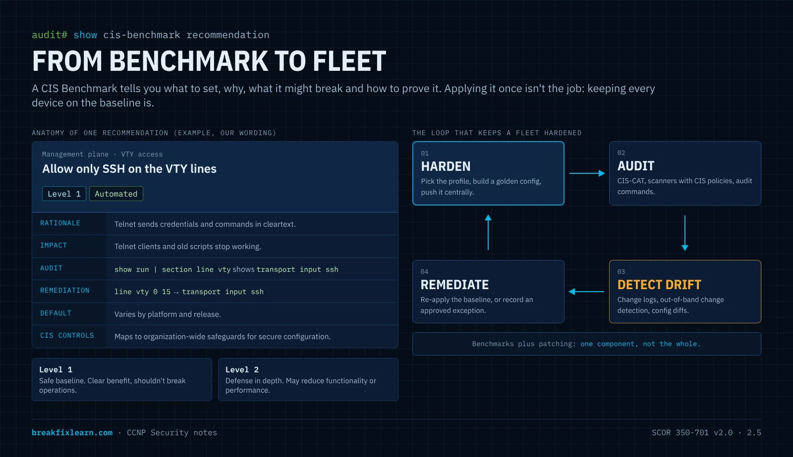
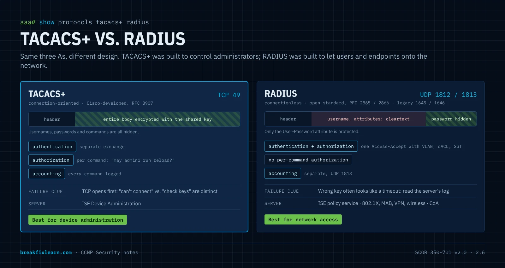
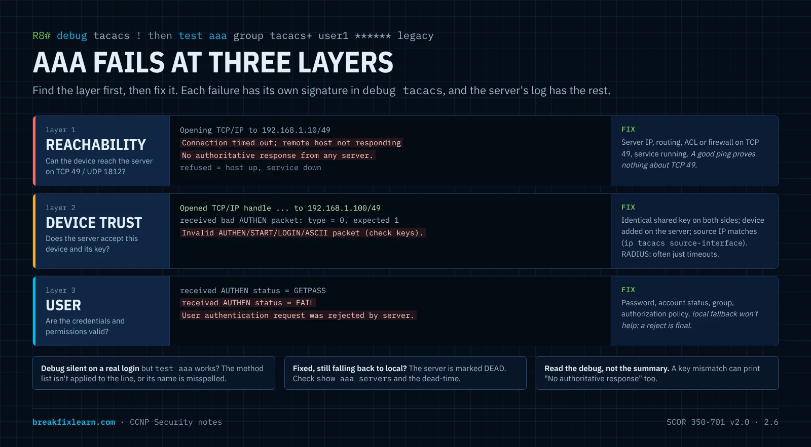

# Management Options, CIS Benchmarks & AAA

> **CCNP Security · SCOR 350-701 v2.0 · Domain 2.0 Network Security**
>
> **2.4** Select management options for network security solutions (single vs. multidevice manager, in-band vs. out-of-band, on-premises vs. cloud with Cisco Security Cloud Control)
>
> **2.5** Describe CIS benchmarks for hardening devices such as Cisco Secure Firewall (FTD) and Cisco IOS XE
>
> **2.6** Troubleshoot AAA for device and network access such as TACACS+ and RADIUS

---

# How to think about the management plane

Every firewall rule, IPS policy and port-security setting you configure lives on a device that someone can log in to. Whoever controls the management plane can switch off every other control in one session. That makes it the highest-value target on the network, and it's why these three exam topics belong together.

Ask three questions about any security device:

| Question | What can go wrong | The exam topic that answers it |
|---|---|---|
| **How do administrators reach it, and from where?** | Management traffic shares a path with users and attackers; one device at a time doesn't scale, so changes drift | **2.4** management options |
| **Is it configured to a known-good standard, and is it still?** | Weak defaults, forgotten services, someone's "quick fix" six months ago | **2.5** CIS Benchmarks |
| **Who can log in, what can they do, and is it recorded?** | Shared passwords, no audit trail, a dead server that locks everyone out | **2.6** AAA with TACACS+ and RADIUS |

Keep those three in mind (**path, baseline, identity**) and the details below stop being a list of products and commands. They're answers to questions an attacker is also asking.



---

# Management options for network security solutions

Every security appliance has to be configured, updated and monitored. Topic 2.4 asks you to **select** a management option, so the exam gives you a scenario (how many devices, which platforms, where the admins are) and expects you to pick the right manager and the right path. That's three separate choices:

1. **Who manages it:** one device at a time, or a central manager for many?
2. **Which path does management traffic take:** the production network (in-band) or a separate one (out-of-band)?
3. **Where does the manager run:** on your premises, or as a cloud service?

## Two ways in: CLI and GUI

Every device gives you at least one of these, usually both:

- **CLI (command-line interface):** over a **console cable** (physical access) or **SSH** (encrypted, over the network). Precise and scriptable, and the baseline for every device.
- **GUI (graphical interface):** a **desktop application** (for example Cisco ASDM for the ASA, a Java application) or a **web interface over HTTPS**. Easier for policy work and visualizing rules.

Neither is better in general. The real question is **how many devices you manage this way.**

## Single-device vs. multidevice managers

**Managing one device at a time** works for a small environment. It doesn't scale. Picture rolling out a new NTP server to 200 firewalls by hand: slow, error-prone, and every device ends up slightly different.

**A multidevice (centralized) manager** reaches every registered device. You make a change once (a new NTP server, an access policy, an intrusion rule update) and push it to all of them. For medium and large environments this isn't a convenience, it's how you stay consistent and auditable.

| Platform | Single-device manager (on the box) | Multidevice manager |
|---|---|---|
| **Secure Firewall Threat Defense (FTD)** | **FDM** (Firewall Device Manager) | **FMC** (Management Center, on-prem or virtual), **cloud-delivered FMC** in Security Cloud Control |
| **Secure Firewall ASA** | **CLI**, **ASDM** | **Security Cloud Control**; Cisco Security Manager (CSM) is the legacy on-prem option |
| **Meraki MX** | Meraki dashboard (cloud) | Meraki dashboard; **Security Cloud Control** for shared security policy |
| **Routers (Catalyst SD-WAN)** | CLI | **Catalyst SD-WAN Manager** (formerly vManage) for the SD-WAN fabric; **Security Cloud Control** for security policy |

> **Exam point:** an FTD is managed by **either** FDM **or** FMC (or cloud-delivered FMC), never both at once. Moving an FTD from FDM to FMC means re-registering it, and the local policy configuration doesn't come with it.

## The managers you need to recognize

**FDM: Firewall Device Manager.** A web GUI built into a single FTD. Good for a branch with one firewall. No central policy, no multi-device reporting.

**FMC: Firewall Management Center.** The classic central manager for FTD. It runs as a hardware appliance or a virtual machine on your network. FTDs **register** to it over an encrypted channel (the sftunnel, TCP 8305), and you deploy access control, intrusion, malware and NAT policies to all of them from one console. FMC also collects events for analysis.

**ASDM: Adaptive Security Device Manager.** A Java GUI for one ASA at a time. Historically there was no good native way to centrally manage many ASAs beyond the ageing Cisco Security Manager. That gap is one reason Security Cloud Control exists.

**Catalyst SD-WAN Manager.** Manages the SD-WAN fabric: routing, connectivity and templates for SD-WAN routers. Its strength is connectivity rather than unified security policy across firewalls, which is the other gap Security Cloud Control fills.

## Security Cloud Control (SCC)

**Security Cloud Control** is Cisco's **cloud-based, AI-assisted management platform** for security devices, and it's named in the v2.0 blueprint. It manages policies, objects and configuration across **different device types at once**, from a browser, with no VPN into a particular site.

> **Exam-critical lineage:** Security Cloud Control is the **evolution of Cisco Defense Orchestrator (CDO)**. Cisco documentation and licensing still use the CDO name in places. If older material or a question says CDO, think Security Cloud Control.

**What it manages:**

| Platform | Notes |
|---|---|
| Secure Firewall **ASA** | On-premises and virtual |
| Secure Firewall **FTD** | On-premises and virtual, through **cloud-delivered FMC** |
| **Meraki MX** | Layer 3 rules; the Meraki dashboard still runs the device |
| **Catalyst SD-WAN** and secure routers | Through Catalyst SD-WAN Manager integration |
| **Multicloud Defense** | Cloud workload protection, including AWS security groups |
| **Secure Access** | Cisco's SSE service |
| **Cisco IOS** | Limited: mainly CLI and change tracking |

**Features worth knowing:**

- **Cloud-delivered FMC:** the FMC experience hosted by Cisco, so you can move FTD management from an on-prem FMC into the cloud.
- **Security Analytics and Logging (SAL):** cloud log storage and analysis for firewall events.
- **ASA-to-FTD migration tooling:** manage ASA and FTD side by side and migrate on your own schedule.
- **AI Assistant and policy analysis:** explain or draft rules in plain language, and find **shadowed, duplicate, redundant or expired rules**.
- **Write once, apply everywhere:** create an object (a malicious IP, URL or domain) once and use it on every supported product.
- **Change log and out-of-band change detection:** every change is recorded with what, when and who. A change made directly on the device, outside SCC, is flagged so you can accept or reject it. That's drift detection, which matters again in the CIS section.
- **Templates, bulk CLI, backups and bulk upgrades.**

**Devices that can't reach the cloud directly** connect through a **Secure Device Connector (SDC)**, a small virtual machine on your network that relays between SCC and the device. On-premises management doesn't have to mean "no SCC".

**The three goals Cisco gives for SCC:**

1. **Simplify operations:** one place to configure, upgrade and push changes.
2. **Enhance security:** logs flow into SCC for AI-assisted analysis.
3. **Improve clarity:** visibility into traffic, threats and events across the estate.

**When SCC fits:** many devices of mixed types, distributed sites, remote administrators, and cloud-first organizations.

## In-band vs. out-of-band management

Where does the management traffic travel?

| | **In-band** | **Out-of-band (OOB)** |
|---|---|---|
| **Path** | Management traffic shares the **production network** with user traffic | Management traffic has **its own network**: a dedicated management VLAN or network, console servers, a separate management interface |
| **Pro** | **Simple and cheap**: nothing extra to build | **More secure** (isolated from users and attackers) and **survives production outages** |
| **Con** | **Less secure**; **fails with the network** (if production is down or flooded, so is your access) | **Costs more**: extra switches, cabling, console servers, maintenance |
| **Use it when** | Small sites, or as a backup path | **Best practice** for security devices |

> **Why OOB matters most when things go wrong:** a DoS attack or a routing failure that takes down the production network takes in-band management with it, exactly when you need access. An out-of-band path keeps you connected to fix the problem, and keeps management protocols out of reach of ordinary users.

What OOB looks like on Cisco platforms:

- **FTD:** a dedicated **Management** interface, separate from the data interfaces, used for FMC registration and updates.
- **ASA:** an interface set with `management-only`, so it never forwards transit traffic.
- **IOS XE:** the **GigabitEthernet0/0** management port lives in its own VRF (**Mgmt-intf**), so its routing table is separate from production.
- **Console servers** for the last-resort path when even the management network fails.

**OOB isn't automatically safe.** It's still a network: protect it with AAA, ACLs that allow management protocols only from admin subnets, SSH and HTTPS only, and logging. An attacker who reaches the management network reaches everything.

## On-premises vs. cloud management

Where does the management platform itself run?

| | **On-premises** (e.g. FMC) | **Cloud / SaaS** (e.g. Security Cloud Control) |
|---|---|---|
| **Where it runs** | An appliance or VM **on your network** | **Cisco's cloud**, consumed as a service |
| **Pro** | **Full control**; **data stays local** (data sovereignty, air-gapped or classified networks) | **Reachable anywhere**, **scales easily**, **Cisco maintains** the platform and updates |
| **Con** | **You** handle upgrades, capacity, backups and troubleshooting; you must reach the network to manage it | **Depends on internet access**; **less direct control**; data leaves your premises |

> Every management platform needs care: upgrades, disk cleanup, backups, TAC cases. On-prem means your team does that work. Cloud means Cisco does it, in exchange for less direct control and a dependency on internet connectivity.

## Selecting a management option

Topic 2.4 says *select*, so practice choosing. Read the scenario, then pick the smallest answer that meets the requirement.

| Scenario | Best fit | Why |
|---|---|---|
| One FTD at a small branch, no central team | **FDM** | Single device; no need for a manager |
| 40 FTDs in a data center, strict rule that management data stays on site | **On-prem FMC** + OOB management network | Multidevice, data stays local |
| ASAs, FTDs and Meraki MX at 120 sites, admins working remotely | **Security Cloud Control** | Mixed platforms, distributed, cloud access from anywhere |
| Migrating a large ASA estate to FTD over two years | **Security Cloud Control** | Manages both side by side and includes migration tooling |
| You must still reach firewalls during a DDoS on the production network | **Out-of-band** management path | In-band fails with production |
| Branch routers running SD-WAN need fabric and routing changes | **Catalyst SD-WAN Manager** | Purpose-built for SD-WAN connectivity |

## Management options: exam traps

- **SCC = cloud, cross-platform, multidevice.** ASA, FTD (cloud-delivered FMC), Meraki MX, SD-WAN, Multicloud Defense, Secure Access. IOS support is limited.
- **SCC is the evolution of CDO.** Same lineage.
- **FDM manages one FTD; FMC manages many.** ASDM manages one ASA. An FTD uses FDM **or** FMC, not both.
- **Catalyst SD-WAN Manager** handles SD-WAN connectivity, not unified security policy.
- **In-band** shares the user network (simple, less secure, fails with production). **OOB** has its own path (secure, survives outages, costs more). **OOB is best practice.**
- **On-prem** (FMC): full control, data stays local, you maintain it. **Cloud** (SCC): access anywhere, Cisco maintains it, needs the internet.
- **Secure Device Connector** lets SCC manage devices that the cloud can't reach directly.

---

# CIS Benchmarks for hardening devices

A firewall or router has hundreds of settings. How do you **know** you've locked it down and haven't left a door open? You don't have to invent the answer. **CIS Benchmarks** are a ready-made, expert-agreed checklist. Topic 2.5 asks you to **describe** them, with Cisco Secure Firewall (FTD) and Cisco IOS XE as the named examples.

## What a CIS Benchmark is

A **CIS Benchmark** is a set of **consensus-based best practices for securely configuring** a specific technology: an operating system, a cloud platform, a database, a network device. It's published by the **Center for Internet Security (CIS)**, a nonprofit, and the PDFs are free to download from **cisecurity.org** after registering.

The key word is **consensus**. A benchmark isn't one vendor's opinion. Volunteers from consulting, auditing, government, vendors and operations draft and test each recommendation, and the wider community reviews it before and after publication. That's why auditors and regulators accept it.

> **Analogy:** you've just taken over an office building. Before anyone moves in, you walk a checklist: every lock works, cameras cover the doors, the alarm is armed, spare keys are accounted for. A CIS Benchmark is that checklist, written by security experts for one specific product, down to the exact command and how to check it.

**Don't confuse the two CIS products:**

| | **CIS Benchmarks** | **CIS Controls** |
|---|---|---|
| What | Configuration guides for **one specific product** | A prioritized set of **organization-wide** security safeguards (inventory, data protection, incident response) |
| Example | "Set SSH version 2 on IOS XE" | "Securely configure enterprise assets and software" |
| Link | Each benchmark recommendation maps to the CIS Controls it supports | |

## Why use CIS Benchmarks

| Benefit | What it means |
|---|---|
| **Reduce the attack surface** | Disable what you don't need and lock down what you do. A hardened device isn't the easy target |
| **Prevent misconfiguration** | Each recommendation says exactly what to set, so dangerous defaults don't survive |
| **Standardize** | Apply the same baseline everywhere: every device configured securely and **identically** |
| **Support compliance** | Benchmarks map to frameworks such as PCI DSS, HIPAA and NIST, and give auditors evidence |

## Anatomy of a recommendation

Every recommendation follows the same structure, so you get the what, the why, the risk and the proof:

| Field | What it tells you |
|---|---|
| **Title** | The setting, phrased as a requirement |
| **Profile** | **Level 1** or **Level 2** |
| **Assessment status** | **Automated** (a tool can check pass/fail) or **Manual** (a human must verify) |
| **Description and rationale** | What the setting does and why it reduces risk |
| **Impact** | What might break or change when you apply it |
| **Audit** | The command or procedure that proves compliance |
| **Remediation** | The exact configuration to apply |
| **Default value** | What the device does out of the box |
| **CIS Controls mapping** | Which organization-level controls it supports |

**Profile levels:**

- **Level 1:** practical and prudent, a clear security benefit, and it **shouldn't break** normal operation. The baseline everyone should meet.
- **Level 2:** **defense in depth** for environments where security is paramount. It extends Level 1 and **may reduce functionality or performance**.

**Here's what a recommendation looks like, in our own words** (modeled on the IOS XE benchmark's style):

| Field | Example |
|---|---|
| Title | Allow only SSH on the VTY lines |
| Profile / status | Level 1, Automated |
| Rationale | Telnet sends usernames, passwords and commands in cleartext. Anyone who can capture the traffic can take over the device |
| Impact | Telnet clients and scripts that rely on Telnet stop working |
| Audit | `show running-config \| section line vty`: every VTY block must show `transport input ssh` |
| Remediation | `line vty 0 15` then `transport input ssh` |
| Default | Depends on platform and release; often `telnet ssh` or `all` |

## The Cisco benchmarks and how they're organized

CIS publishes benchmarks for the Cisco platforms you'll harden, including **Cisco IOS XE** (16.x and 17.x), **Cisco IOS XR**, **Cisco NX-OS**, **Cisco Firepower Threat Defense** and **Cisco ASA 9.x**. The blueprint names **FTD** and **IOS XE**, so expect those two in questions.

The Cisco network-device benchmarks are organized around the **three planes** you already know:

| Plane | What it protects | Typical recommendations |
|---|---|---|
| **Management plane** | How admins and tools reach and control the device | AAA with TACACS+ or RADIUS and a local fallback account, `enable secret` with strong hashing, `service password-encryption`, login banners, **SSH version 2 only** with a 2048-bit or larger key, Telnet and the HTTP server disabled, `exec-timeout`, VTY access lists, **SNMPv3 with authPriv**, logging with timestamps to a syslog server, **authenticated NTP**, unused services such as CDP or the HTTP server turned off |
| **Control plane** | The protocols the device uses to build its tables | **Routing protocol authentication** (OSPF, EIGRP, BGP), no ICMP redirects, no proxy ARP on untrusted interfaces |
| **Data plane** | Traffic passing through the device | **Unicast RPF** (`ip verify unicast source reachable-via rx`) against spoofed sources, no IP source routing, no directed broadcast, ACLs with an explicit deny and logging |

Notice how this reads like a checklist version of earlier topics: SSHv2, SNMPv3 authPriv, authenticated NTP, AAA, routing authentication, uRPF. The benchmark is the **standardized, auditable** form of "harden the three planes".

## FTD vs. IOS XE: where the hardening lives

The goals are the same on both platforms. Where you apply them differs:

| | **Cisco IOS XE** | **Cisco Secure Firewall Threat Defense** |
|---|---|---|
| **How you harden** | CLI configuration, line by line | Mostly **platform settings** pushed from **FMC** (or FDM / Security Cloud Control), not the CLI |
| **Examples** | `transport input ssh`, `ip ssh version 2`, `no ip http server`, `service password-encryption`, `ntp authenticate` | SSH and HTTPS access lists for the management interface, **external authentication** (RADIUS or LDAP) for admins, syslog and SNMPv3 settings, NTP, banners, session timeouts |
| **Who audits** | Scanners and CIS-CAT read the running config | Review the platform settings policy and the device's management access settings |

## From benchmark to fleet: harden, audit, monitor drift

The trap is to apply a benchmark once and call it done. Say you manage **80 firewalls** and push a hardened configuration to all of them. Over the next year someone enables Telnet "just for a minute", an upgrade changes a default, a contractor adds a local account. That's **configuration drift**: the gap between your approved secure baseline and what's actually running.

The real workflow is a loop:

1. **Choose the profile** (Level 1, or Level 2 where justified) and record any exceptions with a reason.
2. **Build a golden configuration** or template from it.
3. **Apply** it centrally (FMC platform settings, Security Cloud Control templates, configuration management tools).
4. **Audit** regularly against the benchmark: CIS-CAT Pro, vulnerability scanners with CIS audit policies, or scripts that run the audit commands.
5. **Detect drift** between audits: change logs and out-of-band change detection in Security Cloud Control, config archive and diff, syslog alerts on `%SYS-5-CONFIG_I`.
6. **Remediate** and go back to step 4.



> **Exam link:** this is why centralized management (2.4) and benchmarks (2.5) go together. A multidevice manager is how you apply a baseline to a fleet and catch drift across it.

**Benchmarks are one component of security, not the whole of it.** A perfectly hardened device running vulnerable software is still vulnerable. Use benchmarks **alongside** patching, vulnerability management and monitoring.

## CIS Benchmarks: exam traps

- **CIS Benchmark = consensus-based** configuration guide for a **specific technology**, free from the **Center for Internet Security**.
- **Four benefits:** reduce attack surface, prevent misconfiguration, standardize, support compliance.
- **Level 1** = safe baseline, minimal impact. **Level 2** = defense in depth, may reduce functionality.
- **Automated** (tool-checkable) vs. **Manual** (human verification).
- Each recommendation has an **audit** procedure (how to check) and a **remediation** procedure (how to fix).
- Cisco network-device benchmarks are organized by **management, control and data plane**.
- Benchmarks are the **starting point**: monitor for **configuration drift** and re-apply.
- **Benchmarks ≠ CIS Controls.** Benchmarks are per-product; Controls are organization-wide.

---

# AAA for device and network access

CIS Benchmarks lean heavily on one control: **AAA**, with central TACACS+ or RADIUS servers and a local fallback account. Topic 2.6 asks you to **troubleshoot** it, so you need to know how it's built well enough to recognize exactly where it broke.

## Authentication, authorization and accounting

| | Question | Device administration example | Network access example |
|---|---|---|---|
| **Authentication** | **Who are you?** | An admin logs in to a router with a username and password | A laptop proves its identity with 802.1X before the switch port opens |
| **Authorization** | **What may you do?** | Privilege level 15, or only `show` commands | Put the laptop in VLAN 20 and apply a downloadable ACL |
| **Accounting** | **What did you do?** | Log every command the admin typed, with a timestamp | Record session start, stop, duration and data used |

> **Analogy:** authentication gets you into the building, authorization decides which rooms you can enter, and accounting is the visitor log at reception. You can pass the first and fail the second.

**Why central AAA beats local accounts:** with 200 devices and local usernames, removing a departing admin means 200 changes, and you have no record of who typed what. With central AAA, you disable one account on the server, every login is checked in one place, and accounting gives you an audit trail.

## Device administration vs. network access

The blueprint says "AAA for **device and network access**". These are two different jobs, and each has a natural protocol:

| | **Device administration** | **Network access** |
|---|---|---|
| **Who authenticates** | Administrators logging in to routers, switches, firewalls | Users and endpoints joining the network (wired, wireless, VPN) |
| **Goal** | Control and record **who configures what** | Decide **who gets on the network and with what access** |
| **Natural protocol** | **TACACS+** | **RADIUS** |
| **Why** | Separate authorization lets the server approve **each command** | Open standard supported by every switch, AP and VPN gateway; carries **EAP** for 802.1X |
| **Cisco server** | **ISE** with the Device Administration service | **ISE** policy service |

Both protocols can do both jobs (RADIUS is often used for device login on non-Cisco gear), but the exam expects the pairing above.

## TACACS+ vs. RADIUS



| | **TACACS+** | **RADIUS** |
|---|---|---|
| **Transport** | **TCP 49** | **UDP 1812** authentication and authorization, **UDP 1813** accounting (older deployments: 1645 / 1646) |
| **Encryption** | The **entire packet body** is obfuscated with the shared key (the header stays readable) | **Only the password attribute** is hidden; usernames and other attributes are in cleartext |
| **AAA functions** | **Separate**: authentication, authorization and accounting are independent exchanges | **Authentication and authorization combined** in one Access-Accept; accounting separate |
| **Command authorization** | **Yes, per command** | Not practical: no per-command exchange |
| **Multiprotocol** | Supports older protocols such as AppleTalk and NetBIOS | IP-focused |
| **Standard** | Cisco-developed, now documented in RFC 8907 | Open standard (RFC 2865, 2866) |
| **Best for** | **Device administration** | **Network access** (802.1X, MAB, VPN, wireless) |

**Two details that show up in troubleshooting:**

- **TCP vs. UDP changes the symptoms.** TACACS+ opens a TCP connection first, so you can tell "couldn't connect" (reachability) from "connected but the reply made no sense" (shared key). RADIUS is connectionless, so a dead server and a wrong key can both look like a timeout from the device side.
- **The shared secret isn't strong encryption** in either protocol. Both rely on MD5-based obfuscation. Use long, unique keys and keep AAA traffic on the management network. Newer options wrap the protocols in TLS: **TACACS+ over TLS 1.3** (RFC 9887) and **RadSec** (RADIUS over TLS, TCP 2083).

## How IOS AAA works: aaa new-model and method lists

`aaa new-model` switches a Cisco device from legacy line passwords to the AAA framework. From that moment, **every login path is controlled by AAA**.

> **Lifeboat first.** Create a working local admin (`username admin1 privilege 15 secret ...`) **before** you type `aaa new-model`. If no method list is defined, IOS checks the local user database, and without a local account you can lock yourself out.

A **method list** says how to authenticate (or authorize, or account), and in what order:

```
aaa authentication login TAC-Login group tacacs+ local
```

Read it left to right: **try the TACACS+ servers first; if none of them answer, use the local database.**

| Element | Meaning |
|---|---|
| `login` | The service: logins on console, VTY, and so on. Others include `enable`, `dot1x`, `ppp` |
| `TAC-Login` | A **named** list. It applies only where you reference it, e.g. `login authentication TAC-Login` under `line vty 0 15` |
| `default` | The **default** list applies to **every line that doesn't name a list**, including the console |
| `group tacacs+` | All configured TACACS+ servers, or `group NAME` for a defined server group |
| `local` | The local username database |
| `none` | No authentication. Never on production login lists |

**The fallback rule that the exam loves:** the next method is tried **only if the current method returns an error** (no server answered). A **reject** (wrong password from a reachable server) is final. `local` doesn't rescue a user the server just rejected.

**Three more method-list traps:**

1. **A named list does nothing until it's applied** to a line. A typo in the name (`TAC-Logn`) breaks it too.
2. **The default list covers the console.** `aaa authentication login default group tacacs+` with no `local` locks the console too when the server is down. Many teams give the console its own list with `local` first.
3. **Authentication isn't authorization.** A TACACS+ user lands at privilege 1 unless the server returns a privilege level through `aaa authorization exec`, or `enable` is authenticated separately.

## Configuring TACACS+ for device administration

A complete, production-style device-administration setup on IOS XE:

```
! 1. Lifeboat account, then turn on AAA
username admin1 privilege 15 secret <strong-local-password>
aaa new-model
!
! 2. Define the servers and group them
tacacs server ISE-1
 address ipv4 10.10.99.10
 key <long-unique-shared-secret>
tacacs server ISE-2
 address ipv4 10.10.99.11
 key <long-unique-shared-secret>
aaa group server tacacs+ ISE-TAC
 server name ISE-1
 server name ISE-2
 ip tacacs source-interface Loopback0
!
! 3. Authentication: servers first, local only if no server answers
aaa authentication login VTY-AUTH group ISE-TAC local
aaa authentication enable default group ISE-TAC enable
!
! 4. Authorization: privilege level from the server, then each level-15 command
aaa authorization exec VTY-AUTHZ group ISE-TAC local
aaa authorization commands 15 VTY-CMD group ISE-TAC local
!
! 5. Accounting: sessions and every level-15 command
aaa accounting exec default start-stop group ISE-TAC
aaa accounting commands 15 default start-stop group ISE-TAC
!
! 6. Apply to the VTY lines, SSH only
line vty 0 15
 login authentication VTY-AUTH
 authorization exec VTY-AUTHZ
 authorization commands 15 VTY-CMD
 transport input ssh
 exec-timeout 10 0
```

| Piece | Why it's there |
|---|---|
| Two servers in a group | One server down doesn't mean an outage. IOS tries them in order |
| `ip tacacs source-interface Loopback0` | Requests always come from the same IP, which must match the **network device entry** on the server |
| `aaa authorization exec` | The server hands out the privilege level at login, so admins don't share an `enable` password |
| `aaa authorization commands 15` | Each privileged command is checked by the server. Only TACACS+ can do this |
| `aaa accounting commands 15` | Every privileged command is logged with who, when and from where |
| `transport input ssh` | No Telnet: credentials never cross the network in cleartext |

> **Console authorization:** IOS doesn't apply authorization to the console unless you add `aaa authorization console`. That's deliberate: a broken authorization server shouldn't lock you out of the last-resort path.

## Configuring RADIUS for network access

RADIUS shows up in two places: device logins on non-Cisco or mixed fleets, and, much more often, **802.1X and MAB** on switch ports and wireless.

```
radius server ISE-1
 address ipv4 10.10.99.10 auth-port 1812 acct-port 1813
 key <long-unique-shared-secret>
aaa group server radius ISE-RAD
 server name ISE-1
 ip radius source-interface Vlan99
!
aaa authentication dot1x default group ISE-RAD
aaa authorization network default group ISE-RAD
aaa accounting dot1x default start-stop group ISE-RAD
!
! Let ISE change a session after it starts (CoA)
aaa server radius dynamic-author
 client 10.10.99.10 server-key <long-unique-shared-secret>
!
dot1x system-auth-control
!
interface GigabitEthernet1/0/10
 switchport mode access
 switchport access vlan 10
 authentication port-control auto
 mab
 dot1x pae authenticator
```

| Piece | Why it's there |
|---|---|
| `auth-port 1812 acct-port 1813` | State the ports explicitly so they match the server. Older IOS defaults were 1645 / 1646 |
| `aaa authorization network` | Without it, the switch ignores the VLAN, downloadable ACL or SGT that ISE sends back |
| `aaa accounting dot1x` | ISE needs accounting to track sessions and profile endpoints |
| `aaa server radius dynamic-author` | **Change of Authorization (CoA)**: ISE can re-authenticate, reassign or disconnect a session (RFC 5176; ISE uses UDP 1700 by default, the RFC port is 3799) |
| `dot1x system-auth-control` | Turns 802.1X on globally. Forget it and nothing authenticates |
| `authentication port-control auto` + `dot1x pae authenticator` + `mab` | The port authenticates the endpoint with 802.1X, or by MAC address (MAB) for devices without a supplicant |

## Troubleshooting AAA: three layers

Every AAA failure sits in one of three layers. Find the layer first and the fix is obvious:

| Layer | Question | Broken when |
|---|---|---|
| **1. Reachability** | Can the device reach the server on the right protocol and port? | Wrong server IP, routing, an ACL or firewall blocking TCP 49 or UDP 1812, server or service down |
| **2. Device trust** | Does the server accept this device as a client? | **Shared key** mismatch, device not added on the server, requests from an unexpected **source IP** |
| **3. User** | Are the credentials and the user's permissions valid? | Wrong password, account disabled, user not in the right group, authorization policy denies |



**The toolbox, in the order to use it:**

| Tool | What it tells you |
|---|---|
| `ping <server>` | Basic IP reachability. **Not proof of TACACS+ or RADIUS reachability**: an ACL can allow ICMP and block TCP 49 |
| `test aaa group tacacs+ <user> <password> legacy` | Authenticates a user **without touching any login configuration**. Safe to run before you apply the method list |
| `test aaa group radius <user> <password> new-code` | The same for RADIUS |
| `show tacacs` | Per-server socket opens, failures and packet counts: did the router actually talk to the server? |
| `show aaa servers` | Server state (**UP** or **DEAD**) and request, accept, reject and timeout counters |
| `debug tacacs`, `debug radius authentication` | The protocol exchange line by line. Turn off with `undebug all` |
| `debug aaa authentication`, `debug aaa authorization` | Which method list ran and what each method returned |
| `show run \| section aaa`, `show run \| section line vty` | Are the lists defined, named correctly and applied? |
| The server's own logs (ISE Live Logs) | The **reason** the server rejected or ignored a request. Often the fastest answer |

**What each failure looks like with TACACS+:**

| `debug tacacs` shows | Layer | Fix |
|---|---|---|
| `Opening TCP/IP to <server>/49` then `Connection timed out; remote host not responding`, and `No authoritative response from any server` | **Reachability**: nobody answered | Server IP, routing, ACLs, firewall, is the server up |
| `Connection refused` | **Reachability**: the host answered but nothing is listening on 49 | Start the TACACS+ service, check the port |
| TCP connection **opened**, then `received bad AUTHEN packet` and `Invalid AUTHEN/START ... (check keys)` | **Device trust**: shared key mismatch | Make the key identical on device and server |
| `status = GETPASS` then `status = FAIL`, and `User authentication request was rejected by server` | **User**: the server understood and said no | Credentials, account status, group membership |
| `status = PASS`, `User was successfully authenticated` | Working | |

> **Read the debug, not the summary.** With a wrong TACACS+ key, `test aaa` can print `No authoritative response from any server`, which sounds like reachability. The debug shows the TCP session **opened** and the reply failed to decrypt: a key problem. The lab on this page captures exactly that.

**With RADIUS, the symptoms are less direct.** Because RADIUS runs over UDP and the server validates requests with the shared secret, a wrong key usually means the server **drops or rejects the request** and the device sees **timeouts**, or a reply it discards because the authenticator doesn't match. From the switch, a key mismatch can look exactly like a reachability problem. The server's log tells them apart: ISE reports messages such as *"Could not locate Network Device or AAA Client"* (device not added, or the request came from an unexpected source IP) or *"The Message-Authenticator RADIUS attribute is invalid"* (shared secret mismatch).

**Classic faults beyond the big three:**

| Symptom | Cause | Fix |
|---|---|---|
| `test aaa` succeeds, real logins never reach the server (`debug tacacs` silent) | Method list defined but **not applied** to the line, or the name is misspelled | `login authentication <name>` under the line, names identical |
| Fault fixed, but logins still go straight to `local` | Server marked **DEAD** and skipped for the dead-time window | `show aaa servers`; wait out the dead-time or clear it |
| Correct IP and key, still failing | Requests come from a **different source IP** than the server expects | `ip tacacs source-interface` / `ip radius source-interface` to match the server's device entry |
| Login works, `enable` fails | Authentication passed but no privilege was granted and no enable method exists | `enable secret`, `aaa authentication enable`, or `aaa authorization exec` returning priv 15 |
| Login accepted, then dropped ("authorization failed") | Authorization denied the shell | Fix the shell profile on the server, or add a fallback (`if-authenticated` or `local`) |
| Server down and nobody can log in | No `local` method in the list | Always end device login lists with `local` |

## Troubleshooting network access (802.1X and MAB)

For network access, the switch and ISE together tell the story:

```
show access-session interface GigabitEthernet1/0/10 details
show aaa servers
test aaa group radius <user> <password> new-code
debug radius authentication
```

`show access-session` (on IOS XE) shows the method (dot1x or mab), the status (Authorized, Unauthorized, Running), the VLAN and ACL applied, and the session ID you can search for in ISE.

| Symptom | Likely cause | Where to look |
|---|---|---|
| No entry in ISE Live Logs at all | Switch can't reach ISE, server marked DEAD, or 802.1X not enabled (`dot1x system-auth-control`) | `show aaa servers`, routing and ACLs for UDP 1812 |
| ISE: device or AAA client not found | Switch not added as a network device, or the source IP differs | ISE network devices, `ip radius source-interface` |
| ISE: shared secret / Message-Authenticator error | Key mismatch | The key on both sides |
| Authentication fails for the user | Wrong credentials, certificate problem, wrong identity store | ISE Live Logs failure reason |
| Authentication passes, wrong VLAN or no ACL | `aaa authorization network` missing, or the authorization policy matched the wrong rule | Switch config, ISE authorization policy |
| Printer or phone never authenticates | No supplicant and MAB not enabled, or not profiled | `mab` on the port, ISE endpoint identity groups |
| Policy changed in ISE, endpoint keeps old access | CoA not configured or blocked | `aaa server radius dynamic-author`, UDP 1700 from ISE |

## Hardening the AAA path

AAA protects the management plane, so the AAA path itself has to be protected:

| Weakness | Why it matters | Hardening |
|---|---|---|
| Weak or reused shared secrets | The key is the trust boundary between device and server | Long, unique keys per device or device group, rotated |
| AAA traffic on the user network | Captured packets plus a guessable key expose credentials (RADIUS shows usernames in cleartext) | Keep AAA on the **out-of-band** management network; use TACACS+ over TLS or RadSec where supported |
| No local fallback | Kill the server, or the path to it, and admins are locked out everywhere | `... group <servers> local` and one strong local account kept in a vault |
| Single AAA server | One failure, total lockout or open fallback | Two or more servers in a group |
| No accounting | Nobody can say who changed what | `aaa accounting exec` and `commands 15` sent to the server and a SIEM |
| Over-trusted AAA server | A compromised server can grant level 15 everywhere | Harden and monitor the server; least-privilege command sets |
| Unlimited password guessing | An attacker can try passwords at line speed | `login block-for 60 attempts 3 within 30` (quiet mode), plus `login quiet-mode access-class <ACL>` so the NOC can still log in |
| Short local passwords | The break-glass account is the easiest way in when AAA is down | `security passwords min-length 10`, entered **before** the passwords, because it only checks passwords set after it |
| Device source IP not registered on the server | The server won't answer a client it doesn't know (RADIUS servers **silently discard** the request), so the device sees a timeout, as if the server were down | Register the IP the device actually sends from (its exit interface, or a fixed loopback with `ip tacacs source-interface`) |

## AAA: exam traps

- **TACACS+:** TCP 49, whole body encrypted, AAA separated, **per-command authorization**, best for **device administration**.
- **RADIUS:** UDP 1812/1813 (legacy 1645/1646), **only the password** hidden, authentication and authorization **combined**, best for **network access**.
- Create a **local account before `aaa new-model`**.
- Method lists fall back **only on error** (no answer), **never on a reject**.
- A **named** list must be **applied** to a line; the **default** list applies everywhere else, including the console.
- `test aaa` checks the server **without** changing the login configuration.
- TACACS+ `(check keys)` = shared key mismatch; `No authoritative response` = nobody answered; `status = FAIL` = bad credentials.
- **Ping success doesn't prove AAA reachability** (TCP 49 / UDP 1812 can be blocked).
- With RADIUS, a **key mismatch often looks like a timeout** from the device; check the server's logs.
- `aaa authorization network` is required for ISE to assign VLANs and ACLs. **CoA** needs `aaa server radius dynamic-author`.

---

# Quick reference

| Concept | One-liner |
|---|---|
| FDM / ASDM | On-box manager for one FTD / one ASA |
| FMC | Central manager for many FTDs, on-prem or virtual |
| Security Cloud Control | Cloud, multidevice, multi-platform manager; the evolution of CDO |
| In-band | Management shares the production network: simple, less secure |
| Out-of-band | Separate management network: secure, best practice |
| On-prem vs. cloud | Control and data locality vs. access anywhere and Cisco-maintained |
| CIS Benchmark | Consensus configuration checklist for one product, from CIS |
| Level 1 / Level 2 | Safe baseline / defense in depth that may reduce functionality |
| Automated / Manual | Tool-checkable / needs human verification |
| Configuration drift | Running config moving away from the approved baseline |
| TACACS+ | TCP 49, full-body encryption, separate AAA, per-command authorization |
| RADIUS | UDP 1812/1813, password-only hiding, combined authN/authZ, 802.1X |
| Method list | Ordered methods; next method only on error, not on reject |
| `test aaa` | Dry-run authentication against a server group |
| `(check keys)` | TACACS+ shared key mismatch |
| CoA | Server-initiated change to a live RADIUS session |

---

# Labs for this module

Two labs put the AAA half into practice, one in Packet Tracer and one on real IOS:

1. [AAA and device hardening lab (Packet Tracer)](/ccnp-security/labs/aaa-device-hardening-packet-tracer): harden a two-site network to a CIS-style baseline, then move admin logins to a central server, TACACS+ on one router and RADIUS on the other, each with a local fallback. Downloadable `.pkt` and `.pka`.
2. [AAA with TACACS+ lab (real IOS)](/ccnp-security/labs/aaa-tacacs-configure-troubleshoot): build TACACS+ login with a local fallback on a real IOS router, prove a server-only user can log in, then break it three ways (wrong key, wrong password, wrong server IP) and read each fault straight from `debug tacacs`.
