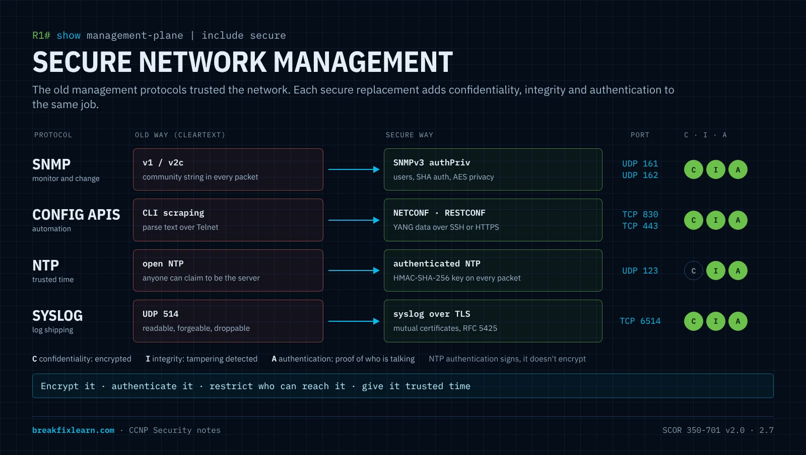
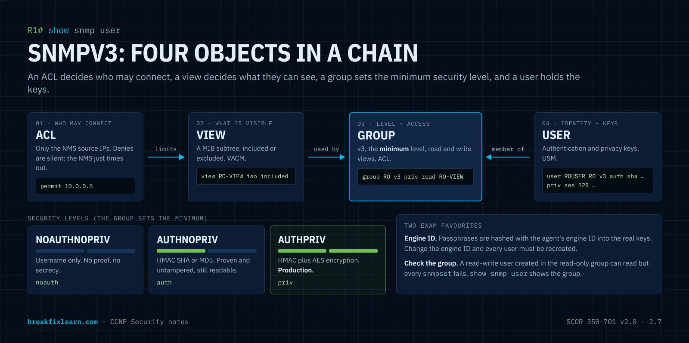
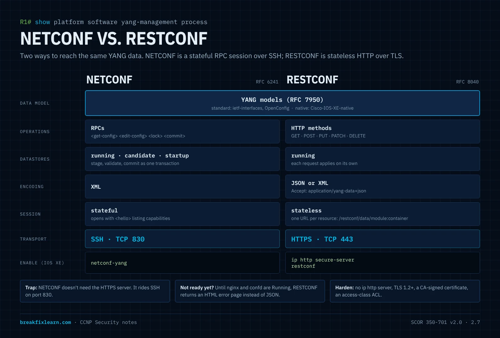
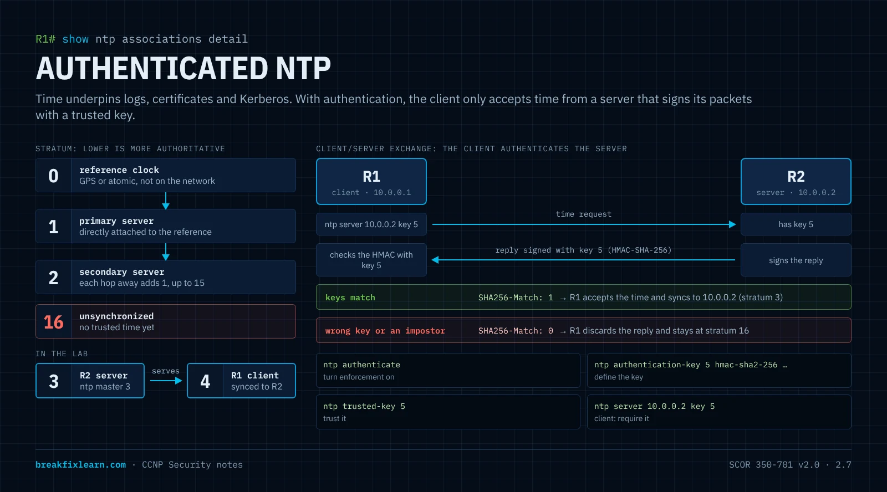

# Secure Network Management

> **CCNP Security · SCOR 350-701 v2.0 · Domain 2.0 Network Security**
>
> **2.7** Configure secure network management of perimeter security and infrastructure devices such as SNMPv3, NETCONF, RESTCONF, APIs, secure syslog, and NTP with authentication

---

# How to think about management protocols

Every device has three planes. The **data plane** forwards user traffic, the **control plane** builds the tables (OSPF, BGP, STP), and the **management plane** is how people and tools reach and run the device. The [AAA notes](/ccnp-security/management-cis-benchmarks-aaa) covered who may log in. This topic covers everything else that talks to the management plane: monitoring, automation, time and logs.

The old versions of these protocols were built for trusted networks. They send data in **cleartext** and trust whoever answers:

| Old way | What an attacker on the path can do |
|---|---|
| SNMPv1 / v2c with community strings | Read the "password" from one packet, then read, or with read-write, **change** the device |
| CLI screen-scraping over Telnet | Capture credentials and every command |
| Unauthenticated NTP | Pretend to be the time server and **move the clock**, which breaks certificates and log correlation |
| Syslog over UDP 514 | Read logs in transit, **forge** log entries, or simply drop them |

Each secure replacement adds the same three properties to management traffic:

- **Confidentiality:** encryption, so a sniffer sees nothing useful.
- **Integrity:** a keyed hash or TLS, so tampering is detected.
- **Authentication:** proof of who is talking, in one or both directions.

Then two habits on top: **restrict who can reach it** (ACLs, out-of-band management) and **give it trusted time** (authenticated NTP), because logs and certificates are only as good as the clock.



| Protocol | Job | Insecure → secure | Port |
|---|---|---|---|
| **SNMPv3** | Monitor and change device state | v1/v2c community strings → v3 users with **authPriv** | UDP **161** (polls), **162** (traps, informs) |
| **NETCONF** | Model-driven configuration | CLI scraping → structured **YANG** data over **SSH** | TCP **830** |
| **RESTCONF** | Model-driven configuration over HTTP | → structured **YANG** data over **HTTPS** | TCP **443** |
| **NTP with authentication** | Trusted, synchronized time | Open NTP → keyed **HMAC** on every packet | UDP **123** |
| **Secure syslog** | Ship logs to a collector | UDP 514 cleartext → syslog over **TLS** | TCP **6514** |

---

# SNMPv3

## SNMP in 90 seconds

**SNMP (Simple Network Management Protocol)** is how a monitoring system reads data from network devices, and optionally changes settings on them.

- **Manager (NMS):** the monitoring station that asks the questions.
- **Agent:** the SNMP process on the managed device that answers.
- **Ports:** the agent listens on **UDP 161** for polls. The manager listens on **UDP 162** for notifications (traps and informs).

The data lives in the **MIB (Management Information Base)**, a hierarchical tree of managed objects. Each object has an **OID (object identifier)**, a dotted path to one spot in the tree:

```
1          iso
1.3        org
1.3.6      dod
1.3.6.1    internet
1.3.6.1.2  mgmt
1.3.6.1.2.1        mib-2
1.3.6.1.2.1.1      system
1.3.6.1.2.1.1.1.0  sysDescr   text description of the device
1.3.6.1.2.1.1.5.0  sysName    the device hostname
```

A **MIB** is the collection; an **OID** is one leaf in it. The trailing `.0` marks a single-value (scalar) object.

**Operations:** `Get` (one object), `GetNext` (the next object, which is how a walk steps through the tree), `GetBulk` (many at once, v2c and later), **`Set`** (change a value: the dangerous one), `Response`, and `Trap` / `Inform` (device-initiated alerts).

| Notification | Delivery | Trade-off |
|---|---|---|
| **Trap** | Fire and forget, no acknowledgement | Cheap, but can be lost |
| **Inform** | Acknowledged and retransmitted | Reliable, costs more memory and traffic |

## Why only SNMPv3 belongs in production

| Version | Identity | Confidentiality | Integrity | Verdict |
|---|---|---|---|---|
| **v1** | Community string | **None**: cleartext | None | Obsolete |
| **v2c** | Community string | **None**: cleartext | None | Adds GetBulk and informs, still cleartext |
| **v3** | **Username** (USM) | **AES** (or DES / 3DES) | **HMAC** + replay protection | The only secure choice |

With v1 and v2c, the community string travels in the clear. One captured packet, or a guess of the defaults `public` and `private`, gives an attacker SNMP access. SNMPv3 replaces that with two models:

- **USM, the User-based Security Model:** **who** you are, and the cryptography protecting your messages (authentication and privacy keys).
- **VACM, the View-based Access Control Model:** **what** you may see or change (views bound to groups).

## SNMPv3 security levels

| Level | Authentication | Encryption | IOS keyword | Use it when |
|---|---|---|---|---|
| **noAuthNoPriv** | Username only | None | `noauth` | Practically never |
| **authNoPriv** | HMAC-**MD5** or **SHA** | None | `auth` | Integrity matters, secrecy doesn't |
| **authPriv** | HMAC-MD5 or SHA | **AES** (128/192/256), DES or 3DES | `priv` | **Always, in production** |

- **Authentication** is a keyed hash (HMAC). It proves the message came from a real user and wasn't altered.
- **Privacy** encrypts the payload, so a sniffer sees ciphertext.
- Prefer **SHA** over MD5 and **AES** over DES. Newer IOS XE releases also offer SHA-2 authentication and AES-256; check `snmp-server user ?` on your release.
- Passphrases need **at least 8 characters** (an SNMPv3 rule enforced by Net-SNMP tools).

## How the pieces connect

SNMPv3 configuration is four objects in a chain. A user belongs to a group, a group points at views, and an ACL limits which hosts may talk at all.



| Object | Command | Answers the question |
|---|---|---|
| **ACL** | `ip access-list standard` | Which NMS source IPs may speak SNMP at all? |
| **View** | `snmp-server view` | Which part of the MIB tree is visible? (`included` / `excluded` subtrees) |
| **Group** | `snmp-server group` | What minimum security level, which read and write views, from which hosts? |
| **User** | `snmp-server user` | Who is this, which group are they in, and what are their keys? |

Two more ideas the exam likes:

- **Engine ID.** Every SNMPv3 agent has a unique engine ID. Passphrases are **localized**: hashed together with the engine ID to make the real keys. If the engine ID changes, existing users stop working and must be recreated. `show snmp user` prints the engine ID for that reason.
- **The group sets the minimum level.** A group created with `priv` requires authPriv. A client that asks for authNoPriv is refused.

## The configuration

```
! 1. Only the monitoring host may speak SNMP
ip access-list standard SNMP-SERVERS
 remark NMS
 permit 10.0.0.5
!
! 2. Views: what each group can see (iso = OID 1, the whole tree)
snmp-server view SNMP-V3-RO-VIEW iso included
snmp-server view SNMP-V3-RW-VIEW iso included
!
! 3. Groups: SNMPv3, minimum authPriv, views and ACL
snmp-server group SNMP-V3-RO v3 priv read SNMP-V3-RO-VIEW access SNMP-SERVERS
snmp-server group SNMP-V3-RW v3 priv read SNMP-V3-RW-VIEW write SNMP-V3-RW-VIEW access SNMP-SERVERS
!
! 4. Users: SHA authentication, AES-128 privacy, tied to a group
snmp-server user ROSNMPUSER SNMP-V3-RO v3 auth sha <auth-pass> priv aes 128 <priv-pass> access SNMP-SERVERS
snmp-server user RWSNMPUSER SNMP-V3-RW v3 auth sha <auth-pass> priv aes 128 <priv-pass> access SNMP-SERVERS
```

- `iso included` exposes the whole MIB. It's convenient in a lab and too broad in production: scope views to what the NMS needs (for example `system` and `interfaces`).
- `v3 priv` on the group makes authPriv the minimum.
- A group that must read **and** write needs both `read <view>` and `write <view>`.
- The `access` keyword on both the group and the user layers the host ACL on top of the keys.

> **IOS XE behavior that confuses people:** `show snmp user`, `show snmp group` and `show snmp view` return `%SNMP agent not enabled` until the first **user** (or v1/v2c community) exists. Views and groups alone don't start the agent. Verify them from `show running-config | include snmp-server` until then.

**Verify on the device:**

| Command | What it proves |
|---|---|
| `show snmp user` | Each user's **authentication protocol** (SHA), **privacy protocol** (AES128), **group**, ACL and the engine ID |
| `show snmp group` | Security model **v3**, the level, and the read / write views |
| `show snmp view` | The views cover the subtrees you meant |
| `show snmp` | Packet counters that move when the NMS polls |
| `show snmp engineID` | The local engine ID the keys are localized to |

**From the monitoring host (Net-SNMP):**

```
snmpwalk -v3 -l authPriv -u ROSNMPUSER -a SHA -A <auth-pass> -x AES -X <priv-pass> 10.0.0.1 1.3.6.1.2.1.1.5
snmpget  -v3 -l authPriv -u ROSNMPUSER -a SHA -A <auth-pass> -x AES -X <priv-pass> 10.0.0.1 1.3.6.1.2.1.1.5.0
snmpset  -v3 -l authPriv -u RWSNMPUSER -a SHA -A <auth-pass> -x AES -X <priv-pass> 10.0.0.1 1.3.6.1.2.1.1.5.0 s NEW-NAME
```

| Flag | Meaning |
|---|---|
| `-v3` | SNMP version 3 |
| `-l authPriv` | Security level; must meet the group's minimum |
| `-u` | Username |
| `-a SHA` / `-A` | Authentication protocol / passphrase |
| `-x AES` / `-X` | Privacy protocol / passphrase |

## Reading SNMPv3 failures

| Symptom on the NMS | Likely cause |
|---|---|
| `Authentication failure (incorrect password, community or key)` | Wrong authentication passphrase or protocol |
| `Timeout: No Response` | Wrong privacy passphrase, the source isn't permitted by the ACL (ACL denies are silent), or no SNMPv3 user matches |
| Error about an unsupported security level | The request's level is below the group's minimum (e.g. authNoPriv against a `priv` group) |
| `notWritable` / `noAccess` on `snmpset` | The user's group has no write view, often because the user was created in the read-only group |
| Everything worked, then all users fail | The engine ID changed; recreate the users |

**`show snmp user` is the fastest sanity check:** it shows the protocols and, most importantly, the **group** each user is in.

## SNMP as an attack surface

| Weakness | Why it's dangerous | Hardening |
|---|---|---|
| v1 / v2c communities | Cleartext; defaults guessed instantly | Remove every `snmp-server community`; v3 authPriv only |
| Read-write access | An attacker can change settings, shut interfaces, or copy the configuration off the device with SNMP-triggered file transfers | Avoid RW unless a tool needs it; separate, tightly scoped RW users |
| Over-broad views | `iso included` exposes the entire MIB, including information useful for reconnaissance | Views limited to the OIDs the NMS polls |
| No host restriction | Any source can try passwords | `access <ACL>` on groups and users; filter UDP 161 at the edge |
| Weak or shared keys | One leak compromises many devices | Long, unique passphrases per role; SHA and AES |

## SNMPv3: exam traps

- Agent **UDP 161**, notifications **UDP 162**.
- **v3** adds authentication, encryption, integrity and replay protection. **v2c** adds GetBulk and informs but is still cleartext.
- Levels: **noAuthNoPriv < authNoPriv < authPriv**. The **group** sets the minimum.
- Order of objects: **view → group → user**, with an ACL limiting hosts.
- **USM** = users and crypto. **VACM** = views and access.
- Keys are **localized to the engine ID**; change it and users must be rebuilt.
- **Trap** = unacknowledged. **Inform** = acknowledged.

---

# NETCONF, RESTCONF and YANG

## From screen-scraping to model-driven management

For decades, "automating" a router meant a script that logged in, typed CLI commands and tried to parse the text that came back. One changed word in the output broke the script. **Model-driven programmability** replaces that: the device exposes its configuration and state as **structured data**, defined by a formal **YANG** model, which a program can read and write reliably.

**YANG** (RFC 7950) is a data modeling language, a schema that defines the structure, data types and constraints of configuration and state. **YANG is the "what". NETCONF and RESTCONF are the "how".**

| Model family | Example | Trait |
|---|---|---|
| **Standard** | `ietf-interfaces`, OpenConfig (`openconfig-*`) | **Vendor-neutral**: the same automation works across vendors, but covers fewer features |
| **Native** | `Cisco-IOS-XE-native` | **Device-specific**: exposes every IOS XE feature, but only on Cisco |

## NETCONF

- **RFC 6241**, over **SSH on TCP 830** (an SSH subsystem, separate from the CLI on port 22).
- Encoding: **XML**.
- Operations are **RPCs** in a persistent session: `<get>`, `<get-config>`, `<edit-config>`, `<copy-config>`, `<delete-config>`, `<lock>` / `<unlock>`, and with the candidate datastore `<validate>` and `<commit>`.
- **Datastores:** `running`, `startup` and `candidate`. Stage a whole change in the candidate, validate it, then commit it in one step or discard it. That **transaction** is NETCONF's main advantage. (On IOS XE the candidate datastore is turned on with `netconf-yang feature candidate-datastore`.)
- Every session starts with a **`<hello>`** in which the device lists its **capabilities**: every protocol feature and YANG module it supports.

## RESTCONF

- **RFC 8040**, over **HTTPS on TCP 443**, so it needs the device's secure HTTP server.
- Encoding: **JSON or XML**, chosen with the `Accept` and `Content-Type` headers (`application/yang-data+json` or `application/yang-data+xml`).
- **Stateless**: each request stands alone, with no session, lock or commit.
- URLs follow the model: `https://<device>/restconf/data/<module>:<container>`, for example `/restconf/data/ietf-interfaces:interfaces`.

| HTTP method | Action | CLI analogy |
|---|---|---|
| **GET** | Read configuration or state | `show` |
| **POST** | Create a new resource | add |
| **PUT** | Create or replace a resource | overwrite |
| **PATCH** | Merge changes into a resource | change part of it |
| **DELETE** | Remove a resource | `no ...` |

## NETCONF vs. RESTCONF



| | **NETCONF** | **RESTCONF** |
|---|---|---|
| RFC | 6241 | 8040 |
| Transport and port | **SSH, TCP 830** | **HTTPS, TCP 443** |
| Encoding | **XML** | **JSON or XML** |
| Operations | RPCs (`<get-config>`, `<edit-config>`, `<commit>`) | HTTP methods (GET, POST, PUT, PATCH, DELETE) |
| Datastores | running, **candidate**, startup | Running (no candidate or commit) |
| Transactions and locking | **Yes** | No |
| Session | Persistent, stateful | Stateless, per request |
| Data model | YANG | YANG |
| Enable on IOS XE | `netconf-yang` | `ip http secure-server` + `restconf` |
| Best for | Bulk, transactional automation | Quick reads and changes, web integration |

**Memory hook:** NETCONF = SSH / 830 / XML / transactions. RESTCONF = HTTPS / 443 / JSON / HTTP methods.

## Enabling them on IOS XE

```
! RESTCONF needs the HTTPS server
ip http secure-server
restconf
!
! NETCONF rides SSH: no HTTP server needed
netconf-yang
```

> **Exam trap:** NETCONF does **not** need `ip http secure-server`. It runs over SSH on port 830. Only RESTCONF needs the HTTPS server.

**Prerequisites:** SSH must already work (hostname, domain name, RSA keys, a user, `transport input ssh`). RESTCONF authenticates against the HTTP server's method (`ip http authentication local`, or AAA), and the account needs **privilege 15**.

**Verify:**

| Command | What it proves |
|---|---|
| `show platform software yang-management process` | The back-end processes are **Running**: `nginx` (RESTCONF's HTTPS front end), `ncsshd` (NETCONF over SSH), `confd`, `pubd` and others |
| `show ip http server status` | The secure server is enabled on **443**, with its TLS versions, ciphers and trustpoint |
| `show netconf-yang sessions` | Active NETCONF sessions: transport, username, source host |
| `show netconf-yang datastores` | Which datastores exist and whether any is locked |

> **Why scripts fail right after you enable it.** The YANG processes take a minute or two to start. Until `nginx` and `confd` are Running, RESTCONF answers with an **HTML error page** instead of JSON, and a Python script that calls `response.json()` fails with `JSONDecodeError: Expecting value: line 1 column 1 (char 0)`. That's a readiness problem, not a code bug. Check `show platform software yang-management process`, and in scripts print the status code and the start of the response before parsing.

## Securing the programmability interfaces

Programmability is another door into the management plane, and a powerful one: a write to the native model can change anything.

| Weakness | Why it matters | Hardening |
|---|---|---|
| Plain HTTP server enabled | Credentials and data in cleartext on port 80 | `no ip http server`; keep only `ip http secure-server` |
| Old TLS versions | TLS 1.0 / 1.1 are deprecated | `ip http tls-version TLSv1.2` (or later) |
| Self-signed certificate, clients skipping checks (`curl -k`, `verify=False`) | A man-in-the-middle can impersonate the device | Install a CA-signed certificate (`ip http secure-trustpoint`) and validate it in clients |
| Reachable from anywhere | Anyone routable can try passwords on 443 and 830 | `ip http access-class ipv4 <ACL>`, VTY ACLs, out-of-band management |
| Over-privileged API accounts | An automation account can rewrite the whole config | Dedicated accounts, AAA authorization and accounting to a SIEM |

---

# APIs on security devices

The blueprint also says **APIs**. Beyond NETCONF and RESTCONF on IOS XE, Cisco's security products expose **REST APIs** over HTTPS:

| Product | API | How it authenticates |
|---|---|---|
| **Firewall Management Center (FMC)** | FMC REST API, with an interactive API Explorer on the FMC | A **token**: POST credentials to the token endpoint, then send the token in the `X-auth-access-token` header. The token expires after 30 minutes and can be refreshed a limited number of times |
| **Firewall Device Manager (FDM)** | FDM REST API | OAuth-style access token |
| **Security Cloud Control** | Cloud REST API | API tokens created in the portal |
| **ISE** | ERS and OpenAPI REST APIs | HTTPS with a dedicated API account |

The same rules apply to every one of them:

1. **HTTPS only**, with certificate validation in the client.
2. **Dedicated API accounts** with only the permissions the integration needs, never a shared admin login.
3. **Tokens are secrets:** short-lived, never hard-coded in scripts or committed to Git; read them from environment variables or a vault.
4. **Restrict the source** of API calls to automation hosts.
5. **Log API activity** so changes made by tools are as traceable as changes made by people.

---

# NTP with authentication

## Why time is a security control

**NTP (Network Time Protocol, UDP 123)** keeps clocks synchronized. It looks like plumbing, but trusted time underpins security:

- **Log correlation and forensics:** during an incident, events from different devices only line up if their clocks agree.
- **Certificates:** TLS, IKE and PKI check validity dates. A wrong clock makes a valid certificate look expired, or an expired one look valid.
- **Kerberos and one-time passwords:** they tolerate only small clock differences.
- **Time-based ACLs and scheduled jobs** fire at the wrong moment.

An attacker who can impersonate your NTP server can shift a device's clock and break all of these without touching the data plane. **Authenticated NTP** makes the client accept time only from a server that proves itself with a shared key.

## Stratum

NTP sources are ranked by **stratum**:

| Stratum | Meaning |
|---|---|
| **0** | A reference clock (GPS, atomic); not on the network itself |
| **1** | Directly attached to a stratum 0 source: the most authoritative on the network |
| **2 to 15** | Each hop away adds 1 |
| **16** | **Unsynchronized**: "I have no trusted time" |

Lower is more authoritative. A router configured with `ntp master 3` serves time from its own clock as stratum 3. A client that syncs to it becomes stratum 4.

## How authenticated NTP works

NTP symmetric-key authentication adds a **keyed hash (HMAC)** to each packet. The server signs its replies; the client checks the signature before it accepts the time.

> **The direction most people get backwards:** in client/server mode, **the client authenticates the server.** The client is protecting itself from a fake time source. `ntp server 10.0.0.2 key 5` means "trust time from 10.0.0.2 only if its packets are signed with trusted key 5".



| Command | Where | Meaning |
|---|---|---|
| `ntp authenticate` | Both | Turn on authentication enforcement |
| `ntp authentication-key <n> <algorithm> <secret>` | Both | Define key `n`. Prefer **`hmac-sha2-256`** over `md5` |
| `ntp trusted-key <n>` | Both | Trust key `n`; only trusted keys are accepted |
| `ntp server <ip> key <n>` | **Client** | Use this server **and** require key `n` on its replies |

**All four are required.** Miss one and authentication silently doesn't happen. The key number, algorithm and secret must match exactly on both ends.

**Server-only commands:** `ntp master <stratum>` (serve time from the local clock, shown as reference `127.127.1.1`) and `ntp source <interface>` (always source NTP from the same address). In production, the server would itself sync to upstream sources rather than its own clock.

```
! Server (R2)
ntp master 3
ntp source GigabitEthernet1
ntp authentication-key 5 hmac-sha2-256 <secret>
ntp trusted-key 5
ntp authenticate
!
! Client (R1)
ntp authentication-key 5 hmac-sha2-256 <secret>
ntp trusted-key 5
ntp authenticate
ntp server 10.0.0.2 key 5
```

**Two operational gotchas:**

1. **`clock set` is a privileged EXEC command**, not a configuration command. Typed at `(config)#`, it's rejected.
2. **NTP won't step a clock that's far off.** If the offset is larger than about 1000 seconds (NTP's panic threshold), the client refuses to sync. Set the clock roughly right first.

## Verify

| Command | What it proves |
|---|---|
| `show ntp status` | **`Clock is synchronized`**, our stratum and the reference: the go / no-go check |
| `show ntp associations` | Each peer, its stratum (`st`), `reach` and offset. A leading **`*`** means synced to that peer; `~` means configured |
| `show ntp associations detail` | The peer is **`authenticated`**, with the algorithm in use |
| `show ntp packets` | In **and** out counts. Out climbing with In at 0 means the server isn't answering |
| `debug ntp all` | Packet-level detail; `SHA256-Match: 1` means the keys matched (`0` = mismatch) |

- **`reach`** is an octal record of the last 8 polls: `1` means only the latest was answered; **`377`** means all 8.
- Sync is **deliberately slow**: going from stratum 16 to synchronized can take several minutes.

| Symptom | Cause | Fix |
|---|---|---|
| `SHA256-Match: 0`, never syncs | Key number, algorithm or secret differ | Make the key identical on both ends |
| Out climbing, In stays 0 | Server unreachable, UDP 123 filtered, or the server isn't serving time | Ping, ACLs, `ntp master` or upstream sync on the server |
| Stuck at stratum 16 with matching keys | Clock too far off, or simply not enough time yet | `clock set` close to the server; wait |
| Syncs, but isn't authenticated | Client's `ntp server` is missing `key <n>`, or `ntp authenticate` / `ntp trusted-key` missing | Add the missing piece |

## Hardening time

| Weakness | Hardening |
|---|---|
| Unauthenticated NTP | `ntp authenticate`, trusted keys, `ntp server ... key` everywhere |
| MD5 keys | `hmac-sha2-256` |
| Anyone can query or peer | `ntp access-group` (`peer`, `serve`, `serve-only`, `query-only`) and UDP 123 ACLs |
| NTP exposed to the internet | Never serve NTP to untrusted networks; old `monlist` behavior enabled huge amplification DDoS attacks |
| A single time source | Several authenticated upstream servers, so a bad one is outvoted (marked a falseticker, `x`) |
| Logs in the wrong time zone | `service timestamps log datetime msec localtime show-timezone` so log lines carry the zone |

---

# Secure syslog

## Why plain syslog is a liability

Classic syslog sends messages to a collector over **UDP 514, in cleartext, with no authentication**:

| Problem | Consequence |
|---|---|
| No encryption | Anyone on the path can read logs, which leak usernames, addresses and topology |
| No authentication | An attacker can impersonate the collector, or **inject forged log lines** to hide activity |
| UDP | Messages are silently dropped under load, exactly when you need the record |

**Secure syslog** runs syslog inside **TLS over TCP**:

| Need | Provided by |
|---|---|
| Confidentiality | TLS encryption |
| Authentication | Certificates, ideally **mutual** (device and collector both prove identity) |
| Integrity | TLS |
| Reliable delivery | TCP |

## The standards

| RFC | Defines | Port |
|---|---|---|
| **RFC 3164** | Legacy "BSD" syslog format | UDP 514 |
| **RFC 5424** | The modern, structured syslog **message format** (ISO 8601 timestamps, hostname, app name, structured data) | n/a |
| **RFC 5425** | Syslog over **TLS** | **TCP 6514** |
| RFC 6587 | Syslog over plain TCP (reliable, not encrypted) | TCP |

**One-liner:** RFC 5424 is the **format**; RFC 5425 is the **TLS transport** on TCP 6514. The exam likes to swap them.

## Severity levels

`logging trap <level>` sets the threshold: the device sends that level **and everything more severe** (lower number = more severe).

| Level | Name | Example |
|---|---|---|
| 0 | Emergencies | System unusable |
| 1 | Alerts | Immediate action needed |
| 2 | Critical | Critical condition |
| 3 | Errors | Error condition |
| 4 | Warnings | Warning condition |
| 5 | Notifications | Normal but significant (interface up/down, config changes) |
| 6 | Informational | Informational messages |
| 7 | Debugging | Debug output |

Mnemonic: **E**very **A**wesome **C**isco **E**ngineer **W**ill **N**eed **I**ce cream **D**aily. `logging trap informational` sends levels 0 to 6.

## The PKI pieces

TLS needs certificates, so secure syslog touches the router's PKI:

| Term | What it is |
|---|---|
| **Trustpoint** | A named container on the router for a CA certificate and the router's own identity certificate |
| **CA certificate** | The certificate of the authority that signed the collector's certificate. Importing it lets the **router trust the collector** |
| **Fingerprint** | A hash of the CA certificate, pinned in the trustpoint so a fake CA can't be slipped in during import |
| **CSR** | The router's certificate signing request. Once the CA signs it, the **collector can trust the router** |


## Router-side commands

```
! 1. Trustpoint, with the CA's fingerprint pinned
crypto pki trustpoint SYSLOG-CA
 enrollment url bootflash:
 revocation-check none
 rsakeypair SYSLOG-CA 2048
 subject-name cn=R1-syslog
 fingerprint <CA-fingerprint>
!
! 2. Trust the CA (its certificate copied to bootflash first)
crypto pki authenticate SYSLOG-CA
!
! 3. Request the router's own certificate, have the CA sign it, install it
crypto pki enroll SYSLOG-CA
crypto pki import SYSLOG-CA certificate
!
! 4. Send logs over TLS
logging trap syslog-format rfc5424
logging source-interface GigabitEthernet1
logging tls-profile SYSLOG-TLS
 tls-version TLSv1.2
logging host 10.0.0.5 transport tls profile SYSLOG-TLS
```

| Command | Remember it as |
|---|---|
| `crypto pki authenticate` | **Trust the CA** (checked against the fingerprint) |
| `crypto pki enroll` | **Request my own certificate** (creates the CSR) |
| `crypto pki import ... certificate` | **Install my signed certificate** |
| `logging host ... transport tls profile ...` | Send to this collector **over TLS** instead of UDP 514 |

Use the highest TLS version both ends support. On SD-WAN-managed IOS XE routers the same commands are entered with `config-transaction` and `commit` instead of `configure terminal`.

**Verify:** `show crypto pki trustpoint SYSLOG-CA status` (CA authenticated, router certificate issued), `show crypto pki certificates verbose SYSLOG-CA`, and `show logging` (TLS profile and destination). On the collector, the messages should arrive, and a packet capture on TCP 6514 should show a TLS handshake followed by encrypted records, never readable log text.

| Symptom | Cause |
|---|---|
| `crypto pki authenticate` rejects the CA | Fingerprint doesn't match, or the wrong CA file |
| TLS handshake fails, no logs | The router has no signed certificate, or the TLS versions don't overlap |
| "Certificate not yet valid" or "expired" | **The clock is wrong**: fix NTP first |
| Logs arrive in cleartext | A plain `logging host` (UDP 514) is still configured |

## Hardening the log pipeline

| Weakness | Hardening |
|---|---|
| Cleartext syslog | Syslog over TLS (RFC 5425, TCP 6514) |
| Collector impersonation | Pin the CA fingerprint; validate the collector's certificate |
| Forged log entries | Mutual TLS: the collector accepts only devices with CA-signed certificates |
| The collector itself | It holds every log: harden it, restrict access, forward to a SIEM, back it up |
| Untrustworthy timestamps | Authenticated NTP and `service timestamps log datetime msec localtime show-timezone` |

---

# A hardened management plane, end to end

Everything in this topic fits on one device. A production-style baseline for an IOS XE router (values are placeholders):

```
! Time first: everything else depends on it
ntp authentication-key 5 hmac-sha2-256 <ntp-secret>
ntp trusted-key 5
ntp authenticate
ntp server 10.10.99.20 key 5
ntp server 10.10.99.21 key 5
service timestamps log datetime msec localtime show-timezone
!
! SNMPv3 only, scoped view, authPriv, NMS only
no snmp-server community public
ip access-list standard NMS
 permit 10.10.99.30
snmp-server view MON-VIEW system included
snmp-server view MON-VIEW interfaces included
snmp-server group MON v3 priv read MON-VIEW access NMS
snmp-server user nms-poller MON v3 auth sha <auth-pass> priv aes 128 <priv-pass> access NMS
!
! Programmability over HTTPS and SSH only, restricted
no ip http server
ip http secure-server
ip http tls-version TLSv1.2
ip http access-class ipv4 MGMT-HOSTS
ip http authentication local
restconf
netconf-yang
!
! Logs over TLS
logging trap informational
logging source-interface Loopback0
logging tls-profile SYSLOG-TLS
 tls-version TLSv1.2
logging host 10.10.99.40 transport tls profile SYSLOG-TLS
```

The rule behind every block: **encrypt it, authenticate it, restrict who can reach it, and give it trusted time.**

---

# Quick reference

| Protocol | Port | Secure form | Key commands | Verify |
|---|---|---|---|---|
| SNMPv3 | UDP 161 / 162 | authPriv (SHA + AES) | `snmp-server view / group / user` | `show snmp user` |
| NETCONF | TCP 830 (SSH) | SSH | `netconf-yang` | `show netconf-yang sessions` |
| RESTCONF | TCP 443 (HTTPS) | TLS | `ip http secure-server`, `restconf` | `show platform software yang-management process` |
| NTP | UDP 123 | HMAC key | `ntp authenticate`, `authentication-key`, `trusted-key`, `server ... key` | `show ntp status`, `show ntp associations detail` |
| Syslog | UDP 514 → TCP 6514 | TLS (RFC 5425) | `crypto pki ...`, `logging host ... transport tls` | `show logging` |

| Exam trap | Answer |
|---|---|
| NETCONF needs the HTTPS server? | **No**: SSH, port 830 |
| RESTCONF encodings? | **JSON or XML** (NETCONF: XML) |
| Which has transactions (candidate + commit)? | **NETCONF** |
| SNMPv3 level with encryption? | **authPriv** |
| What sets the minimum SNMPv3 level? | The **group** |
| Who authenticates whom in NTP client/server? | The **client** authenticates the **server** |
| Stratum 16? | **Unsynchronized** |
| RFC 5424 vs. 5425? | **Format** vs. **TLS transport** (TCP 6514) |
| `logging trap warnings` sends? | Levels **0 to 4** |

---

# Labs for this module

Three hands-on labs on a real IOS XE router, each built step by step with verify commands and real output:

1. [SNMPv3 lab](/ccnp-security/labs/snmpv3-authpriv-lab): ACL, views, groups and authPriv users, then `snmpwalk` the router from a Linux host and change its hostname with `snmpset`.
2. [NETCONF and RESTCONF lab](/ccnp-security/labs/netconf-restconf-lab): turn on RESTCONF and NETCONF, check the YANG processes, then read interfaces, OSPF and the full config with curl and Python.
3. [Authenticated NTP lab](/ccnp-security/labs/ntp-authentication-lab): make one router an authenticated NTP server and another its client, then watch it go from stratum 16 to synchronized.
